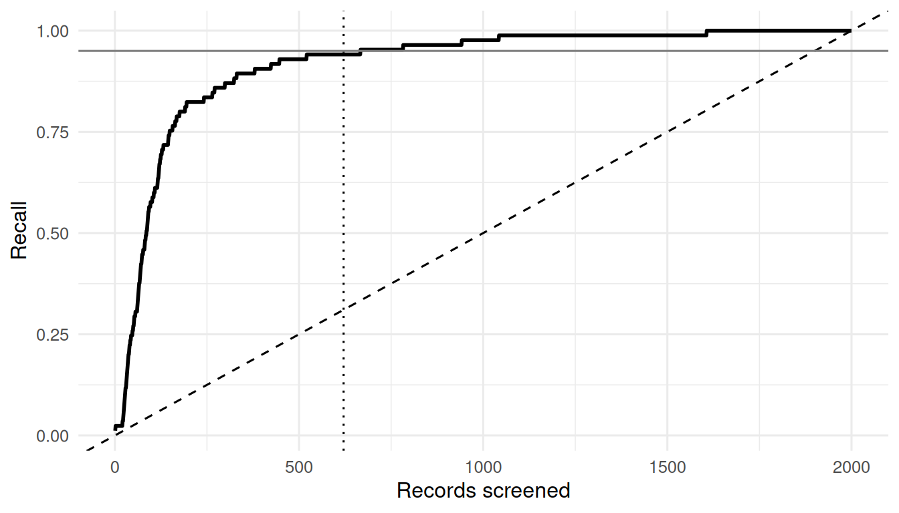
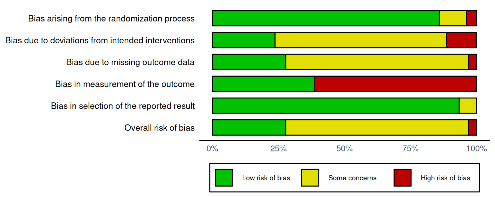
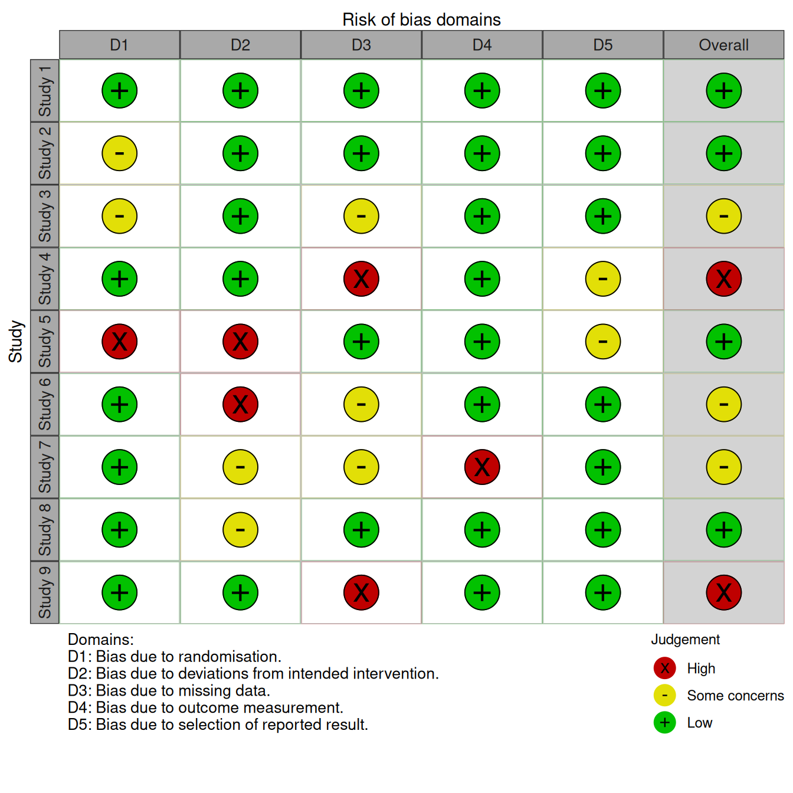

# The Systematic Review Workflow {#sec-systematic-review}

A meta-analysis is only as good as the set of studies it combines. If the search misses studies,
if eligibility is judged inconsistently, if numbers are copied wrongly from papers, or if biased
studies are pooled with sound ones without comment, no estimator in the later chapters can repair
the damage. The systematic review is the set of procedures designed to prevent these failures,
and to make the ones that remain visible.

This chapter walks through the workflow in the order a review team meets it: formulating the
question, writing and registering a protocol, searching, removing duplicates, screening, data
extraction, and risk-of-bias assessment. Along the way it shows how R supports each step: building
a search string, deduplicating records, computing inter-rater agreement for screening decisions,
simulating machine-learning-assisted screening, drawing a PRISMA 2020 flow diagram, keeping a
codebook, reconciling double data extraction, plotting risk-of-bias assessments, and feeding those
assessments into the synthesis. The authoritative references for this material are the Cochrane
Handbook [@higgins2019cochrane] and, for the social sciences, @cooper2019handbook.

## Overview of the workflow {#sec-systematic-review-overview}

Table \@ref(tab:sr-stages) summarizes the stages. Two principles cut across all of them. First,
decisions are made before the data are seen whenever possible, and recorded in a protocol, so
that the results cannot steer the methods. Second, every judgment that could be made differently
by different people (whether a record is eligible, what number a paper reports, whether a trial
is at high risk of bias) is made independently by at least two reviewers, with disagreements
resolved by discussion or a third reviewer.


Table: (\#tab:sr-stages)Stages of a systematic review and their outputs.

|Stage                   |Main output                                                                |Chapter |
|:-----------------------|:--------------------------------------------------------------------------|:-------|
|Question                |PICO or equivalent; eligibility criteria                                   |2       |
|Protocol                |Registered protocol (PROSPERO, OSF); PRISMA-P checklist                    |2       |
|Search                  |Search strategies for each source; records retrieved                       |2       |
|Deduplication           |Unique records                                                             |2       |
|Screening               |Included studies; reasons for exclusion at full text; agreement statistics |2       |
|Extraction              |Codebook; extracted data in duplicate; reconciliation log                  |2, 3    |
|Risk of bias            |Domain-level and overall judgments per study and outcome                   |2       |
|Synthesis               |Meta-analysis or structured narrative synthesis                            |4 to 14 |
|Certainty and reporting |GRADE ratings; PRISMA 2020 report; open data and code                      |15      |


## Formulating the question {#sec-systematic-review-question}

A good review question is narrow enough to be answerable and broad enough to be useful. The
standard device for structuring it is **PICO** [@richardson1995wellbuilt]: the **P**opulation (or
problem), the **I**ntervention, the **C**omparator, and the **O**utcomes. Variants add or replace
elements. **PECO** replaces the intervention with an **E**xposure for etiological questions, for
example the effect of air pollution or of a management practice that is not deliberately
assigned. **PICOS** adds the eligible **S**tudy designs, and a time frame or setting is often
added as well. For qualitative and mixed-methods evidence syntheses, where "intervention" and
"comparator" may not apply, the **SPIDER** tool (Sample, Phenomenon of Interest, Design,
Evaluation, Research type) was proposed [@cooke2012beyond].

The question translates into **eligibility criteria**, the rules that decide which studies enter
the review. Criteria should be operational: someone who did not write them should be able to
apply them consistently. "Adults" should say what age; "randomized" should say whether
cluster-randomized and crossover trials count; "anxiety" should say whether a diagnosis is
required or a symptom scale suffices. Criteria about language and publication status deserve
particular care. Restricting to English-language or peer-reviewed publications is convenient
but can introduce bias, and when such restrictions are used they belong in the eligibility
criteria, not in the search, so that their consequences can be documented
[@pieper2021language].

Table \@ref(tab:sr-pico) shows a PICOS specification for a running example used in this
chapter, a review of mindfulness-based interventions for anxiety in adults.


Table: (\#tab:sr-pico)PICOS specification for the running example.

|Element      |Specification                                                                                                                 |
|:------------|:-----------------------------------------------------------------------------------------------------------------------------|
|Population   |Adults (18+) with elevated anxiety symptoms or an anxiety disorder diagnosis; any setting                                     |
|Intervention |Mindfulness-based programs (MBSR, MBCT, or adaptations) of at least four sessions                                             |
|Comparator   |Wait-list, usual care, or active control (analyzed separately)                                                                |
|Outcomes     |Primary: anxiety symptoms at post-intervention on a validated scale. Secondary: depression, adverse events, follow-up anxiety |
|Study design |Randomized controlled trials, including cluster-randomized trials                                                             |


The comparator deserves as much thought as the intervention. Mindfulness compared with a
wait-list and mindfulness compared with an active psychological treatment answer different
questions, and pooling them would mix two estimands. Deciding in advance whether such contrasts
will be analyzed separately, combined with a moderator, or analyzed in a network
(Chapter \@ref(sec-network)) is a protocol decision.

## Protocols and registration {#sec-systematic-review-protocol}

A **protocol** states the question, eligibility criteria, search strategy, screening and
extraction procedures, risk-of-bias tools, effect-size metrics, statistical model, planned
subgroup and sensitivity analyses, and the approach to certainty assessment, before the review
begins. Its purpose is the same as preregistration of a primary study: to separate decisions made
in advance from decisions made after seeing the data, so that readers can tell confirmatory from
exploratory analyses [@nosek2018preregistration]. The **PRISMA-P** statement gives a 17-item
checklist for protocol content [@moher2015preferred], and its explanation and elaboration
document gives examples of each item [@shamseer2015preferred].

Protocols should be registered in a public, time-stamped registry. **PROSPERO**, run by the
Centre for Reviews and Dissemination at the University of York, registers systematic reviews
with a health-related outcome [@booth2012nuts]. Reviews outside its scope, including most reviews
in psychology, education, economics, management, and marketing, can be registered on the **Open
Science Framework** (OSF), which offers preregistration templates for systematic reviews and
meta-analyses. Some journals accept reviews as **registered reports**, in which the protocol is
peer-reviewed and receives in-principle acceptance before the review is carried out, so that
publication does not depend on the results [@chambers2021past].

Deviations from a protocol are normal; reviews discover problems that the protocol did not
anticipate. What matters is that deviations are reported with reasons. PRISMA 2020 asks
authors to state where the protocol can be accessed and to describe and explain any amendments
[@page2021prisma].

::: {.rmdtip}
Write the analysis section of the protocol as code. A short R script that runs the planned
model on simulated data in the structure of the codebook (Section
\@ref(sec-systematic-review-codebook)) forces decisions about effect-size metrics, the
$\tau^2$ estimator, moderators, and the handling of multiple effects per study, and it can be
registered alongside the protocol.
:::

## Searching {#sec-systematic-review-search}

The aim of the search is high recall: to find as many eligible studies as possible, accepting
that most retrieved records will be irrelevant. Precision is bought later, during screening.
Searching well is a specialized skill, and involving an information specialist or librarian is
one of the most effective ways to improve a review [@higgins2019cochrane].

### Sources {#sec-systematic-review-sources}

No single bibliographic database covers any field completely, and databases overlap less than
one might expect. In a prospective study of the references included in a set of systematic
reviews, @bramer2017optimal found that combining several databases was needed to reach
adequate recall. Typical choices are MEDLINE (via PubMed or Ovid), Embase, and the Cochrane
Central Register of Controlled Trials (CENTRAL) for health interventions; APA PsycInfo for
psychology; ERIC for education; EconLit for economics; ABI/INFORM and Business Source for
management and marketing; and multidisciplinary indexes such as Web of Science and Scopus.

Beyond databases, three sources matter. **Trial registries** (ClinicalTrials.gov and the WHO
International Clinical Trials Registry Platform) identify completed but unpublished trials and
outcomes that were registered but not reported, which is direct evidence on publication and
outcome-reporting bias (Chapter \@ref(sec-publication-bias)). **Grey literature**, including
dissertations, reports from government agencies and organizations, conference abstracts, and
preprints, is often where null results end up [@paez2017gray]. **Citation chasing**, checking the
reference lists of included studies (backward) and the papers that cite them (forward), finds
studies that keyword searches miss. In a review of complex evidence, @greenhalgh2005effectiveness
found that a large share of the relevant sources came from citation tracking and personal
knowledge rather than from the protocol-driven database search. Tools such as citationchaser
automate forward and backward chasing [@haddaway2022citationchaser].

### Building a Boolean search string {#sec-systematic-review-boolean}

A search strategy is built from **concept blocks**, usually one for each of the key PICO
elements (rarely the comparator or outcome, which are often poorly described in titles and
abstracts). Within a block, synonyms are combined with `OR`; blocks are combined with `AND`.
Each block mixes two kinds of terms:

- **Controlled vocabulary**: the database's subject headings, such as MeSH in MEDLINE, Emtree in
  Embase, or the APA Thesaurus in PsycInfo. Indexers assign these to records, so they catch
  studies that use unexpected wording. They differ by database and must be translated.
- **Free-text terms** searched in titles and abstracts, with truncation (`mindful*` matches
  mindful, mindfulness, mindfully), phrase searching, and, where supported, proximity operators.

Because the syntax is fiddly and every database differs, it helps to keep the blocks as data and
generate the string. The function below assembles a PubMed-style string from concept blocks.


``` r
blocks <- list(
  population   = c('"Anxiety"[Mesh]', '"Anxiety Disorders"[Mesh]', "anxi*[tiab]",
                   "worry[tiab]", "panic[tiab]"),
  intervention = c('"Mindfulness"[Mesh]', "mindful*[tiab]", "MBSR[tiab]", "MBCT[tiab]",
                   '"mindfulness-based"[tiab]', "vipassana[tiab]"),
  design       = c('"randomized controlled trial"[pt]', "randomi*[tiab]",
                   "placebo[tiab]", "trial[ti]")
)

build_query <- function(blocks) {
  inner <- vapply(blocks, function(terms) paste0("(", paste(terms, collapse = " OR "), ")"),
                  character(1))
  paste(inner, collapse = "\nAND ")
}
cat(build_query(blocks))
#> ("Anxiety"[Mesh] OR "Anxiety Disorders"[Mesh] OR anxi*[tiab] OR worry[tiab] OR panic[tiab])
#> AND ("Mindfulness"[Mesh] OR mindful*[tiab] OR MBSR[tiab] OR MBCT[tiab] OR "mindfulness-based"[tiab] OR vipassana[tiab])
#> AND ("randomized controlled trial"[pt] OR randomi*[tiab] OR placebo[tiab] OR trial[ti])
```

The design block is a simplified version of a validated **search filter**; for randomized trials
in MEDLINE, the Cochrane Highly Sensitive Search Strategy is the standard choice and should be
used in its published form rather than improvised [@higgins2019cochrane]. Note what the string
does not contain: no outcome block, no date or language limits, and no terms for the comparator.
Each of these would cut recall.

### Peer review and documentation of the search {#sec-systematic-review-press}

Search strategies contain errors surprisingly often: a missing parenthesis, a misspelled subject
heading, a truncation that matches unwanted words, or a block combined with `OR` instead of `AND`.
The **PRESS** guideline gives a checklist for peer review of electronic search strategies by a
second information specialist, covering the translation of the research question, Boolean and
proximity operators, subject headings, free-text terms, spelling, syntax and line numbers, and
limits and filters [@mcgowan2016press]. The full strategy for every source, with the date it was
run, should be reported; PRISMA-S is a 16-item extension of PRISMA for reporting literature
searches [@rethlefsen2021prismas].

## Deduplication {#sec-systematic-review-dedup}

Searching several overlapping sources retrieves the same record many times, with small
differences in capitalization, punctuation, author formatting, and journal abbreviations.
Duplicates waste screening effort and, if they survive into the analysis, double-count studies.
Reference managers and screening platforms have deduplication functions, and @bramer2016deduplication
describes a systematic procedure in EndNote. The logic is simple: normalize the fields, then match
on DOI where available and on normalized title plus year otherwise.


``` r
records <- data.frame(
  id     = 1:8,
  source = c("MEDLINE", "Embase", "PsycInfo", "MEDLINE", "Embase", "Scopus", "PsycInfo", "Scopus"),
  title  = c("Mindfulness-based stress reduction for generalized anxiety disorder: a randomized trial",
             "Mindfulness-Based Stress Reduction for Generalized Anxiety Disorder: A Randomized Trial.",
             "Mindfulness based stress reduction for generalized anxiety disorder - a randomized trial",
             "Effects of MBCT on worry in older adults",
             "Effects of MBCT on Worry in Older Adults",
             "A pilot study of app-based mindfulness for test anxiety",
             "Yoga versus mindfulness for panic disorder",
             "Yoga vs. mindfulness for panic disorder"),
  year   = c(2018, 2018, 2018, 2020, 2020, 2021, 2019, 2019),
  doi    = c("10.1000/abc123", "10.1000/ABC123", NA, NA, NA, "10.1000/xyz789", NA, NA)
)

norm_title <- function(x) {
  x <- tolower(x)
  x <- gsub("\\bvs\\b\\.?", "versus", x)   # harmonize a common abbreviation
  x <- gsub("[^a-z0-9 ]", " ", x)           # drop punctuation, including hyphens
  gsub("\\s+", " ", trimws(x))
}
# group by normalized title + year, then merge groups that share a DOI
tkey <- paste(norm_title(records$title), records$year)
records$group <- match(tkey, unique(tkey))
doi <- tolower(records$doi)
for (d in unique(na.omit(doi))) {
  idx <- which(doi == d)
  records$group[records$group %in% records$group[idx]] <- min(records$group[idx])
}
records$group <- match(records$group, unique(records$group))   # relabel 1, 2, ...
records$duplicate <- duplicated(records$group)
records[, c("id", "source", "year", "group", "duplicate")]
#>   id   source year group duplicate
#> 1  1  MEDLINE 2018     1     FALSE
#> 2  2   Embase 2018     1      TRUE
#> 3  3 PsycInfo 2018     1      TRUE
#> 4  4  MEDLINE 2020     2     FALSE
#> 5  5   Embase 2020     2      TRUE
#> 6  6   Scopus 2021     3     FALSE
#> 7  7 PsycInfo 2019     4     FALSE
#> 8  8   Scopus 2019     4      TRUE
```

The eight records collapse to 4 unique studies. Real data are
messier: titles are truncated, translated, or changed between a conference abstract and the
journal article, and two genuinely different trials can share a generic title. Automated
deduplication should therefore be conservative (it is better to leave a duplicate for screeners
to catch than to delete a distinct study), and the numbers removed must be reported for the flow
diagram. A related but distinct problem is **multiple reports of the same study**: a protocol, a
main paper, and a secondary analysis of the same trial are different records but one study. These
are linked during screening and extraction, and the unit of analysis is the study, not the
report [@page2021prisma].

## Screening {#sec-systematic-review-screening}

### Two-stage screening {#sec-systematic-review-two-stage}

Screening usually proceeds in two stages. In **title and abstract screening**, reviewers exclude
records that are clearly ineligible; anything uncertain passes through. In **full-text
screening**, reviewers retrieve and read the reports that survived and apply the eligibility
criteria in full, recording a reason for each exclusion. The first stage is about speed and
sensitivity, the second about accuracy. Screening platforms such as Rayyan support blinded dual
screening and conflict resolution [@ouzzani2016rayyan].

Before screening starts, the team should pilot the eligibility criteria on a sample of records,
compare decisions, and refine the wording of the criteria and the screening guidance. Piloting is
cheap and catches ambiguities that would otherwise produce disagreements throughout.

### Dual independent screening {#sec-systematic-review-dual}

The standard is that two reviewers screen every record independently, each blind to the other's
decisions. The evidence for this is direct. In a randomized trial of single-reviewer abstract
screening, a single reviewer missed 13 percent of relevant studies
[@gartlehner2020single], and a methodological review comparing single and double screening
found that single screening misses more eligible studies [@waffenschmidt2019single]. When
resources do not permit full dual screening, common compromises are to dual-screen a random
sample to calibrate and monitor agreement, or to have a second reviewer check all exclusions.
Whatever is done should be reported.

### Measuring agreement {#sec-systematic-review-kappa}

Agreement between screeners is reported as a quality indicator and, more usefully, monitored
during piloting to decide whether the criteria are clear enough. Let $p_o$ be the observed
proportion of records on which two reviewers agree, and $p_e$ the proportion of agreement expected
by chance given each reviewer's marginal rates of inclusion. With $p_{1+}$ and $p_{+1}$ the
proportions included by reviewers 1 and 2,

$$
p_e = p_{1+}\,p_{+1} + (1 - p_{1+})(1 - p_{+1}), \qquad
\kappa = \frac{p_o - p_e}{1 - p_e}.
$$

Cohen's $\kappa$ [@cohen1960coefficient] is the proportion of the possible agreement beyond chance
that was achieved. It equals 1 for perfect agreement and 0 for agreement no better than chance.

The simulation below creates a realistic screening scenario: 600 records of which about 8% are
truly eligible, and two reviewers who each catch most eligible records and exclude most
ineligible ones, with independent errors.


``` r
library(irr)
library(psych)

set.seed(42)
N <- 600
eligible <- rbinom(N, 1, 0.08)
screen <- function(truth, sens, spec) {
  ifelse(truth == 1, rbinom(length(truth), 1, sens), rbinom(length(truth), 1, 1 - spec))
}
decisions <- data.frame(
  reviewer1 = factor(screen(eligible, sens = 0.92, spec = 0.95), 0:1, c("exclude", "include")),
  reviewer2 = factor(screen(eligible, sens = 0.88, spec = 0.93), 0:1, c("exclude", "include"))
)
table(decisions)
#>          reviewer2
#> reviewer1 exclude include
#>   exclude     490      39
#>   include      30      41

agree(decisions)            # percent agreement (irr)
#>  Percentage agreement (Tolerance=0)
#> 
#>  Subjects = 600 
#>    Raters = 2 
#>   %-agree = 88.5
kappa2(decisions)           # Cohen's kappa (irr)
#>  Cohen's Kappa for 2 Raters (Weights: unweighted)
#> 
#>  Subjects = 600 
#>    Raters = 2 
#>     Kappa = 0.478 
#> 
#>         z = 11.7 
#>   p-value = 0
ck <- cohen.kappa(decisions)  # kappa with confidence interval (psych)
ck$confid
#>                   lower estimate  upper
#> unweighted kappa 0.3722   0.4775 0.5829
#> weighted kappa   0.3722   0.4775 0.5829
```


The reviewers agree on 88.5% of records, which sounds excellent. Cohen's $\kappa$,
however, is only 0.48 (95% CI 0.37 to
0.58). The reason is visible in the table: most records are
obvious exclusions on which any two reviewers would agree, so chance agreement is already
$p_e$ = 0.78, and the disagreements are concentrated in the small set of
records that matter. On the widely quoted benchmarks of @landis1977measurement this is
"moderate" agreement; on the stricter scale that @mchugh2012interrater proposes for health
research it is "weak". Either way, it says that the two reviewers disagree on a substantial
fraction of the records that either of them would include, and 69 conflicts must be
resolved.

This behavior, high percent agreement with low $\kappa$, is the first of the two **kappa
paradoxes** described by @feinstein1990high: when one category dominates, $\kappa$ is low even
when agreement is high. It is not a flaw so much as a reminder of what $\kappa$ measures.
Alternatives that are less sensitive to prevalence include the prevalence-adjusted
bias-adjusted kappa, $\text{PABAK} = 2p_o - 1$, here 0.77, and Gwet's
AC1 [@gwet2008computing], here 0.85. These look much better, but they look
better partly by giving credit for agreeing on easy exclusions.

For screening, the most informative summary is often not a single coefficient but the
cross-tabulation itself, and specifically the number of records included by one reviewer and
excluded by the other. Those are the records where an eligible study could be lost. In practice:
report percent agreement and $\kappa$ with its confidence interval, report the number of
conflicts and how they were resolved, and use low agreement during piloting as a signal to clarify
the criteria rather than as a pass or fail threshold.

## Machine-learning and LLM-assisted screening {#sec-systematic-review-automation}

Screening is the most labor-intensive step of a review: searches routinely return thousands or
tens of thousands of records, of which a few percent are eligible. Text-mining methods to reduce
this burden have been studied for over a decade. A systematic review of this literature
concluded that screening workload could be reduced by roughly 30 to 70 percent, sometimes at the
cost of missing around 5 percent of relevant studies [@omaraeves2015using].

### Active learning {#sec-systematic-review-active-learning}

The dominant approach is **active learning** (also called screening prioritization). Reviewers
screen an initial set of records; a classifier is trained on their decisions and ranks the
unscreened records by predicted relevance; reviewers screen the top-ranked records; the model is
retrained; and the cycle repeats. Relevant records are found early, and screening can stop before
the whole set is read. Open-source tools such as ASReview implement this workflow, and simulation
studies show that it can be far more efficient than screening in random order
[@vandeschoot2021open]. Cochrane uses a machine-learning classifier to identify randomized trials
for its register [@thomas2021machine].

The simulation below illustrates the mechanism with a deliberately simple setup: 2,000 records
described by ten numeric text features, of which about 4% are relevant and differ from irrelevant
records on four of the features. A logistic regression is refitted after every batch of 20
screening decisions, and the next batch is the 20 unscreened records with the highest predicted
relevance.


``` r
set.seed(303)
M <- 2000; p <- 10
relevant <- rbinom(M, 1, 0.04)
X <- matrix(rnorm(M * p), M, p)
X[relevant == 1, 1:4] <- X[relevant == 1, 1:4] + 1.2   # signal in four features

# initial training set: 2 known relevant and 18 random irrelevant records
screened <- c(sample(which(relevant == 1), 2), sample(which(relevant == 0), 18))
batch <- 20
while (length(screened) < M) {
  train <- data.frame(y = relevant[screened], X[screened, , drop = FALSE])
  model <- suppressWarnings(glm(y ~ ., data = train, family = binomial))
  pool <- setdiff(seq_len(M), screened)
  score <- predict(model, newdata = data.frame(X[pool, , drop = FALSE]))
  screened <- c(screened, pool[order(score, decreasing = TRUE)][seq_len(min(batch, length(pool)))])
}
recall <- cumsum(relevant[screened]) / sum(relevant)

# a naive stopping heuristic: stop after 100 consecutive irrelevant records
run <- 0; stop_at <- NA
for (i in seq_along(screened)) {
  run <- if (relevant[screened[i]] == 1) 0 else run + 1
  if (run >= 100) { stop_at <- i; break }
}
c(total_relevant = sum(relevant),
  screened_for_95pct_recall = which(recall >= 0.95)[1],
  screened_for_100pct_recall = which(recall >= 1)[1],
  heuristic_stop = stop_at,
  recall_at_stop = round(recall[stop_at], 3))
#>             total_relevant  screened_for_95pct_recall 
#>                     85.000                    667.000 
#> screened_for_100pct_recall             heuristic_stop 
#>                   1607.000                    621.000 
#>             recall_at_stop 
#>                      0.941
```


``` r
curve_df <- data.frame(screened = seq_along(recall), recall = recall)
ggplot(curve_df, aes(screened, recall)) +
  geom_line(linewidth = 1) +
  geom_abline(slope = 1 / M, intercept = 0, linetype = "dashed") +
  geom_vline(xintercept = stop_at, linetype = "dotted") +
  geom_hline(yintercept = 0.95, colour = "grey50") +
  labs(x = "Records screened", y = "Recall")
```

<div class="figure" style="text-align: center">

<p class="caption">(\#fig:sr-active-learning-plot)Recall of relevant records as a function of the number of records screened, for active-learning prioritization (solid) and screening in random order (dashed). The dotted vertical line marks where a heuristic of stopping after 100 consecutive irrelevant records would end screening.</p>
</div>


In this idealized example, active learning finds 95% of the 85 relevant records
after screening 667 of 2000 records (33%), whereas random-order
screening would need about 95% of the records to reach the same recall (Figure
\@ref(fig:sr-active-learning-plot)). Finding the *last* few relevant records is much harder:
100% recall is reached only after 1607 records. And the stopping heuristic stops at record
621 with a recall of 0.94, without any warning that
relevant records remain.

This is the central practical problem. In a real review the total number of relevant records is
unknown, so recall cannot be computed while screening. Simple heuristics, such as stopping after
a fixed number of consecutive irrelevant records, give inconsistent recall across datasets.
@callaghan2020statistical proposed statistical stopping criteria that test the hypothesis that a
recall target has been missed, and showed that they achieve reliable recall while still saving
work; @boetje2024safe proposed a conservative combination of heuristics (the SAFE procedure).
Practical guidance on integrating these tools, including how to build the training set and when
to truncate screening, is given by @hamel2021guidance. Whatever tool is used, the stopping
rule and its justification belong in the protocol and the report.

### Large language models {#sec-systematic-review-llm}

Since 2023, large language models (LLMs) have been evaluated as screeners and data extractors,
typically by giving the model the eligibility criteria in a prompt and asking for an include or
exclude decision. Results so far are mixed and highly dependent on the task, the prompt, and the
dataset. In a pre-registered evaluation, @khraisha2024can found that GPT-4's apparent accuracy in
screening and data extraction dropped substantially once chance agreement and class imbalance
were accounted for, although performance on full-text screening with carefully designed prompts
approached human levels; the authors concluded that substantial caution is warranted. In a
prospective diagnostic study of citation screening for five clinical questions,
@oami2024performance reported an integrated sensitivity of 0.75 with the original prompt, improved
to 0.91 after post hoc prompt modifications, with specificity near 0.99 and much faster
processing. A 2025 scoping review of LLMs for conducting systematic reviews summarized the field
as on the rise but not yet ready for use [@lieberum2025large].

::: {.rmdwarning}
Treat machine-learning and LLM screening as tools that assist human reviewers, not replace them.
Evaluate any tool on a sample screened in duplicate by humans before relying on it; report the
tool, version, prompt or settings, training procedure, and stopping rule; and remember that a
reported sensitivity of 0.9 means that one eligible study in ten is lost. Post hoc prompt tuning
on the same records used for evaluation overstates performance, for the same reason that
in-sample fit overstates predictive accuracy.
:::

## The PRISMA 2020 flow diagram {#sec-systematic-review-prisma}

The flow of records through the review is reported with a **PRISMA 2020 flow diagram**
[@page2021prisma; @page2021prismaelaboration]. It shows the number of records identified from
each source, duplicates removed, records screened and excluded, reports sought and not retrieved,
reports assessed at full text and excluded (with reasons), and studies and reports included. The
2020 version distinguishes **studies** from **reports**, separates database and register searches
from other methods such as citation searching, and has a variant for updated reviews.

The PRISMA2020 package draws the diagram from a table of counts [@haddaway2022prisma2020]. The
package ships a template; the code below fills it with the counts of a hypothetical review and
draws the diagram (Figure \@ref(fig:sr-prisma-flow)).


``` r
library(PRISMA2020)

counts <- read.csv(system.file("extdata", "PRISMA.csv", package = "PRISMA2020"))
set_n <- function(df, field, value) {
  df$n[!is.na(df$data) & df$data == field] <- value
  df
}
vals <- list(
  database_results = 2846,
  database_specific_results = "MEDLINE, 1120; Embase, 1342; PsycInfo, 384",
  register_results = 112,
  register_specific_results = "ClinicalTrials.gov, 87; WHO ICTRP, 25",
  website_results = 14, organisation_results = 6, citations_results = 31,
  duplicates = 905, excluded_automatic = 0, excluded_other = 0,
  records_screened = 2053, records_excluded = 1921,
  dbr_sought_reports = 132, dbr_notretrieved_reports = 7,
  dbr_assessed = 125,
  dbr_excluded = "Wrong population, 38; Wrong comparator, 27; No usable outcome data, 21; Not randomized, 15",
  other_sought_reports = 51, other_notretrieved_reports = 3, other_assessed = 48,
  other_excluded = "Wrong population, 20; No usable outcome data, 12",
  new_studies = 35, new_reports = 40, total_studies = 35, total_reports = 40
)
for (nm in names(vals)) counts <- set_n(counts, nm, vals[[nm]])

flow <- PRISMA_data(counts)
PRISMA_flowdiagram(flow, previous = FALSE, other = TRUE,
                   detail_databases = TRUE, detail_registers = TRUE, fontsize = 12)
```

<div class="figure" style="text-align: center">

```{=html}
<div class="grViz html-widget html-fill-item" id="htmlwidget-98053550de7929724f3d" style="width:100%;height:672px;"></div>
<script>
HTMLWidgets.addPostRenderHandler(function() {

       const nodeMap = new Map([["node1","Identification"], ["node2","Screening"], ["node3","Included"]]);
       for (const [node, label] of nodeMap) {
         var theDiv = document.getElementById(node);
         var theText = theDiv.querySelector("text");
         var attrX = theText.getAttribute("x");
         var attrY = theText.getAttribute("y");
         theText.setAttribute("y",parseFloat(attrX))
         theText.setAttribute("x",parseFloat(attrY)*-1)
         theText.setAttribute("style","transform: rotate(-90deg);")
         theText.setAttribute("dominant-baseline", "middle")
         theText.innerHTML = label;
       }
    
});
</script>
<script type="application/json" data-for="htmlwidget-98053550de7929724f3d">{"x":{"diagram":"digraph TD {\n        graph[\n          splines = ortho,\n          layout = neato,\n          tooltip = \"Click the boxes for further information\",\n          outputorder = edgesfirst,\n        ]node [\n        shape = box,\n        fontsize = 12,\n        fontname = Helvetica,\n        color = Goldenrod1\n      ]\n      identification [\n        color = LightSteelBlue2,\n        label = \" \",\n        style = \"filled,rounded\",\n        pos = \"0,7.75!\",\n        width = 0.4,\n        height = 2.5,\n        tooltip = \"Blue identification box\"\n      ];\n      screening [\n        color = LightSteelBlue2,\n        label = \" \",\n        style = \"filled,rounded\",\n        pos = \"0,4.125!\",\n        width = 0.4,\n        height = 3.25,\n        tooltip = \"Blue screening box\"\n      ];\n      included [\n        color = LightSteelBlue2,\n        label = \" \",\n        style = \"filled,rounded\",\n        pos = \"0,1!\",\n        width = 0.4,\n        height = 2.5,\n        tooltip = \"Blue included box\"\n      ];\nnode [\n        shape = box,\n        fontsize = 12,\n        fontname = Helvetica,\n        color = Goldenrod1]\n        3 [\n          label = \"Identification of new studies via databases and registers\",\n          style = \"rounded,filled\",\n          width = 7.5,\n          height = 0.4,\n          pos = \"4.25,9.45!\",\n      tooltip = \"Yellow title box; Identification of new studies via databases and registers\"\n      ]\n        node [\n          shape = box,\n          fontname = Helvetica,\n          color = Black]\n        4 [\n          label = \"Records identified from:\nDatabases (n = 2,846):\nMEDLINE (n = 1,120)\nEmbase (n = 1,342)\nPsycInfo (n = 384)\nRegisters (n = 112):\nClinicalTrials.gov (n = 87)\nWHO ICTRP (n = 25)\",\n          width = 3.5,\n          height = 2,\n          pos = \"2.25,7.75!\",\n          tooltip = \"Records identified from: Databases and Registers\"\n        ]\n        node [\n          shape = box,\n          fontname = Helvetica,\n          color = Black]\n        5 [\n          label = \"Records removed before screening:\nDuplicate records (n = 905)\nRecords marked as ineligible by automation\ntools (n = 0)\nRecords removed for other reasons (n = 0)\",\n          width = 3.5,\n          height = 0.5,\n          pos = \"6.25,7.75!\",\n          tooltip = \"Duplicate records\"\n        ]\n        node [\n          shape = box,\n          fontname = Helvetica,\n          color = Black\n        ]\n        6 [\n          label = \"Records screened\n(n = 2,053)\",\n          width = 3.5,\n          height = 0.5,\n          pos = \"2.25,5.5!\",\n          tooltip = \"Records screened (databases and registers)\"\n        ]\n        node [\n          shape = box,\n          fontname = Helvetica,\n          color = Black\n        ]\n        7 [\n          label = \"Records excluded\n(n = 1,921)\",\n          width = 3.5,\n          height = 0.5,\n          pos = \"6.25,5.5!\",\n          tooltip = \"Records excluded (databases and registers)\"\n        ]\n        node [\n          shape = box,\n          fontname = Helvetica,\n          color = Black]\n      8 [\n        label = \"Reports sought for retrieval\n(n = 132)\",\n        width = 3.5,\n        height = 0.5,\n        pos = \"2.25,4.5!\",\n        tooltip = \"Reports sought for retrieval (databases and registers)\"\n      ]\n      node [\n        shape = box,\n        fontname = Helvetica,\n        color = Black]\n      9 [\n        label = \"Reports not retrieved\n(n = 7)\",\n        width = 3.5,\n        height = 0.5,\n        pos = \"6.25,4.5!\",\n        tooltip = \"Reports not retrieved (databases and registers)\"\n      ]\n      node [\n        shape = box,\n        fontname = Helvetica,\n        color = Black]\n        10 [\n          label = \"Reports assessed for eligibility\n(n = 125)\",\n          width = 3.5,\n          height = 0.5,\n          pos = \"2.25,3.125!\",\n          tooltip = \"Reports assessed for eligibility (databases and registers)\"\n        ]\n        node [\n          shape = box,\n          fontname = Helvetica,\n          color = Black,\n          fillcolor = White,\n          style = filled\n        ]\n        11 [\n          label = \"Reports excluded:\nWrong population (n = 38)\nWrong comparator (n = 27)\nNo usable outcome data (n = 21)\nNot randomized (n = 15)\",\n          width = 3.5,\n          height = 0.5,\n          pos = \"6.25,3.125!\",\n      tooltip = \"Reports excluded (databases and registers)\"\n      ]\n      node [\n        shape = box,\n        fontname = Helvetica,\n        color = Black,\n      fillcolor = \"\",\n      style = solid\n      ]\n      12 [\n        label = \"New studies included in review\n(n = 35)\nReports of new included studies\n(n = 40)\",\n        width = 3.5,\n        height = 1,\n        pos = \"2.25,1!\",\n        tooltip = \"New studies included in review\"\n      ]node [\n        shape = box,\n        fontname = Helvetica,\n        color = Gainsboro]\n      13 [\n        label = \"Identification of new studies via other methods\",\n        style = \"rounded,filled\",\n        width = 7.5,\n        height = 0.4,\n        pos = \"12.25,9.45!\",\n      tooltip = \"Grey title box; Identification of new studies via other methods\"\n      ]\n      node [\n        shape = box,\n        fontname = Helvetica,\n        color = Gainsboro]\n      14 [\n        label = \"Records identified from:\nWebsites (n = 14)\nOrganisations (n = 6)\nCitation searching (n = 31)\",\n        style = \"filled\",\n        width = 3.5,\n        height = 1,\n        pos = \"10.25,7.75!\",\n        tooltip = \"Records identified from: Websites, Organisations and Citation Searching\"\n      ]\n      node [\n        shape = box,\n        fontname = Helvetica,\n        color = Gainsboro]\n      15 [\n        label = \"Reports sought for retrieval\n(n = 51)\",\n        style = \"filled\",\n        width = 3.5,\n        height = 0.5,\n        pos = \"10.25,4.5!\",\n        tooltip = \"Reports sought for retrieval (other)\"\n      ]\n      node [\n        shape = box,\n        fontname = Helvetica,\n        color = Gainsboro]\n      16 [\n        label = \"Reports not retrieved\n(n = 3)\",\n        style = \"filled\",\n        width = 3.5,\n        height = 0.5,\n        pos = \"14.25,4.5!\",\n        tooltip = \"Reports not retrieved (other)\"\n      ]\n      node [\n        shape = box,\n        fontname = Helvetica,\n        color = Gainsboro\n      ]\n      17 [\n        label = \"Reports assessed for eligibility\n(n = 48)\",\n        style = \"filled\",\n        width = 3.5,\n        height = 0.5,\n        pos = \"10.25,3.125!\",\n        tooltip = \"Reports assessed for eligibility (other)\"\n      ]\n      node [\n        shape = box,\n        fontname = Helvetica,\n        color = Gainsboro]\n      18 [\n        label = \"Reports excluded:\nWrong population (n = 20)\nNo usable outcome data (n = 12)\",\n        style = \"filled\",\n        width = 3.5,\n        height = 0.75,\n        pos = \"14.25,3.125!\",\n        tooltip = \"Reports excluded (other)\"\n      ]\nnode [\n        shape = square,\n        width = 0,\n        color=White\n      ]\n\nB [\n        label = \"\",\n        pos = \"10.25,1!\",\n        tooltip = \"\"\n      ]\nnode [\n        shape = square,\n        width = 0,\n        style=invis\n      ]\n      C [\n        label = \"\",\n        width = 3.5,\n        height = 0.5,\n        pos = \"6.25,3.125!\",\n        tooltip = \"\"\n      ]\n      subgraph cluster1 {\n        edge [\n          style = invis\n      ]\n      3->4;\n      3->5;\n      edge [\n        color = Black,\n        arrowhead = normal,\n        arrowtail = none,\n        style = filled\n      ]\n      4->5;\n      4->6;\n      6->7;\n      6->8;\n      8->9;\n      8->10;\n      10->C;\n      10->12;\n      edge [\n      style = invis\n      ]\n      5->7;\n      7->9;\n      9->11;\n      16->18;\n      }subgraph cluster2 {\n        edge [\n          color = White,\n          arrowhead = none,\n          arrowtail = none\n        ]\n        13->14;\n        edge [\n          color = Black,\n          arrowhead = normal,\n          arrowtail = none]\n        14->15;\n        15->16;\n        15->17;\n        17->18;\n        edge [\n          color = Black,\n          arrowhead = none,\n          arrowtail = none]\n        17->B;\n        edge [\n          color = Black,\n          arrowhead = normal,\n          arrowtail = none,\n          constraint = FALSE\n        ]\n        B->12;\n      }\n\n\n\n{\n      rank = same; 3; 13}\n      {\n      rank = same; 4; 5; 14}\n        {\n          rank = same; 6; 7\n        }\n        {\n          rank = same; 8; 9; 15; 16}\n      {\n      rank = same; 10; 11; 17; 18}\n      {\n      rank = same; 12; B}\n      }","config":{"engine":"dot","options":null}},"evals":[],"jsHooks":[]}</script>
```

<p class="caption">(\#fig:sr-prisma-flow)PRISMA 2020 flow diagram for a hypothetical review, drawn with the PRISMA2020 package.</p>
</div>

The counts must add up, and checking that they do is a useful audit of the screening records:
the 2,958 records from databases and registers minus 905
duplicates gives the 2,053 records screened; 2,053 minus 1,921 exclusions gives the 132 reports
sought; and so on down the diagram. The same counts should be generated from the screening
database rather than typed by hand, so that the diagram updates when screening does.
`PRISMA_save()` exports the diagram to PDF, PNG, SVG, or an interactive HTML file for the
supplementary material.

## Data extraction {#sec-systematic-review-extraction}

### Forms and codebooks {#sec-systematic-review-codebook}

Data extraction is coding: turning the text, tables, and figures of each report into a structured
dataset. The instrument is an extraction form backed by a **codebook** that defines every
variable, its type, its permitted values, and the rules for edge cases. A codebook kept as a data
frame can be versioned with the analysis code, used to validate the extracted data, and published
as supplementary material.


``` r
codebook <- data.frame(
  variable = c("study_id", "report_id", "year", "country", "design", "comparator",
               "n_t", "n_c", "m_t", "sd_t", "m_c", "sd_c", "scale", "timepoint_wk",
               "rob_overall", "funding"),
  type = c("character", "character", "integer", "character", "factor", "factor",
           "integer", "integer", "numeric", "numeric", "numeric", "numeric",
           "character", "numeric", "factor", "factor"),
  allowed = c("S001-S999", "S001-R1, S001-R2, ...", "1950-2026", "ISO 3166 alpha-3",
              "individual RCT; cluster RCT", "wait-list; usual care; active",
              ">= 1", ">= 1", "scale units", "> 0", "scale units", "> 0",
              "e.g., GAD-7, BAI, STAI-T", ">= 0",
              "low; some concerns; high", "industry; public; none; not reported"),
  rule = c("One ID per study, shared by all its reports",
           "Each report of the study gets its own ID",
           "Year of the main report",
           "Country where participants were recruited",
           "As randomized, not as analyzed",
           "Classify by the control condition actually delivered",
           "Randomized to intervention", "Randomized to control",
           "Post-intervention mean; prefer ITT, adjusted if only adjusted reported",
           "SD, not SE; convert SE or CI to SD and flag", "As m_t", "As sd_t",
           "Primary anxiety scale named by the authors; else first listed",
           "Weeks since randomization",
           "RoB 2 overall judgment for this outcome", "As stated in the report")
)
knitr::kable(codebook, caption = "Excerpt from an extraction codebook for the running example.")
```


Table: (\#tab:sr-codebook)Excerpt from an extraction codebook for the running example.

|variable     |type      |allowed                              |rule                                                                   |
|:------------|:---------|:------------------------------------|:----------------------------------------------------------------------|
|study_id     |character |S001-S999                            |One ID per study, shared by all its reports                            |
|report_id    |character |S001-R1, S001-R2, ...                |Each report of the study gets its own ID                               |
|year         |integer   |1950-2026                            |Year of the main report                                                |
|country      |character |ISO 3166 alpha-3                     |Country where participants were recruited                              |
|design       |factor    |individual RCT; cluster RCT          |As randomized, not as analyzed                                         |
|comparator   |factor    |wait-list; usual care; active        |Classify by the control condition actually delivered                   |
|n_t          |integer   |>= 1                                 |Randomized to intervention                                             |
|n_c          |integer   |>= 1                                 |Randomized to control                                                  |
|m_t          |numeric   |scale units                          |Post-intervention mean; prefer ITT, adjusted if only adjusted reported |
|sd_t         |numeric   |> 0                                  |SD, not SE; convert SE or CI to SD and flag                            |
|m_c          |numeric   |scale units                          |As m_t                                                                 |
|sd_c         |numeric   |> 0                                  |As sd_t                                                                |
|scale        |character |e.g., GAD-7, BAI, STAI-T             |Primary anxiety scale named by the authors; else first listed          |
|timepoint_wk |numeric   |>= 0                                 |Weeks since randomization                                              |
|rob_overall  |factor    |low; some concerns; high             |RoB 2 overall judgment for this outcome                                |
|funding      |factor    |industry; public; none; not reported |As stated in the report                                                |


Forms should be **piloted** on a handful of studies by all extractors, and revised before full
extraction starts. Pilot extraction reveals ambiguous variables ("follow-up" measured from
randomization or from the end of treatment?), missing categories, and differences in how
extractors read the same table. The most important rule in the codebook is to extract the raw
summary statistics (means, standard deviations, counts, sample sizes, test statistics) rather
than pre-computed effect sizes, so that every effect size can be recomputed and the conversion
rules applied uniformly (Chapter \@ref(sec-effect-sizes)).

### Double extraction and reconciliation {#sec-systematic-review-double}

Extraction errors are common and consequential. Single extraction produces more errors than
double extraction [@buscemi2006single], and an audit of meta-analyses using standardized mean
differences found errors in a large proportion of the trials whose data could be checked
[@gotzsche2007data]. The safeguard is double extraction of at least the data that enter the
analysis: two reviewers extract independently, and a script lists every discrepancy for
resolution against the source report.


``` r
ext_a <- data.frame(study_id = c("S001", "S002", "S003", "S004", "S005"),
                    n_t = c(48, 30, 112, 25, 60), m_t = c(8.1, 10.4, 6.9, 12.0, 7.7),
                    sd_t = c(4.2, 5.1, 3.8, 6.3, 4.0))
ext_b <- data.frame(study_id = c("S001", "S002", "S003", "S004", "S005"),
                    n_t = c(48, 30, 121, 25, 60), m_t = c(8.1, 10.4, 6.9, 12.0, 7.7),
                    sd_t = c(4.2, 0.93, 3.8, 6.3, 4.0))

compare_extractions <- function(a, b, id = "study_id") {
  m <- merge(a, b, by = id, suffixes = c(".a", ".b"))
  vars <- setdiff(names(a), id)
  out <- lapply(vars, function(v) {
    x <- m[[paste0(v, ".a")]]; y <- m[[paste0(v, ".b")]]
    bad <- !mapply(identical, x, y)
    if (any(bad)) data.frame(study_id = m[[id]][bad], variable = v,
                             extractor_a = x[bad], extractor_b = y[bad])
  })
  do.call(rbind, out)
}
compare_extractions(ext_a, ext_b)
#>   study_id variable extractor_a extractor_b
#> 1     S003      n_t       112.0      121.00
#> 2     S002     sd_t         5.1        0.93
```

Two discrepancies are flagged. The first is a transposition (112 versus 121). The second is more
instructive: extractor B recorded 0.93, which in this hypothetical report is the standard error,
not the standard deviation. Confusing standard errors with standard deviations is one of the most
common extraction errors and inflates standardized mean differences dramatically. Both are
resolved by returning to the report, and the resolution is logged.

### Extracting data from figures {#sec-systematic-review-figures}

Some studies report results only in figures: bar charts of means with error bars, survival
curves, or time series. Plot-digitizing software recovers the underlying values by calibrating
the axes and clicking on points. WebPlotDigitizer is widely used, and a study of two coders who
extracted several thousand data points with it reported high intercoder reliability and validity
[@drevon2016intercoder]. Values extracted from figures should be extracted in duplicate, flagged
in the dataset, and examined in a sensitivity analysis (Chapter \@ref(sec-sensitivity)). When a
report is missing data altogether, contacting the authors is worthwhile and should be documented.

## Risk of bias {#sec-systematic-review-rob}

### Concepts {#sec-systematic-review-rob-concepts}

**Risk of bias** is the risk that a study's design, conduct, or analysis leads to a systematic
error in its result, that is, a result that differs from the truth in a predictable direction.
It is distinct from imprecision (random error), from the quality of reporting, and from the
applicability of the study to the review question. Three lessons from the methodological
literature shape current practice. First, meta-epidemiological studies show that trials with
inadequate or unclear allocation concealment or lack of blinding tend to report larger effects,
especially for subjectively assessed outcomes [@wood2008empirical; @savovic2012influence;
@page2016empirical]. Second, summary quality scores that add up points for different features
are unreliable: different scales applied to the same trials can lead to opposite conclusions
about whether quality matters [@juni1999hazards]. Third, bias should therefore be judged
**domain by domain**, for a specific result rather than for a study as a whole, using tools
designed for the study design at hand.

### RoB 2 for randomized trials {#sec-systematic-review-rob2}

The revised Cochrane tool, **RoB 2**, replaced the original Cochrane risk-of-bias tool
[@higgins2011cochrane; @sterne2019rob]. It assesses five domains:

1. bias arising from the randomization process;
2. bias due to deviations from intended interventions;
3. bias due to missing outcome data;
4. bias in measurement of the outcome;
5. bias in selection of the reported result.

Within each domain, signalling questions with answers such as yes, probably yes, probably no, no,
and no information feed an algorithm that proposes a judgment of **low risk of bias**, **some
concerns**, or **high risk of bias**, which the assessor can override with justification. The
overall judgment is generally the worst of the domain judgments, with some concerns in several
domains potentially escalating to high risk. Domain 2 depends on the effect of interest: the
effect of *assignment* to the intervention (the intention-to-treat effect) or the effect of
*adhering* to it. The choice must be made in advance. Variants exist for cluster-randomized and
crossover trials.

### ROBINS-I and ROBINS-E for non-randomized studies {#sec-systematic-review-robins}

For non-randomized studies of interventions, **ROBINS-I** judges each study against a
hypothetical **target trial**, the randomized trial that would ideally answer the question
[@sterne2016robinsi]. It covers seven domains: confounding, selection of participants into the
study, classification of interventions, deviations from intended interventions, missing data,
measurement of outcomes, and selection of the reported result. Judgments are **low**,
**moderate**, **serious**, or **critical** risk of bias, or no information. "Low" means
comparable to a well-performed randomized trial, so most non-randomized studies are at least at
moderate risk. Confounding usually dominates the overall judgment, and the review protocol should
list the important confounding domains in advance.

**ROBINS-E** adapts this approach to observational studies of exposures, such as environmental,
occupational, or behavioral exposures that are not assigned by an investigator
[@higgins2024robinse]. Its domains cover confounding, measurement of the exposure, selection of
participants into the study or the analysis, post-exposure interventions, missing data,
measurement of the outcome, and selection of the reported result.

### QUADAS for diagnostic accuracy studies {#sec-systematic-review-quadas}

Diagnostic accuracy studies have their own biases, for example spectrum bias from case-control
sampling and verification bias when not all patients receive the reference standard.
**QUADAS-2** assesses four domains (patient selection, index test, reference standard, and flow
and timing) for risk of bias, and the first three also for concerns about applicability
[@whiting2011quadas2]. A revision, QUADAS-3, has since been published [@whiting2026quadas3].
Chapter \@ref(sec-dta) covers diagnostic accuracy reviews in detail.

### Visualizing risk of bias with robvis {#sec-systematic-review-robvis}

Risk-of-bias judgments are usually presented in two plots: a **summary plot** showing, for each
domain, the proportion of studies (optionally weighted by their meta-analytic weight) at each
level of risk, and a **traffic-light plot** showing each study's judgment in each domain. The
robvis package draws both from a data frame with one row per study and one column per domain, in
the layout exported by the official assessment templates [@mcguinness2020robvis]. Its example
dataset `data_rob2` contains RoB 2 assessments of nine hypothetical trials.


``` r
library(robvis)
head(data_rob2)
#>     Study            D1   D2            D3  D4            D5       Overall
#> 1 Study 1           Low  Low           Low Low           Low           Low
#> 2 Study 2 Some concerns  Low           Low Low           Low           Low
#> 3 Study 3 Some concerns  Low Some concerns Low           Low Some concerns
#> 4 Study 4           Low  Low          High Low Some concerns          High
#> 5 Study 5          High High           Low Low Some concerns           Low
#> 6 Study 6           Low High Some concerns Low           Low Some concerns
#>    Weight
#> 1 33.3333
#> 2 33.3333
#> 3  0.1429
#> 4  9.0909
#> 5 12.5000
#> 6 25.0000
```


``` r
rob_summary(data_rob2, tool = "ROB2", overall = TRUE, weighted = TRUE)
```

<div class="figure" style="text-align: center">

<p class="caption">(\#fig:sr-rob-summary)Weighted summary plot of RoB 2 judgments for the robvis example data. Bars show the proportion of the meta-analytic weight at each level of risk in each domain.</p>
</div>


``` r
rob_traffic_light(data_rob2, tool = "ROB2", psize = 10)
```

<div class="figure" style="text-align: center">

<p class="caption">(\#fig:sr-rob-traffic)Traffic-light plot of RoB 2 judgments for the robvis example data, by study and domain.</p>
</div>


The two plots answer different questions. The summary plot in Figure \@ref(fig:sr-rob-summary)
shows how much of the evidence, by weight, is at risk in each domain: here
2 of the 9 studies are at high overall risk, carrying
3% of the total weight. The traffic-light plot in Figure
\@ref(fig:sr-rob-traffic) shows which studies are responsible and why, which is what a reader
needs to judge whether excluding them would change the conclusions. The same functions accept
ROBINS-I (`tool = "ROBINS-I"`, example data `data_robins`) and QUADAS-2 assessments.

The traffic-light plot also exposes a problem that is easy to miss in a table. Under RoB 2, a
result judged at high risk in any domain is at high risk overall, and one with some concerns in
any domain cannot be at low risk overall. The example data, which are illustrative, do not respect
this rule, and a few lines of code catch such inconsistencies before they reach a publication.


``` r
lev <- c("Low" = 1, "Some concerns" = 2, "High" = 3)
worst_domain <- apply(data_rob2[, paste0("D", 1:5)], 1, function(r) names(lev)[max(lev[r])])
inconsistent <- lev[as.character(data_rob2$Overall)] < lev[worst_domain]
data.frame(Study = data_rob2$Study, worst_domain, Overall = data_rob2$Overall)[inconsistent, ]
#>     Study  worst_domain       Overall
#> 2 Study 2 Some concerns           Low
#> 5 Study 5          High           Low
#> 6 Study 6          High Some concerns
#> 7 Study 7          High Some concerns
#> 8 Study 8 Some concerns           Low
```

Each flagged study needs either a corrected overall judgment or a written justification for the
override. Checks of this kind belong in the same script that produces the plots.

### Using risk of bias in the synthesis {#sec-systematic-review-rob-synthesis}

Assessing risk of bias and then ignoring it in the analysis is a common failure. There are four
established ways to make the assessments count, and the protocol should say which will be used
[@higgins2019cochrane]:

1. **Restrict the primary analysis** to studies at low risk of bias (or low and some concerns),
   with all studies in a sensitivity analysis. This is attractive when there are enough
   low-risk studies.
2. **Stratify** by risk of bias, presenting subgroup estimates and a test of subgroup
   differences, or include risk of bias as a moderator in a meta-regression
   (Chapter \@ref(sec-heterogeneity)).
3. **Sensitivity analysis**, comparing the estimate with and without studies at high risk
   (Chapter \@ref(sec-sensitivity)).
4. **Rate down** the certainty of the evidence for risk of bias when the pooled result depends on
   studies at high risk (Chapter \@ref(sec-reporting)).

Weighting studies by a quality score, or multiplying inverse-variance weights by one, is not
recommended, for the reasons given by @juni1999hazards. Bias-adjusted models that place priors
on the size of bias in each domain exist but are specialized.

The BCG vaccine data introduced in Chapter \@ref(sec-introduction) record how participants were
allocated: by random assignment, by alternation, or systematically. Allocation by alternation or
by systematic rules is predictable and therefore at higher risk of selection bias than proper
randomization, so `alloc` serves as a single risk-of-bias domain for illustration.


``` r
dat <- escalc(measure = "RR", ai = tpos, bi = tneg, ci = cpos, di = cneg,
              data = dat.bcg, slab = paste(author, year))
dat$allocation <- ifelse(dat$alloc == "random", "random", "non-random")

res_all  <- rma(yi, vi, data = dat)
res_sub  <- rma(yi, vi, mods = ~ allocation, data = dat)
res_rand <- rma(yi, vi, data = dat, subset = allocation == "random")

res_sub
#> 
#> Mixed-Effects Model (k = 13; tau^2 estimator: REML)
#> 
#> tau^2 (estimated amount of residual heterogeneity):     0.3184 (SE = 0.1779)
#> tau (square root of estimated tau^2 value):             0.5642
#> I^2 (residual heterogeneity / unaccounted variability): 89.92%
#> H^2 (unaccounted variability / sampling variability):   9.92
#> R^2 (amount of heterogeneity accounted for):            0.00%
#> 
#> Test for Residual Heterogeneity:
#> QE(df = 11) = 138.5113, p-val < .0001
#> 
#> Test of Moderators (coefficient 2):
#> QM(df = 1) = 1.8327, p-val = 0.1758
#> 
#> Model Results:
#> 
#>                   estimate      se     zval    pval    ci.lb   ci.ub    
#> intrcpt            -0.4673  0.2574  -1.8157  0.0694  -0.9717  0.0371  . 
#> allocationrandom   -0.4900  0.3619  -1.3538  0.1758  -1.1994  0.2194    
#> 
#> ---
#> Signif. codes:  0 '***' 0.001 '**' 0.01 '*' 0.05 '.' 0.1 ' ' 1
summ <- function(m) {
  p <- predict(m, transf = exp)
  c(k = m$k, RR = p$pred, ci.lb = p$ci.lb, ci.ub = p$ci.ub)
}
round(rbind(all_trials = summ(res_all), random_only = summ(res_rand)), 2)
#>              k   RR ci.lb ci.ub
#> all_trials  13 0.49  0.34  0.70
#> random_only  7 0.38  0.22  0.65
```


The meta-regression gives no evidence that allocation method is associated with the size of the
effect (test of moderators $p$ = 0.18), and restricting to the
7 randomized trials gives a risk ratio of 0.38
(95% CI 0.22 to 0.65) compared with
0.49 for all trials. If anything, the properly randomized trials
show the larger reduction in risk, so the conclusion that the vaccine reduces risk on average is
not driven by the trials with weaker allocation. Two caveats apply. A test
of subgroup differences with 13 studies has little power, so absence of evidence of
a difference is weak evidence of absence. And allocation method is confounded with other trial
characteristics, such as latitude and era, so a difference, had one appeared, would not by
itself show that allocation caused it.

## Living systematic reviews {#sec-systematic-review-living}

A systematic review is out of date as soon as a relevant new study is published, and updating
reviews has traditionally been slow. A **living systematic review** is continually updated,
incorporating relevant new evidence as it becomes available [@elliott2014living;
@elliott2017living]. Living reviews are most useful when the question is a priority for decision
making, the certainty of the existing evidence is low or moderate, and new evidence is arriving
quickly, as it did for many treatments during the COVID-19 pandemic.

Living reviews change the workflow rather than the principles. Searches run continuously or at
short intervals, often through automated alerts; machine classifiers and crowd effort reduce the
screening load [@thomas2017living]; and the analysis code is rerun as studies are added, which is
a strong argument for scripted, reproducible pipelines of the kind used throughout this book.
They also raise statistical issues. Repeatedly updating and testing a cumulative meta-analysis
inflates the chance of a false-positive conclusion at some update, and methods for updating
meta-analyses, including sequential approaches, are reviewed by @simmonds2017living. The protocol
of a living review should state the update frequency, the triggers for updating conclusions, and
how repeated looks at the data will be handled.

## Common pitfalls {#sec-systematic-review-pitfalls}

Several failures recur in published reviews. Searching a single database, or applying language
and date limits in the search without justification, produces an incomplete and possibly biased
set of studies. Screening by a single reviewer without any check loses eligible studies. Treating
multiple reports of one trial as separate studies double-counts participants. Extracting
pre-computed effect sizes from papers, rather than raw statistics, imports each paper's errors and
conversion choices; confusing standard errors with standard deviations is the most common single
extraction error. Assessing risk of bias and then not using the assessments in the analysis, or
collapsing them into a numerical quality score, defeats their purpose. Finally, leaving the counts
in the flow diagram, the search strategies, and the extracted data out of the published report
makes the review impossible to verify or update.

## Key takeaways {#sec-systematic-review-takeaways}

- Structure the question with PICO, PECO, PICOS, or SPIDER, and write operational eligibility
  criteria that a second reviewer could apply consistently.
- Register a protocol (PROSPERO, OSF, or a registered report) following PRISMA-P, and report
  deviations with reasons.
- Search several databases plus trial registries, grey literature, and citation chasing; build
  strategies from concept blocks with controlled vocabulary and free text; have them peer
  reviewed with PRESS and report them with PRISMA-S.
- Screen and extract in duplicate. Report percent agreement and Cohen's $\kappa$ with its
  confidence interval, but read the cross-tabulation: with rare inclusions, $\kappa$ can be low
  when percent agreement is high.
- Active learning can greatly reduce screening workload, but the stopping rule determines how
  many eligible studies are missed. LLM screening is promising but not yet reliable enough to
  replace human reviewers.
- Draw the PRISMA 2020 flow diagram from the screening data, not by hand.
- Assess risk of bias by domain with a design-specific tool (RoB 2, ROBINS-I, ROBINS-E, QUADAS)
  and feed the assessments into the synthesis through restriction, stratification, sensitivity
  analysis, and the certainty rating.

## Further reading {#sec-systematic-review-reading}

The Cochrane Handbook [@higgins2019cochrane] is the reference for every step in this chapter,
with chapters on searching, selecting studies, collecting data, and assessing risk of bias, and
@cooper2019handbook covers the same ground for the social and behavioral sciences. The PRISMA
2020 statement and its explanation and elaboration paper [@page2021prisma;
@page2021prismaelaboration] are essential reading before writing a protocol, because the
reporting items show what must be planned. For searching, see @mcgowan2016press and
@rethlefsen2021prismas; for risk of bias, the original papers for RoB 2 [@sterne2019rob] and
ROBINS-I [@sterne2016robinsi] explain the reasoning behind each domain. @vandeschoot2021open and
@callaghan2020statistical are good entry points to active learning and stopping rules, and the
series beginning with @elliott2017living introduces living systematic reviews.
