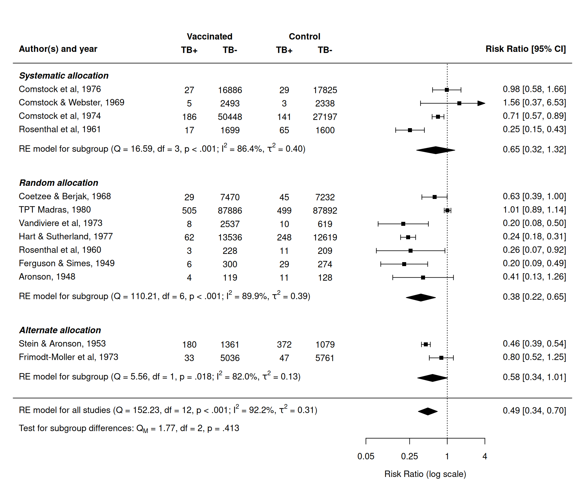
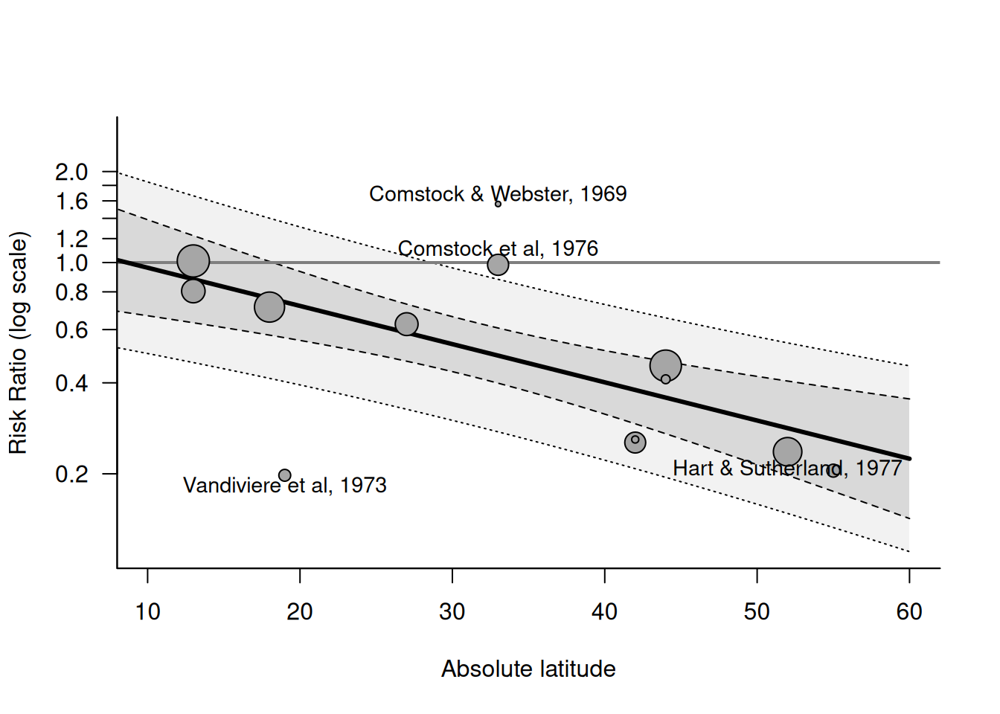
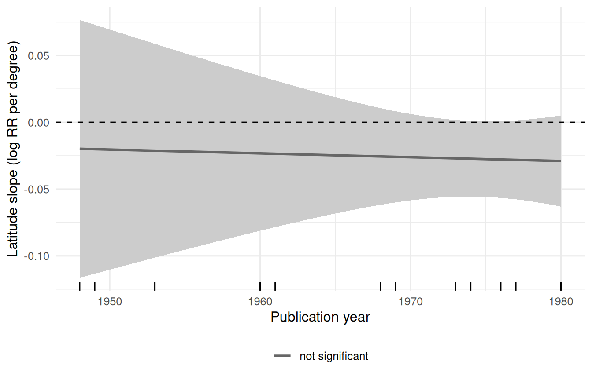
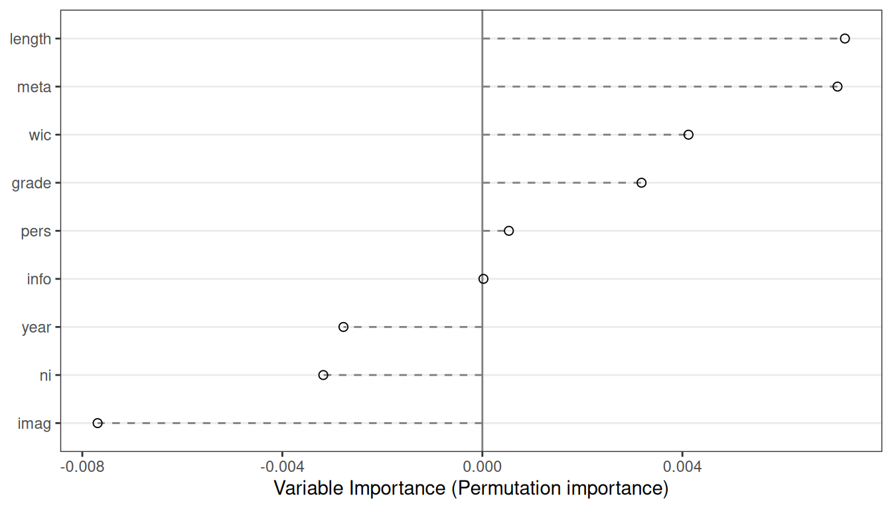

# Heterogeneity, Subgroups, and Meta-Regression {#sec-heterogeneity}


A random-effects model (Chapter \@ref(sec-models)) treats between-study variation as noise around a grand mean and summarises it with a single number, $\tau^2$. That is a reasonable first description, but it is rarely the end of the analysis. When the true effects of a vaccine, a training programme, or a marketing intervention differ across studies, the natural next question is *why*. Do they differ because the populations differ, because the interventions were delivered differently, because some studies were badly designed, or simply because the sampling error was underestimated? Answering that question is the job of subgroup analysis and meta-regression, and it is where meta-analysis moves from estimating an average to explaining variation.

This chapter is also where meta-analysis is most often abused. Moderator analyses are observational comparisons *across* studies, typically with few studies and many candidate moderators, so false positives, confounding, and aggregation bias are the rule rather than the exception [@thompson2002how; @higgins2004controlling]. We therefore develop the tools together with their failure modes: how to test subgroup differences properly, how to fit and interpret meta-regression models, how to probe interactions with the Johnson–Neyman technique, how to calibrate inference with Knapp–Hartung and permutation tests, how to compare many candidate models with multimodel inference, how to model heterogeneity itself with location-scale models, and how to use machine learning for exploratory moderator search without fooling ourselves.

## Where heterogeneity comes from {#sec-heterogeneity-sources}

It helps to separate three kinds of heterogeneity, following the terminology of the Cochrane Handbook [@higgins2019cochrane]. *Clinical* (or substantive) heterogeneity refers to differences in participants, interventions, comparators, and outcomes: one trial vaccinates infants and another adults; one training programme runs for two weeks and another for a year; one study measures job performance with supervisor ratings and another with sales figures. *Methodological* heterogeneity refers to differences in design and risk of bias: randomised versus quasi-random allocation, blinded versus unblinded outcome assessment, different follow-up lengths, different ways of handling attrition. *Statistical* heterogeneity is the observable consequence of either: the variability of the estimated effects exceeds what sampling error alone would produce.

Formally, in the random-effects model each observed effect $y_i$ ($i = 1, \dots, k$) estimates a study-specific true effect $\theta_i$,
$$
y_i = \theta_i + \varepsilon_i, \qquad \varepsilon_i \sim N(0, v_i), \qquad \theta_i = \mu + u_i, \qquad u_i \sim N(0, \tau^2),
$$
where $v_i$ is the (treated as known) sampling variance. Statistical heterogeneity is $\tau^2 > 0$. The Cochran $Q$ statistic, $I^2$, and $H^2$ [@higgins2002quantifying] quantify it, and the prediction interval translates it into the range of true effects one should expect in a new setting. None of these statistics says anything about the *source* of the variation. Clinical and methodological heterogeneity are hypotheses about the source, and the methods in this chapter test those hypotheses by letting $\theta_i$ depend on study-level covariates.

Two consequences follow immediately. First, the covariates are characteristics of *studies*, not of the individuals within them, so all inferences are about how average effects vary across study contexts. Second, because studies are not randomised to their characteristics, every moderator analysis is observational even when every included study is a randomised trial [@thompson2002how]. A difference between "random" and "systematic" allocation might reflect the allocation method, or the decade in which those trials were run, or the countries where they took place.

### The running example: BCG vaccine trials {#sec-heterogeneity-bcg}

We use the 13 trials of the Bacillus Calmette–Guérin (BCG) vaccine against tuberculosis compiled by @colditz1994efficacy and analysed with meta-regression by @berkey1995random. The data are in `metadat` as `dat.bcg`. Each trial reports a 2×2 table, the absolute latitude of the trial site (`ablat`), the year of publication, and the method of treatment allocation (`alloc`: random, alternate, or systematic). The effect size is the log risk ratio of tuberculosis, vaccinated versus control, so negative values favour the vaccine.


``` r
dat <- escalc(measure = "RR", ai = tpos, bi = tneg, ci = cpos, di = cneg,
              slab = paste0(author, ", ", year), data = dat.bcg)
res <- rma(yi, vi, data = dat)
res
#> 
#> Random-Effects Model (k = 13; tau^2 estimator: REML)
#> 
#> tau^2 (estimated amount of total heterogeneity): 0.3132 (SE = 0.1664)
#> tau (square root of estimated tau^2 value):      0.5597
#> I^2 (total heterogeneity / total variability):   92.22%
#> H^2 (total variability / sampling variability):  12.86
#> 
#> Test for Heterogeneity:
#> Q(df = 12) = 152.2330, p-val < .0001
#> 
#> Model Results:
#> 
#> estimate      se     zval    pval    ci.lb    ci.ub      
#>  -0.7145  0.1798  -3.9744  <.0001  -1.0669  -0.3622  *** 
#> 
#> ---
#> Signif. codes:  0 '***' 0.001 '**' 0.01 '*' 0.05 '.' 0.1 ' ' 1
predict(res, transf = exp, digits = 2)
#> 
#>  pred ci.lb ci.ub pi.lb pi.ub 
#>  0.49  0.34  0.70  0.15  1.55
```

The REML estimate of the average log risk ratio is $\hat\mu =$ -0.715 (risk ratio 0.49), but heterogeneity is enormous: $\hat\tau^2 =$ 0.313, $I^2 =$ 92.2%, and $Q(12) =$ 152.2. The 95% prediction interval for the risk ratio in a new setting runs from 0.15 to 1.55, that is, from a strongly protective vaccine to one that increases risk by about half. The average effect is clearly not the whole story. The original investigators hypothesised that the vaccine works better farther from the equator, possibly because of differential exposure to environmental mycobacteria, which makes latitude a pre-specified, scientifically motivated moderator. That distinction matters later.

## Subgroup analysis {#sec-heterogeneity-subgroups}

A subgroup analysis splits the studies by a categorical characteristic and asks whether the average effect differs between the groups. With $G$ subgroups, each with average true effect $\mu_g$, the hypothesis of interest is $H_0: \mu_1 = \dots = \mu_G$.

### Separate versus pooled estimates of $\tau^2$ {#sec-heterogeneity-tau2-pooled}

There are two ways to set up the model. In the *separate* approach, each subgroup gets its own random-effects model and its own $\tau^2_g$:
$$
y_{ig} = \mu_g + u_{ig} + \varepsilon_{ig}, \qquad u_{ig} \sim N(0, \tau_g^2).
$$
In the *pooled* approach, all subgroups share a common residual heterogeneity $\tau^2_{\text{res}}$; this is exactly a mixed-effects meta-regression with dummy-coded subgroup indicators. The pooled approach borrows strength across subgroups, which matters because $\tau^2$ is estimated very imprecisely in small subgroups. The separate approach is more flexible when the subgroups really differ in heterogeneity. In a simulation study, @rubioaparicio2017analysis found that both approaches perform similarly when there are at least about 20 studies roughly balanced across categories, and recommended the pooled estimate for most scenarios unless the residual between-study variances are clearly different and each category has enough studies to estimate its own variance precisely.

For the BCG data the three allocation subgroups are small: two alternate-allocation trials, seven random, and four systematic.


``` r
table(dat$alloc)
#> 
#>  alternate     random systematic 
#>          2          7          4
res_sep <- lapply(split(dat, dat$alloc), function(d) rma(yi, vi, data = d))
sapply(res_sep, function(r) c(k = r$k, estimate = coef(r)[[1]], se = r$se,
                              tau2 = r$tau2, I2 = r$I2))
#>          alternate  random systematic
#> k           2.0000  7.0000     4.0000
#> estimate   -0.5408 -0.9710    -0.4242
#> se          0.2816  0.2760     0.3597
#> tau2        0.1326  0.3925     0.4003
#> I2         82.0225 89.9343    86.4221
```

The separate fits give log risk ratios of -0.541 (alternate), -0.971 (random), and -0.424 (systematic), with subgroup heterogeneity estimates between 0.133 and 0.400. The estimate of $\tau^2$ for the alternate group rests on two studies and is essentially uninformative.

### Testing subgroup differences {#sec-heterogeneity-qbetween}

With separate estimates, the test of subgroup differences treats the $G$ subgroup means as data and computes a between-group heterogeneity statistic
$$
Q_B = \sum_{g=1}^G \hat w_g (\hat\mu_g - \bar\mu)^2, \qquad \hat w_g = 1/\widehat{\mathrm{SE}}(\hat\mu_g)^2, \qquad \bar\mu = \frac{\sum_g \hat w_g \hat\mu_g}{\sum_g \hat w_g},
$$
which is compared with a $\chi^2_{G-1}$ distribution. Computationally this is a common-effect meta-analysis of the subgroup estimates:


``` r
sub <- data.frame(alloc = names(res_sep),
                  est = sapply(res_sep, coef),
                  se = sapply(res_sep, function(r) r$se))
qb_sep <- rma(est, sei = se, data = sub, method = "EE")
qb_sep
#> 
#> Equal-Effects Model (k = 3)
#> 
#> I^2 (total heterogeneity / total variability):   0.00%
#> H^2 (total variability / sampling variability):  0.93
#> 
#> Test for Heterogeneity:
#> Q(df = 2) = 1.8614, p-val = 0.3943
#> 
#> Model Results:
#> 
#> estimate      se     zval    pval    ci.lb    ci.ub      
#>  -0.6827  0.1729  -3.9493  <.0001  -1.0214  -0.3439  *** 
#> 
#> ---
#> Signif. codes:  0 '***' 0.001 '**' 0.01 '*' 0.05 '.' 0.1 ' ' 1
```

With pooled $\tau^2$, the test is the omnibus moderator test $Q_M$ of a mixed-effects model with `alloc` as a factor:


``` r
res_alloc <- rma(yi, vi, mods = ~ alloc, data = dat)
res_alloc
#> 
#> Mixed-Effects Model (k = 13; tau^2 estimator: REML)
#> 
#> tau^2 (estimated amount of residual heterogeneity):     0.3615 (SE = 0.2111)
#> tau (square root of estimated tau^2 value):             0.6013
#> I^2 (residual heterogeneity / unaccounted variability): 88.77%
#> H^2 (unaccounted variability / sampling variability):   8.91
#> R^2 (amount of heterogeneity accounted for):            0.00%
#> 
#> Test for Residual Heterogeneity:
#> QE(df = 10) = 132.3676, p-val < .0001
#> 
#> Test of Moderators (coefficients 2:3):
#> QM(df = 2) = 1.7675, p-val = 0.4132
#> 
#> Model Results:
#> 
#>                  estimate      se     zval    pval    ci.lb   ci.ub    
#> intrcpt           -0.5180  0.4412  -1.1740  0.2404  -1.3827  0.3468    
#> allocrandom       -0.4478  0.5158  -0.8682  0.3853  -1.4588  0.5632    
#> allocsystematic    0.0890  0.5600   0.1590  0.8737  -1.0086  1.1867    
#> 
#> ---
#> Signif. codes:  0 '***' 0.001 '**' 0.01 '*' 0.05 '.' 0.1 ' ' 1
```

The two approaches agree here: $Q_B =$ 1.86 ($p$ = .394) with separate variances, and $Q_M =$ 1.77 on 2 degrees of freedom ($p$ = .413) with a pooled residual variance of $\hat\tau^2_{\text{res}} =$ 0.362. Notice that the pooled residual heterogeneity is *larger* than the total heterogeneity of the intercept-only model (0.313), so the reported $R^2$ is truncated at zero: allocation method explains none of the variation. Neither test supports a difference between allocation methods, but with 13 studies such a test has low power, and "no significant difference" is not evidence of equivalence.

Dropping the intercept gives the subgroup means directly, and linear contrasts give pairwise comparisons:


``` r
res_alloc0 <- rma(yi, vi, mods = ~ 0 + alloc, data = dat)
coef(summary(res_alloc0))
#>                 estimate     se   zval      pval  ci.lb   ci.ub
#> allocalternate   -0.5180 0.4412 -1.174 0.2404004 -1.383  0.3468
#> allocrandom      -0.9658 0.2672 -3.614 0.0003017 -1.490 -0.4420
#> allocsystematic  -0.4289 0.3449 -1.243 0.2137066 -1.105  0.2472
anova(res_alloc, X = rbind(c(0, 1, 0), c(0, 0, 1), c(0, -1, 1)))
#> 
#> Hypotheses:                                      
#> 1:                    allocrandom = 0 
#> 2:                allocsystematic = 0 
#> 3: -allocrandom + allocsystematic = 0 
#> 
#> Results:
#>    estimate     se    zval   pval   
#> 1:  -0.4478 0.5158 -0.8682 0.3853   
#> 2:   0.0890 0.5600  0.1590 0.8737   
#> 3:   0.5369 0.4364  1.2303 0.2186
```

Here the omnibus test in the no-intercept model ($Q_M(3) =$ 15.98) tests whether *all three* subgroup means are zero, which is a different and usually uninteresting hypothesis. Read the test that answers your question. In the model with an intercept, the omnibus test of coefficients 2 and 3 is the test of subgroup differences.

::: {.rmdwarning}
A common error is to declare a subgroup difference because the effect is "significant in one subgroup but not in another". Here the random-allocation subgroup has $p < .001$ and the other two do not, yet the formal test of the difference has $p$ = .413. Differences in significance are not significant differences. Only the test of the interaction (here $Q_B$ or $Q_M$) addresses whether effects differ.
:::

### A forest plot with subgroups {#sec-heterogeneity-subgroup-forest}

Figure \@ref(fig:het-forest-subgroups) displays the trials grouped by allocation method with a summary polygon per subgroup, an overall polygon, and the test for subgroup differences. The code adapts an example from the `metafor` documentation. The `rows` argument places the studies, leaving gaps for subgroup headings and polygons.


``` r
mlabfun <- function(text, x) {
  list(bquote(paste(.(text),
    " (Q = ", .(f2(x$QE)), ", df = ", .(x$k - x$p),
    ", p ", .(fp(x$QEp)), "; ", I^2, " = ", .(f2(x$I2, 1)), "%, ",
    tau^2, " = ", .(f2(x$tau2)), ")")))
}

forest(res, xlim = c(-16, 4.6), at = log(c(0.05, 0.25, 1, 4)), atransf = exp,
       ilab = cbind(dat$tpos, dat$tneg, dat$cpos, dat$cneg),
       ilab.xpos = c(-9.5, -8, -6, -4.5), cex = 0.9, ylim = c(-3, 27),
       order = dat$alloc, rows = c(3:4, 9:15, 20:23),
       mlab = mlabfun("RE model for all studies", res),
       psize = 1, header = "Author(s) and year")
par(xpd = NA)
op <- par(cex = 0.9, font = 2)
text(c(-9.5, -8, -6, -4.5), 26, c("TB+", "TB-", "TB+", "TB-"))
text(c(-8.75, -5.25), 27, c("Vaccinated", "Control"))
par(font = 4)
text(-16, c(24, 16, 5), pos = 4,
     c("Systematic allocation", "Random allocation", "Alternate allocation"))
par(op)
addpoly(res_sep$systematic, row = 18.5, cex = 0.9, atransf = exp,
        mlab = mlabfun("RE model for subgroup", res_sep$systematic))
addpoly(res_sep$random, row = 7.5, cex = 0.9, atransf = exp,
        mlab = mlabfun("RE model for subgroup", res_sep$random))
addpoly(res_sep$alternate, row = 1.5, cex = 0.9, atransf = exp,
        mlab = mlabfun("RE model for subgroup", res_sep$alternate))
text(-16, -2.4, pos = 4, cex = 0.9, bquote(paste(
  "Test for subgroup differences: ", Q[M], " = ", .(f2(res_alloc$QM)),
  ", df = ", .(res_alloc$p - 1), ", p ", .(fp(res_alloc$QMp)))))
```

<div class="figure" style="text-align: center">

<p class="caption">(\#fig:het-forest-subgroups)Forest plot of the BCG trials grouped by method of treatment allocation, with random-effects summaries per subgroup (separate $\tau^2$) and the mixed-effects test for subgroup differences (pooled $\tau^2$).</p>
</div>

The plot makes the problem of small subgroups visible: the alternate-allocation polygon is based on two trials, and the within-subgroup heterogeneity remains large in every group, so allocation cannot be what drives the variation.

## Meta-regression {#sec-heterogeneity-metareg}

### The mixed-effects meta-regression model {#sec-heterogeneity-model}

Meta-regression generalises subgroup analysis to any set of study-level covariates $x_{i1}, \dots, x_{ip'}$, categorical or continuous:
$$
y_i = \beta_0 + \beta_1 x_{i1} + \dots + \beta_{p'} x_{ip'} + u_i + \varepsilon_i, \qquad u_i \sim N(0, \tau^2_{\text{res}}), \qquad \varepsilon_i \sim N(0, v_i).
$$
In matrix form $\mathbf{y} = \mathbf{X}\boldsymbol\beta + \mathbf{u} + \boldsymbol\varepsilon$ with $p = p' + 1$ columns in $\mathbf X$. Given an estimate $\hat\tau^2_{\text{res}}$ (by default REML in `metafor`), the coefficients are estimated by weighted least squares,
$$
\hat{\boldsymbol\beta} = (\mathbf{X}^\top \mathbf{W} \mathbf{X})^{-1} \mathbf{X}^\top \mathbf{W} \mathbf{y}, \qquad \mathbf{W} = \mathrm{diag}\{1/(v_i + \hat\tau^2_{\text{res}})\}, \qquad \widehat{\mathrm{Var}}(\hat{\boldsymbol\beta}) = (\mathbf{X}^\top \mathbf{W} \mathbf{X})^{-1}.
$$
The residual variance $\tau^2_{\text{res}}$ is the heterogeneity left unexplained by the covariates. Ignoring it, that is, fitting a "fixed-effect" meta-regression with weights $1/v_i$, understates standard errors whenever residual heterogeneity is present and produces badly inflated false-positive rates [@thompson2002how; @higgins2004controlling]. A mixed-effects model is therefore the default.

Two tests are reported. The test for residual heterogeneity $Q_E = \sum_i (y_i - \mathbf{x}_i^\top \hat{\boldsymbol\beta}_{\text{EE}})^2 / v_i$ compares with $\chi^2_{k-p}$ and asks whether variation remains after accounting for the moderators. The omnibus test of moderators $Q_M = \hat{\boldsymbol\beta}_{[2]}^\top \widehat{\mathrm{Var}}(\hat{\boldsymbol\beta}_{[2]})^{-1} \hat{\boldsymbol\beta}_{[2]}$, where $[2]$ denotes the non-intercept coefficients, is a Wald test compared with $\chi^2_{p-1}$.

### A continuous moderator: latitude {#sec-heterogeneity-continuous}


``` r
res_lat <- rma(yi, vi, mods = ~ ablat, data = dat)
res_lat
#> 
#> Mixed-Effects Model (k = 13; tau^2 estimator: REML)
#> 
#> tau^2 (estimated amount of residual heterogeneity):     0.0764 (SE = 0.0591)
#> tau (square root of estimated tau^2 value):             0.2763
#> I^2 (residual heterogeneity / unaccounted variability): 68.39%
#> H^2 (unaccounted variability / sampling variability):   3.16
#> R^2 (amount of heterogeneity accounted for):            75.62%
#> 
#> Test for Residual Heterogeneity:
#> QE(df = 11) = 30.7331, p-val = 0.0012
#> 
#> Test of Moderators (coefficient 2):
#> QM(df = 1) = 16.3571, p-val < .0001
#> 
#> Model Results:
#> 
#>          estimate      se     zval    pval    ci.lb    ci.ub      
#> intrcpt    0.2515  0.2491   1.0095  0.3127  -0.2368   0.7397      
#> ablat     -0.0291  0.0072  -4.0444  <.0001  -0.0432  -0.0150  *** 
#> 
#> ---
#> Signif. codes:  0 '***' 0.001 '**' 0.01 '*' 0.05 '.' 0.1 ' ' 1
```

Each additional degree of absolute latitude changes the log risk ratio by -0.0291 (95% CI -0.0432 to -0.0150; $z =$ -4.04). On the risk ratio scale, ten degrees farther from the equator multiplies the risk ratio by $\exp(10 \times$ -0.0291$) =$ 0.75. Residual heterogeneity falls from 0.313 to 0.076, but it is still significant ($Q_E(11) =$ 30.73, $p$ = .001): latitude explains much but not all of the variation.

Predicted effects at chosen latitudes come from `predict()`. The confidence interval describes uncertainty about the average risk ratio at that latitude, and the prediction interval adds the residual heterogeneity:


``` r
predict(res_lat, newmods = c(10, 30, 50), transf = exp, digits = 2)
#> 
#>   pred ci.lb ci.ub pi.lb pi.ub 
#> 1 0.96  0.67  1.39  0.50  1.85 
#> 2 0.54  0.44  0.66  0.30  0.96 
#> 3 0.30  0.21  0.42  0.16  0.57
```

Near the equator (10°) the predicted risk ratio is 0.96, with a confidence interval that includes 1; at 50° it is 0.30.

A bubble plot shows the fitted line together with the data, with point areas proportional to the model weights (Figure \@ref(fig:het-bubble)).


``` r
regplot(res_lat, xlim = c(10, 60), predlim = c(0, 60),
        xlab = "Absolute latitude", refline = 0, atransf = exp,
        at = log(seq(0.2, 2, by = 0.2)), digits = 1, las = 1, bty = "l",
        pi = TRUE, label = c(4, 7, 12, 13), offset = c(1.6, 1), labsize = 0.9)
```

<div class="figure" style="text-align: center">

<p class="caption">(\#fig:het-bubble)Bubble plot of the log risk ratios against absolute latitude. Point size is proportional to the weight in the mixed-effects model; the solid line is the fitted relationship, the darker band its 95% confidence band, and the lighter band the 95% prediction band. The y-axis is labelled on the risk-ratio scale.</p>
</div>

### How much heterogeneity is explained? {#sec-heterogeneity-r2}

`metafor` reports a pseudo-$R^2$, the proportional reduction in the heterogeneity variance,
$$
R^2 = \max\left\{0, \frac{\hat\tau^2_{\text{RE}} - \hat\tau^2_{\text{res}}}{\hat\tau^2_{\text{RE}}}\right\},
$$
which for latitude is 75.6%. The statistic is intuitive but fragile. It is a ratio of two noisy variance estimates from two separately fitted models, it can be negative before truncation, and it depends on the estimator of $\tau^2$. @lopezlopez2013estimation found in simulations that precise estimates of the predictive power can be expected only with at least about 40 studies. Two quick checks show the instability on these 13 trials, first across $\tau^2$ estimators and then across leave-one-out subsets:


``` r
r2_by_method <- sapply(c("REML", "ML", "DL", "PM", "SJ", "HE"), function(m)
  rma(yi, vi, mods = ~ ablat, data = dat, method = m)$R2)
round(r2_by_method, 1)
#> REML   ML   DL   PM   SJ   HE 
#> 75.6 87.7 79.5 55.3 32.9 36.4
r2_loo <- sapply(seq_len(nrow(dat)), function(i) {
  t0 <- rma(yi, vi, data = dat[-i, ])$tau2
  t1 <- rma(yi, vi, mods = ~ ablat, data = dat[-i, ])$tau2
  max(0, 100 * (t0 - t1) / t0)
})
round(range(r2_loo), 1)
#> [1] 60.9 86.2
```

Depending on the estimator, latitude "explains" between 32.9% and 87.7% of the heterogeneity; dropping one study at a time moves the REML-based value between 60.9% and 86.2%. Report $R^2$ if you must, but with this caveat, and put more weight on the coefficients, their confidence intervals, and the residual $\hat\tau^2$ and prediction interval.

### Categorical moderators and the Knapp–Hartung adjustment {#sec-heterogeneity-knha}

The Wald-type $z$ and $\chi^2$ tests above treat $\hat\tau^2_{\text{res}}$ as if it were known. With few studies that is optimistic. @knapp2003improved proposed scaling the variance–covariance matrix by
$$
s^2 = \frac{1}{k - p} \sum_{i=1}^k \hat w_i (y_i - \mathbf{x}_i^\top \hat{\boldsymbol\beta})^2, \qquad \hat w_i = 1/(v_i + \hat\tau^2_{\text{res}}),
$$
and using $t_{k-p}$ for individual coefficients and $F_{p-1, k-p}$ for the omnibus test. In a large simulation study, @viechtbauer2015comparison found that this adjustment keeps the Type I error rate of moderator tests much closer to nominal than the standard Wald tests, which tend to be too liberal. In `metafor` it is `test = "knha"`.


``` r
res_lat_kh <- rma(yi, vi, mods = ~ ablat, data = dat, test = "knha")
res_lat_kh
#> 
#> Mixed-Effects Model (k = 13; tau^2 estimator: REML)
#> 
#> tau^2 (estimated amount of residual heterogeneity):     0.0764 (SE = 0.0591)
#> tau (square root of estimated tau^2 value):             0.2763
#> I^2 (residual heterogeneity / unaccounted variability): 68.39%
#> H^2 (unaccounted variability / sampling variability):   3.16
#> R^2 (amount of heterogeneity accounted for):            75.62%
#> 
#> Test for Residual Heterogeneity:
#> QE(df = 11) = 30.7331, p-val = 0.0012
#> 
#> Test of Moderators (coefficient 2):
#> F(df1 = 1, df2 = 11) = 12.5905, p-val = 0.0046
#> 
#> Model Results:
#> 
#>          estimate      se     tval  df    pval    ci.lb    ci.ub     
#> intrcpt    0.2515  0.2839   0.8857  11  0.3948  -0.3735   0.8764     
#> ablat     -0.0291  0.0082  -3.5483  11  0.0046  -0.0472  -0.0111  ** 
#> 
#> ---
#> Signif. codes:  0 '***' 0.001 '**' 0.01 '*' 0.05 '.' 0.1 ' ' 1
```

For latitude the conclusion is unchanged, $F(1, 11) =$ 12.59, $p$ = .005, but the confidence interval for the slope widens to -0.0472 to -0.0111. For allocation method the Knapp–Hartung test gives $F(2, 10) =$ 0.97. In what follows we use Knapp–Hartung tests by default. One caveat: whenever $s^2 < 1$, which is not rare when the residuals are small, the adjusted standard errors are smaller than the unadjusted ones, and the adjusted intervals can be narrower despite the larger $t$ quantile. Some authors truncate $s^2$ at 1 for that reason (`test = "adhoc"` in `metafor`).

### Multiple moderators and collinearity {#sec-heterogeneity-multiple}

Moderators measured on studies are often correlated. In the BCG data, trials at higher latitudes were also older:


``` r
cor(dat$ablat, dat$year)
#> [1] -0.6631
res_mult <- rma(yi, vi, mods = ~ ablat + year + alloc, data = dat, test = "knha")
res_mult
#> 
#> Mixed-Effects Model (k = 13; tau^2 estimator: REML)
#> 
#> tau^2 (estimated amount of residual heterogeneity):     0.1796 (SE = 0.1425)
#> tau (square root of estimated tau^2 value):             0.4238
#> I^2 (residual heterogeneity / unaccounted variability): 73.09%
#> H^2 (unaccounted variability / sampling variability):   3.72
#> R^2 (amount of heterogeneity accounted for):            42.67%
#> 
#> Test for Residual Heterogeneity:
#> QE(df = 8) = 26.2030, p-val = 0.0010
#> 
#> Test of Moderators (coefficients 2:5):
#> F(df1 = 4, df2 = 8) = 2.2668, p-val = 0.1509
#> 
#> Model Results:
#> 
#>                  estimate       se     tval  df    pval      ci.lb    ci.ub    
#> intrcpt          -14.4984  39.3525  -0.3684   8  0.7221  -105.2454  76.2487    
#> ablat             -0.0236   0.0136  -1.7382   8  0.1204    -0.0548   0.0077    
#> year               0.0075   0.0199   0.3755   8  0.7170    -0.0385   0.0534    
#> allocrandom       -0.3421   0.4284  -0.7984   8  0.4477    -1.3300   0.6459    
#> allocsystematic    0.0101   0.4579   0.0221   8  0.9829    -1.0457   1.0659    
#> 
#> ---
#> Signif. codes:  0 '***' 0.001 '**' 0.01 '*' 0.05 '.' 0.1 ' ' 1
vif(res_mult)
#> 
#>  ablat    year  allocrandom  allocsystematic 
#> 1.7697  1.9148       2.0858           2.0193
```

With latitude, year, and allocation in one model, no individual coefficient is significant and the omnibus test is not either ($F(4, 8) =$ 2.27, $p$ = .151). The latitude slope is still negative (-0.0236) but its standard error has grown from 0.0082 to 0.0136. The correlation of -0.66 between latitude and year means that the data cannot cleanly separate the two explanations, and with five parameters for 13 studies there are only eight residual degrees of freedom. The variance inflation factors (between 1.77 and 2.09) are not alarming by regression conventions, which is a reminder that a small $k$ can make a model unstable even without severe collinearity.

The coefficients in a multiple meta-regression are *partial* associations: the latitude coefficient is the expected change in the log risk ratio for one degree of latitude among trials published in the same year with the same allocation method. Whether that is the quantity of scientific interest depends on whether year and allocation are confounders (common causes of latitude and effect) or mediators (consequences of the setting). This is a causal question that the regression itself cannot answer.

### Many moderators, few studies {#sec-heterogeneity-overfitting}

@higgins2004controlling showed that standard meta-regression suffers from substantially inflated false-positive rates when there is heterogeneity, when there are few studies, and when there are many covariates, which are exactly the conditions under which it is typically used. A small simulation makes the point concrete. We generate 13 studies with no true moderator effect and $\tau^2 = 0.1$, add four pure-noise moderators, and record how often the omnibus test rejects at $\alpha = .05$ under a fixed-effect meta-regression, a mixed-effects model with Wald tests, and a mixed-effects model with Knapp–Hartung tests. The mixed-effects models use the non-iterative DerSimonian–Laird estimator so that every replication converges.


``` r
set.seed(2026)
sim_once <- function(k = 13, p = 4, tau2 = 0.1) {
  vi <- runif(k, 0.01, 0.2)
  yi <- rnorm(k, mean = 0, sd = sqrt(tau2 + vi))
  X <- matrix(rnorm(k * p), nrow = k)
  c(fixed  = rma(yi, vi, mods = X, method = "EE")$QMp,
    re_z   = rma(yi, vi, mods = X, method = "DL")$QMp,
    re_kh  = rma(yi, vi, mods = X, method = "DL", test = "knha")$QMp) < 0.05
}
typeI <- rowMeans(replicate(1000, sim_once()))
typeI
#> fixed  re_z re_kh 
#> 0.501 0.138 0.064
```

The nominal rate is 5%. The fixed-effect meta-regression rejects in 50.1% of replications, the mixed-effects Wald test in 13.8%, and the Knapp–Hartung test in 6.4%. And this is for a *single* pre-specified test; analysts who screen moderators one at a time and report the significant ones face a multiple-testing problem on top. A frequently quoted rule of thumb asks for about ten studies per moderator [@higgins2019cochrane], but no rule substitutes for pre-registration of a small set of moderators with a scientific rationale [@thompson2002how].

### Aggregation bias and the ecological fallacy {#sec-heterogeneity-ecological}

Many moderators are study-level summaries of participant characteristics: mean age, percentage female, mean baseline severity. A meta-regression on mean age estimates how the *average* effect varies across studies with different mean ages. It does not estimate how the effect varies with age *within* studies. The two can differ in magnitude and even in sign, because between-study differences in mean age are confounded with everything else that differs between studies (country, decade, recruitment, intervention version), while within-study differences are not. Inferring individual-level effect modification from study-level associations is the ecological fallacy, and the resulting discrepancy is called aggregation bias [@thompson2002how]. The bias is worst when within-study variation in the covariate is large relative to between-study variation, so that study means cluster in a narrow range. Questions about patient-level effect modification are best addressed with individual participant data (Chapter \@ref(sec-multivariate-ipd)) or with within-study interaction estimates if studies report them.

A related trap is meta-regression on *baseline risk* (the control-group event rate). Because the observed control-group risk appears in both the outcome (the treatment effect) and the predictor, measurement error induces a spurious association, a form of regression to the mean; specialised methods are needed for that question.

## Interactions and the Johnson–Neyman technique {#sec-heterogeneity-jn}

Moderators can interact. Suppose the latitude gradient has changed over time, for example because the strains of BCG or the background exposure to environmental mycobacteria changed. The model
$$
\theta_i = \beta_0 + \beta_1 X_i + \beta_2 W_i + \beta_3 X_i W_i
$$
lets the slope of $X$ (latitude) depend on $W$ (year): the *conditional effect* of $X$ at $W = w$ is
$$
\psi(w) = \beta_1 + \beta_3 w, \qquad \mathrm{Var}\{\hat\psi(w)\} = \sigma_{11} + 2 w \sigma_{13} + w^2 \sigma_{33},
$$
where $\sigma_{jl}$ are elements of $\widehat{\mathrm{Var}}(\hat{\boldsymbol\beta})$. Testing $\psi(w)$ at a few hand-picked values of $w$ ("simple slopes") is arbitrary. The Johnson–Neyman technique instead finds every value of $w$ at which $\hat\psi(w)$ is exactly on the boundary of significance [@bauer2005probing]. Setting $\hat\psi(w)^2 = c^2\, \mathrm{Var}\{\hat\psi(w)\}$, where $c$ is the critical value of the reference distribution ($z$ or $t$), gives the quadratic
$$
A w^2 + B w + C = 0, \qquad A = \hat\beta_3^2 - c^2 \sigma_{33}, \quad B = 2(\hat\beta_1 \hat\beta_3 - c^2 \sigma_{13}), \quad C = \hat\beta_1^2 - c^2 \sigma_{11}.
$$
The conditional effect is significant wherever $A w^2 + B w + C > 0$. If $A > 0$ that is *outside* the two roots (or everywhere, if there are no real roots); if $A < 0$ it is *between* the two roots (or nowhere). Only the part of the region that lies inside the observed range of $W$ is interpretable; outside it the model extrapolates.

The technique requires a continuous $W$. With a binary moderator the conditional effect is defined only at $W = 0$ and $W = 1$, both of which are already tested directly by the coefficients of a suitably coded model; "regions of significance" between 0 and 1 are meaningless.

### Implementation {#sec-heterogeneity-jn-code}

The three functions below work for any `rma.uni` or `rma.mv` fit with a two-way interaction between continuous moderators. They take the coefficients and covariance matrix from the fitted model, use the same reference distribution as the model (normal for `test = "z"`, $t$ with the model's degrees of freedom for `test = "knha"` or `test = "t"`), check that the moderator is not binary, and classify the region according to the sign of $A$ rather than by testing a random point.


``` r
jn_parts <- function(fit, pred, mod, level = 0.95) {
  b <- coef(fit)
  if (!pred %in% names(b)) stop("'", pred, "' is not a model coefficient.")
  int <- intersect(c(paste0(pred, ":", mod), paste0(mod, ":", pred)), names(b))
  if (length(int) != 1) stop("No ", pred, " x ", mod, " interaction in the model.")
  if (length(unique(fit$X[, mod])) <= 2)
    stop("'", mod, "' is binary: the Johnson-Neyman technique needs a continuous moderator.")
  V <- vcov(fit)
  ddf <- fit$ddf
  df <- if (length(ddf) > 1) ddf[[match(pred, names(b))]] else ddf[[1]]
  crit <- if (is.null(df) || is.na(df)) qnorm(1 - (1 - level) / 2) else
    qt(1 - (1 - level) / 2, df)
  list(b1 = b[[pred]], b3 = b[[int]], v11 = V[pred, pred], v33 = V[int, int],
       v13 = V[pred, int], crit = crit, df = df, w = fit$X[, mod])
}

jn_slopes <- function(fit, pred, mod, at, level = 0.95) {
  p <- jn_parts(fit, pred, mod, level)
  est <- p$b1 + p$b3 * at
  se <- sqrt(p$v11 + 2 * at * p$v13 + at^2 * p$v33)
  stat <- est / se
  pval <- if (is.null(p$df) || is.na(p$df)) 2 * pnorm(-abs(stat)) else 2 * pt(-abs(stat), p$df)
  data.frame(at = at, estimate = est, se = se,
             ci.lb = est - p$crit * se, ci.ub = est + p$crit * se, pval = pval)
}

jn_region <- function(fit, pred, mod, level = 0.95) {
  p <- jn_parts(fit, pred, mod, level)
  A <- p$b3^2 - p$crit^2 * p$v33
  B <- 2 * (p$b1 * p$b3 - p$crit^2 * p$v13)
  C <- p$b1^2 - p$crit^2 * p$v11
  disc <- B^2 - 4 * A * C
  if (A == 0) {
    bounds <- -C / B
    where <- if (B > 0) "above the bound" else "below the bound"
  } else if (disc < 0) {
    bounds <- numeric(0)
    where <- if (A > 0) "everywhere" else "nowhere"
  } else {
    bounds <- sort((-B + c(-1, 1) * sqrt(disc)) / (2 * A))
    where <- if (A > 0) "outside the bounds" else "between the bounds"
  }
  list(bounds = bounds, significant = where, observed = range(p$w),
       crit = p$crit, df = p$df)
}

jn_plot <- function(fit, pred, mod, level = 0.95, shift = 0, n = 200,
                    xlab = mod, ylab = paste("Conditional effect of", pred)) {
  p <- jn_parts(fit, pred, mod, level)
  grid <- seq(min(p$w), max(p$w), length.out = n)
  d <- jn_slopes(fit, pred, mod, at = grid, level = level)
  d$sig <- d$pval < 1 - level
  reg <- jn_region(fit, pred, mod, level)
  vb <- reg$bounds[reg$bounds >= min(p$w) & reg$bounds <= max(p$w)]
  ggplot(d, aes(x = at + shift, y = estimate)) +
    geom_ribbon(aes(ymin = ci.lb, ymax = ci.ub), fill = "grey80") +
    geom_hline(yintercept = 0, linetype = 2) +
    geom_line(aes(colour = sig, group = 1), linewidth = 1) +
    geom_vline(xintercept = vb + shift, linetype = 3) +
    geom_rug(data = data.frame(w = p$w), aes(x = w + shift), inherit.aes = FALSE) +
    scale_colour_manual(values = c(`FALSE` = "grey40", `TRUE` = "firebrick"),
                        labels = c(`FALSE` = "not significant", `TRUE` = "significant"),
                        name = NULL) +
    labs(x = xlab, y = ylab) +
    theme(legend.position = "bottom")
}
```

### Latitude × year in the BCG trials {#sec-heterogeneity-jn-bcg}

We centre both moderators so that $\beta_1$ is the latitude slope at the mean publication year and $\beta_2$ the year slope at mean latitude. Centring does not change the fit or the interaction coefficient; it makes the lower-order terms interpretable.


``` r
dat$ablat_c <- dat$ablat - mean(dat$ablat)
dat$year_c  <- dat$year - mean(dat$year)
res_int_z  <- rma(yi, vi, mods = ~ ablat_c * year_c, data = dat)
res_int_kh <- rma(yi, vi, mods = ~ ablat_c * year_c, data = dat, test = "knha")
coef(summary(res_int_kh))
#>                  estimate       se    tval df     pval     ci.lb     ci.ub
#> intrcpt        -0.7660042 0.214742 -3.5671  9 0.006052 -1.251785 -0.280223
#> ablat_c        -0.0250613 0.017857 -1.4035  9 0.194028 -0.065456  0.015334
#> year_c          0.0058636 0.024702  0.2374  9 0.817681 -0.050016  0.061743
#> ablat_c:year_c -0.0002855 0.001539 -0.1855  9 0.856925 -0.003767  0.003196
jn_z  <- jn_region(res_int_z,  "ablat_c", "year_c")
jn_kh <- jn_region(res_int_kh, "ablat_c", "year_c")
jn_z
#> $bounds
#> [1]  3.375 15.309
#> 
#> $significant
#> [1] "between the bounds"
#> 
#> $observed
#> [1] -18.23  13.77
#> 
#> $crit
#> [1] 1.96
#> 
#> $df
#> [1] NA
jn_kh
#> $bounds
#> numeric(0)
#> 
#> $significant
#> [1] "nowhere"
#> 
#> $observed
#> [1] -18.23  13.77
#> 
#> $crit
#> [1] 2.262
#> 
#> $df
#> [1] 9
```

The interaction coefficient is tiny and far from significant (-0.0003, $p$ = .857 with Knapp–Hartung), so there is no evidence that the latitude gradient changed over time. The Johnson–Neyman analysis nonetheless shows how much the conclusion about *where* latitude matters depends on inferential choices. With Wald $z$ tests, the latitude slope is significant for centred years between 3.37 and 15.31, that is, for trials published from about 1970 onward (the upper bound lies beyond the last observed year, 1980). With the Knapp–Hartung $t_{9}$ reference distribution the quadratic has no real roots and $A < 0$, so the conditional slope is significant nowhere.

We can verify a bound directly: the Wald test of the linear combination $\beta_1 + \beta_3 w$ at the lower Johnson–Neyman bound should have $p = .05$ exactly.


``` r
anova(res_int_z, X = c(0, 1, 0, jn_z$bounds[1]))
#> 
#> Hypothesis:                                       
#> 1: ablat_c + 3.3746*ablat_c:year_c = 0 
#> 
#> Results:
#>    estimate     se    zval   pval   
#> 1:  -0.0260 0.0133 -1.9600 0.0500 . 
#> 
#> Test of Hypothesis:
#> QM(df = 1) = 3.8415, p-val = 0.0500
jn_slopes(res_int_z, "ablat_c", "year_c", at = c(-15, 0, jn_z$bounds[1], 10))
#>        at estimate      se    ci.lb     ci.ub    pval
#> 1 -15.000 -0.02078 0.03450 -0.08841  0.046849 0.54704
#> 2   0.000 -0.02506 0.01623 -0.05688  0.006755 0.12263
#> 3   3.375 -0.02602 0.01328 -0.05205  0.000000 0.05000
#> 4  10.000 -0.02792 0.01161 -0.05067 -0.005163 0.01619
```

Figure \@ref(fig:het-jn-plot) plots the conditional latitude slope across the observed range of years for the Knapp–Hartung model, with the rug showing where the trials lie.


``` r
jn_plot(res_int_kh, "ablat_c", "year_c", shift = mean(dat$year),
        xlab = "Publication year", ylab = "Latitude slope (log RR per degree)")
```

<div class="figure" style="text-align: center">

<p class="caption">(\#fig:het-jn-plot)Conditional effect of absolute latitude on the log risk ratio as a function of publication year (Knapp–Hartung model) with its 95% confidence band. The slope is negative throughout but its confidence band includes zero over the whole observed range; the rug marks the publication years of the 13 trials.</p>
</div>

Three lessons carry over to any application. First, probe an interaction only when the interaction itself is supported; a Johnson–Neyman region computed from a null interaction (here $p$ = .857) describes noise. Second, Johnson–Neyman bounds inherit all the weaknesses of the model's standard errors, so use the same small-sample correction as for the main analysis. Third, report the bounds together with the observed range of the moderator, never as a statement about values that no study observed.

## Permutation tests {#sec-heterogeneity-permutation}

The Knapp–Hartung test improves on the Wald test but still relies on distributional assumptions. @higgins2004controlling proposed a permutation test: if the moderator is unrelated to the effects, then the assignment of moderator values to studies is exchangeable, so randomly reshuffling the rows of the moderator matrix generates the null distribution of the test statistic. With $k$ studies there are $k!$ permutations; for $k = 13$ that is more than six billion, so we take a random sample of permutations. They recommend this test before a statistically significant relationship from a standard meta-regression is claimed.


``` r
set.seed(2026)
perm_lat <- permutest(res_lat_kh, iter = 1000)
#> Running 1000 iterations for an approximate permutation test.
perm_lat
#> 
#> Test of Moderators (coefficient 2):¹
#> F(df1 = 1, df2 = 11) = 12.5905, p-val = 0.0140
#> 
#> Model Results:
#> 
#>          estimate      se     tval  df    pval¹    ci.lb    ci.ub    
#> intrcpt    0.2515  0.2839   0.8857  11  0.7770   -0.3735   0.8764    
#> ablat     -0.0291  0.0082  -3.5483  11  0.0140   -0.0472  -0.0111  * 
#> 
#> ---
#> Signif. codes:  0 '***' 0.001 '**' 0.01 '*' 0.05 '.' 0.1 ' ' 1
#> 
#> 1) p-values based on permutation testing
perm_mult <- permutest(res_mult, iter = 1000)
#> Running 1000 iterations for an approximate permutation test.
```

For latitude alone, the permutation $p$-value is 0.014 (based on 1000 permutations), compared with 0.0046 from the Knapp–Hartung $F$ test, so the association survives. For the four-moderator model, the omnibus permutation $p$-value is 0.154. The permutation test is also the natural tool for screening analyses: permuting whole rows of the moderator matrix while recording the *minimum* $p$-value across moderators gives a multiplicity-adjusted test, which is the adjustment @higgins2004controlling proposed for multiple covariates. Permutation tests are not a cure for confounding; they only calibrate the $p$-value for the hypothesis of no association.

## Multimodel inference {#sec-heterogeneity-mmi}

When several candidate moderators are plausible and none is singled out a priori, fitting one large model or choosing a single "best" model by stepwise selection both have problems. Multimodel inference fits all candidate models, ranks them with an information criterion such as $\text{AIC}_c$, converts the differences $\Delta_m = \text{AIC}_{c,m} - \min \text{AIC}_c$ into Akaike weights
$$
w_m = \frac{\exp(-\Delta_m/2)}{\sum_{l} \exp(-\Delta_l/2)},
$$
and then averages coefficients across models and sums the weights of all models containing a predictor to obtain its relative importance [@burnham2004multimodel]. Because likelihoods of models with different fixed effects are not comparable under REML, the models must be fitted by maximum likelihood.

We illustrate with the writing-to-learn meta-analysis in `dat.bangertdrowns2004` (48 school-based interventions, standardised mean differences). Following the approach documented on the `metafor` website, we drop studies with missing values on any candidate moderator (so that all models are fitted to the same data) and register the helper methods that `MuMIn` needs for `rma` objects with `eval(metafor:::.MuMIn)`.


``` r
eval(metafor:::.MuMIn)
mods <- c("length", "wic", "feedback", "info", "pers", "imag", "meta")
bd <- dat.bangertdrowns2004
bd <- bd[complete.cases(as.data.frame(bd)[, mods]), ]
nrow(bd)
#> [1] 41
full <- rma(yi, vi, mods = ~ length + wic + feedback + info + pers + imag + meta,
            data = bd, method = "ML")
```

The seven moderators are treatment length in weeks (`length`) and indicators for writing in class (`wic`), feedback (`feedback`), writing that contained informational components (`info`), personal components (`pers`), imaginative components (`imag`), and metacognitive prompts (`meta`). With seven binary-or-continuous main effects there are $2^7 = 128$ candidate models.


``` r
dd <- dredge(full, trace = FALSE)
subset(dd, delta <= 2)
#> Global model call: rma(yi = yi, vi = vi, mods = ~length + wic + feedback + info + 
#>     pers + imag + meta, data = bd, method = "ML")
#> ---
#> Model selection table 
#>    (Intrc)   fdbck   imag    lngth    meta    pers      wic df logLik AICc
#> 3        +         0.4437                                    3 -3.427 13.5
#> 19       +         0.4020          0.10880                   4 -2.197 13.5
#> 4        + 0.09907 0.4359                                    4 -2.446 14.0
#> 11       +         0.4059 0.007695                           4 -2.510 14.1
#> 20       + 0.09112 0.3967          0.10140                   5 -1.360 14.4
#> 83       +         0.4209          0.12500         -0.09359  5 -1.517 14.7
#> 36       + 0.11820 0.3869                  0.08858           5 -1.636 15.0
#> 35       +         0.4072                  0.06671           4 -2.974 15.1
#> 27       +         0.3812 0.005604 0.09186                   5 -1.748 15.2
#> 67       +         0.4608                          -0.05935  4 -3.150 15.4
#>    delta weight
#> 3   0.00  0.156
#> 19  0.00  0.156
#> 4   0.50  0.121
#> 11  0.63  0.114
#> 20  0.93  0.098
#> 83  1.25  0.084
#> 36  1.48  0.074
#> 35  1.56  0.072
#> 27  1.71  0.066
#> 67  1.91  0.060
#> Models ranked by AICc(x)
avg <- model.avg(dd, revised.var = FALSE)
round(coefTable(avg, full = TRUE), 4)
#>          Estimate Std. Error
#> intrcpt    0.1084       0.10
#> imag       0.3512       0.20
#> meta       0.0512       0.09
#> feedback   0.0366       0.07
#> length     0.0023       0.00
#> wic       -0.0170       0.05
#> pers       0.0132       0.07
#> info      -0.0183       0.08
sw(dd)
#>                      imag meta feedback length pers wic  info
#> Sum of weights:      0.85 0.42 0.37     0.33   0.29 0.26 0.24
#> N containing models:   64   64   64       64     64   64   64
```


10 models lie within two $\text{AIC}_c$ units of the best, and every one of them contains `imag`. Its importance (sum of Akaike weights over the 64 models that include it) is 0.85, far above the next predictors, `meta` (0.42) and `feedback` (0.37). The full model-averaged coefficient for `imag`, which treats the coefficient as zero in models that exclude it, is 0.351 (SE 0.202).

Multimodel inference is a principled way to express model uncertainty, but it is not a licence to dredge. The averaged estimates are only as good as the candidate set; importance values have no absolute threshold and even a pure-noise predictor can receive substantial weight; and with 41 studies and 128 models, any conclusion is exploratory. An alternative implementation is the `glmulti` package [@calcagno2010glmulti], which can also search candidate sets with interactions using a genetic algorithm when exhaustive search is infeasible. The `metafor` website shows how to use it with `rma` models; it is not run here because `glmulti` depends on Java.

## Location-scale models {#sec-heterogeneity-location-scale}

Standard meta-regression lets the *mean* of the true effects depend on moderators but assumes the same residual heterogeneity $\tau^2$ for every study. Yet one may expect more heterogeneity among small, community-based studies than among large, protocol-driven trials, or more among studies with a particular design. The location-scale model of @viechtbauer2022location adds a second linear predictor for the heterogeneity:
$$
y_i = \mathbf{x}_i^\top \boldsymbol\beta + u_i + \varepsilon_i, \qquad u_i \sim N(0, \tau_i^2), \qquad \log \tau_i^2 = \mathbf{z}_i^\top \boldsymbol\alpha .
$$
The log link keeps $\tau_i^2$ positive. The model answers questions that standard models cannot: whether a characteristic is related to the *consistency* of effects rather than (or as well as) to their average size. A subgroup analysis with separate $\tau^2_g$ (Section \@ref(sec-heterogeneity-tau2-pooled)) is the special case with a single categorical predictor in both parts.

In the writing-to-learn data, we ask whether heterogeneity is related to study size:


``` r
ls0 <- rma(yi, vi, scale = ~ 1, data = dat.bangertdrowns2004)
ls_n <- rma(yi, vi, scale = ~ log(ni), data = dat.bangertdrowns2004)
ls_n
#> 
#> Location-Scale Model (k = 48; tau^2 estimator: REML)
#> 
#> Test for Heterogeneity:
#> Q(df = 47) = 107.1061, p-val < .0001
#> 
#> Model Results (Location):
#> 
#> estimate      se    zval    pval   ci.lb   ci.ub      
#>   0.1708  0.0412  4.1445  <.0001  0.0900  0.2515  *** 
#> 
#> Test of Scale Coefficients (coefficient 2):
#> QM(df = 1) = 3.3488, p-val = 0.0673
#> 
#> Model Results (Scale):
#> 
#>          estimate      se     zval    pval    ci.lb   ci.ub    
#> intrcpt    1.5141  2.3582   0.6421  0.5208  -3.1078  6.1361    
#> log(ni)   -0.9659  0.5278  -1.8300  0.0673  -2.0003  0.0686  . 
#> 
#> ---
#> Signif. codes:  0 '***' 0.001 '**' 0.01 '*' 0.05 '.' 0.1 ' ' 1
anova(ls_n, ls0)
#> 
#>         df     AIC     BIC    AICc   logLik    LRT   pval       QE 
#> Full     3 39.8610 45.4114 40.4191 -16.9305               107.1061 
#> Reduced  2 40.9886 44.6889 41.2613 -18.4943 3.1276 0.0770 107.1061
predict(ls_n, newscale = log(c(30, 100, 300)), transf = exp, digits = 3)
#> 
#>    pred ci.lb ci.ub 
#> 1 0.170 0.047 0.610 
#> 2 0.053 0.025 0.114 
#> 3 0.018 0.004 0.085
```


The scale coefficient for $\log n_i$ is -0.966 (SE 0.528): larger studies tend to be more homogeneous. The implied heterogeneity is $\hat\tau^2 =$ 0.170 for a study with 30 pupils, 0.053 with 100 pupils, and 0.018 with 300. The evidence is modest, however: the likelihood-ratio test against the homoscedastic model gives $\chi^2(1) =$ 3.13, $p$ = .077. Location-scale models need more data than location models, because variance components are estimated with less precision than means; with a few dozen studies they are best viewed as hypothesis-generating unless the scale predictors were specified in advance.

## Exploratory moderator search with machine learning {#sec-heterogeneity-metaforest}

When a literature offers many coded study characteristics and little theory to choose among them, a data-driven screen can suggest which characteristics are worth a confirmatory analysis in future syntheses. MetaForest adapts random forests to meta-analysis by growing trees on bootstrap samples of studies, weighting studies by their random-effects weights, and assessing predictive performance on the studies left out of each bootstrap sample (out-of-bag) [@vanlissa2020small]. Its appeal is that it can capture non-linear relations and interactions without specifying them; its cost is that it offers no inference in the usual sense.


``` r
mf_dat <- na.omit(as.data.frame(dat.bangertdrowns2004)[,
  c("yi", "vi", "grade", "length", "wic", "info", "pers", "imag", "meta", "year", "ni")])
set.seed(2026)
mf <- MetaForest(yi ~ grade + length + wic + info + pers + imag + meta + year + ni,
                 data = mf_dat, vi = "vi", whichweights = "random", num.trees = 1000)
mf
#> Call:
#> MetaForest(formula = yi ~ grade + length + wic + info + pers + 
#>     imag + meta + year + ni, data = mf_dat, vi = "vi", whichweights = "random", 
#>     num.trees = 1000)
#> 
#> R squared (OOB):                  -0.0902 
#> Residual heterogeneity (tau2):    0.0470
```

The out-of-bag $R^2$ is -0.090. A negative value means the forest predicts the effect sizes of held-out studies *worse* than their mean does: with 42 studies and nine moderators there is no stable, generalisable moderator structure to find. The variable-importance plot (Figure \@ref(fig:het-metaforest-varimp)) should be read in that light, as a ranking of noise.


``` r
VarImpPlot(mf)
```

<div class="figure" style="text-align: center">

<p class="caption">(\#fig:het-metaforest-varimp)Permutation variable importance from MetaForest for the writing-to-learn data. Because the out-of-bag $R^2$ is negative, these importances do not indicate reliable moderators.</p>
</div>

This is the honest outcome of many machine-learning analyses of small meta-analytic data sets, and it is worth reporting. When MetaForest does find positive out-of-bag $R^2$, good practice is to check that the forest has converged (`plot(mf)` shows the out-of-bag error by number of trees), to tune `mtry` and the minimum node size by cross-validation, to use clustered bootstrap sampling via the `study` argument when effect sizes are nested in studies, and to treat the variables it selects as hypotheses to be tested in a pre-specified meta-regression on new data [@vanlissa2020small].

## Practical recommendations {#sec-heterogeneity-recommendations}

Specify a small number of moderators, each with a substantive rationale, in the protocol, and label everything else exploratory [@thompson2002how]. Use mixed-effects models and Knapp–Hartung tests by default, and confirm key findings with a permutation test when $k$ is small [@viechtbauer2015comparison; @higgins2004controlling]. For categorical moderators, test subgroup differences with $Q_B$ or $Q_M$, never by comparing within-subgroup $p$-values, and prefer a pooled $\tau^2$ unless subgroups are large and clearly differ in heterogeneity [@rubioaparicio2017analysis]. Report coefficients with confidence intervals, the residual $\tau^2$, and predictions with prediction intervals at meaningful moderator values; present $R^2$ only with a caveat about its instability [@lopezlopez2013estimation]. Centre continuous moderators before forming interactions, probe interactions with Johnson–Neyman regions only when the interaction is supported, and restrict interpretation to the observed range [@bauer2005probing]. When several moderators compete, show how estimates change across specifications or use multimodel inference rather than reporting one selected model. Interpret study-level associations as such, and do not translate them into statements about individuals.

## Common pitfalls {#sec-heterogeneity-pitfalls}

The pitfalls in this area are well documented. Analysts fit fixed-effect meta-regressions that ignore residual heterogeneity and produce spuriously small $p$-values. They screen dozens of moderators one at a time and report those that cross $p < .05$. They interpret a significant subgroup effect in one group and a non-significant effect in another as a subgroup difference. They read a moderator association as causal, forgetting that studies are not randomised to their characteristics. They regress treatment effects on observed baseline risk without accounting for the shared measurement error. They interpret coefficients of study-level means as individual-level effect modification. They report $R^2 = 100\%$ from a model whose residual $\hat\tau^2$ was truncated at zero in a meta-analysis of a dozen studies. And they extrapolate a fitted line, or a Johnson–Neyman region, beyond the range of moderator values that any included study observed.

## Key takeaways {#sec-heterogeneity-takeaways}

- Heterogeneity statistics quantify variation in true effects; subgroup analysis and meta-regression attempt to explain it with study-level covariates, which makes them observational analyses even when all studies are randomised.
- Subgroup differences are tested with $Q_B$ (separate $\tau^2$) or the mixed-effects $Q_M$ (pooled $\tau^2$); a pooled $\tau^2$ is usually preferable with few studies per subgroup.
- Mixed-effects meta-regression with Knapp–Hartung tests is the default; fixed-effect meta-regression and Wald tests are too liberal with few studies, and permutation tests offer a further check.
- Pseudo-$R^2$ is unstable with fewer than about 40 studies; report coefficients, residual heterogeneity, and prediction intervals instead.
- The Johnson–Neyman technique locates the moderator values at which a conditional effect is significant; it requires a continuous moderator, a supported interaction, and interpretation within the observed range.
- Multimodel inference, location-scale models, and MetaForest extend the toolkit, but with typical meta-analytic sample sizes they are exploratory and must be reported as such.

## Further reading {#sec-heterogeneity-reading}

@thompson2002how remains the best short guide to doing and interpreting meta-regression, and @higgins2004controlling documents the false-positive problem and the permutation remedy. @viechtbauer2015comparison compares moderator tests in mixed-effects models, and @viechtbauer2007accounting gives an accessible introduction to random- and mixed-effects models for moderator analysis. @rubioaparicio2017analysis study pooled versus separate heterogeneity estimates for categorical moderators, and @lopezlopez2013estimation the precision of $R^2$. @bauer2005probing develop the Johnson–Neyman technique for single-level and multilevel regression. @burnham2004multimodel explain the logic of multimodel inference, and @calcagno2010glmulti describe `glmulti`. @viechtbauer2022location introduce location-scale models for meta-analysis, and @vanlissa2020small presents MetaForest. The `metafor` paper [@viechtbauer2010conducting] and the package documentation cover the software used throughout.
