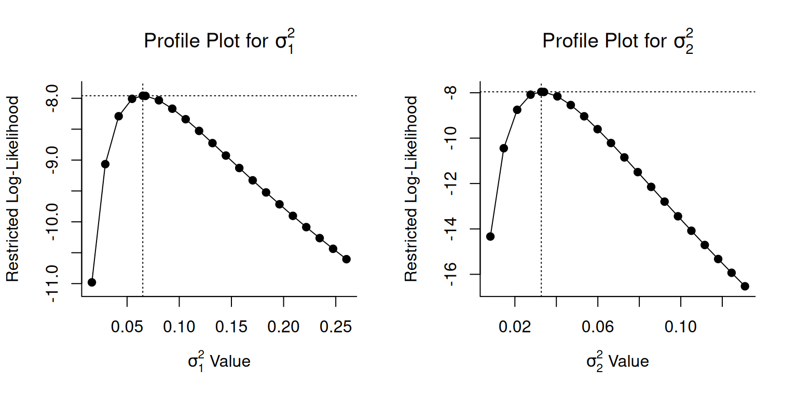
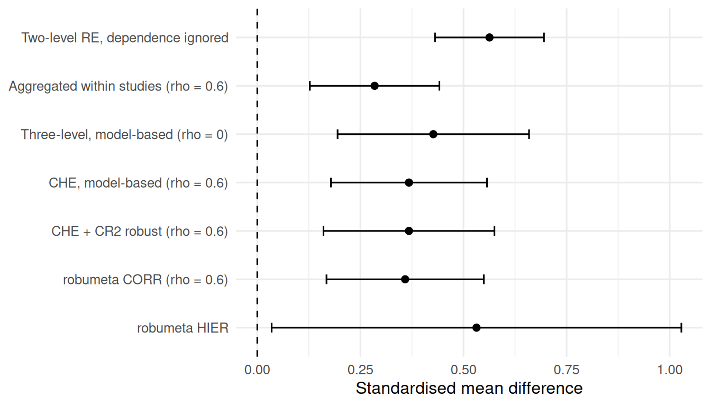

# Dependent Effect Sizes {#sec-dependent-effects}


The models of Chapter \@ref(sec-models) and Chapter \@ref(sec-heterogeneity) assume that each study contributes one effect size and that the sampling errors of different effect sizes are independent. Real literatures rarely cooperate. A single trial reports depression at the end of treatment and at six-month follow-up; an experiment compares two doses of a drug with the same placebo group; a survey reports correlations of job satisfaction with three performance measures; a paper reports four studies run by the same lab with the same materials. Treating every effect size as an independent observation inflates the effective sample size, gives too much weight to studies that report many outcomes, and produces standard errors and $p$-values that are too small. Throwing away all but one effect per study avoids the problem but wastes information and forces arbitrary choices.

This chapter develops the modern toolkit for dependent effects. We begin with the forms dependence takes and the quick fixes recommended for unit-of-analysis problems. We then fit three-level models that represent hierarchical dependence explicitly, multivariate models that use known or imputed sampling covariances, and the correlated-and-hierarchical-effects (CHE) working model combined with cluster-robust variance estimation (RVE), which is now the recommended default for most applied meta-analyses with dependent effects [@pustejovsky2021meta]. We close with the original RVE implementation in `robumeta` and a side-by-side comparison of all approaches on one data set.

## Types of dependence {#sec-dependent-types}

Let $y_{ij}$ denote the $i$th effect size from study (cluster) $j$, $j = 1, \dots, J$, with $k_j$ effects in study $j$ and $k = \sum_j k_j$ in total. It is useful to distinguish two sources of dependence [@hedges2010robust].

*Correlated effects* arise when several estimates share participants, so that their *sampling errors* are correlated. Typical cases are multiple outcomes measured on the same sample, the same outcome at several time points, and several treatment arms compared with one shared control group. If $y_{ij} = \theta_{ij} + \varepsilon_{ij}$, then $\mathrm{Cov}(\varepsilon_{ij}, \varepsilon_{i'j}) = \rho_{ii'j} \sqrt{v_{ij} v_{i'j}} \neq 0$. The correlation $\rho_{ii'j}$ depends on the correlation between the outcome measures (or time points) within persons, which primary studies almost never report.

*Hierarchical effects* arise when estimates come from *different* samples that are nested in a higher-level unit: several experiments in one paper, several schools in one district, several sites run by one lab. The sampling errors are independent, but the *true effects* $\theta_{ij}$ in the same cluster are more alike than true effects in different clusters, because they share investigators, materials, populations, or measurement practices.

Both forms often occur together. A study can report several outcomes (correlated) for several independent subsamples (hierarchical). The methods below differ mainly in which form of dependence they model explicitly, which they approximate, and how they protect inference against getting the approximation wrong. @lopezlopez2018dealing review the strategies used in practice and their trade-offs.

## Unit-of-analysis problems and quick fixes {#sec-dependent-unit}

Before reaching for multilevel models, it is worth knowing the simpler fixes, because they are often adequate when dependence is limited to a few studies, and because systematic-review guidance recommends them for specific designs [@higgins2019cochrane]. The underlying problem is always the same: the *unit of analysis* used in the meta-analysis (the effect size) does not correspond to an independent unit of information.

### Multi-arm trials with a shared control group {#sec-dependent-shared-control}

Consider a three-arm trial that compares a low dose and a high dose with a common control group. Entering both comparisons as if they were independent counts the control participants twice. For raw mean differences the size of the dependence is known exactly: $\mathrm{MD}_1 = \bar y_{L} - \bar y_C$ and $\mathrm{MD}_2 = \bar y_{H} - \bar y_C$ share the term $\bar y_C$, so
$$
\mathrm{Cov}(\mathrm{MD}_1, \mathrm{MD}_2) = \mathrm{Var}(\bar y_C) = s_C^2 / n_C .
$$
We simulate such a trial to compare the options.


``` r
set.seed(2026)
arms <- list(control = rnorm(40, 50, 10), low = rnorm(40, 45, 10), high = rnorm(40, 42, 10))
s <- data.frame(arm = names(arms), n = lengths(arms),
                m = sapply(arms, mean), sd = sapply(arms, sd))
s
#>             arm  n     m     sd
#> control control 40 49.59  9.991
#> low         low 40 43.70  9.052
#> high       high 40 40.60 11.542
```

There are three standard ways to handle the shared control [@higgins2019cochrane, ch. 23]. The first is to *split the shared group*: each comparison gets half the control participants (here 20) with the same mean and SD, so the two comparisons no longer double-count anyone, at the cost of some precision. The second, which the Cochrane Handbook recommends when the arms can sensibly be pooled, is to *combine the experimental groups* into one arm using
$$
n = n_1 + n_2, \qquad \bar y = \frac{n_1 \bar y_1 + n_2 \bar y_2}{n_1 + n_2}, \qquad
s^2 = \frac{(n_1 - 1)s_1^2 + (n_2 - 1)s_2^2 + \frac{n_1 n_2}{n_1 + n_2}(\bar y_1 - \bar y_2)^2}{n_1 + n_2 - 1},
$$
and to compute a single effect against the control. The third is to *keep both comparisons and model their covariance*.


``` r
combine_groups <- function(n1, m1, s1, n2, m2, s2) {
  n <- n1 + n2
  m <- (n1 * m1 + n2 * m2) / n
  sd <- sqrt(((n1 - 1) * s1^2 + (n2 - 1) * s2^2 + n1 * n2 / n * (m1 - m2)^2) / (n - 1))
  c(n = n, m = m, sd = sd)
}
ctl <- s[s$arm == "control", ]; low <- s[s$arm == "low", ]; high <- s[s$arm == "high", ]

# (1) naive: both comparisons, control counted twice
naive <- escalc("MD", m1i = c(low$m, high$m), sd1i = c(low$sd, high$sd), n1i = c(40, 40),
                m2i = rep(ctl$m, 2), sd2i = rep(ctl$sd, 2), n2i = c(40, 40))
# (2) split the control group
split <- escalc("MD", m1i = c(low$m, high$m), sd1i = c(low$sd, high$sd), n1i = c(40, 40),
                m2i = rep(ctl$m, 2), sd2i = rep(ctl$sd, 2), n2i = c(20, 20))
# (3) combine the two active arms
cg <- combine_groups(40, low$m, low$sd, 40, high$m, high$sd)
comb <- escalc("MD", m1i = cg["m"], sd1i = cg["sd"], n1i = cg["n"],
               m2i = ctl$m, sd2i = ctl$sd, n2i = 40)
# (4) keep both, with the exact covariance from the shared control
V <- diag(naive$vi)
V[1, 2] <- V[2, 1] <- ctl$sd^2 / 40
fix_rows <- rbind(
  naive    = unlist(rma(yi, vi, data = naive, method = "EE")[c("beta", "se")]),
  split    = unlist(rma(yi, vi, data = split, method = "EE")[c("beta", "se")]),
  combined = c(comb$yi, sqrt(comb$vi)),
  gls      = unlist(rma.mv(naive$yi, V)[c("beta", "se")]))
colnames(fix_rows) <- c("estimate", "se")
round(fix_rows, 3)
#>          estimate    se
#> naive      -7.243 1.598
#> split      -7.305 1.953
#> combined   -7.435 1.963
#> gls        -7.065 1.940
```


All approaches give a mean difference between -7.4 and -7.1 points (lower scores under treatment), but their standard errors differ. Treating the comparisons as independent gives 1.60, which is too small because the control group's information is used twice. The generalised least-squares average with the correct covariance has standard error 1.94, close to the combined-arm analysis (1.96); splitting the control group is slightly conservative (1.95). Splitting and combining are easy and transparent; modelling the covariance keeps the dose-specific comparisons, which matters if dose is itself a moderator. For standardised mean differences or log odds ratios the covariance is only approximately known, and `vcalc()` in `metafor` can compute it for multi-treatment studies via its `grp1` and `grp2` arguments.

### Multiple outcomes in the same sample: aggregation {#sec-dependent-aggregate}

When a study reports several outcomes for the same participants and the meta-analytic question concerns the construct rather than individual measures, the effects can be averaged within studies before analysis. If $\mathbf{y}_j$ holds the $k_j$ effects of study $j$ with covariance matrix $\mathbf{V}_j$, the optimal (GLS) composite and its variance are
$$
\bar y_j = (\mathbf{1}^\top \mathbf{V}_j^{-1}\mathbf{1})^{-1} \mathbf{1}^\top \mathbf{V}_j^{-1} \mathbf{y}_j, \qquad \mathrm{Var}(\bar y_j) = (\mathbf{1}^\top \mathbf{V}_j^{-1}\mathbf{1})^{-1}.
$$
Because $\mathbf V_j$ is unknown, a common choice is a constant correlation $\rho$ between sampling errors, $[\mathbf V_j]_{ii'} = \rho\sqrt{v_{ij}v_{i'j}}$. With $\rho = 1$ (and equal sampling variances) the composite has the same variance as a single outcome; with $\rho = 0$ it is treated as if it pooled independent samples, which overstates precision.

We use the data of @assink2016fitting in `dat.assink2016`: 100 standardised mean differences on the association between recidivism and mental health in delinquent juveniles, from 17 studies, with up to 22 effects per study.


``` r
da <- dat.assink2016
table(table(da$study))
#> 
#>  1  2  3  5  6 10 16 22 
#>  3  2  2  3  4  1  1  1
agg <- aggregate(da, cluster = study, rho = 0.6)
nrow(agg)
#> [1] 17
res_agg <- rma(yi, vi, data = agg)
res_agg
#> 
#> Random-Effects Model (k = 17; tau^2 estimator: REML)
#> 
#> tau^2 (estimated amount of total heterogeneity): 0.0839 (SE = 0.0377)
#> tau (square root of estimated tau^2 value):      0.2896
#> I^2 (total heterogeneity / total variability):   89.37%
#> H^2 (total variability / sampling variability):  9.41
#> 
#> Test for Heterogeneity:
#> Q(df = 16) = 90.5385, p-val < .0001
#> 
#> Model Results:
#> 
#> estimate      se    zval    pval   ci.lb   ci.ub      
#>   0.2845  0.0801  3.5500  0.0004  0.1274  0.4415  *** 
#> 
#> ---
#> Signif. codes:  0 '***' 0.001 '**' 0.01 '*' 0.05 '.' 0.1 ' ' 1
```

Aggregating to one composite per study with $\rho = 0.6$ gives an average effect of 0.284 (95% CI 0.127 to 0.442) across the 17 studies. Aggregation is simple and robust, but it discards within-study variation: outcome-level moderators can no longer be studied, and heterogeneity among outcomes within studies disappears from the model.

### Correlated correlation coefficients {#sec-dependent-rcalc}

For correlation matrices the sampling covariances can be computed from the reported correlations themselves. @olkin1990testing give the large-sample covariance between two correlations $r_{st}$ and $r_{uv}$ from the same sample, which covers the overlapping case (the two correlations share a variable, as $r_{12}$ and $r_{13}$) and the non-overlapping case (no shared variable, as $r_{12}$ and $r_{34}$). `rcalc()` implements these formulas. The data in `dat.craft2003` [@craft2003relationship] contain, for each study, the correlations among cognitive anxiety (`acog`), somatic anxiety (`asom`), self-confidence (`conf`), and sport performance (`perf`).


``` r
head(dat.craft2003, 6)
#>   study  ni sport    ri var1 var2
#> 1     1 142     I -0.55 acog perf
#> 2     1 142     I -0.48 asom perf
#> 3     1 142     I  0.66 conf perf
#> 4     1 142     I  0.47 acog asom
#> 5     1 142     I -0.38 acog conf
#> 6     1 142     I -0.46 asom conf
tmp <- rcalc(ri ~ var1 + var2 | study, ni = ni, data = dat.craft2003)
V_craft <- tmp$V
round(blsplit(V_craft, tmp$dat$study)[["1"]], 4)
#> 
#>           acog.perf asom.perf conf.perf acog.asom acog.conf asom.conf 
#> acog.perf    0.0035    0.0013   -0.0006   -0.0014    0.0025    0.0009 
#> asom.perf    0.0013    0.0042   -0.0010   -0.0019    0.0013    0.0025 
#> conf.perf   -0.0006   -0.0010    0.0023    0.0006   -0.0015   -0.0011 
#> acog.asom   -0.0014   -0.0019    0.0006    0.0043   -0.0018   -0.0012 
#> acog.conf    0.0025    0.0013   -0.0015   -0.0018    0.0052    0.0019 
#> asom.conf    0.0009    0.0025   -0.0011   -0.0012    0.0019    0.0044
```

The block for study 1 is the $6 \times 6$ covariance matrix of its six correlations. The correlation between cognitive anxiety and performance and the correlation between somatic anxiety and performance have a positive sampling covariance (0.0013): both share performance, and the two anxiety scales are themselves correlated. The matrix enters a multivariate model as `rma.mv(yi, V_craft, ...)`, and it is the input to meta-analytic structural equation modelling (Chapter \@ref(sec-masem)). By default the covariances refer to raw correlations; `rtoz = TRUE` switches to Fisher's $z$, and when the sample sizes differ across the correlations in a study the `nfun` argument sets how a common $n$ is chosen.

## The three-level model {#sec-dependent-three-level}

### Model and interpretation {#sec-dependent-three-level-model}

The three-level model represents hierarchical dependence directly [@konstantopoulos2011fixed; @cheung2014modeling; @vandennoortgate2012three]:
$$
y_{ij} = \mu + u_{(3)j} + u_{(2)ij} + \varepsilon_{ij}, \qquad u_{(3)j} \sim N(0, \sigma^2_{(3)}), \quad u_{(2)ij} \sim N(0, \sigma^2_{(2)}), \quad \varepsilon_{ij} \sim N(0, v_{ij}).
$$
Level 1 is sampling error, level 2 is variation among effects within clusters, and level 3 is variation between clusters. The total heterogeneity is $\sigma^2_{(2)} + \sigma^2_{(3)}$, and two effects in the same cluster have covariance $\sigma^2_{(3)}$, so the intra-cluster correlation of true effects is $\sigma^2_{(3)} / (\sigma^2_{(2)} + \sigma^2_{(3)})$. The model assumes that sampling errors are independent, which is exactly right for independent samples nested in clusters and an approximation when effects share participants. In `metafor` it is `rma.mv()` with `random = ~ 1 | cluster/effect`.

### Example: schools within districts {#sec-dependent-konstantopoulos}

@konstantopoulos2011fixed analysed 56 standardised mean differences of modified school calendars on achievement, from schools nested in 11 districts (`dat.konstantopoulos2011`). Schools are independent samples, so this is a purely hierarchical structure.


``` r
dk <- dat.konstantopoulos2011
m3 <- rma.mv(yi, vi, random = ~ 1 | district/school, data = dk)
m3
#> 
#> Multivariate Meta-Analysis Model (k = 56; method: REML)
#> 
#> Variance Components:
#> 
#>             estim    sqrt  nlvls  fixed           factor 
#> sigma^2.1  0.0651  0.2551     11     no         district 
#> sigma^2.2  0.0327  0.1809     56     no  district/school 
#> 
#> Test for Heterogeneity:
#> Q(df = 55) = 578.8640, p-val < .0001
#> 
#> Model Results:
#> 
#> estimate      se    zval    pval   ci.lb   ci.ub    
#>   0.1847  0.0846  2.1845  0.0289  0.0190  0.3504  * 
#> 
#> ---
#> Signif. codes:  0 '***' 0.001 '**' 0.01 '*' 0.05 '.' 0.1 ' ' 1
m2 <- rma(yi, vi, data = dk)
c(two_level = coef(m2), se = m2$se)
#> two_level.intrcpt                se 
#>           0.12793           0.04387
```

The three-level estimate of the average effect is 0.185 (SE 0.085), with between-district variance $\hat\sigma^2_{(3)} =$ 0.0651 and within-district variance $\hat\sigma^2_{(2)} =$ 0.0327. A two-level model that ignores the districts gives 0.128 with a standard error of only 0.044. Ignoring the clustering changes the point estimate, because districts with many schools receive too much weight, and underestimates the uncertainty by roughly half, because 56 schools from 11 districts carry much less independent information than 56 unrelated schools.

### Distribution of variance across levels {#sec-dependent-i2}

@cheung2014modeling extended $I^2$ to the three-level model by dividing each variance component by the total variance, using the "typical" sampling variance of @higgins2002quantifying for level 1:
$$
I^2_{(2)} = \frac{\hat\sigma^2_{(2)}}{\hat\sigma^2_{(2)} + \hat\sigma^2_{(3)} + \tilde v}, \qquad
I^2_{(3)} = \frac{\hat\sigma^2_{(3)}}{\hat\sigma^2_{(2)} + \hat\sigma^2_{(3)} + \tilde v}, \qquad
\tilde v = \frac{(k - 1)\sum_i w_i}{(\sum_i w_i)^2 - \sum_i w_i^2}, \quad w_i = 1/v_i .
$$


``` r
i2_levels <- function(fit) {
  w <- 1 / fit$vi
  k <- fit$k
  vtyp <- (k - 1) * sum(w) / (sum(w)^2 - sum(w^2))
  s2 <- fit$sigma2
  out <- 100 * c(s2, vtyp) / (sum(s2) + vtyp)
  names(out) <- c(paste0("level", length(s2) + 2 - seq_along(s2)), "level1 (sampling)")
  round(out, 1)
}
i2_levels(m3)
#>            level3            level2 level1 (sampling) 
#>              63.3              31.9               4.8
```

About 63% of the total variance lies between districts, 32% between schools within districts, and only 5% is attributable to sampling error. Decompositions like this help to decide where moderators should be sought: district-level characteristics (funding, calendar policy) are likely to matter more than school-level ones.

### Testing the variance components {#sec-dependent-lrt}

Is the third level needed? A likelihood-ratio test compares the full model with a model in which one variance component is fixed at zero, which `rma.mv()` allows through the `sigma2` argument:


``` r
m3_no3 <- rma.mv(yi, vi, random = ~ 1 | district/school, data = dk, sigma2 = c(0, NA))
m3_no2 <- rma.mv(yi, vi, random = ~ 1 | district/school, data = dk, sigma2 = c(NA, 0))
anova(m3, m3_no3)
#> 
#>         df     AIC     BIC    AICc   logLik     LRT   pval       QE 
#> Full     3 21.9174 27.9394 22.3880  -7.9587                578.8640 
#> Reduced  2 37.6910 41.7057 37.9218 -16.8455 17.7736 <.0001 578.8640
anova(m3, m3_no2)
#> 
#>         df     AIC     BIC    AICc   logLik     LRT   pval       QE 
#> Full     3 21.9174 27.9394 22.3880  -7.9587                578.8640 
#> Reduced  2 68.4330 72.4476 68.6637 -32.2165 48.5155 <.0001 578.8640
```


Removing the district level increases the deviance by 17.77 and removing the school level by 48.52; both components are clearly needed, and the AIC agrees. Because the null value of a variance lies on the boundary of the parameter space, the usual $\chi^2_1$ reference distribution is conservative; the correct asymptotic null distribution is a 50:50 mixture of $\chi^2_0$ and $\chi^2_1$, so the reported $p$-value can be halved. In practice, many analysts keep the three-level structure whenever it reflects the design, regardless of the test, because a variance component estimated near zero does little harm.

### Profile likelihood {#sec-dependent-profile}

Variance components of multilevel models can be poorly identified, especially with few clusters, and REML can converge to a boundary or a flat ridge. Profiling the restricted log-likelihood over each component, re-estimating the others at each point, checks that the estimates are at a proper peak (Figure \@ref(fig:dep-profile)).


``` r
par(mfrow = c(1, 2))
profile(m3, progbar = FALSE)
```

<div class="figure" style="text-align: center">

<p class="caption">(\#fig:dep-profile)Profile restricted log-likelihoods for the between-district ($\sigma^2_1$) and within-district ($\sigma^2_2$) variance components of the three-level model. The dotted lines mark the REML estimates; both profiles have a clear peak.</p>
</div>

Both profiles have a well-defined peak. A profile that is flat, or that peaks at zero, signals that the data cannot separate the levels, which is common with fewer than about ten clusters; `confint(m3)` then returns very wide profile-likelihood intervals.

## Multivariate models with imputed sampling covariances {#sec-dependent-multivariate}

The three-level model assumes independent sampling errors within clusters. In `dat.assink2016` this is false: within a study, many effects come from the *same* participants measured on different outcomes. The multivariate approach writes the full model
$$
\mathbf{y}_j = \mathbf{X}_j\boldsymbol\beta + \mathbf{u}_j + \boldsymbol\varepsilon_j, \qquad \boldsymbol\varepsilon_j \sim N(\mathbf 0, \mathbf V_j), \qquad \mathbf{u}_j \sim N(\mathbf 0, \boldsymbol\Sigma_j),
$$
with $\mathbf V_j$ the within-study sampling covariance matrix. When $\mathbf{V}_j$ is known (as for correlations via `rcalc()` or for shared control groups) it should be used. When it is not, it can be *imputed* from an assumed correlation, typically a constant $\rho$ among effects in the same study. `vcalc()` builds the block-diagonal matrix:


``` r
V6 <- vcalc(vi, cluster = study, obs = esid, data = da, rho = 0.6)
round(V6[1:4, 1:4], 4)
#> 
#>        1      2      3      4 
#> 1 0.0740 0.0326 0.0358 0.0252 
#> 2 0.0326 0.0398 0.0263 0.0185 
#> 3 0.0358 0.0263 0.0481 0.0203 
#> 4 0.0252 0.0185 0.0203 0.0239
```

The imputed covariance for the first two effects of study 1 is $0.6\sqrt{v_{11} v_{21}} =$ 0.0326. The value $\rho = 0.6$ is an assumption, not an estimate, and the analysis below examines how much it matters. `vcalc()` also supports more refined structures, for example different correlations for different outcome pairs or an autoregressive correlation for repeated time points.

## Correlated and hierarchical effects with robust variance estimation {#sec-dependent-che-rve}

### The CHE working model {#sec-dependent-che}

@pustejovsky2021meta proposed a strategy with two parts. First, fit a *working model* that approximates both forms of dependence: the imputed sampling covariance $\mathbf V_j$ with constant $\rho$ (correlated effects) plus random effects for studies and for effects within studies (hierarchical effects),
$$
y_{ij} = \mathbf{x}_{ij}^\top\boldsymbol\beta + u_{(3)j} + u_{(2)ij} + \varepsilon_{ij}, \qquad \mathrm{Cov}(\varepsilon_{ij}, \varepsilon_{i'j}) = \rho \sqrt{v_{ij} v_{i'j}} .
$$
This is the correlated-and-hierarchical-effects (CHE) model. Second, because $\rho$ is guessed and the random-effects structure is a simplification, base inference on *cluster-robust* standard errors that remain valid even if the working model is wrong. The working model affects efficiency (how the effects are weighted); the robust variance estimator protects validity.


``` r
che <- rma.mv(yi, V6, random = ~ 1 | study/esid, data = da, sparse = TRUE)
che
#> 
#> Multivariate Meta-Analysis Model (k = 100; method: REML)
#> 
#> Variance Components:
#> 
#>             estim    sqrt  nlvls  fixed      factor 
#> sigma^2.1  0.0807  0.2841     17     no       study 
#> sigma^2.2  0.1545  0.3931    100     no  study/esid 
#> 
#> Test for Heterogeneity:
#> Q(df = 99) = 745.4385, p-val < .0001
#> 
#> Model Results:
#> 
#> estimate      se    zval    pval   ci.lb   ci.ub      
#>   0.3678  0.0965  3.8097  0.0001  0.1786  0.5570  *** 
#> 
#> ---
#> Signif. codes:  0 '***' 0.001 '**' 0.01 '*' 0.05 '.' 0.1 ' ' 1
```

The CHE model gives an average effect of 0.368 (model-based SE 0.097), with $\hat\sigma^2_{(3)} =$ 0.081 between studies and $\hat\sigma^2_{(2)} =$ 0.155 within studies. Compare the three-level model that assumes $\rho = 0$:


``` r
a3 <- rma.mv(yi, vi, random = ~ 1 | study/esid, data = da)
c(estimate = coef(a3), se = a3$se, sigma2 = a3$sigma2)
#> estimate.intrcpt               se          sigma21          sigma22 
#>           0.4268           0.1184           0.1879           0.1120
```

With $\rho = 0$ the estimate is 0.427 and more of the variance is attributed to the study level (0.188). When sampling errors within a study are positively correlated but the model assumes independence, the shared sampling error masquerades as between-study variance.

### Cluster-robust variance estimation {#sec-dependent-rve}

Let $\mathbf{W}_j$ be the working-model weight matrix for study $j$ (the inverse of its marginal covariance under the working model), $\mathbf{M} = (\sum_j \mathbf{X}_j^\top \mathbf{W}_j \mathbf{X}_j)^{-1}$, and $\mathbf{e}_j = \mathbf{y}_j - \mathbf{X}_j\hat{\boldsymbol\beta}$. The cluster-robust (sandwich) variance estimator is
$$
\mathbf{V}^{R} = \mathbf{M}\left(\sum_{j=1}^J \mathbf{X}_j^\top \mathbf{W}_j \mathbf{A}_j \mathbf{e}_j \mathbf{e}_j^\top \mathbf{A}_j^\top \mathbf{W}_j \mathbf{X}_j\right)\mathbf{M} .
$$
With $\mathbf{A}_j = \mathbf{I}$ this is the original estimator of @hedges2010robust, which is consistent as the number of *studies* grows, whatever the true covariance structure. With few studies it is biased downward and tests based on it are too liberal. The CR2 correction chooses the adjustment matrices $\mathbf{A}_j$ so that $\mathbf{V}^R$ is exactly unbiased when the working model is correct, and pairs it with $t$ tests whose degrees of freedom come from a Satterthwaite approximation [@tipton2015small; @pustejovsky2017small]. For hypotheses involving several coefficients, @tipton2015smallsample developed an approximate Hotelling's $T^2$ test (HTZ) that keeps the Type I error rate close to nominal with few studies.

In `metafor`, `robust()` with `clubSandwich = TRUE` applies CR2 with Satterthwaite degrees of freedom; `clubSandwich::coef_test()` and `Wald_test()` provide the same and additional tests directly.


``` r
che_rve <- robust(che, cluster = study, clubSandwich = TRUE)
che_rve
#> 
#> Multivariate Meta-Analysis Model (k = 100; method: REML)
#> 
#> Variance Components:
#> 
#>             estim    sqrt  nlvls  fixed      factor 
#> sigma^2.1  0.0807  0.2841     17     no       study 
#> sigma^2.2  0.1545  0.3931    100     no  study/esid 
#> 
#> Test for Heterogeneity:
#> Q(df = 99) = 745.4385, p-val < .0001
#> 
#> Number of estimates:   100
#> Number of clusters:    17
#> Estimates per cluster: 1-22 (mean: 5.88, median: 5)
#> 
#> Model Results:
#> 
#> estimate      se¹    tval¹     df¹    pval¹   ci.lb¹   ci.ub¹     
#>   0.3678  0.0970   3.7924   14.53   0.0019   0.1605   0.5750   ** 
#> 
#> ---
#> Signif. codes:  0 '***' 0.001 '**' 0.01 '*' 0.05 '.' 0.1 ' ' 1
#> 
#> 1) results based on cluster-robust inference (var-cov estimator: CR2,
#>    approx t-test and confidence interval, df: Satterthwaite approx)
coef_test(che, vcov = "CR2", cluster = da$study)
#> Alternative hypothesis: two-sided 
#>    Coef. Estimate    SE Null value t-stat d.f. (Satt) p-val (Satt) Sig.
#>  intrcpt    0.368 0.097          0   3.79        14.5      0.00186   **
```

The robust standard error (0.0970) is almost the same as the model-based one (0.0965), which suggests that the working model is reasonable for this purpose. The Satterthwaite degrees of freedom are 14.5, far fewer than the 99 that the number of effect sizes might suggest: with RVE the effective sample size is driven by the number of studies, and by how evenly the information is spread across them.

### Sensitivity to the assumed correlation {#sec-dependent-rho}

Because $\rho$ is assumed, a sensitivity analysis across plausible values is part of every CHE analysis:


``` r
rho_grid <- c(0, 0.2, 0.4, 0.6, 0.8, 0.9)
sens <- t(sapply(rho_grid, function(r) {
  V <- vcalc(vi, cluster = study, obs = esid, data = da, rho = r)
  fit <- rma.mv(yi, V, random = ~ 1 | study/esid, data = da, sparse = TRUE)
  rob <- robust(fit, cluster = study, clubSandwich = TRUE)
  c(rho = r, estimate = coef(fit)[[1]], se_model = fit$se, se_robust = rob$se,
    sigma2_study = fit$sigma2[1], sigma2_esid = fit$sigma2[2])
}))
round(sens, 4)
#>      rho estimate se_model se_robust sigma2_study sigma2_esid
#> [1,] 0.0   0.4268   0.1184    0.1186       0.1879      0.1120
#> [2,] 0.2   0.4046   0.1094    0.1097       0.1434      0.1236
#> [3,] 0.4   0.3847   0.1021    0.1024       0.1080      0.1377
#> [4,] 0.6   0.3678   0.0965    0.0970       0.0807      0.1545
#> [5,] 0.8   0.3542   0.0928    0.0933       0.0600      0.1746
#> [6,] 0.9   0.3487   0.0915    0.0921       0.0515      0.1861
```


As $\rho$ increases from 0 to 0.9, the estimate decreases from 0.427 to 0.349, the robust standard error from 0.119 to 0.092, and variance shifts from the study level (0.188 to 0.052) to the effect level. The substantive conclusion, a moderate positive average effect, holds throughout. The estimate moves because $\rho$ changes the weights: with larger $\rho$ the many outcomes from one study are recognised as more redundant, so studies with many effects receive relatively less weight. The robust standard errors remain valid for every $\rho$; what changes is efficiency and the interpretation of the variance components.

### Meta-regression with robust variance estimation {#sec-dependent-rve-metareg}

Moderators are added to the working model as usual, and tested with CR2 $t$ tests for single coefficients and HTZ Wald tests for several. The publication year (approximately mean-centred in these data) is a study-level moderator (except in study 3, which combines two publications of the same data):


``` r
che_year <- rma.mv(yi, V6, mods = ~ year, random = ~ 1 | study/esid,
                   data = da, sparse = TRUE)
coef_test(che_year, vcov = "CR2")
#> Alternative hypothesis: two-sided 
#>    Coef. Estimate     SE Null value t-stat d.f. (Satt) p-val (Satt) Sig.
#>  intrcpt   0.3835 0.0953          0   4.02       13.16      0.00141   **
#>     year  -0.0388 0.0228          0  -1.70        7.66      0.12916
```


The year slope is -0.0388 (robust SE 0.0228, $t$ = -1.70 on 7.7 degrees of freedom, $p$ = .129). Even though there are 100 effect sizes, only 17 studies inform a study-level moderator and the degrees of freedom are fewer still, because the studies differ greatly in their number of effects and in their weights.

### Few clusters and small-sample corrections {#sec-dependent-few-clusters}

The type of delinquent behaviour (`deltype`: general, overt, covert) varies *within* studies, so it is an effect-level moderator. Looking at how it is distributed across studies is instructive:


``` r
tapply(da$study, da$deltype, function(x) length(unique(x)))
#>  covert general   overt 
#>       1      17       3
che_type <- rma.mv(yi, V6, mods = ~ deltype, random = ~ 1 | study/esid,
                   data = da, sparse = TRUE)
coef_test(che_type, vcov = "CR2")
#> Alternative hypothesis: two-sided 
#>           Coef. Estimate     SE Null value t-stat d.f. (Satt) p-val (Satt) Sig.
#>         intrcpt   -0.290 0.0823          0  -3.52        4.20      0.02249    *
#>  deltypegeneral    0.706 0.0418          0  16.89        2.32      0.00177   **
#>    deltypeovert    0.450 0.0665          0   6.77        2.10      0.01860    *
Wald_test(che_type, constraints = constrain_zero(2:3), vcov = "CR2", test = "HTZ")
#>  test Fstat df_num df_denom p_val sig
#>   HTZ  66.6      2    0.878  0.11
```


Covert delinquency appears in a single study and overt delinquency in three. The model-based Wald test from the CHE working model, which trusts the assumed covariance structure, finds a clear difference among the three types ($Q_M(2) =$ 13.72, $p$ = .001). The robust analysis tells a different story about the information in the data. The CR2 $t$ statistics for the two contrasts are large (16.9 and 6.8), but their Satterthwaite degrees of freedom are only 2.3 and 2.1, and the HTZ test of both contrasts together has 0.88 denominator degrees of freedom, so that an $F$ statistic of 66.6 yields $p$ = .110. @tipton2015small found that RVE tests with degrees of freedom below about 4 do not control the Type I error rate even after the small-sample correction, and recommended not trusting them. None of these tests is trustworthy, and that is the substantive finding: the covert-versus-general contrast is estimated from within a single study, so there is essentially no between-study replication of it, however many effect sizes there are. The tiny degrees of freedom are the diagnostic that reveals this; the model-based test hides it.

The practical rules that follow are simple. Always use the small-sample-corrected tests (CR2 with Satterthwaite $t$, HTZ for multiple contrasts) rather than the original large-sample RVE tests. Report the degrees of freedom. When they fall below 4, do not interpret the robust $p$-value; report the result as inconclusive, rely on the model-based results with explicit caveats about the working model, or refrain from testing the moderator.

### Cluster wild bootstrap tests {#sec-dependent-cwb}

The CR2 corrections fix the bias of the sandwich estimator, but the HTZ test still relies on an approximate reference distribution, and it can be overly conservative, particularly for hypotheses with several contrasts [@joshi2022cluster]. @joshi2022cluster brought the *cluster wild bootstrap* (CWB) from econometrics into meta-analysis as an alternative that does not need degrees of freedom at all. For a null hypothesis $H_0: \mathbf C\boldsymbol\beta = \mathbf 0$ the algorithm is:

1. Fit the *null* model, which imposes $H_0$, and keep its fitted values $\tilde{\mathbf y}_j$ and residuals $\tilde{\mathbf e}_j$ for each cluster $j$.
2. Draw one auxiliary weight $\eta_j$ per cluster, $+1$ or $-1$ with equal probability (Rademacher weights), and form new outcomes $\mathbf y_j^* = \tilde{\mathbf y}_j + \eta_j \tilde{\mathbf e}_j$. Every residual in a cluster gets the same sign, so the within-cluster dependence is carried into the bootstrap data whatever its form.
3. Refit the *full* model to $\mathbf y^*$ and compute the robust Wald statistic $F^*$ for $H_0$.
4. Repeat steps 2 and 3 $R$ times. The $p$-value is the proportion of bootstrap statistics $F^*$ at least as large as the statistic $F$ from the original data.

Because the bootstrap data are generated under $H_0$, the comparison of $F$ with the $F^*$ calibrates the test directly. Optionally the null residuals can first be multiplied by the CR2 adjustment matrices (`adjust = "CR2"`, the "CWB adjusted" variant). In two simulation studies, @joshi2022cluster found that CWB kept the Type I error rate adequate with a small number of studies and had more power than the small-sample-corrected HTZ test, especially for multiple-contrast hypotheses, and recommended it for meta-analyses with few studies.

`Wald_test_cwb()` in the `wildmeta` package implements the test for `robumeta` and `metafor` models. Each bootstrap replicate refits the model, which is fast for `robu()` fits and slow for large `rma.mv()` fits, so we use the correlated-effects weights of `robumeta` (Section \@ref(sec-dependent-robumeta)) as the working model. As an example, we test jointly whether publication year and the indicator for general delinquency (versus overt or covert delinquency) moderate the effects in the delinquency data:


``` r
da$general <- as.numeric(da$deltype == "general")
rb_mods <- robu(yi ~ year + general, data = da, studynum = study, var.eff.size = vi,
                modelweights = "CORR", rho = 0.6, small = TRUE)
htz_mods <- Wald_test(rb_mods, constraints = constrain_zero(2:3), vcov = "CR2", test = "HTZ")
htz_mods
#>  test Fstat df_num df_denom p_val sig
#>   HTZ 0.729      2     3.26 0.547
cwb_mods <- Wald_test_cwb(rb_mods, constraints = constrain_zero(2:3), R = 999, seed = 2026)
cwb_mods
#>   Test Adjustment CR_type Statistic   R  p_val
#> 1  CWB        CR0     CR0   Naive-F 999 0.4935
```

The HTZ test gives $F =$ 0.73 with only 3.26 denominator degrees of freedom, below the threshold of 4 at which the approximation is no longer trusted, and $p$ = .547. The cluster wild bootstrap, which does not depend on that approximation, gives $p$ = .493 from 999 replicates. The two tests agree that there is no evidence for either moderator, but only the bootstrap $p$-value comes without a warning attached. With 17 studies, and only 3 of them reporting any outcome other than general delinquency, the bootstrap is still limited by the same scarcity of information as every other method: it calibrates the test, it does not create replication. Use a few thousand replicates in a final analysis (the Monte Carlo error of a bootstrap $p$-value near .05 with $R = 999$ is about .007), and report the test variant and the number of replicates.

### Within-study and between-study moderator effects {#sec-dependent-within-between}

An effect-level moderator such as delinquency type carries two kinds of information. *Between* studies, it compares studies that measured mostly general delinquency with studies that measured other types; *within* studies, it compares outcomes of different types measured on the same participants. The within-study contrast is protected from study-level confounding, because everything about the study (population, design, country, decade) is held constant; the between-study contrast is not. A single coefficient for the moderator mixes the two, and if they differ the mixture is hard to interpret. The remedy, familiar from multilevel modelling, is to split the moderator into its study mean $\bar x_j$ and the deviation $x_{ij} - \bar x_j$ and enter both:


``` r
da$general   <- as.numeric(da$deltype == "general")
da$general_b <- ave(da$general, da$study)
da$general_w <- da$general - da$general_b
che_wb <- rma.mv(yi, V6, mods = ~ general_b + general_w, random = ~ 1 | study/esid,
                 data = da, sparse = TRUE)
coef_test(che_wb, vcov = "CR2")
#> Alternative hypothesis: two-sided 
#>      Coef. Estimate    SE Null value t-stat d.f. (Satt) p-val (Satt) Sig.
#>    intrcpt    0.247 0.241          0  1.024        1.27        0.462     
#>  general_b    0.134 0.256          0  0.526        1.76        0.658     
#>  general_w    0.428 0.146          0  2.933        1.48        0.140
```


The within-study contrast between general and other delinquency is 0.428 and the between-study contrast 0.134, but both are estimated with Satterthwaite degrees of freedom below 2 (1.48 and 1.76). Only 3 studies contain any variation in the indicator, so the within-study contrast rests on those studies alone, and the between-study contrast rests on the few studies whose share of general-delinquency outcomes differs from 1. The decomposition does not create information; it shows where the information is, and here it confirms that the data cannot say much about delinquency type.

### A family of working models: CE, CHE, and SCE {#sec-dependent-working-models}

CHE is one member of a larger family of working models that @pustejovsky2021meta describe, all of which are fitted with `rma.mv()` and combined with robust inference in the same way. Writing $u_j$ for a study-level random effect, $v_{ij}$ for an effect-level random effect, and $e_{ij}$ for the sampling error, the main members are as follows. The *correlated effects* (CE) model, $y_{ij} = \mathbf x_{ij}^\top\boldsymbol\beta + u_j + e_{ij}$ with $\mathrm{Cov}(e_{hj}, e_{ij}) = \rho\sqrt{v_{hj}v_{ij}}$, has correlated sampling errors but no within-study heterogeneity. The *hierarchical effects* (HE) model, $y_{ij} = \mathbf x_{ij}^\top\boldsymbol\beta + u_j + v_{ij} + e_{ij}$ with independent sampling errors, is the three-level model of Section \@ref(sec-dependent-three-level). CHE combines the two. The *subgroup correlated effects* (SCE) model is designed for effect sizes that fall into $C$ categories, such as outcome domains. With indicators $d_{ij}^c$ for category $c$,
$$
y_{ij} = \sum_{c=1}^C d_{ij}^c\left(\mathbf x_{ij}^\top\boldsymbol\beta_c + u_{cj}\right) + e_{ij}, \qquad \mathrm{Var}(u_{cj}) = \tau_c^2, \qquad \mathrm{Cov}(u_{cj}, u_{c'j}) = 0,
$$
and the sampling errors of two effects in the same study are correlated (with $\rho$) only if they belong to the same category. Each category thus gets its own coefficients and its own between-study variance, and the estimates are identical to those of separate meta-analyses within each category. The advantage over separate analyses is that everything is one model, so robust tests and confidence intervals for *differences* between categories are available, even though the categories share studies.

First, CE and CHE for the delinquency data. The two models have the same fixed effects and differ only in the within-study variance component, so their fit can be compared by a likelihood-ratio test:


``` r
ce <- rma.mv(yi, V6, random = ~ 1 | study, data = da, sparse = TRUE)
ce_rve <- robust(ce, cluster = study, clubSandwich = TRUE)
rbind(CE  = c(estimate = coef(ce)[[1]],  se_robust = ce_rve$se),
      CHE = c(estimate = coef(che)[[1]], se_robust = che_rve$se))
#>     estimate se_robust
#> CE    0.2845   0.07967
#> CHE   0.3678   0.09697
anova(che, ce)
#> 
#>         df      AIC      BIC     AICc    logLik      LRT   pval       QE 
#> Full     3 151.5334 159.3188 151.7861  -72.7667                 745.4385 
#> Reduced  2 528.5630 533.7532 528.6880 -262.2815 379.0295 <.0001 745.4385
```


The CE working model gives 0.284 and CHE 0.368. Both robust standard errors are valid, but the models weight the studies differently: without within-study heterogeneity, CE treats the many outcomes of a study as nearly redundant once the sampling correlation is accounted for, so a study's weight grows little with its number of effects. The likelihood-ratio statistic of 379.0 shows that the within-study variance component is far from zero, so CE describes these data poorly. @pustejovsky2021meta stress that the working model should be chosen from the structure of the data (do samples contribute several effects, is there reason to expect heterogeneity within studies, are effects classified into distinct categories?) and ideally pre-registered, *not* by trying several working models and keeping the one with the preferred result.

For SCE we need data whose effects fall into categories that occur in many studies. The 68 studies in `dat.crede2010` report correlations between class attendance and either the grade in the class or the overall grade point average (GPA) of college students; some studies include several samples and some samples report both criteria. Following @pustejovsky2021meta, we build a sampling covariance matrix that correlates effects within a sample only when they have the same criterion (the `subgroup` argument of `vcalc()`), and give each criterion its own between-study variance with `struct = "DIAG"`:


``` r
dc <- escalc(measure = "ZCOR", ri = ri, ni = ni, data = dat.crede2010)
dc$sample <- paste(dc$studyid, dc$sampleid, sep = ".")
dc$esid <- seq_len(nrow(dc))
V_sce <- vcalc(vi, cluster = sample, subgroup = criterion, obs = esid,
               data = dc, rho = 0.6)
sce <- rma.mv(yi, V_sce, mods = ~ 0 + criterion, random = ~ criterion | studyid,
              struct = "DIAG", data = dc, sparse = TRUE)
sce_sep <- sapply(c(gpa = "gpa", grade = "grade"), function(cr) {
  fit <- rma.mv(yi, V_sce, random = ~ 1 | studyid, data = dc, subset = criterion == cr)
  c(estimate = coef(fit)[[1]], tau2 = fit$sigma2)
})
rbind(SCE = c(coef(sce), sce$tau2), separate = c(sce_sep[1, ], sce_sep[2, ]))
#>          criteriongpa criteriongrade               
#> SCE            0.3597         0.4865 0.06414 0.0528
#> separate       0.3597         0.4865 0.06414 0.0528
conf_int(sce, vcov = "CR2", cluster = dc$studyid)
#>           Coef. Estimate     SE d.f. Lower 95% CI Upper 95% CI
#>    criteriongpa    0.360 0.0543 22.9        0.247        0.472
#>  criteriongrade    0.487 0.0332 52.4        0.420        0.553
sce_diff <- Wald_test(sce, constraints = constrain_equal(1:2), vcov = "CR2",
                      cluster = dc$studyid, test = "HTZ")
sce_diff
#>  test Fstat df_num df_denom  p_val sig
#>   HTZ  4.05      1     35.9 0.0517   .
```

No sample in these data reports two correlations with the same criterion, so `V_sce` is diagonal: the dependence between the grade and GPA correlations of the same sample is not modelled at all and is left to the robust variance estimator, which is exactly the division of labour that RVE is designed for. The first table confirms that the SCE estimates of the average Fisher-$z$ correlation and of $\tau^2_c$ for each criterion are those of two separate analyses. The average correlation with the class grade is 0.45 and with GPA 0.34, with similar heterogeneity in both ($\hat\tau^2 =$ 0.053 and 0.064 on the $z$ scale). The robust HTZ test of equality, which accounts for the studies that contribute to both criteria, gives $F =$ 4.05 on 1 and 35.9 degrees of freedom, $p$ = .052. The point estimates suggest that attendance is more strongly related to performance in the class itself than to overall GPA, but the evidence for a difference is modest. A CHE model with a criterion moderator would instead assume one common between-study variance and correlated errors across criteria; with RVE either working model gives valid inference, and SCE is the natural choice when the analysis plan calls for separate results per category.

The same framework accommodates further refinements [@pustejovsky2021meta]: an additional level of random effects for samples or labs nested in studies (marked with a "+", as in CHE+), an autoregressive sampling correlation for outcomes measured repeatedly over time (`vcalc()` with `time1` and `phi`), and partially known correlations that use reported values where available and an assumed value elsewhere.

## RVE with `robumeta` {#sec-dependent-robumeta}

The `robumeta` package implements the original RVE approach of @hedges2010robust with the small-sample corrections of @tipton2015small. Instead of fitting a full working model, it uses simple approximately efficient weights for one of two working models. For *correlated effects* (`modelweights = "CORR"`) each effect in study $j$ receives weight $w_{ij} = 1/\{k_j(\bar v_j + \hat\tau^2)\}$, where $\bar v_j$ is the mean sampling variance in study $j$, so each study contributes roughly the weight of one effect. For *hierarchical effects* (`modelweights = "HIER"`) the weights are $w_{ij} = 1/(v_{ij} + \hat\tau^2 + \hat\omega^2)$, with $\hat\tau^2$ and $\hat\omega^2$ method-of-moments estimates of between- and within-cluster variance. Inference uses the robust variance estimator in both cases.


``` r
rb_corr <- robu(yi ~ 1, data = da, studynum = study, var.eff.size = vi,
                modelweights = "CORR", rho = 0.6, small = TRUE)
rb_corr
#> RVE: Correlated Effects Model with Small-Sample Corrections 
#> 
#> Model: yi ~ 1 
#> 
#> Number of studies = 17 
#> Number of outcomes = 100 (min = 1 , mean = 5.88 , median = 5 , max = 22 )
#> Rho = 0.6 
#> I.sq = 77.44 
#> Tau.sq = 0.08606 
#> 
#>                Estimate StdErr t-value  dfs P(|t|>) 95% CI.L 95% CI.U Sig
#> 1 X.Intercept.    0.359 0.0892    4.02 14.4  0.0012    0.168    0.549 ***
#> ---
#> Signif. codes: < .01 *** < .05 ** < .10 *
#> ---
#> Note: If df < 4, do not trust the results
rb_hier <- robu(yi ~ 1, data = da, studynum = study, var.eff.size = vi,
                modelweights = "HIER", small = TRUE)
rb_hier
#> RVE: Hierarchical Effects Model with Small-Sample Corrections 
#> 
#> Model: yi ~ 1 
#> 
#> Number of clusters = 17 
#> Number of outcomes = 100 (min = 1 , mean = 5.88 , median = 5 , max = 22 )
#> Omega.sq = 0 
#> Tau.sq = 0.1828 
#> 
#>                Estimate StdErr t-value  dfs P(|t|>) 95% CI.L 95% CI.U Sig
#> 1 X.Intercept.    0.532  0.218    2.43 8.68  0.0387   0.0348     1.03  **
#> ---
#> Signif. codes: < .01 *** < .05 ** < .10 *
#> ---
#> Note: If df < 4, do not trust the results
sensitivity(rb_corr)
#> RVE: Correlated Effects Model with Small-Sample Corrections 
#> Model: yi ~ 1 
#> 
#> Sensitivity Analysis 
#> 
#>                           Rho = 0 Rho = 0.2 Rho = 0.4 Rho = 0.6 Rho = 0.8
#>  X.Intercept. Coefficient 0.3583  0.3583    0.3584    0.3585    0.3586   
#>               Std. Error  0.0890  0.0891    0.0891    0.0892    0.0892   
#>  Tau.sq       Estimate    0.0855  0.0857    0.0859    0.0861    0.0863   
#>  Rho = 1
#>  0.3587 
#>  0.0892 
#>  0.0865
```

The correlated-effects weights give 0.359 (SE 0.089), close to the CHE results. In the CORR model $\rho$ enters only through the estimate of $\tau^2$, so the `sensitivity()` output shows that the estimate barely moves with $\rho$. The hierarchical-effects weights treat the effects within a study as independent samples, which they are not here; the moment estimator puts the within-study variance $\hat\omega^2$ at zero, the weights then favour the many-effect studies, and the estimate jumps to 0.532 with a standard error more than twice as large.

The CHE model can be seen as a generalisation of both: it models correlated sampling errors (as the CORR working model assumes) *and* hierarchical random effects (as the HIER model assumes) at the same time, estimates the variance components by REML, and accommodates effect-level moderators with weights that reflect within-study variation. @pustejovsky2021meta argue that the CHE working model describes the dependence structures typical of meta-analytic data better than either original working model, so that it can yield more precise estimates, and recommend CHE with CR2 inference as a default; `robumeta` remains useful for checking results and when its simpler weighting is preferred.

## Comparing the approaches {#sec-dependent-comparison}

Table \@ref(tab:dep-compare) collects the estimates of the average effect in `dat.assink2016` from every approach in this chapter.


``` r
naive2 <- rma(yi, vi, data = da)
row_rma <- function(fit, label) data.frame(approach = label, estimate = coef(fit)[[1]],
  se = fit$se, ci.lb = fit$ci.lb, ci.ub = fit$ci.ub)
row_robu <- function(fit, label) with(fit$reg_table, data.frame(approach = label,
  estimate = b.r, se = SE, ci.lb = CI.L, ci.ub = CI.U))
comp <- rbind(
  row_rma(naive2,  "Two-level RE, dependence ignored"),
  row_rma(res_agg, "Aggregated within studies (rho = 0.6)"),
  row_rma(a3,      "Three-level, model-based (rho = 0)"),
  row_rma(che,     "CHE, model-based (rho = 0.6)"),
  row_rma(che_rve, "CHE + CR2 robust (rho = 0.6)"),
  row_robu(rb_corr, "robumeta CORR (rho = 0.6)"),
  row_robu(rb_hier, "robumeta HIER"))
knitr::kable(comp, digits = 3, row.names = FALSE,
             caption = "Average effect in the Assink and Wibbelink data under different treatments of dependence.")
```


Table: (\#tab:dep-compare)Average effect in the Assink and Wibbelink data under different treatments of dependence.

|approach                              | estimate|    se| ci.lb| ci.ub|
|:-------------------------------------|--------:|-----:|-----:|-----:|
|Two-level RE, dependence ignored      |    0.563| 0.067| 0.431| 0.695|
|Aggregated within studies (rho = 0.6) |    0.284| 0.080| 0.127| 0.442|
|Three-level, model-based (rho = 0)    |    0.427| 0.118| 0.195| 0.659|
|CHE, model-based (rho = 0.6)          |    0.368| 0.097| 0.179| 0.557|
|CHE + CR2 robust (rho = 0.6)          |    0.368| 0.097| 0.160| 0.575|
|robumeta CORR (rho = 0.6)             |    0.359| 0.089| 0.168| 0.549|
|robumeta HIER                         |    0.532| 0.218| 0.035| 1.028|


The naive two-level model, which treats 100 effects as independent, gives 0.563 with the smallest standard error in the table (0.067), a precision that the data do not support. The models that account for dependence give estimates between about 0.28 and 0.43 with standard errors around 0.08 to 0.12, except for the hierarchical-effects weights, whose working model fits these data poorly. Differences among the defensible approaches are mostly differences in weighting, and the robust standard errors make the inference honest about the 17 independent studies behind the 100 effects. Figure \@ref(fig:dep-compare-plot) shows the same results graphically.


``` r
comp$approach <- factor(comp$approach, levels = rev(comp$approach))
ggplot(comp, aes(x = estimate, y = approach)) +
  geom_vline(xintercept = 0, linetype = 2) +
  geom_errorbar(aes(xmin = ci.lb, xmax = ci.ub), width = 0.2, orientation = "y") +
  geom_point(size = 2) +
  labs(x = "Standardised mean difference", y = NULL)
```

<div class="figure" style="text-align: center">

<p class="caption">(\#fig:dep-compare-plot)Average effect and 95% confidence interval in the Assink and Wibbelink data under seven treatments of dependence.</p>
</div>

### Choosing an approach {#sec-dependent-choosing}

Table \@ref(tab:dep-choose) summarises when each approach is a reasonable choice. The rows are not mutually exclusive; in many reviews a CHE model with robust inference is the primary analysis and one or two of the others serve as sensitivity analyses.


Table: (\#tab:dep-choose)Matching the treatment of dependence to the data structure.

|Situation                                                      |Approach                                                           |
|:--------------------------------------------------------------|:------------------------------------------------------------------|
|Multi-arm trial, shared control, few such trials               |Combine arms or split the control; or model the exact covariance   |
|Several outcomes per sample, question about the construct only |Aggregate within studies with an assumed correlation               |
|Correlation matrices from primary studies                      |Multivariate model with rcalc() covariances (see MASEM chapter)    |
|Independent samples nested in papers, labs, or sites           |Three-level model; check variance components with LRT and profiles |
|Several outcomes and/or samples per study, covariances unknown |CHE working model plus CR2 robust inference; sensitivity over rho  |
|Few studies (roughly fewer than 20) or unbalanced clusters     |CR2 with Satterthwaite or HTZ tests; flag df below 4               |


## Practical recommendations {#sec-dependent-recommendations}

Map the dependence structure before choosing a model: which effects share participants, which share a higher-level unit, and how many independent clusters there are. Use the design-specific fixes (splitting or combining arms, exact covariances for shared controls, `rcalc()` for correlation matrices) when the dependence is known and limited. For the common case of several outcomes and samples per study, fit a CHE working model with an imputed sampling correlation (0.6 to 0.8 is a typical range for related outcome measures, but use any information the literature provides), base inference on CR2 robust standard errors with Satterthwaite degrees of freedom, test multiple contrasts with HTZ, and report a sensitivity analysis over $\rho$ [@pustejovsky2021meta]. Report variance components and their distribution across levels [@cheung2014modeling], because they show where heterogeneity lives. Check the degrees of freedom of every robust test and treat values below 4 as a warning [@tipton2015small]; with few studies, and for multiple-contrast hypotheses in particular, confirm the result with a cluster wild bootstrap test [@joshi2022cluster]. Choose the working model (CE, CHE, SCE, or a refinement) from the structure of the data before seeing the results [@pustejovsky2021meta]. When a moderator varies only within a handful of studies, say so explicitly. Funnel-plot regressions and selection models also have to respect the dependence, for example by fitting Egger-type regressions within the multilevel or CHE working model with cluster-robust inference or by aggregating to one effect per study; Chapter \@ref(sec-publication-bias) treats small-study effects and publication bias.

## Common pitfalls {#sec-dependent-pitfalls}

The most common error is still to ignore dependence and analyse all effect sizes as independent, which overweights studies that report many outcomes and gives standard errors that are too small. A second is to select one effect per study by an undocumented or outcome-dependent rule, which invites selective reporting by the meta-analyst. A third is to fit a three-level model to effects that share participants and to interpret the resulting study-level variance as true heterogeneity, when part of it is shared sampling error. A fourth is to treat the large number of effect sizes as the sample size: with RVE the information comes from the clusters, and with 10 to 20 clusters the large-sample sandwich estimator is too liberal unless the small-sample corrections are used. A fifth is to read robust tests with tiny degrees of freedom as if they were informative. Finally, analysts sometimes impute $\rho$ and present the result as if the correlation had been estimated; the assumed value and its sensitivity analysis belong in the report.

## Key takeaways {#sec-dependent-takeaways}

- Dependence arises from shared participants (correlated sampling errors) and from shared higher-level units (hierarchically related true effects); most literatures have both.
- Unit-of-analysis problems in multi-arm trials and multi-outcome studies have simple fixes: split or combine groups, aggregate within studies, or compute exact covariances (`rcalc()` for correlations).
- Three-level models represent hierarchical dependence; variance decomposition, likelihood-ratio tests, and profile likelihoods describe and check the variance components.
- The CHE working model with an imputed sampling correlation, combined with CR2 cluster-robust inference and Satterthwaite or HTZ degrees of freedom, is the recommended default for most dependent-effects meta-analyses; a sensitivity analysis over the assumed correlation is part of it.
- The effective sample size for RVE is the number of independent clusters; robust tests with fewer than about 4 degrees of freedom are not trustworthy, and the cluster wild bootstrap offers a better-calibrated test when studies are few.
- CE, CHE, and SCE are working models for different data structures; SCE reproduces separate subgroup analyses while allowing robust comparisons between categories.

## Further reading {#sec-dependent-reading}

@lopezlopez2018dealing survey strategies for effect-size multiplicity. @vandennoortgate2012three, @konstantopoulos2011fixed, and @cheung2014modeling develop the three-level model, and @assink2016fitting give a step-by-step tutorial in `metafor`. @hedges2010robust introduced robust variance estimation for meta-regression; @tipton2015small and @tipton2015smallsample developed the small-sample corrections for single coefficients and multiple-contrast tests, and @pustejovsky2017small the CR2 methods underlying `clubSandwich`. @pustejovsky2021meta expand the range of working models (CE, CHE, SCE, and their refinements) and make the case for CHE, and @joshi2022cluster introduce cluster wild bootstrap tests for meta-analysis with few studies. @olkin1990testing derive the covariances of correlated correlations, and the Cochrane Handbook [@higgins2019cochrane] covers unit-of-analysis issues in multi-arm and other non-standard trial designs.
