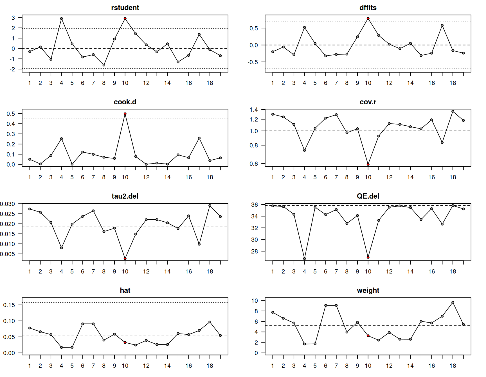
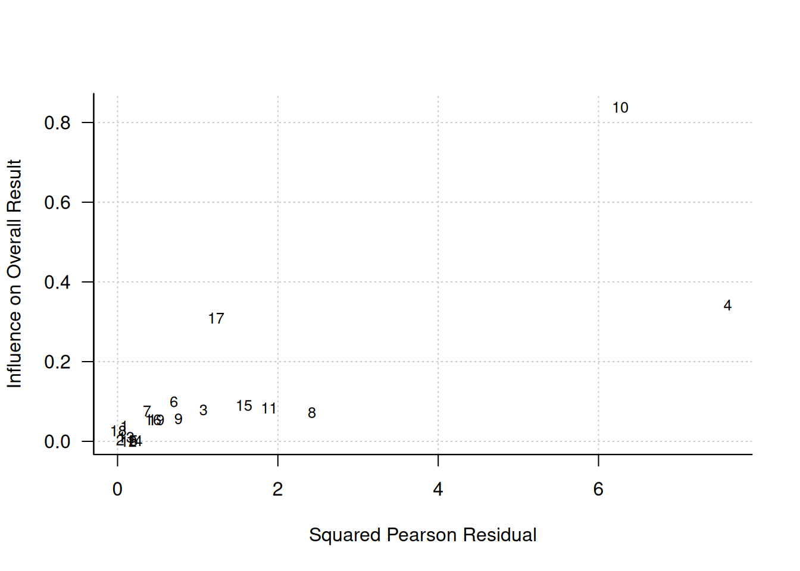
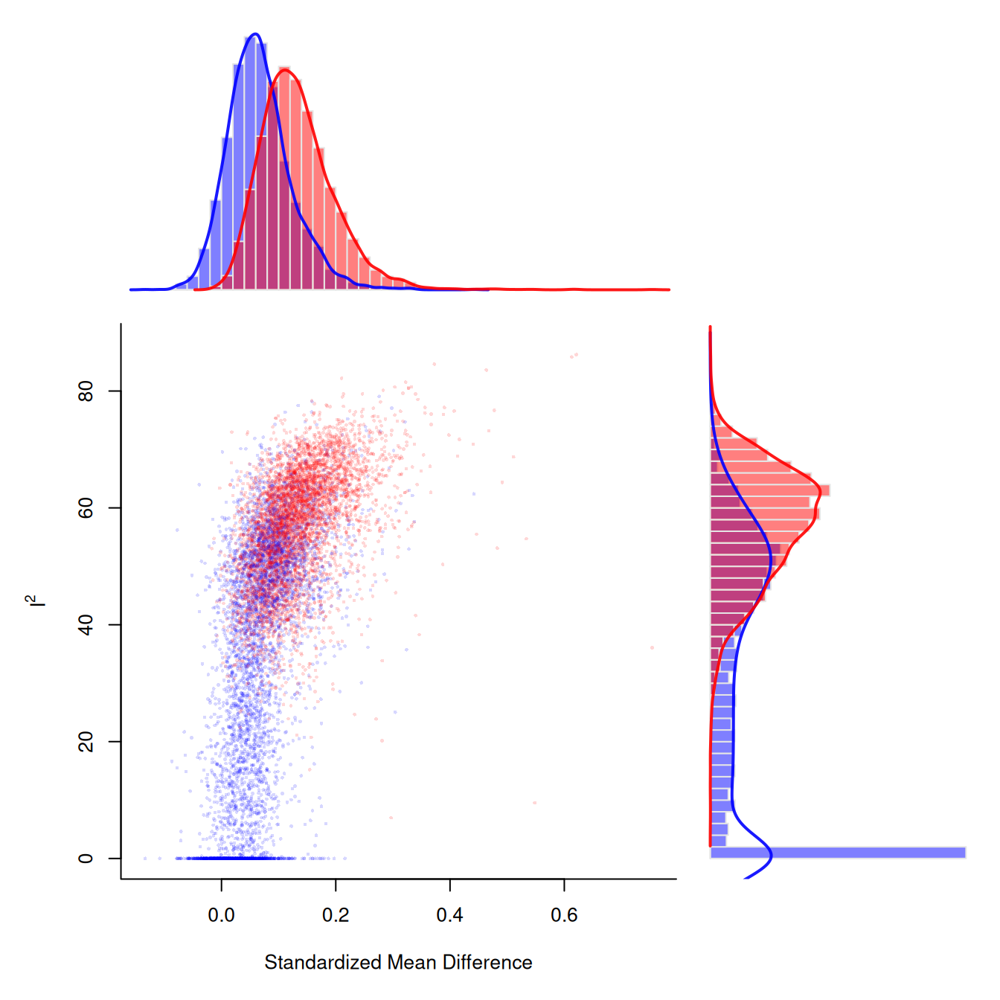
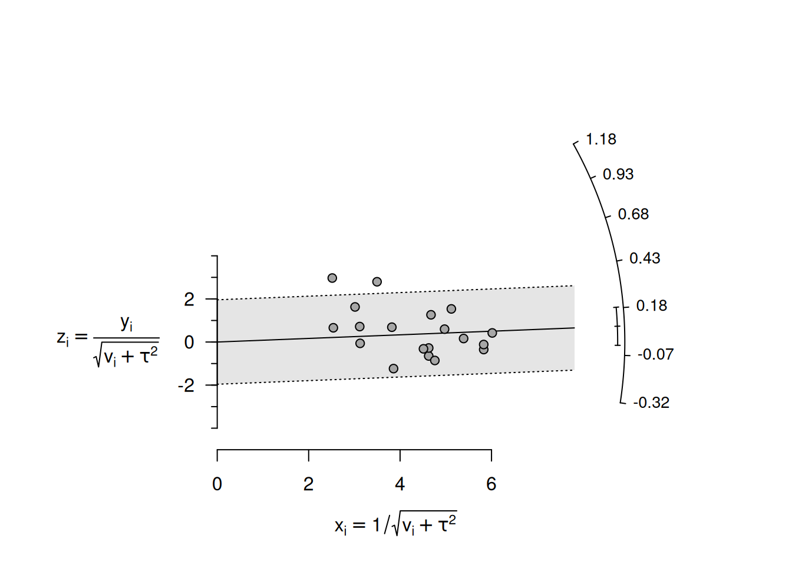
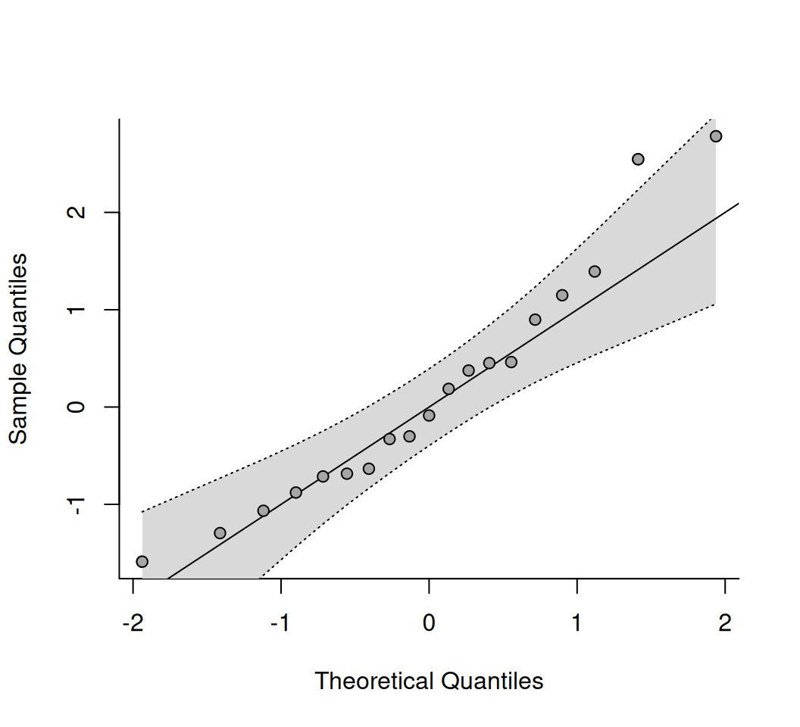
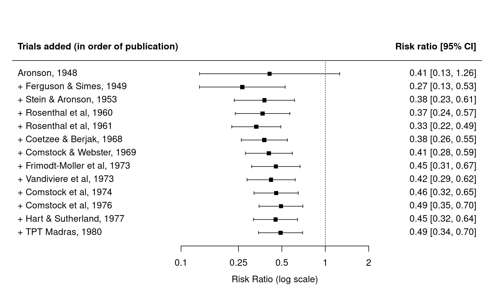
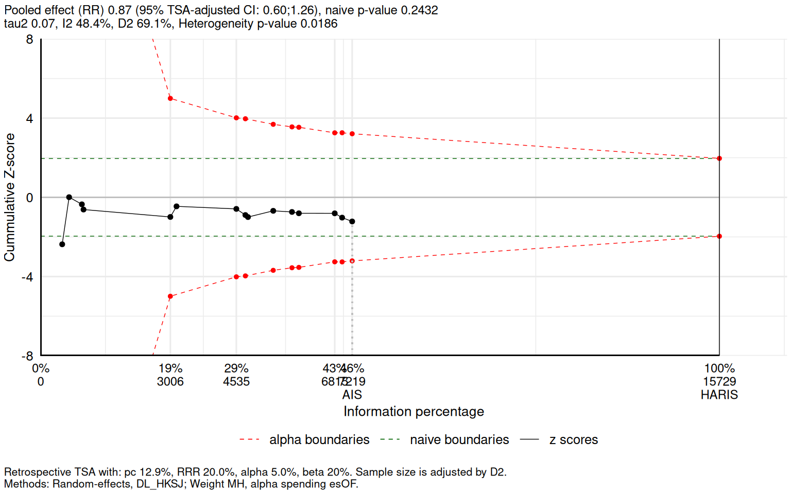
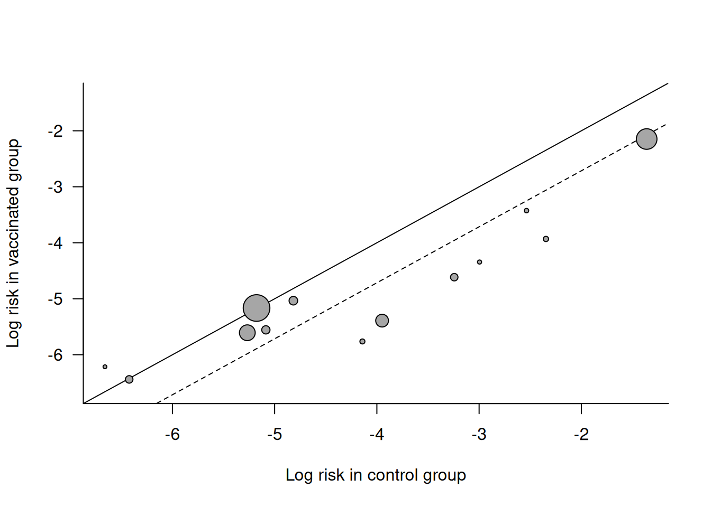
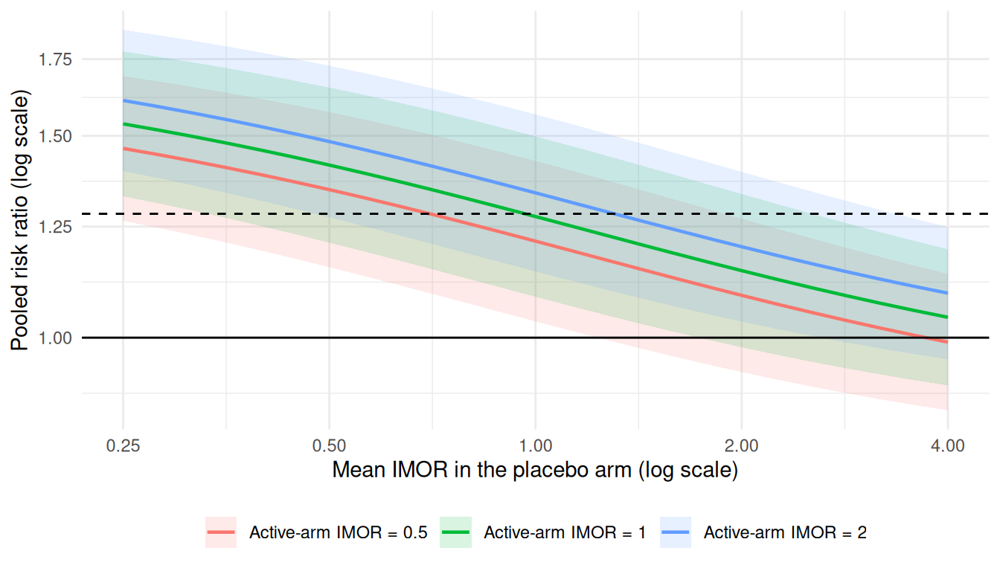
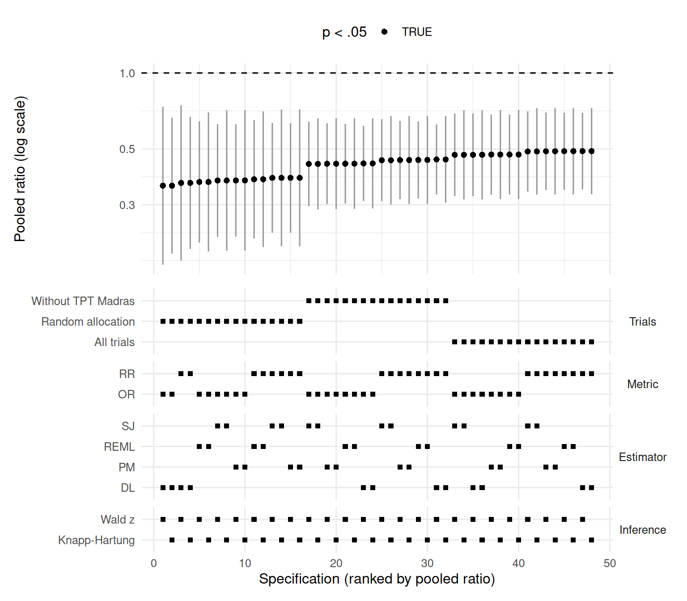

# Sensitivity Analysis and Diagnostics {#sec-sensitivity}


A meta-analytic result is the output of a long chain of decisions: which studies to include, which effect size to extract, which metric to use, which model and estimator to fit, and what to do with studies that look unusual. Each decision is defensible, but several are not uniquely determined by the data or the protocol. Sensitivity analysis asks whether the conclusions survive reasonable changes to those decisions; diagnostics ask whether the fitted model describes the data adequately and whether a few studies drive the result. Both are required by reporting guidelines and by common sense: a pooled estimate that flips sign when one study is removed, or that depends on an arbitrary choice of heterogeneity estimator, is not a finding but a fragile coincidence.

This chapter covers three layers. The first is *study-level diagnostics*: outlier and influence statistics, leave-one-out analysis, and graphical tools such as Baujat, GOSH, radial, and normal quantile plots. The second is *analysis-level sensitivity*: cumulative meta-analysis and its sequential extensions, bootstrap intervals, and sensitivity to the estimator of $\tau^2$, to risk-of-bias exclusions, to the effect-size metric, and to assumptions about participants whose outcomes are missing. The third is the *multiverse* or *specification-curve* approach, which runs all reasonable combinations of choices at once and displays the distribution of results [@voracek2019which]. Publication bias, a special and important kind of sensitivity analysis, has its own chapter (Chapter \@ref(sec-publication-bias)).

## Outliers, leverage, and influence {#sec-sensitivity-concepts}

Three concepts from regression diagnostics carry over to meta-analysis [@viechtbauer2010outlier]. An *outlier* is a study whose effect is far from what the model predicts, given its sampling variance and the estimated heterogeneity. *Leverage* reflects how much a study's own observed effect determines its fitted value; in an intercept-only random-effects model it is simply the study's share of the total weight, so large, precise studies have high leverage. An *influential* study is one whose removal changes the results materially: the pooled estimate, its precision, or the heterogeneity estimate. Outliers need not be influential (a small outlying study may barely move the estimate), and influential studies need not be outliers (a very large study close to the mean can dominate the estimate and its standard error).

Let $\hat\mu$, $\hat\tau^2$ be estimates from all $k$ studies and $\hat\mu_{(-i)}$, $\hat\tau^2_{(-i)}$ the estimates with study $i$ removed. The main case-deletion statistics are as follows.

- The *studentized deleted residual*
$$
t_i = \frac{y_i - \hat\mu_{(-i)}}{\sqrt{v_i + \hat\tau^2_{(-i)} + \widehat{\mathrm{Var}}(\hat\mu_{(-i)})}},
$$
which is approximately standard normal if the model is correct and study $i$ is not an outlier.
- *DFFITS*, the standardised change in the fitted value of study $i$ when it is deleted, and *DFBETAS*, the standardised change in each coefficient.
- *Cook's distance* $D_i = (\hat{\boldsymbol\beta} - \hat{\boldsymbol\beta}_{(-i)})^\top \widehat{\mathrm{Var}}(\hat{\boldsymbol\beta})^{-1} (\hat{\boldsymbol\beta} - \hat{\boldsymbol\beta}_{(-i)})$, a Mahalanobis distance between the full and leave-one-out estimates.
- The *covariance ratio* $\det \widehat{\mathrm{Var}}(\hat{\boldsymbol\beta}_{(-i)}) / \det \widehat{\mathrm{Var}}(\hat{\boldsymbol\beta})$; values below 1 mean that deleting the study *improves* precision, typically because it inflates $\hat\tau^2$.
- The leave-one-out heterogeneity estimate $\hat\tau^2_{(-i)}$ and test statistic $Q_{E(-i)}$, which show how much of the heterogeneity a single study generates.
- The *hat value* $h_i$ (leverage) and the study's weight in the analysis.

These statistics were adapted to random- and mixed-effects meta-analysis by @viechtbauer2010outlier, and are computed by `influence()` in `metafor`. Cook's distance originates in linear regression [@cook1977detection].

## Diagnostics in practice: teacher expectancy {#sec-sensitivity-influence}

The data in `dat.raudenbush1985` are 19 experiments on the effect of teacher expectancy on pupil IQ, expressed as standardised mean differences. A key moderator is the number of weeks of contact between teacher and pupils before the expectancy induction (`weeks`).


``` r
dr <- dat.raudenbush1985
dr$slab <- paste0(dr$author, " (", dr$year, ")")
res_te <- rma(yi, vi, data = dr, slab = slab)
res_te
#> 
#> Random-Effects Model (k = 19; tau^2 estimator: REML)
#> 
#> tau^2 (estimated amount of total heterogeneity): 0.0188 (SE = 0.0155)
#> tau (square root of estimated tau^2 value):      0.1372
#> I^2 (total heterogeneity / total variability):   41.86%
#> H^2 (total variability / sampling variability):  1.72
#> 
#> Test for Heterogeneity:
#> Q(df = 18) = 35.8295, p-val = 0.0074
#> 
#> Model Results:
#> 
#> estimate      se    zval    pval    ci.lb   ci.ub    
#>   0.0837  0.0516  1.6208  0.1051  -0.0175  0.1849    
#> 
#> ---
#> Signif. codes:  0 '***' 0.001 '**' 0.01 '*' 0.05 '.' 0.1 ' ' 1
```

The random-effects estimate is $\hat\mu =$ 0.084 (95% CI -0.018 to 0.185) with moderate heterogeneity, $\hat\tau^2 =$ 0.0188 and $I^2 =$ 41.9%.

### Case-deletion diagnostics {#sec-sensitivity-casedeletion}


``` r
inf_te <- influence(res_te)
inf_te
#> 
#>                             rstudent  dffits cook.d  cov.r tau2.del  QE.del 
#> Rosenthal et al. (1974)      -0.3027 -0.1996 0.0497 1.2974   0.0274 35.7649 
#> Conn et al. (1968)            0.1464 -0.0597 0.0042 1.2449   0.0257 35.6541 
#> Jose & Cody (1971)           -1.0529 -0.2897 0.0872 1.1073   0.0207 34.3186 
#> Pellegrini & Hicks (1972).1   2.9068  0.5210 0.2528 0.7374   0.0080 26.7305 
#> Pellegrini & Hicks (1972).2   0.4480  0.0434 0.0019 1.0428   0.0199 35.5340 
#> Evans & Rosenthal (1969)     -0.8344 -0.3228 0.1214 1.2216   0.0237 34.2667 
#> Fielder et al. (1971)        -0.5958 -0.2795 0.0984 1.2896   0.0265 35.1328 
#> Claiborn (1969)              -1.6114 -0.2699 0.0699 0.9712   0.0161 32.7559 
#> Kester (1969)                 0.9124  0.2443 0.0583 1.0354   0.0178 34.1109 
#> Maxwell (1970)                2.9033  0.7873 0.4972 0.5927   0.0026 26.9588 
#> Carter (1970)                 1.4290  0.2834 0.0774 0.9231   0.0148 33.2697 
#> Flowers (1966)                0.3566  0.0230 0.0006 1.1220   0.0221 35.5336 
#> Keshock (1970)               -0.3321 -0.1085 0.0121 1.1080   0.0221 35.7509 
#> Henrikson (1970)              0.4540  0.0487 0.0024 1.0682   0.0205 35.4819 
#> Fine (1972)                  -1.3078 -0.3103 0.0937 1.0333   0.0176 33.4192 
#> Grieger (1970)               -0.6690 -0.2429 0.0655 1.1903   0.0240 35.2843 
#> Rosenthal & Jacobson (1968)   1.3707  0.5818 0.2583 0.8341   0.0098 32.6340 
#> Fleming & Anttonen (1971)    -0.1159 -0.1637 0.0368 1.3590   0.0291 35.8171 
#> Ginsburg (1970)              -0.6984 -0.2416 0.0640 1.1779   0.0236 35.2429 
#>                                hat weight    dfbs inf 
#> Rosenthal et al. (1974)     0.0775 7.7478 -0.2035     
#> Conn et al. (1968)          0.0660 6.5979 -0.0599     
#> Jose & Cody (1971)          0.0571 5.7083 -0.2891     
#> Pellegrini & Hicks (1972).1 0.0169 1.6889  0.5895     
#> Pellegrini & Hicks (1972).2 0.0172 1.7205  0.0431     
#> Evans & Rosenthal (1969)    0.0906 9.0642 -0.3299     
#> Fielder et al. (1971)       0.0906 9.0642 -0.2888     
#> Claiborn (1969)             0.0397 3.9676 -0.2736     
#> Kester (1969)               0.0583 5.8331  0.2446     
#> Maxwell (1970)              0.0326 3.2597  0.9268   * 
#> Carter (1970)               0.0242 2.4242  0.2929     
#> Flowers (1966)              0.0389 3.8923  0.0227     
#> Keshock (1970)              0.0261 2.6066 -0.1061     
#> Henrikson (1970)            0.0259 2.5914  0.0481     
#> Fine (1972)                 0.0604 6.0446 -0.3106     
#> Grieger (1970)              0.0571 5.7083 -0.2416     
#> Rosenthal & Jacobson (1968) 0.0700 6.9959  0.5773     
#> Fleming & Anttonen (1971)   0.0965 9.6548 -0.1722     
#> Ginsburg (1970)             0.0543 5.4294 -0.2399
```


`metafor` marks a study as influential (asterisk in the last column) if at least one of the following holds: $|\text{DFFITS}| > 3\sqrt{p/(k-p)}$, the Cook's distance exceeds the median of a $\chi^2_p$ distribution, the hat value exceeds $3p/k$, or any $|\text{DFBETAS}| > 1$. These thresholds are heuristics, not tests. Only Maxwell (1970) is flagged. Its studentized deleted residual is 2.90, its Cook's distance 0.497, and its covariance ratio 0.593, the smallest in the data. Without it, $\hat\tau^2$ would drop from 0.0188 to 0.0026 and $Q_E$ from 35.83 to 26.96. A second study, the first Pellegrini and Hicks (1972) experiment, has a similarly large residual (2.91) but receives so little weight (1.7%) that it is not flagged as influential. Figure \@ref(fig:sens-influence-plot) displays all statistics at once.


``` r
plot(inf_te, cex = 0.8, las = 1)
```

<div class="figure" style="text-align: center">

<p class="caption">(\#fig:sens-influence-plot)Outlier and influence diagnostics for the teacher-expectancy meta-analysis: studentized deleted residuals, DFFITS, Cook's distances, covariance ratios, leave-one-out $\tau^2$ and $Q_E$, hat values, and weights. Study 10 (Maxwell, 1970) is highlighted as influential.</p>
</div>

### Leave-one-out analysis {#sec-sensitivity-leave1out}

`leave1out()` refits the model $k$ times, each time omitting one study, and reports the full set of results. It answers the practical question directly: does any single study change the conclusion?


``` r
l1o <- leave1out(res_te)
l1o
#> 
#>                              estimate     se   zval   pval   ci.lb  ci.ub 
#> -Rosenthal et al. (1974)       0.0952 0.0588 1.6187 0.1055 -0.0201 0.2105 
#> -Conn et al. (1968)            0.0870 0.0576 1.5105 0.1309 -0.0259 0.2000 
#> -Jose & Cody (1971)            0.0990 0.0543 1.8209 0.0686 -0.0076 0.2055 
#> -Pellegrini & Hicks (1972).1   0.0577 0.0443 1.3019 0.1929 -0.0292 0.1447 
#> -Pellegrini & Hicks (1972).2   0.0815 0.0527 1.5445 0.1225 -0.0219 0.1848 
#> -Evans & Rosenthal (1969)      0.1017 0.0571 1.7818 0.0748 -0.0102 0.2136 
#> -Fielder et al. (1971)         0.0999 0.0586 1.7035 0.0885 -0.0150 0.2149 
#> -Claiborn (1969)               0.0974 0.0509 1.9129 0.0558 -0.0024 0.1971 
#> -Kester (1969)                 0.0712 0.0526 1.3555 0.1752 -0.0318 0.1742 
#> -Maxwell (1970)                0.0473 0.0398 1.1895 0.2343 -0.0306 0.1252 
#> -Carter (1970)                 0.0693 0.0496 1.3974 0.1623 -0.0279 0.1666 
#> -Flowers (1966)                0.0825 0.0547 1.5079 0.1316 -0.0247 0.1897 
#> -Keshock (1970)                0.0894 0.0544 1.6445 0.1001 -0.0171 0.1959 
#> -Henrikson (1970)              0.0812 0.0534 1.5207 0.1283 -0.0234 0.1858 
#> -Fine (1972)                   0.0995 0.0525 1.8955 0.0580 -0.0034 0.2024 
#> -Grieger (1970)                0.0969 0.0563 1.7202 0.0854 -0.0135 0.2074 
#> -Rosenthal & Jacobson (1968)   0.0575 0.0472 1.2183 0.2231 -0.0350 0.1499 
#> -Fleming & Anttonen (1971)     0.0936 0.0602 1.5548 0.1200 -0.0244 0.2116 
#> -Ginsburg (1970)               0.0968 0.0561 1.7266 0.0842 -0.0131 0.2066 
#>                                    Q     Qp   tau2      I2     H2 
#> -Rosenthal et al. (1974)     35.7649 0.0049 0.0274 50.1126 2.0045 
#> -Conn et al. (1968)          35.6541 0.0051 0.0257 49.2489 1.9704 
#> -Jose & Cody (1971)          34.3186 0.0076 0.0207 44.1704 1.7912 
#> -Pellegrini & Hicks (1972).1 26.7305 0.0621 0.0080 24.2415 1.3200 
#> -Pellegrini & Hicks (1972).2 35.5340 0.0053 0.0199 44.2737 1.7945 
#> -Evans & Rosenthal (1969)    34.2667 0.0078 0.0237 45.4746 1.8340 
#> -Fielder et al. (1971)       35.1328 0.0060 0.0265 48.2254 1.9315 
#> -Claiborn (1969)             32.7559 0.0121 0.0161 38.6888 1.6310 
#> -Kester (1969)               34.1109 0.0081 0.0178 40.4821 1.6802 
#> -Maxwell (1970)              26.9588 0.0587 0.0026  9.4217 1.1040 
#> -Carter (1970)               33.2697 0.0104 0.0148 37.0930 1.5896 
#> -Flowers (1966)              35.5336 0.0053 0.0221 46.3956 1.8655 
#> -Keshock (1970)              35.7509 0.0050 0.0221 46.7450 1.8778 
#> -Henrikson (1970)            35.4819 0.0054 0.0205 44.8840 1.8144 
#> -Fine (1972)                 33.4192 0.0100 0.0176 40.1649 1.6713 
#> -Grieger (1970)              35.2843 0.0057 0.0240 47.8434 1.9173 
#> -Rosenthal & Jacobson (1968) 32.6340 0.0125 0.0098 26.7888 1.3659 
#> -Fleming & Anttonen (1971)   35.8171 0.0049 0.0291 49.9547 1.9982 
#> -Ginsburg (1970)             35.2429 0.0058 0.0236 47.5656 1.9071
```


The pooled estimate ranges from 0.047 (without Maxwell) to 0.102, and none of the leave-one-out confidence intervals excludes zero, so the qualitative conclusion is stable. The heterogeneity is not: without Maxwell, $I^2$ falls to 9.4% and the $Q$ test is no longer significant at the 5% level ($p$ = .059). Removing the first Pellegrini and Hicks experiment instead has a smaller effect in the same direction ($I^2 =$ 24.2%, $p$ = .062). A large share of the apparent heterogeneity in this literature is attributable to one or two small studies.

### Baujat plot {#sec-sensitivity-baujat}

@baujat2002graphical proposed plotting, for each study, its contribution to the overall heterogeneity statistic $Q$ (horizontal axis) against its influence on the pooled result (vertical axis, the squared standardised change in the estimate when the study is removed). Studies in the upper right both create heterogeneity and move the result (Figure \@ref(fig:sens-baujat)).


``` r
baujat(res_te, symbol = "ids", bty = "l", las = 1)
```

<div class="figure" style="text-align: center">

<p class="caption">(\#fig:sens-baujat)Baujat plot for the teacher-expectancy data: contribution of each study to the $Q$ statistic against its influence on the pooled estimate. Points are labelled by study number.</p>
</div>

Studies 4 (Pellegrini and Hicks, first experiment) and 10 (Maxwell) contribute most to $Q$, but only study 10 also has a large influence on the overall estimate.

### GOSH plot {#sec-sensitivity-gosh}

The graphical display of study heterogeneity (GOSH) of @olkin2012gosh fits the model to every subset of the studies and plots a summary of heterogeneity ($I^2$) against the pooled estimate for each subset. Clusters in the plot reveal subsets of studies that are internally homogeneous but differ from each other; a study that splits the cloud into two separate groups depending on whether it is included is a candidate outlier. With $k$ studies there are $2^k - 1$ subsets: $524{,}287$ for $k = 19$. A random sample of subsets is enough for visualisation, and fitting with the non-iterative DerSimonian–Laird estimator keeps the computation to a second or two.


``` r
res_te_dl <- rma(yi, vi, data = dr, method = "DL")
gosh_te <- gosh(res_te_dl, subsets = 10000, seed = 2026)
gosh_te
#> 
#> Model fits attempted: 10000
#> Model fits succeeded: 10000
#> 
#>             mean     min      q1  median      q3     max 
#> k         9.5025  2.0000  8.0000  9.0000 11.0000 16.0000 
#> QE       17.2163  0.3000 12.3563 17.2925 22.0525 35.5284 
#> I2       44.7322  0.0000 36.0125 50.9390 59.8869 86.2216 
#> H2        2.0314  0.0822  1.5628  2.0383  2.4929  7.2578 
#> tau2      0.0315  0.0000  0.0147  0.0284  0.0438  0.3312 
#>                                                          
#> tau       0.1590  0.0000  0.1212  0.1685  0.2094  0.5755 
#> estimate  0.1000 -0.1336  0.0522  0.0925  0.1402  0.7537
```


``` r
plot(gosh_te, out = 10, breaks = 50, cex = 0.4)
```

<div class="figure" style="text-align: center">

<p class="caption">(\#fig:sens-gosh-plot)GOSH plot for the teacher-expectancy data based on 10,000 random subsets. Subsets containing study 10 (Maxwell, 1970) are shown in red and subsets without it in blue; marginal histograms show the distributions of $I^2$ and the pooled estimate.</p>
</div>

The subsets that include Maxwell (red) form a cloud shifted towards higher estimates and higher heterogeneity: on average, subsets with the study have a pooled estimate of 0.133 and $I^2$ of 56.8%, compared with 0.067 and 32.6% without it. GOSH plots confirm visually what the case-deletion statistics found, and they are especially useful when two or more studies are jointly unusual, a pattern that one-at-a-time deletion can miss.

### Radial and normal quantile plots {#sec-sensitivity-radial-qq}

The radial (Galbraith) plot [@galbraith1988note] plots the standardised effect $y_i/\sqrt{v_i + \hat\tau^2}$ against precision $1/\sqrt{v_i + \hat\tau^2}$. Under the model, points scatter around a line through the origin whose slope is $\hat\mu$, and about 95% should lie within $\pm 2$ of it. The normal quantile–quantile plot of standardised residuals checks the normality assumption for the random effects and residuals, with a pseudo-confidence envelope obtained by simulation (Figures \@ref(fig:sens-radial) and \@ref(fig:sens-qq)).


``` r
radial(res_te)
```

<div class="figure" style="text-align: center">

<p class="caption">(\#fig:sens-radial)Radial (Galbraith) plot for the teacher-expectancy random-effects model. The shaded band marks $\pm 2$ around the line whose slope is the pooled estimate; the arc on the right translates slopes into effect sizes.</p>
</div>


``` r
set.seed(2026)
qqnorm(res_te, main = "")
```

<div class="figure" style="text-align: center">

<p class="caption">(\#fig:sens-qq)Normal quantile-quantile plot of the standardised residuals of the teacher-expectancy random-effects model with a simulated 95% envelope.</p>
</div>

In the radial plot, two small studies lie outside the $\pm 2$ band on the upper side; in the QQ plot the largest residuals (Maxwell and Pellegrini and Hicks) lie at or beyond the upper edge of the envelope, a mild right skew that is consistent with the influence diagnostics. With 19 studies, normality checks have little power; their main value is to spot gross departures.

## Cumulative meta-analysis {#sec-sensitivity-cumulative}

A cumulative meta-analysis adds studies one at a time in a meaningful order, usually publication date, and re-estimates the model at each step [@lau1992cumulative]. It shows when the evidence became convincing, whether early studies overstated the effect (a "decline effect"), and whether later, typically larger studies changed the picture. We return to the 13 BCG vaccine trials of Chapter \@ref(sec-heterogeneity), whose effects are known to vary systematically.


``` r
dat <- escalc(measure = "RR", ai = tpos, bi = tneg, ci = cpos, di = cneg,
              slab = paste0(author, ", ", year), data = dat.bcg)
res <- rma(yi, vi, data = dat)
cum <- cumul(res, order = dat$year)
cum
#> 
#>                             k estimate     se    zval   pval   ci.lb   ci.ub 
#> Aronson, 1948               1  -0.8893 0.5706 -1.5586 0.1191 -2.0077  0.2290 
#> Ferguson & Simes, 1949      2  -1.3250 0.3490 -3.7967 0.0001 -2.0090 -0.6410 
#> Stein & Aronson, 1953       3  -0.9721 0.2455 -3.9602 0.0001 -1.4532 -0.4910 
#> Rosenthal et al, 1960       4  -1.0011 0.2223 -4.5037 0.0000 -1.4368 -0.5654 
#> Rosenthal et al, 1961       5  -1.1014 0.1997 -5.5164 0.0000 -1.4928 -0.7101 
#> Coetzee & Berjak, 1968      6  -0.9735 0.1877 -5.1875 0.0000 -1.3413 -0.6057 
#> Comstock & Webster, 1969    7  -0.9013 0.1907 -4.7250 0.0000 -1.2751 -0.5274 
#> Frimodt-Moller et al, 1973  8  -0.7886 0.1970 -4.0039 0.0001 -1.1746 -0.4025 
#> Vandiviere et al, 1973      9  -0.8656 0.1963 -4.4107 0.0000 -1.2503 -0.4810 
#> Comstock et al, 1974       10  -0.7852 0.1801 -4.3588 0.0000 -1.1383 -0.4321 
#> Comstock et al, 1976       11  -0.7082 0.1784 -3.9701 0.0001 -1.0578 -0.3586 
#> Hart & Sutherland, 1977    12  -0.7948 0.1799 -4.4184 0.0000 -1.1473 -0.4422 
#> TPT Madras, 1980           13  -0.7145 0.1798 -3.9744 0.0001 -1.0669 -0.3622 
#>                                   Q     Qp   tau2      I2      H2 
#> Aronson, 1948                0.0000 1.0000 0.0000  0.0000  1.0000 
#> Ferguson & Simes, 1949       0.9315 0.3345 0.0000  0.0000  1.0000 
#> Stein & Aronson, 1953        3.1879 0.2031 0.0872 40.7090  1.6866 
#> Rosenthal et al, 1960        3.8614 0.2768 0.0763 33.9750  1.5146 
#> Rosenthal et al, 1961        7.6415 0.1056 0.0858 48.4120  1.9384 
#> Coetzee & Berjak, 1968      10.1854 0.0702 0.1046 60.0008  2.5000 
#> Comstock & Webster, 1969    13.2116 0.0398 0.1205 59.9982  2.4999 
#> Frimodt-Moller et al, 1973  19.5749 0.0066 0.1780 72.3904  3.6219 
#> Vandiviere et al, 1973      22.8208 0.0036 0.2023 73.5065  3.7745 
#> Comstock et al, 1974        34.1203 0.0001 0.2005 81.4029  5.3772 
#> Comstock et al, 1976        39.6122 0.0000 0.2281 83.0110  5.8862 
#> Hart & Sutherland, 1977     67.9858 0.0000 0.2732 87.0314  7.7109 
#> TPT Madras, 1980           152.2330 0.0000 0.3132 92.2214 12.8558
```


``` r
forest(cum, xlim = c(-5, 2.5), atransf = exp, at = log(c(0.1, 0.25, 0.5, 1, 2)),
       header = c("Trials added (in order of publication)", "Risk ratio [95% CI]"))
```

<div class="figure" style="text-align: center">

<p class="caption">(\#fig:sens-cumul-forest)Cumulative meta-analysis of the BCG trials ordered by publication year. Each row shows the random-effects estimate (risk ratio) based on all trials up to and including the one named.</p>
</div>

By the third trial (1953), the cumulative risk ratio was 0.38 and already clearly below 1. It drifted towards the null as later trials were added, reaching 0.49 after the large 1980 Madras trial, while $\hat\tau^2$ grew from 0.087 to 0.313 and $I^2$ from 41% to 92%. The early trials were not wrong about the existence of a protective effect, but they overstated its size and hid how variable it would prove to be. Ordering by a moderator rather than time (for the BCG trials, absolute latitude) turns the cumulative plot into an informal moderator analysis. Note that cumulative meta-analysis involves repeated looks at accumulating data; if it is used to decide when to stop doing trials, the multiplicity of tests must be handled formally. That is the subject of the next section.

## Sequential methods and the required information size {#sec-sensitivity-sequential}

A meta-analysis that is updated every time a new trial appears performs a significance test at every update. Even if the intervention has no effect, the chance that the cumulative $z$-statistic crosses $\pm 1.96$ at *some* update is much larger than 5%, for the same reason that repeated interim analyses of a single trial inflate its Type I error. @pogue1997cumulating proposed borrowing the group-sequential monitoring boundaries used in trials, and the Copenhagen Trial Unit developed the idea into *trial sequential analysis* (TSA) [@wetterslev2008trial]. TSA has two ingredients: a *required information size*, the number of participants a meta-analysis needs before its result can be regarded as conclusive, and *alpha-spending boundaries* that the cumulative $z$-curve must cross before that information size is reached.

### Required information size {#sec-sensitivity-ris}

The starting point is the sample size of a single adequately powered trial, since a meta-analysis should contain at least as much information as one [@wetterslev2008trial]. For a binary outcome with anticipated control-group risk $p_C$, a relative risk reduction $\mathrm{RRR}$ that one wants to detect, $p_I = p_C(1 - \mathrm{RRR})$, and $\bar p = (p_C + p_I)/2$, the required total number of participants for a two-sided test at level $\alpha$ with power $1 - \beta$ is
$$
\mathrm{RIS} = 4\,(z_{1-\alpha/2} + z_{1-\beta})^2\,\frac{\bar p(1 - \bar p)}{(p_C - p_I)^2}.
$$
This is the fixed-effect information size. Heterogeneity reduces the information each participant contributes, so @wetterslev2009estimating inflate it with the *diversity*
$$
D^2 = \frac{V_R - V_F}{V_R}, \qquad \mathrm{HARIS} = \frac{\mathrm{RIS}}{1 - D^2},
$$
where $V_F$ and $V_R$ are the variances of the pooled estimate under the common-effect and random-effects models. $D^2$ is the relative reduction in variance when the random-effects model is replaced by the common-effect model, and they show that $D^2 \ge I^2$ always, so adjusting by $I^2$ understates the information needed.

We use the `perioOxy` data from the `RTSA` package: 15 trials comparing 80% with 30--35% perioperative oxygen, with surgical site infection as the outcome. We order the trials by year, take the pooled control-group risk as $p_C$, and ask for 80% power to detect a 20% relative risk reduction:


``` r
data(perioOxy, package = "RTSA")
po <- perioOxy
po$year <- as.numeric(sub(".* ", "", po$study))
po <- po[order(po$year), ]
pC <- with(po, sum(eC) / sum(nC))
pI <- pC * (1 - 0.2)
pbar <- (pC + pI) / 2
ris <- 4 * (qnorm(0.975) + qnorm(0.80))^2 * pbar * (1 - pbar) / (pC - pI)^2
po_mh <- rma.mh(measure = "RR", ai = eI, n1i = nI, ci = eC, n2i = nC, data = po)
po_re <- rma(measure = "RR", ai = eI, n1i = nI, ci = eC, n2i = nC, data = po,
             method = "DL")
D2 <- 1 - po_mh$se^2 / po_re$se^2
round(c(pC = pC, I2 = po_re$I2 / 100, D2 = D2), 3)
#>    pC    I2    D2 
#> 0.129 0.484 0.641
round(c(RIS = ris, HARIS = ris / (1 - D2), accrued = sum(po$nI + po$nC)))
#>     RIS   HARIS accrued 
#>    4845   13506    7219
```


With a control risk of 12.9%, a single trial would need about 4,845 participants. The trials are moderately heterogeneous ($I^2 =$ 48.4%), but the diversity is larger, $D^2 =$ 64.1%, and the heterogeneity-adjusted information size is 13,506. Here $V_F$ is the Mantel–Haenszel variance and $V_R$ the DerSimonian–Laird random-effects variance. The 15 trials have randomised 7,219 participants, 53% of the required information.

### Trial sequential analysis {#sec-sensitivity-tsa}

The monitoring boundaries come from an alpha-spending function [@lan1983discrete]. If $t \in (0, 1]$ is the information fraction (accrued over required information), the O'Brien–Fleming-type spending function
$$
\alpha^*(t) = 2 - 2\,\Phi\!\left(\frac{z_{1-\alpha/2}}{\sqrt t}\right)
$$
releases almost none of the Type I error early and the full $\alpha$ at $t = 1$. At each update the boundary is chosen so that the probability under the null of having crossed it at any update so far equals $\alpha^*(t)$. Early boundaries are therefore very wide and shrink towards $\pm z_{1-\alpha/2}$ as the information size is approached. `RTSA()` computes the information size, the boundaries, and the cumulative $z$-statistics in one call:


``` r
tsa <- RTSA(type = "analysis", data = po, outcome = "RR", mc = 0.8, side = 2,
            alpha = 0.05, beta = 0.2, es_alpha = "esOF", random_adj = "D2")
tsa_df <- tsa$results$results_df
round(tsa_df[, c("sma_timing", "upper", "z_fixed", "z_random")], 3)
#>    sma_timing  upper z_fixed z_random
#> 1       0.032 20.000  -2.372   -2.372
#> 2       0.042 20.000  -0.505    0.007
#> 3       0.061 20.000  -1.586   -0.354
#> 4       0.063     NA  -1.718   -0.617
#> 5       0.192  4.995  -2.722   -0.992
#> 6       0.201     NA  -2.171   -0.456
#> 7       0.289  4.014  -1.959   -0.585
#> 8       0.302  3.967  -2.284   -0.894
#> 9       0.306     NA  -2.323   -0.996
#> 10      0.344  3.687  -1.810   -0.682
#> 11      0.371  3.557  -1.819   -0.739
#> 12      0.381  3.538  -1.838   -0.806
#> 13      0.434  3.257  -1.758   -0.808
#> 14      0.445  3.261  -1.967   -1.025
#> 15      0.460  3.210  -2.137   -1.218
#> 16      1.003  1.966      NA       NA
unlist(tsa$results[c("RIS", "HARIS", "SMA_HARIS", "AIS")])
#>       RIS     HARIS SMA_HARIS       AIS 
#>      4845     15688     15729      7219
```


`RTSA` reproduces the fixed-effect information size computed by hand (4,845). Its heterogeneity-adjusted value, 15,688, is larger than ours because its default random-effects variance includes the Hartung–Knapp–Sidik–Jonkman adjustment, which raises $D^2$ to 69.1%: $D^2$ depends on the model as much as on the data. A small further inflation (to 15,729) preserves power under sequential monitoring. Figure \@ref(fig:sens-tsa-plot) shows the result. The common-effect cumulative $z$-statistic falls below $-1.96$ at 7 of the 15 updates, starting with the very first trial, so a conventional cumulative meta-analysis would have declared a significant benefit of high oxygen several times. After the first trial the random-effects $z$-statistic never reaches $\pm 1.96$ (its largest absolute value is 1.22), and neither curve crosses the monitoring boundaries, which are still at $\pm$ 3.21 when the last trial is added. The random-effects risk ratio is 0.87 with a TSA-adjusted 95% confidence interval from 0.60 to 1.26. The conclusion is that the evidence is insufficient: neither a 20% reduction nor its absence has been established.


``` r
plot(tsa)
```

<div class="figure" style="text-align: center">

<p class="caption">(\#fig:sens-tsa-plot)Trial sequential analysis of the perioperative oxygen trials. The black line is the cumulative random-effects $z$-statistic, the red dashed curves are the O'Brien–Fleming-type monitoring boundaries, and the green dashed lines the conventional $\pm 1.96$. The horizontal axis is the accrued number of participants as a percentage of the diversity-adjusted required information size.</p>
</div>

### Critiques and limits of trial sequential analysis {#sec-sensitivity-tsa-critique}


TSA is widely used in clinical meta-analyses, and it does what it was designed to do: in an empirical study of 100 Cochrane meta-analyses with a binary outcome, a non-significant result, and enough participants to be adequately powered, @imberger2016false found that conventional cumulative updating would have produced 14 false-positive results and that TSA prevented 13 of them. It is nevertheless contested, for reasons that matter in applications.

First, the required information size depends on inputs that are chosen, not estimated: the anticipated effect, the control risk, $\alpha$ and $\beta$, and a heterogeneity adjustment that is itself estimated with great uncertainty from the trials already available. Changing the anticipated relative risk reduction from 20% to 15% multiplies the information size by 1.82, and the Q-profile 95% confidence interval for $\tau^2$ in these 15 trials runs from 0.0032 to 0.467, a factor of more than 140. Second, the random-effects case is conceptually awkward. @kulinskaya2013trial point out that when there is heterogeneity, adding participants to a meta-analysis does not by itself make its variance small, because the between-trial variance does not shrink with sample size: what matters is the number of new trials. They derive the minimum number of further trials, and their sizes, that a random-effects meta-analysis would need; `RTSA` provides a calculation of this kind through `random_adj = "tau2"` (its default), which bases the information size on $\hat\tau^2$ and a number of future trials, and for these data asks for at least 6 additional trials. Third, a meta-analysis is not a trial: its sequence of updates is not planned, studies are not added in a pre-specified order, and the review question may change over time. @higgins2010sequential proposed sequential methods for random-effects meta-analysis that update the evidence on the between-study variance with an informative prior, and found Type I and II error rates close to nominal in simulations.

In practice, TSA is most defensible for a living or prospectively planned meta-analysis whose information size and boundaries are specified in the protocol. Used retrospectively, as here, it is best read as a sensitivity analysis that asks how much the evidence would have to grow before a conventional $p < .05$ could be trusted, and the TSA-adjusted interval should be reported alongside, not instead of, the conventional one.

A related descriptive measure is the *fragility index* of a meta-analysis, defined by @atal2019statistical as the minimum number of participants in one or more trials whose event status would have to change (from event to non-event or the reverse) to change the statistical significance of the pooled effect. In a cross-sectional study of 906 Cochrane meta-analyses with binary outcomes, they found that the significance of a third of them depended on five or fewer participants. Like TSA, the fragility index inherits the arbitrariness of the 5% threshold, but it is a vivid way to show that a "significant" pooled result can rest on very few events.

## L'Abbé plot {#sec-sensitivity-labbe}

For binary outcomes, the L'Abbé plot [@labbe1987meta] plots each study's event risk in the treatment group against the risk in the control group. Points below the diagonal favour treatment; the dashed line shows the pooled effect translated to the risk scale. Systematic departures from that line suggest that the effect depends on baseline risk or that the chosen metric is not constant across studies (Figure \@ref(fig:sens-labbe)).


``` r
res_rr <- rma(measure = "RR", ai = tpos, bi = tneg, ci = cpos, di = cneg, data = dat.bcg)
labbe(res_rr, bty = "l", las = 1,
      xlab = "Log risk in control group", ylab = "Log risk in vaccinated group")
```

<div class="figure" style="text-align: center">

<p class="caption">(\#fig:sens-labbe)L'Abbé plot of the BCG trials: tuberculosis risk among vaccinated versus unvaccinated participants, both on the log scale. Point size reflects precision; the solid line is the line of no effect and the dashed line the pooled risk ratio.</p>
</div>

``` r
risk_c <- with(dat.bcg, cpos / (cpos + cneg))
round(range(risk_c), 4)
#> [1] 0.0013 0.2564
```

All but two trials lie below the diagonal, and the spread around the pooled line is large relative to the control risks, which range from 0.1% to 26%. Because the trials differ so much in baseline risk, a constant risk ratio and a constant risk difference make very different predictions, which is why the choice of metric is examined below.

## Bootstrap confidence intervals {#sec-sensitivity-bootstrap}

The usual Wald interval for $\mu$ and the Q-profile interval for $\tau^2$ rely on asymptotic approximations. A nonparametric bootstrap resamples whole studies with replacement, refits the model to each resample, and uses the empirical distribution of the estimates [@efron1994introduction]. It makes fewer assumptions about the distribution of the random effects, although with few studies the bootstrap distribution is itself coarse.


``` r
boot_fun <- function(d, i) {
  fit <- rma(yi, vi, data = d[i, ], control = list(stepadj = 0.5, maxiter = 1000))
  c(mu = coef(fit)[[1]], tau2 = fit$tau2)
}
set.seed(2026)
bt <- boot(as.data.frame(dat), boot_fun, R = 999)
bt
#> 
#> ORDINARY NONPARAMETRIC BOOTSTRAP
#> 
#> 
#> Call:
#> boot(data = as.data.frame(dat), statistic = boot_fun, R = 999)
#> 
#> 
#> Bootstrap Statistics :
#>     original    bias    std. error
#> t1*  -0.7145 -0.003878     0.16334
#> t2*   0.3133 -0.024856     0.08515
ci_mu <- boot.ci(bt, index = 1, type = c("perc", "bca"))
ci_t2 <- boot.ci(bt, index = 2, type = c("perc", "bca"))
ci_mu
#> BOOTSTRAP CONFIDENCE INTERVAL CALCULATIONS
#> Based on 999 bootstrap replicates
#> 
#> CALL : 
#> boot.ci(boot.out = bt, type = c("perc", "bca"), index = 1)
#> 
#> Intervals : 
#> Level     Percentile            BCa          
#> 95%   (-1.0357, -0.4275 )   (-1.0507, -0.4315 )  
#> Calculations and Intervals on Original Scale
ci_t2
#> BOOTSTRAP CONFIDENCE INTERVAL CALCULATIONS
#> Based on 999 bootstrap replicates
#> 
#> CALL : 
#> boot.ci(boot.out = bt, type = c("perc", "bca"), index = 2)
#> 
#> Intervals : 
#> Level     Percentile            BCa          
#> 95%   ( 0.0992,  0.4479 )   ( 0.1438,  0.4614 )  
#> Calculations and Intervals on Original Scale
confint(res)
#> 
#>        estimate   ci.lb   ci.ub 
#> tau^2    0.3132  0.1197  1.1115 
#> tau      0.5597  0.3460  1.0543 
#> I^2(%)  92.2214 81.9177 97.6781 
#> H^2     12.8558  5.5303 43.0680
```

The BCa bootstrap interval for $\mu$, -1.051 to -0.432, is close to the Wald interval (-1.067 to -0.362). For $\tau^2$ the bootstrap and Q-profile intervals differ: the BCa interval is 0.144 to 0.461, whereas the Q-profile interval is 0.120 to 1.111. Resamples of 13 trials cannot generate much more heterogeneity than the observed trials display, so with few studies the bootstrap upper limit for $\tau^2$ tends to be too low. Neither interval is exact, and the gap between them is itself informative: $\tau^2$ is poorly determined by 13 studies. A parametric bootstrap, which simulates new data from the fitted model, is an alternative that `metafor` documents for `rma` models.

## Sensitivity to analytic choices {#sec-sensitivity-choices}

### The estimator of $\tau^2$ {#sec-sensitivity-estimator}

More than a dozen estimators of the between-study variance exist [@veroniki2015methods]. Simulation comparisons found that the DerSimonian–Laird estimator is negatively biased with small studies and rare events, that the Paule–Mandel estimator can have considerable positive bias when study sizes differ greatly, and recommended REML [@langan2018comparison]; @veroniki2015methods favoured Paule–Mandel and, for continuous data, REML. Since no estimator is uniformly best, reporting how the results change across estimators is a cheap and informative check.


``` r
methods_tau <- c(DL = "DL", HE = "HE", HS = "HS", SJ = "SJ", ML = "ML",
                 REML = "REML", EB = "EB", PM = "PM")
est_tab <- t(sapply(methods_tau, function(m) {
  fit <- rma(yi, vi, data = dat, method = m)
  fit_kh <- rma(yi, vi, data = dat, method = m, test = "knha")
  c(RR = exp(coef(fit)[[1]]), lower = exp(fit$ci.lb), upper = exp(fit$ci.ub),
    tau2 = fit$tau2, lower_kh = exp(fit_kh$ci.lb), upper_kh = exp(fit_kh$ci.ub))
}))
round(est_tab, 3)
#>         RR lower upper  tau2 lower_kh upper_kh
#> DL   0.490 0.345 0.695 0.309    0.330    0.726
#> HE   0.489 0.341 0.700 0.329    0.329    0.725
#> HS   0.494 0.362 0.675 0.228    0.335    0.730
#> SJ   0.488 0.338 0.704 0.346    0.329    0.725
#> ML   0.491 0.351 0.688 0.280    0.332    0.727
#> REML 0.489 0.344 0.696 0.313    0.330    0.726
#> EB   0.489 0.343 0.697 0.318    0.330    0.726
#> PM   0.489 0.343 0.697 0.318    0.330    0.726
```

Across eight estimators, $\hat\tau^2$ ranges from 0.228 (Hunter–Schmidt) to 0.346 (Sidik–Jonkman), but the pooled risk ratio barely moves (0.488 to 0.494), and every confidence interval, with or without the Knapp–Hartung adjustment, excludes 1. When heterogeneity is this large, the pooled mean is insensitive to the exact value of $\hat\tau^2$ because all weights are dominated by $\hat\tau^2$ and become nearly equal. The prediction interval, by contrast, depends directly on $\hat\tau$, so the estimator matters more for statements about the range of effects than for the mean. @langan2018comparison also found the Hartung–Knapp–Sidik–Jonkman interval for the mean to be more robust to the choice of estimator than the standard interval.

### Excluding studies at high risk of bias {#sec-sensitivity-rob}

A standard sensitivity analysis restricts the meta-analysis to studies at low risk of bias. In the BCG data, alternate and systematic allocation are quasi-random methods vulnerable to selection bias, so we restrict the analysis to the seven trials with random allocation:


``` r
res_rand <- rma(yi, vi, data = dat, subset = alloc == "random")
predict(res_rand, transf = exp, digits = 2)
#> 
#>  pred ci.lb ci.ub pi.lb pi.ub 
#>  0.38  0.22  0.65  0.10  1.45
```

Among randomised trials, the risk ratio is 0.38 (95% CI 0.22 to 0.65), a somewhat larger protective effect than in all trials (0.49), with similar heterogeneity ($I^2 =$ 89.9%). Restricting to low-risk studies did not explain the heterogeneity and did not weaken the conclusion. Restriction is not the only option: risk-of-bias domains can enter a meta-regression as moderators (Chapter \@ref(sec-heterogeneity)), which uses all the data and tests whether bias-prone studies differ, although with the usual low power.

### The effect-size metric {#sec-sensitivity-metric}

Different metrics answer different questions and need not be equally homogeneous. For binary outcomes, the risk ratio, odds ratio, and risk difference are the usual candidates (Chapter \@ref(sec-effect-sizes)).


``` r
metric_tab <- t(sapply(c("RR", "OR", "RD"), function(m) {
  fit <- rma(measure = m, ai = tpos, bi = tneg, ci = cpos, di = cneg, data = dat.bcg)
  c(estimate = coef(fit)[[1]], lower = fit$ci.lb, upper = fit$ci.ub, I2 = fit$I2)
}))
round(metric_tab, 4)
#>    estimate   lower   upper    I2
#> RR  -0.7145 -1.0669 -0.3622 92.22
#> OR  -0.7452 -1.1098 -0.3806 92.07
#> RD  -0.0252 -0.0464 -0.0039 99.94
```

The log risk ratio (-0.715) and log odds ratio (-0.745) are nearly identical because tuberculosis is rare in all trials, and both show $I^2$ around 92%. The risk difference is small in absolute terms (-2.52 percentage points) and almost perfectly heterogeneous ($I^2 =$ 99.9%), because absolute effects scale with baseline risk, which varied widely across settings. Relative measures are usually more stable across populations than absolute ones, which is the standard argument for pooling on a ratio scale and converting to absolute effects for a specified baseline risk afterwards.

## Missing participant outcome data {#sec-sensitivity-missing}

Most trials lose participants: they withdraw, are lost to follow-up, or have no outcome measured. Most meta-analyses then pool the *available-case* results, the outcomes of the participants who were observed. That analysis is unbiased only if the missing participants would have had, on average, the same outcomes as the observed participants in the same arm, a missing-at-random assumption that the data cannot confirm. When dropout is heavy, or differs between arms, the assumption carries real weight, and the risk-of-bias tools treat "missing outcome data" as a domain of its own (Chapter \@ref(sec-systematic-review)). @akl2015handling surveyed the approaches proposed for handling such participants in meta-analysis; the coherent modern framework is the *pattern-mixture model*, reviewed by @mavridis2020dealing. Each arm's outcome is a mixture of the observed and the missing participants, and the analyst specifies how the missing participants differ from the observed ones through an *informative missingness parameter*. Because the parameter is not identified by the data, the honest analysis is a sensitivity analysis over plausible values, not a single "corrected" estimate.

### Imputation scenarios for binary outcomes {#sec-sensitivity-missing-binary}

For a binary outcome the informative missingness parameter is the *informative missingness odds ratio* (IMOR): the odds of the event among missing participants divided by the odds among observed participants in the same arm [@higgins2008imputation]. An IMOR of 1 is the available-case analysis. The familiar ad hoc imputations are special cases: imputing every missing participant as a non-event sets the IMOR to 0 (ICA-0), imputing all as events sets it to infinity (ICA-1), and the "best case" and "worst case" analyses use opposite extremes in the two arms. These are not plausible scenarios but bounds, and treating imputed participants as if they had been observed also overstates precision. @gamble2005uncertainty proposed instead to turn the best- and worst-case results into an uncertainty interval for each study and to inflate its standard error accordingly. `metasens::metamiss()` implements all of these for `meta` objects.

The example uses ten simulated placebo-controlled trials with a binary response outcome, in which dropout is more frequent on placebo.


``` r
set.seed(2026)
k <- 10
N.e <- round(runif(k, 60, 220)); N.c <- round(runif(k, 60, 220))
p.e <- plogis(qlogis(0.35) + 0.45 + rnorm(k, 0, 0.2))
p.c <- plogis(qlogis(0.35) + rnorm(k, 0, 0.2))
m.e <- rbinom(k, N.e, runif(k, 0.05, 0.20))   # missing, active arm
m.c <- rbinom(k, N.c, runif(k, 0.15, 0.35))   # missing, placebo arm
r.e <- rbinom(k, N.e - m.e, p.e)
r.c <- rbinom(k, N.c - m.c, p.c)
trials <- data.frame(trial = paste("Trial", 1:k),
                     r.e, f.e = N.e - m.e - r.e, m.e,
                     r.c, f.c = N.c - m.c - r.c, m.c)
c(missing_active = sum(m.e) / sum(N.e), missing_placebo = sum(m.c) / sum(N.c))
#>  missing_active missing_placebo 
#>          0.1376          0.2798
```


``` r
aca <- meta::metabin(r.e, r.e + f.e, r.c, r.c + f.c, data = trials, studlab = trial,
               sm = "RR", method = "Inverse", method.tau = "REML",
               common = FALSE)
scen <- c("Available case" = NA, "ICA-0 (missing = no response)" = "0",
          "ICA-1 (missing = response)" = "1",
          "Missing at placebo risk (ICA-pc)" = "pc",
          "Best case for active" = "b", "Worst case for active" = "w",
          "Gamble-Hollis" = "GH")
miss_tab <- t(sapply(names(scen), function(s) {
  fit <- if (is.na(scen[[s]])) aca else
    metasens::metamiss(aca, m.e, m.c, method.miss = scen[[s]], small.values = "undesirable")
  c(RR = exp(fit$TE.random), lower = exp(fit$lower.random),
    upper = exp(fit$upper.random), tau2 = fit$tau2)
}))
round(miss_tab, 3)
#>                                     RR lower upper  tau2
#> Available case                   1.283 1.143 1.439 0.000
#> ICA-0 (missing = no response)    1.523 1.294 1.793 0.027
#> ICA-1 (missing = response)       1.016 0.932 1.108 0.003
#> Missing at placebo risk (ICA-pc) 1.243 1.107 1.396 0.000
#> Best case for active             2.050 1.755 2.395 0.027
#> Worst case for active            0.758 0.689 0.834 0.002
#> Gamble-Hollis                    1.272 0.986 1.642 0.000
```

The available-case risk ratio is 1.28 (95% CI 1.14 to 1.44). Because more placebo patients are missing, counting them all as non-responders favours the active arm (RR 1.52), and counting them all as responders removes most of the effect (RR 1.02). The best- and worst-case bounds run from 0.76 to 2.05, so even the direction of the effect is not determined by the data alone. Those extremes assume that every missing participant behaves identically, which no one believes, and they keep the observed-data precision. The Gamble-Hollis interval (0.99 to 1.64) is centred on the available-case estimate but is wider, and it now includes 1.

### Informative missingness odds ratios with uncertainty {#sec-sensitivity-missing-imor}

A better analysis states a plausible IMOR for each arm and also acknowledges that it is uncertain. @white2008allowing placed a normal distribution on the log IMOR, $\lambda \sim N(\mu_\lambda, \sigma_\lambda^2)$, and derived the study's effect size and variance from the pattern-mixture model. With observed risk $p$ among the $n$ observed of $N$ randomized participants, $\pi = n/N$, and risk among the missing $p_m = \operatorname{expit}\{\operatorname{logit}(p) + \lambda\}$, the risk among all randomized participants is
$$
p_{\text{tot}} = \pi p + (1 - \pi)\, p_m ,
$$
and the log risk ratio is $\log p_{\text{tot},E} - \log p_{\text{tot},C}$. A first-order Taylor expansion in $(p, \pi, \lambda)$ gives the variance, which now contains a term in $\sigma_\lambda^2$ weighted by the proportion missing. Studies with more missing data therefore lose weight, which is the main practical effect of the method [@mavridis2020dealing]. If the log IMORs of the two arms are believed to be correlated (with correlation $\rho$), the covariance term reduces the variance of the contrast. Stata's `metamiss` and `metamiss2` implement this model [@chaimani2018allowing]; the function below is a compact R version for risk ratios.


``` r
imor_arm <- function(r, f, m, mu) {
  n <- r + f; N <- n + m; p <- r / n; pi <- n / N
  pm <- plogis(qlogis(p) + mu)
  pt <- pi * p + (1 - pi) * pm
  d_p  <- pi + (1 - pi) * pm * (1 - pm) / (p * (1 - p))
  d_pi <- p - pm
  list(pt = pt,
       v_obs = d_p^2 * p * (1 - p) / n + d_pi^2 * pi * (1 - pi) / N,
       d_lambda = (1 - pi) * pm * (1 - pm))
}
imor_rr <- function(d, mu.e, mu.c, sd.e, sd.c = sd.e, rho = 0) {
  e <- with(d, imor_arm(r.e, f.e, m.e, mu.e))
  ctl <- with(d, imor_arm(r.c, f.c, m.c, mu.c))
  a.e <- e$d_lambda / e$pt
  a.c <- ctl$d_lambda / ctl$pt
  data.frame(yi = log(e$pt / ctl$pt),
             vi = e$v_obs / e$pt^2 + ctl$v_obs / ctl$pt^2 +
                  a.e^2 * sd.e^2 + a.c^2 * sd.c^2 -
                  2 * rho * sd.e * sd.c * a.e * a.c)
}
pool_rr <- function(es) {
  fit <- rma(yi, vi, data = es)
  c(RR = exp(coef(fit)[[1]]), lower = exp(fit$ci.lb), upper = exp(fit$ci.ub),
    tau2 = fit$tau2)
}
# centred on missing at random, increasing uncertainty about the IMOR
imor_tab <- t(sapply(c(0, 0.5, 1, 1.5, 2), function(s)
  pool_rr(imor_rr(trials, mu.e = 0, mu.c = 0, sd.e = s))))
rownames(imor_tab) <- paste("sd(log IMOR) =", c(0, 0.5, 1, 1.5, 2))
round(imor_tab, 3)
#>                       RR lower upper tau2
#> sd(log IMOR) = 0   1.283 1.143 1.439    0
#> sd(log IMOR) = 0.5 1.281 1.125 1.459    0
#> sd(log IMOR) = 1   1.275 1.086 1.498    0
#> sd(log IMOR) = 1.5 1.269 1.040 1.549    0
#> sd(log IMOR) = 2   1.265 0.994 1.609    0
```

With $\sigma_\lambda = 0$ the model reproduces the available-case estimate. Allowing the log IMOR a standard deviation of 1, the value @mavridis2020dealing use as an example, so that IMORs between about 1/7 and 7 are plausible, leaves the point estimate almost unchanged but widens the interval to 1.09 to 1.50; at $\sigma_\lambda = 2$ the lower limit reaches 0.99. The Taylor approximation is conservative when $\sigma_\lambda$ is large; `metamiss2` also offers a parametric bootstrap that avoids it.

Centring the IMOR away from 1 encodes a belief about *why* people left. Patients who leave a placebo arm often do so because they are not improving, which suggests an IMOR below 1 for response on placebo. Figure \@ref(fig:sens-miss-imor-fig) varies the mean IMOR in the placebo arm for three assumptions about the active arm, keeping $\sigma_\lambda = 1$ throughout.


``` r
grid <- expand.grid(mu.c = seq(log(1/4), log(4), length.out = 25),
                    mu.e = log(c(1/2, 1, 2)))
grid <- cbind(grid, t(mapply(function(me, mc)
  pool_rr(imor_rr(trials, mu.e = me, mu.c = mc, sd.e = 1)), grid$mu.e, grid$mu.c)))
grid$active <- factor(paste("Active-arm IMOR =", round(exp(grid$mu.e), 2)),
                      levels = paste("Active-arm IMOR =", c(0.5, 1, 2)))
ggplot(grid, aes(exp(mu.c), RR, colour = active, fill = active)) +
  geom_ribbon(aes(ymin = lower, ymax = upper), alpha = 0.15, colour = NA) +
  geom_line(linewidth = 0.8) +
  geom_hline(yintercept = 1) +
  geom_hline(yintercept = miss_tab[1, "RR"], linetype = "dashed") +
  scale_x_log10(breaks = c(0.25, 0.5, 1, 2, 4)) +
  scale_y_log10() +
  labs(x = "Mean IMOR in the placebo arm (log scale)",
       y = "Pooled risk ratio (log scale)", colour = NULL, fill = NULL) +
  theme_minimal() + theme(legend.position = "bottom")
```

<div class="figure" style="text-align: center">

<p class="caption">(\#fig:sens-miss-imor-fig)Pooled risk ratio (with 95% CI) as a function of the assumed mean IMOR in the placebo arm, for three mean IMORs in the active arm, with a standard deviation of 1 on each log IMOR. The dashed line marks the available-case estimate.</p>
</div>


When both arms are centred on missing at random and the placebo IMOR moves from 1/4 to 4, the pooled risk ratio falls from 1.54 to 1.04. The least favourable combination shown, missing active-arm patients half as likely to respond and missing placebo patients four times as likely, gives 0.99 (95% CI 0.86 to 1.14). A conclusion that holds over the range of IMORs that clinical experts consider plausible can be reported as robust to missing data; one that holds only near IMOR = 1 cannot. Eliciting those ranges from clinicians before seeing the results, as in the examples of @white2008allowing and @mavridis2020dealing, is the step that turns this from a mechanical exercise into evidence.

### Continuous outcomes: the IMDoM {#sec-sensitivity-missing-continuous}

For continuous outcomes, @mavridis2015allowing defined the *informative missingness difference of means* (IMDoM), $\lambda = \mu_{\text{miss}} - \mu_{\text{obs}}$ in each arm, and the analogous log ratio of means (IMRoM) for positive outcomes. Under the pattern-mixture model the mean of all randomized participants is $\bar y_{\text{tot}} = \bar y_{\text{obs}} + (1 - \pi)\lambda$, so with $\lambda \sim N(\mu_\lambda, \sigma_\lambda^2)$ a first-order expansion gives
$$
\operatorname{Var}(\bar y_{\text{tot}}) \approx \frac{s^2}{n} + (1 - \pi)^2 \sigma_\lambda^2 + \mu_\lambda^2 \frac{\pi (1 - \pi)}{N}.
$$
The example simulates eight trials of a symptom score (lower is better) with differential dropout.


``` r
set.seed(11)
k2 <- 8
cont <- data.frame(trial = paste("Trial", 1:k2),
                   N.e = round(runif(k2, 50, 200)), N.c = round(runif(k2, 50, 200)))
cont$m.e <- rbinom(k2, cont$N.e, 0.15)
cont$m.c <- rbinom(k2, cont$N.c, 0.30)
cont$n.e <- cont$N.e - cont$m.e
cont$n.c <- cont$N.c - cont$m.c
cont$y.e <- rnorm(k2, 20 - 3, 1.5)
cont$y.c <- rnorm(k2, 20, 1.5)
cont$s.e <- runif(k2, 7, 9)
cont$s.c <- runif(k2, 7, 9)

imdom_md <- function(d, mu.e, mu.c, sd.e, sd.c = sd.e, rho = 0) {
  arm <- function(y, s, n, m, mu, sdl) {
    N <- n + m; pi <- n / N
    list(y = y + (1 - pi) * mu,
         v = s^2 / n + (1 - pi)^2 * sdl^2 + mu^2 * pi * (1 - pi) / N,
         w = 1 - pi)
  }
  e <- with(d, arm(y.e, s.e, n.e, m.e, mu.e, sd.e))
  ctl <- with(d, arm(y.c, s.c, n.c, m.c, mu.c, sd.c))
  data.frame(yi = e$y - ctl$y, vi = e$v + ctl$v - 2 * rho * sd.e * sd.c * e$w * ctl$w)
}
scen_c <- rbind(
  "Missing at random"                    = c(0, 0, 0),
  "MAR, sd(IMDoM) = 4"                   = c(0, 0, 4),
  "Dropouts worse by 4 in both arms"     = c(4, 4, 4),
  "Placebo dropouts worse by 6, active 0" = c(0, 6, 4),
  "Active dropouts worse by 6, placebo 0" = c(6, 0, 4))
md_tab <- t(apply(scen_c, 1, function(z) {
  fit <- rma(yi, vi, data = imdom_md(cont, z[1], z[2], z[3]))
  c(MD = coef(fit)[[1]], lower = fit$ci.lb, upper = fit$ci.ub)
}))
round(md_tab, 2)
#>                                          MD lower upper
#> Missing at random                     -2.49 -3.62 -1.35
#> MAR, sd(IMDoM) = 4                    -2.52 -3.76 -1.27
#> Dropouts worse by 4 in both arms      -3.11 -4.37 -1.86
#> Placebo dropouts worse by 6, active 0 -4.23 -5.48 -2.97
#> Active dropouts worse by 6, placebo 0 -1.70 -2.96 -0.44
```

Under missing at random the mean difference is -2.49 points. Uncertainty about the IMDoM, with a standard deviation of 4 points (half an outcome SD), widens the interval without moving the estimate. A common shift in both arms would cancel only if both arms lost the same proportion of participants; here twice as many placebo patients are missing, so assuming all dropouts are 4 points worse moves the estimate to -3.11. Differential assumptions matter: if missing placebo patients are 6 points worse than observed ones, the benefit grows to -4.23; if instead missing active-arm patients are 6 points worse, it shrinks to -1.70 (95% CI -2.96 to -0.44). When outcomes are pooled as standardized mean differences it is convenient to express the IMDoM in units of the outcome SD, and as for the IMOR its distribution is best elicited from clinicians; @chaimani2018allowing describe the corresponding Stata implementation. A related problem, outcomes imputed by last observation carried forward in the primary trials, has its own extension of the model [@mavridis2018allowing].

### Network meta-analysis and robustness {#sec-sensitivity-missing-nma}

The same pattern-mixture model extends to network meta-analysis, where it is most naturally fitted in one stage within a Bayesian model: the informative missingness parameters get prior distributions, and the model can assume them identical, exchangeable, or independent across trials and interventions [@spineli2019participants; @mavridis2015allowing]. The `rnmamod` package (which uses JAGS) fits these models for pairwise and network meta-analysis and runs the sensitivity analysis over a grid of IMOR or IMDoM scenarios. To summarize the grid in one number, @spineli2021quantifying proposed a *robustness index*: a measure of how far the results under the alternative scenarios diverge from the primary analysis, with a threshold beyond which the primary result is declared not robust. The package also provides `robustness_index_user()` for sensitivity analyses carried out with `metafor` or `netmeta`. Whatever the software, the reporting principle is the same: give the proportion of missing data per arm, the primary assumption with its justification, and the range of results across the plausible scenarios, and downgrade the certainty of evidence for risk of bias when those results disagree (Chapter \@ref(sec-reporting)).

## Handling outliers: delete, downweight, or model? {#sec-sensitivity-outliers}

Once an outlying or influential study has been identified, there are three broad responses, and none is automatically right.

*Deletion* is simple and transparent: report the analysis with and without the study. It is justified when the study is demonstrably different in a way that puts it outside the review question or makes it untrustworthy (a data error, a different population, evidence of misconduct). It is not justified merely because the study is inconvenient; deleting every study with $|t_i| > 2$ will make any meta-analysis look homogeneous.

*Downweighting* keeps the study but limits its influence, for example by using weights from a heavy-tailed random-effects distribution or by robust estimation. It acknowledges that the study carries information while guarding against undue influence. The cost is that the weights become another analytic choice that must be justified. Random-effects models with heavy-tailed or mixture distributions for the true effects, which downweight outlying studies automatically, are discussed with the other random-effects models in Chapter \@ref(sec-models).

*Modelling* treats the outlier as a signal. Either a mean-shift indicator for the study (which reproduces deletion for the estimate of $\mu$ but keeps the study visible in the model) or, more usefully, a substantive moderator that explains why the study differs. In the teacher-expectancy data, the expectancy manipulation should matter only when teachers do not already know their pupils. Maxwell (1970) had one week of prior contact:


``` r
res_del  <- rma(yi, vi, data = dr, subset = -10)
res_wk   <- rma(yi, vi, mods = ~ weeks, data = dr)
res_lwk  <- rma(yi, vi, mods = ~ log(weeks + 1), data = dr)
rbind(all       = c(estimate = coef(res_te)[[1]], tau2 = res_te$tau2),
      without10 = c(coef(res_del)[[1]], res_del$tau2),
      weeks     = c(coef(res_wk)[[1]], res_wk$tau2),
      logweeks  = c(coef(res_lwk)[[1]], res_lwk$tau2))
#>           estimate     tau2
#> all        0.08371 0.018826
#> without10  0.04729 0.002634
#> weeks      0.19416 0.011177
#> logweeks   0.28873 0.003136
which(influence(res_wk)$is.infl)
#> [1] 10
which(influence(res_lwk)$is.infl)
#> integer(0)
```

Deleting Maxwell reduces the pooled estimate to 0.047 and $\hat\tau^2$ to 0.0026. Modelling prior contact instead keeps all 19 studies and reduces residual heterogeneity to 0.0112 with a linear term in weeks or 0.0031 with $\log(\text{weeks} + 1)$; under the linear specification Maxwell is still flagged as influential, under the logarithmic one it is not. The outlier is an outlier with respect to a particular model, and which model is reasonable is a substantive question (here: does the effect of expectancy fade quickly or gradually with prior contact?). The intercept now has a different meaning, the expected effect with no prior contact (0.289 under the logarithmic model). A balanced report would present the primary analysis, the analysis without Maxwell, and the moderator model, and would base its conclusions on what they have in common: a small average effect overall, concentrated in studies with little prior contact.

## Diagnostics for dependent effect sizes {#sec-sensitivity-multilevel}

When studies contribute several effect sizes (Chapter \@ref(sec-dependent-effects)), the natural unit for influence diagnostics is the *study*, not the individual effect size: deleting one of 22 outcomes from a study tells us little, whereas deleting the study tells us whether a single research group drives the result. `cooks.distance()` and `dfbetas()` for `rma.mv` models accept a `cluster` argument that deletes whole clusters. We apply them to the correlated-and-hierarchical-effects model for the delinquency data of @assink2016fitting.


``` r
da <- dat.assink2016
V6 <- vcalc(vi, cluster = study, obs = esid, data = da, rho = 0.6)
che <- rma.mv(yi, V6, random = ~ 1 | study/esid, data = da, sparse = TRUE)
cd_study <- cooks.distance(che, cluster = da$study)
dfb_study <- dfbetas(che, cluster = da$study)
round(cbind(k = as.vector(table(da$study)), cook = cd_study, dfbetas = dfb_study[, 1]), 3)
#>     k  cook dfbetas
#> 1   6 0.009  -0.092
#> 2   3 0.001   0.021
#> 3  10 0.192   0.472
#> 4   1 0.027  -0.161
#> 5   1 0.110   0.347
#> 6   5 0.036  -0.187
#> 7   6 0.095   0.316
#> 8   1 0.000  -0.015
#> 9   2 0.022  -0.144
#> 10  5 0.036  -0.183
#> 11 22 1.086   1.572
#> 12  5 0.017  -0.124
#> 13  2 0.004  -0.065
#> 14  6 0.099  -0.309
#> 15  3 0.010  -0.098
#> 16 16 0.020  -0.145
#> 17  6 0.092  -0.295
che_no11 <- rma.mv(yi, V6, random = ~ 1 | study/esid, data = da, sparse = TRUE,
                   subset = study != 11)
c(all = coef(che)[[1]], without_11 = coef(che_no11)[[1]])
#>        all without_11 
#>     0.3678     0.2672
```

Study 11 stands out, with a Cook's distance of 1.09 and a DFBETAS of 1.57; it contributes 22 of the 100 effect sizes. Removing it changes the average effect from 0.368 to 0.267. Whether that matters depends on the question, but it should be reported, and it would be hidden by effect-level diagnostics that delete one outcome at a time. Cluster-level deletion refits the multilevel model once per study, which is slow for large models; with many clusters, the `parallel` argument of these functions helps.

## Multiverse and specification-curve meta-analysis {#sec-sensitivity-multiverse}

The checks so far vary one choice at a time. In practice several choices interact, and the analyst's particular combination is only one of many defensible "specifications". Multiverse analysis [@steegen2016increasing] and specification-curve analysis [@simonsohn2020specification] address this in primary research by running all reasonable combinations of analytic choices and displaying the full distribution of results. @voracek2019which adapted both ideas to meta-analysis, distinguishing choices about *which data* to meta-analyse (inclusion criteria, subsets of studies) from choices about *how* to analyse them (metric, model, estimator), and showing how to display and summarise the resulting set of meta-analytic specifications.

We build a small multiverse for the BCG data from four factors: the metric (risk ratio or odds ratio), the estimator of $\tau^2$ (DL, REML, PM, SJ), the inference method (Wald $z$ or Knapp–Hartung), and the set of trials (all; random allocation only; all except the very large TPT Madras trial, which dominates the heterogeneity statistic). This gives $2 \times 4 \times 2 \times 3 = 48$ specifications.


``` r
specs <- expand.grid(metric = c("RR", "OR"), method = c("DL", "REML", "PM", "SJ"),
                     test = c("z", "knha"),
                     trials = c("All trials", "Random allocation", "Without TPT Madras"),
                     stringsAsFactors = FALSE)
fit_spec <- function(metric, method, test, trials) {
  d <- escalc(measure = metric, ai = tpos, bi = tneg, ci = cpos, di = cneg, data = dat.bcg)
  keep <- switch(trials,
                 "All trials" = rep(TRUE, nrow(d)),
                 "Random allocation" = d$alloc == "random",
                 "Without TPT Madras" = d$author != "TPT Madras")
  fit <- rma(yi, vi, data = d, subset = keep, method = method, test = test)
  data.frame(ratio = exp(coef(fit)[[1]]), lower = exp(fit$ci.lb),
             upper = exp(fit$ci.ub), pval = fit$pval, k = fit$k)
}
mv <- cbind(specs, do.call(rbind, Map(fit_spec, specs$metric, specs$method,
                                      specs$test, specs$trials)))
mv <- mv[order(mv$ratio), ]
mv$rank <- seq_len(nrow(mv))
summary(mv$ratio)
#>    Min. 1st Qu.  Median    Mean 3rd Qu.    Max. 
#>   0.357   0.382   0.444   0.433   0.474   0.490
mean(mv$pval < 0.05)
#> [1] 1
```

Across the 48 specifications the pooled ratio ranges from 0.36 to 0.49 with a median of 0.44, and 100% of specifications yield $p < .05$. The specification curve (Figure \@ref(fig:sens-spec-curve)) orders the estimates and shows, underneath, which choices produced each one.


``` r
top <- ggplot(mv, aes(x = rank, y = ratio)) +
  geom_hline(yintercept = 1, linetype = 2) +
  geom_linerange(aes(ymin = lower, ymax = upper), colour = "grey60") +
  geom_point(aes(shape = pval < 0.05), size = 2) +
  scale_shape_manual(values = c(`TRUE` = 16, `FALSE` = 1), name = "p < .05") +
  scale_y_log10() +
  labs(x = NULL, y = "Pooled ratio (log scale)") +
  theme(axis.text.x = element_blank(), legend.position = "top")
long <- rbind(
  data.frame(rank = mv$rank, factor = "Metric", choice = mv$metric),
  data.frame(rank = mv$rank, factor = "Estimator", choice = mv$method),
  data.frame(rank = mv$rank, factor = "Inference", choice = ifelse(mv$test == "z", "Wald z", "Knapp-Hartung")),
  data.frame(rank = mv$rank, factor = "Trials", choice = mv$trials))
long$factor <- factor(long$factor, levels = c("Trials", "Metric", "Estimator", "Inference"))
bottom <- ggplot(long, aes(x = rank, y = choice)) +
  geom_point(shape = 15, size = 1.6) +
  facet_grid(factor ~ ., scales = "free_y", space = "free_y") +
  labs(x = "Specification (ranked by pooled ratio)", y = NULL) +
  theme(strip.text.y = element_text(angle = 0), panel.grid.minor = element_blank())
top / bottom + plot_layout(heights = c(1.2, 1.5))
```

<div class="figure" style="text-align: center">

<p class="caption">(\#fig:sens-spec-curve)Specification curve for the BCG meta-analysis. Top: pooled ratio (risk ratio or odds ratio) with 95% confidence interval for each of 48 specifications, ordered by size; filled points have $p < .05$. Bottom: the analytic choices that define each specification.</p>
</div>


The curve shows that the set of trials is the dominant choice: the median pooled ratio is 0.37 for randomised trials only, 0.48 for all trials, and 0.44 without the Madras trial. Metric and estimator matter little, and the inference method changes the width of the intervals but not the estimates; 48 of the 48 specifications reach $p < .05$ (100% of the Wald and 100% of the Knapp–Hartung specifications). Every specification points to a protective effect; the conclusion that BCG reduces the risk of tuberculosis on average is robust, while its size depends mainly on which trials one considers relevant.

Three cautions apply. First, a multiverse is only as good as its factors: every specification must be one a reasonable analyst could defend, otherwise the curve mixes good and bad analyses and the summary becomes meaningless. Second, the specifications are not independent samples, so the proportion of significant results is a descriptive summary, not a test; @voracek2019which and @simonsohn2020specification discuss inferential procedures based on permutation or bootstrap. Third, the multiverse complements but does not replace a pre-specified primary analysis.

## Reporting sensitivity analyses {#sec-sensitivity-reporting}

Sensitivity analyses are most useful when they are reported compactly and completely, including those that change the result. A summary table with one row per analysis, the estimate, its interval, and the heterogeneity estimate is usually enough; details go in a supplement. For the BCG meta-analysis, the analyses in this chapter can be collected as follows.


``` r
l1o_bcg <- as.data.frame(leave1out(res))
res_kh <- rma(yi, vi, data = dat, test = "knha")
res_or <- rma(measure = "OR", ai = tpos, bi = tneg, ci = cpos, di = cneg, data = dat.bcg)
report <- data.frame(
  analysis = c("Primary: REML, Wald CI", "Knapp-Hartung CI",
               "Range over 8 tau^2 estimators", "Leave-one-out range",
               "Random allocation only (k = 7)", "Odds ratio instead of risk ratio",
               "Nonparametric bootstrap (BCa)"),
  estimate = c(exp(coef(res)), exp(coef(res_kh)),
               NA, NA, exp(coef(res_rand)), exp(coef(res_or)), exp(coef(res))),
  lower = c(exp(res$ci.lb), exp(res_kh$ci.lb), min(est_tab[, "RR"]),
            min(exp(l1o_bcg$estimate)), exp(res_rand$ci.lb), exp(res_or$ci.lb),
            exp(ci_mu$bca[4])),
  upper = c(exp(res$ci.ub), exp(res_kh$ci.ub), max(est_tab[, "RR"]),
            max(exp(l1o_bcg$estimate)), exp(res_rand$ci.ub), exp(res_or$ci.ub),
            exp(ci_mu$bca[5])),
  tau2 = c(res$tau2, res_kh$tau2, NA, NA, res_rand$tau2, res_or$tau2, NA))
knitr::kable(report, digits = 3, caption = "Summary of sensitivity analyses for the BCG meta-analysis. For the range rows, lower and upper give the smallest and largest pooled ratio.")
```


Table: (\#tab:sens-report)Summary of sensitivity analyses for the BCG meta-analysis. For the range rows, lower and upper give the smallest and largest pooled ratio.

|analysis                         | estimate| lower| upper|  tau2|
|:--------------------------------|--------:|-----:|-----:|-----:|
|Primary: REML, Wald CI           |    0.489| 0.344| 0.696| 0.313|
|Knapp-Hartung CI                 |    0.489| 0.330| 0.726| 0.313|
|Range over 8 tau^2 estimators    |       NA| 0.488| 0.494|    NA|
|Leave-one-out range              |       NA| 0.452| 0.533|    NA|
|Random allocation only (k = 7)   |    0.379| 0.221| 0.650| 0.393|
|Odds ratio instead of risk ratio |    0.475| 0.330| 0.683| 0.338|
|Nonparametric bootstrap (BCa)    |    0.489| 0.350| 0.650|    NA|


The table makes the overall picture easy to read: the point estimates across all analyses lie between 0.38 and 0.53, and the largest upper confidence limit of any interval is 0.73. The only analysis that moves the estimate appreciably is the restriction to randomised trials, which strengthens rather than weakens the conclusion.

## Practical recommendations {#sec-sensitivity-recommendations}

Pre-specify the primary analysis and the main sensitivity analyses in the protocol: the $\tau^2$ estimator and inference method, the risk-of-bias restriction, the alternative metric, and how outliers will be handled. Run `influence()` and `leave1out()` on every random-effects model and report any study whose removal changes a conclusion. Use Baujat and GOSH plots when heterogeneity is substantial and you need to know where it comes from [@baujat2002graphical; @olkin2012gosh]. Look for a substantive explanation before deleting an outlier, and present results with and without it rather than silently removing it [@viechtbauer2010outlier]. Use cumulative meta-analysis to show how the evidence evolved, and bootstrap or profile intervals to show how uncertain $\tau^2$ really is. When several defensible choices interact, summarise them with a specification curve [@voracek2019which].

## Common pitfalls {#sec-sensitivity-pitfalls}

Treating influence thresholds as significance tests and deleting every flagged study is the most consequential mistake, because it manufactures homogeneity. Close behind is reporting a sensitivity analysis only when it agrees with the primary result. Others include confusing outliers with influential studies (and so ignoring a large study that dominates the result because it is "not an outlier"), interpreting the absence of flagged studies in a meta-analysis of eight trials as evidence that the model fits, running GOSH on a random-effects model with iterative estimation for all subsets of 20 or more studies (which takes hours; use random subsets and a non-iterative estimator), forgetting that an outlier is defined relative to a model, and building a multiverse that includes indefensible specifications so that its spread looks reassuringly large or alarmingly small.

## Key takeaways {#sec-sensitivity-takeaways}

- Outliers are studies the model fits poorly; influential studies are those whose removal changes the results. Studentized deleted residuals, DFFITS, Cook's distances, covariance ratios, and leave-one-out $\tau^2$ and $Q_E$ quantify both.
- Leave-one-out, Baujat, GOSH, radial, and QQ plots show whether one or a few studies drive the estimate or the heterogeneity.
- Cumulative meta-analysis shows how the evidence accumulated over time; bootstrap and profile intervals show how weakly $\tau^2$ is determined.
- Repeated updating inflates the Type I error. Trial sequential analysis compares the accrued information with a heterogeneity-adjusted required information size and uses alpha-spending boundaries; its inputs are assumptions, and it is most defensible when planned prospectively.
- The pooled mean is often robust to the $\tau^2$ estimator, but conclusions can depend strongly on the set of studies and the effect-size metric.
- Available-case analysis assumes missing participants resemble observed ones. Pattern-mixture models with informative missingness parameters (IMOR for binary, IMDoM for continuous outcomes), given a distribution rather than a fixed value, show how far conclusions depend on that assumption; best- and worst-case imputations are bounds, not scenarios.
- Outliers can be deleted, downweighted, or modelled; each is a choice to justify, and reporting several side by side is usually best.
- Specification curves display the results of all defensible combinations of analytic choices and reveal which choices matter.

## Further reading {#sec-sensitivity-reading}

@viechtbauer2010outlier is the standard reference for outlier and influence diagnostics in random- and mixed-effects meta-analysis. @baujat2002graphical, @olkin2012gosh, @galbraith1988note, and @labbe1987meta introduced the Baujat, GOSH, radial, and L'Abbé plots, and @lau1992cumulative showed what cumulative meta-analysis can reveal. @wetterslev2008trial and @wetterslev2009estimating introduced trial sequential analysis and the diversity-adjusted information size, building on @pogue1997cumulating and the spending functions of @lan1983discrete; @kulinskaya2013trial and @higgins2010sequential discuss the difficulties of sequential random-effects meta-analysis, and @atal2019statistical define the fragility index of a meta-analysis. @veroniki2015methods review estimators of the between-study variance and @langan2018comparison compare them by simulation; @viechtbauer2005bias studies the bias and efficiency of the main estimators. @efron1994introduction is the classic introduction to the bootstrap. For missing participant data, @mavridis2020dealing give the best overview; @higgins2008imputation and @white2008allowing introduced the IMOR and its two-stage treatment with uncertainty, @mavridis2015allowing the IMDoM and the extension to networks, and @spineli2021quantifying the robustness index. @steegen2016increasing and @simonsohn2020specification introduced multiverse and specification-curve analysis, and @voracek2019which adapted them to meta-analysis. @harrer2021doing give an applied treatment of many of these diagnostics in R.
