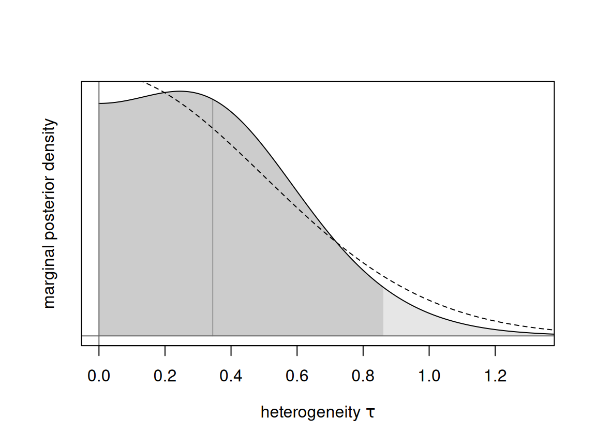
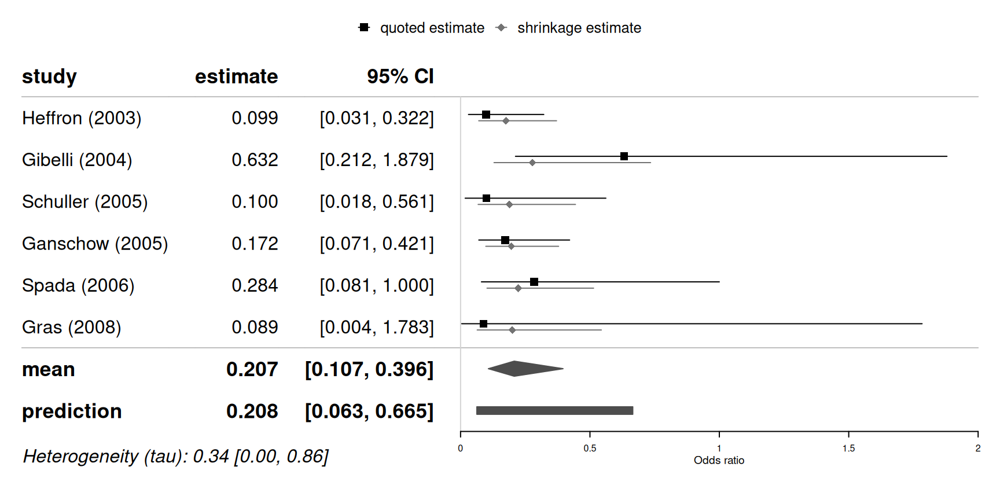
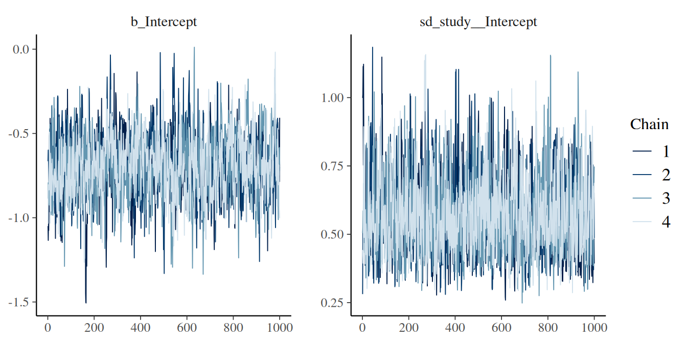
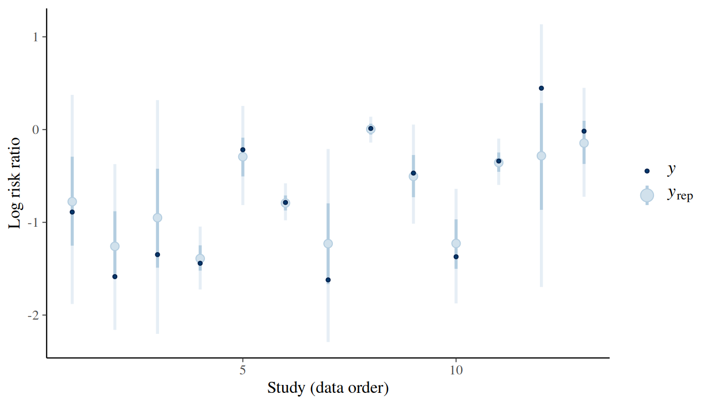
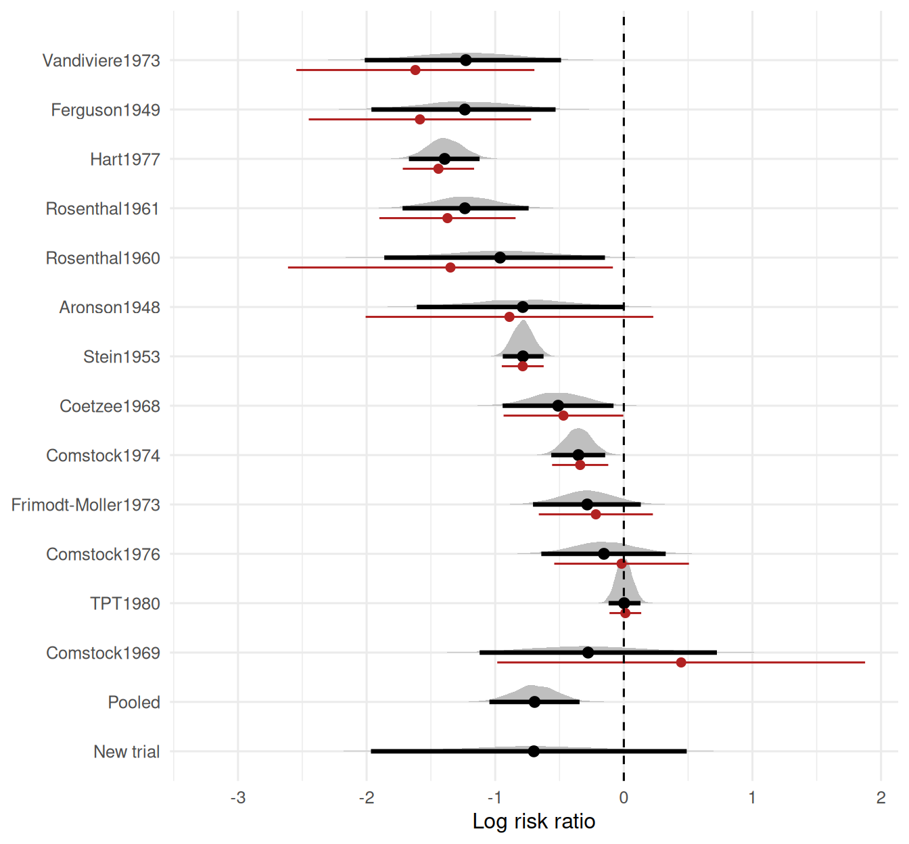

# (PART) Advanced Methods {#sec-part-advanced-methods .unnumbered}

# Bayesian Meta-Analysis {#sec-bayesian}

Meta-analysis is a natural application of Bayesian inference. The random-effects model of
Chapter \@ref(sec-models) is already a hierarchical model: study-specific effects are drawn from
a population distribution whose mean and variance are the targets of inference. A Bayesian
analysis adds prior distributions for these population parameters and reports their joint
posterior distribution. Four practical advantages follow. First, uncertainty in the
between-study standard deviation $\tau$ is propagated into every other quantity, including the
pooled effect and the prediction for a new study, rather than being ignored by plugging in a
point estimate. Second, when the number of studies is small, prior information about plausible
heterogeneity can stabilize inference where frequentist methods break down. Third, the
posterior supports direct probability statements, such as the probability that the effect
exceeds a clinically relevant threshold. Fourth, Bayes factors and Bayesian model averaging
provide a coherent way to weigh evidence for and against an effect, heterogeneity, or
publication bias.

These advantages come with obligations: priors must be chosen and justified, the computations
must be checked, and the results must be reported in enough detail to be reproduced and
criticized. This chapter covers the normal-normal hierarchical model and its priors, fits it
with the `bayesmeta` package (which uses numerical integration instead of MCMC) and with `brms`
(which uses Stan), and then turns to Bayes factors and model averaging with `metaBMA` and
`RoBMA`. We close with the special case of very few studies and with reporting guidelines.

## The Bayesian normal-normal hierarchical model {#sec-bayesian-model}

Let $y_i$ be the estimate from study $i = 1, \ldots, k$ with known standard error $\sigma_i$. The
normal-normal hierarchical model (NNHM) is
$$
\begin{aligned}
y_i \mid \theta_i &\sim N(\theta_i, \sigma_i^2), \\
\theta_i \mid \mu, \tau &\sim N(\mu, \tau^2), \\
(\mu, \tau) &\sim p(\mu)\, p(\tau).
\end{aligned}
$$
The first two lines are the random-effects model; the third adds priors, usually independent,
for the overall mean $\mu$ and the heterogeneity $\tau$ [@sutton2001bayesian;
@higgins2009reevaluation]. Integrating out the study effects gives the marginal likelihood
$y_i \mid \mu, \tau \sim N(\mu, \sigma_i^2 + \tau^2)$, and the joint posterior is
$$
p(\mu, \tau \mid y) \propto p(\mu)\, p(\tau) \prod_{i=1}^k
\frac{1}{\sqrt{\sigma_i^2 + \tau^2}}\,
\phi\!\left(\frac{y_i - \mu}{\sqrt{\sigma_i^2 + \tau^2}}\right).
$$

Three derived quantities are of particular interest.

*The marginal posterior of $\tau$.* With a normal prior $\mu \sim N(m_\mu, s_\mu^2)$ (or a flat
prior), $\mu$ can be integrated out analytically, leaving a one-dimensional posterior for $\tau$.
Conditional on $\tau$, the posterior of $\mu$ is normal with a precision-weighted mean; under a
flat prior this is exactly the random-effects estimate with $\tau$ fixed, and a normal prior adds
its mean as one more term in the weighted average. The marginal posterior of $\mu$ is therefore a mixture of
normals over the posterior of $\tau$. The `bayesmeta` package exploits this structure to compute
all posterior quantities by numerical integration, with no simulation error
[@rover2020bayesian].

*Shrinkage estimates.* Given $\mu$ and $\tau$, the posterior of a study's true effect is
$$
\theta_i \mid \mu, \tau, y \sim N\!\left(B_i \mu + (1 - B_i)\, y_i,\; (1 - B_i)\,\sigma_i^2\right),
\qquad B_i = \frac{\sigma_i^2}{\sigma_i^2 + \tau^2}.
$$
Each study's estimate is pulled toward the overall mean, more strongly when the study is
imprecise ($\sigma_i^2$ large) or when heterogeneity is small ($\tau^2$ small). Averaging over the
posterior of $(\mu, \tau)$ gives the *shrinkage* or study-specific estimates, which are usually a
better guess of a study's true effect than its own estimate.

*The posterior predictive distribution* of the true effect in a new study,
$\theta_{\text{new}} \mid y = \int N(\mu, \tau^2)\, p(\mu, \tau \mid y)\, d\mu\, d\tau$, is the
Bayesian counterpart of the prediction interval of Chapter \@ref(sec-heterogeneity). Because it
integrates over uncertainty in $\tau$, it does not need the ad hoc $t$-distribution
approximation used in frequentist prediction intervals [@higgins2009reevaluation].

## Prior distributions {#sec-bayesian-priors}

### Priors for the overall effect {#sec-bayesian-prior-mu}

With more than a few studies the likelihood dominates the prior for $\mu$, and a weakly
informative normal prior centered on zero is a reasonable default. The scale should exclude
absurd values while comfortably covering all plausible ones. For log odds ratios or log risk
ratios, $N(0, 4^2)$ is nearly flat over the range of realistic effects (an odds ratio of
$e^{8} \approx 3000$ is two prior standard deviations from zero), while $N(0, 1)$ places 95% of its
mass on odds ratios between about 0.14 and 7. For standardized mean differences, $N(0, 1)$ is a
common choice. A prior centered on zero is mildly skeptical, which is usually appropriate. When
the prior for $\mu$ matters, which happens with very few studies or when Bayes factors are
computed, it must be justified and its influence shown in a sensitivity analysis.

### Priors for heterogeneity {#sec-bayesian-prior-tau}

The prior for $\tau$ is the consequential choice. The likelihood carries little information about
$\tau$ unless $k$ is large, so the prior shapes the posterior of $\tau$ and, through it, the width
of the credible interval for $\mu$ and of the predictive interval.

Improper "non-informative" priors are a poor choice. A uniform prior on $\log\tau$ yields an
improper posterior, and a uniform prior on $\tau^2$ places most of its mass on large values. A
uniform prior on $\tau$ over a wide but bounded range is proper but implies that very large
heterogeneity is as likely as small heterogeneity. @gelman2006prior recommended half-$t$ and
half-Cauchy priors for hierarchical standard deviations: they have their mode at zero, decline
gradually, and have heavy tails that let the data override them if heterogeneity is large. The
half-normal prior is similar but has lighter tails.

@rover2021weakly reviewed weakly informative priors for $\tau$ in meta-analysis. They argue that a
prior should be judged by the plausibility of the heterogeneity it implies on the outcome scale,
and suggest relating the prior scale to the *unit information standard deviation* (UISD), the
within-study standard deviation corresponding to a single observation, so that the prior
expresses heterogeneity as a fraction of the variability between individual patients or
participants. For log odds ratios, half-normal priors with scale 0.5 or 1.0 are common choices
[@friede2017meta]. Which prior is appropriate depends on the outcome scale and the context.

### Empirically based priors {#sec-bayesian-prior-empirical}

An alternative is to calibrate the prior on what heterogeneity looks like in comparable
meta-analyses. @turner2015predictive analyzed thousands of meta-analyses of binary outcomes in the
Cochrane Database of Systematic Reviews and derived log-normal predictive distributions for
$\tau^2$ (on the log odds ratio scale), classified by the type of outcome (e.g., all-cause
mortality, subjective outcomes) and the type of comparison (e.g., pharmacological versus
placebo). @rhodes2015predictive did the same for standardized mean differences, obtaining
log-$t$ predictive distributions. For psychology, @vanerp2017estimates compiled heterogeneity
estimates from 705 meta-analyses published in *Psychological Bulletin*, which underlie the default
heterogeneity prior in `RoBMA`, and @bartos2021bayesian developed empirical priors for both $\mu$
and $\tau$ in medicine for use in Bayesian model averaging. Empirically based priors are most
useful when $k$ is small, and both sets of predictive distributions are available in `bayesmeta`
through `TurnerEtAlPrior()` and `RhodesEtAlPrior()`.

## Fitting the model with bayesmeta {#sec-bayesian-bayesmeta}

Our first example is a small meta-analysis of six studies in pediatric liver transplantation,
distributed with `bayesmeta`. The studies compared immunosuppression including an interleukin-2
receptor antagonist (IL-2RA) with control regimens without it; the outcome is acute rejection.
Only two of the six studies were randomized. Small meta-analyses of this kind are common in
rare diseases and are exactly where the choice of method matters.


``` r
library(bayesmeta)
data("CrinsEtAl2014", package = "bayesmeta")
crins <- escalc(measure = "OR",
                ai = exp.AR.events,  n1i = exp.total,
                ci = cont.AR.events, n2i = cont.total,
                slab = publication, data = CrinsEtAl2014)
crins[, c("publication", "randomized", "exp.AR.events", "exp.total",
          "cont.AR.events", "cont.total", "yi", "vi")]
#> 
#>       publication randomized exp.AR.events exp.total cont.AR.events cont.total 
#> 1  Heffron (2003)        yes            14        61             15         20 
#> 2  Gibelli (2004)         no            16        28             19         28 
#> 3 Schuller (2005)         no             3        18              8         12 
#> 4 Ganschow (2005)         no             9        54             29         54 
#> 5    Spada (2006)        yes             4        36             11         36 
#> 6     Gras (2008)         no             0        50              3         34 
#>        yi     vi 
#> 1 -2.3097 0.3594 
#> 2 -0.4595 0.3096 
#> 3 -2.3026 0.7750 
#> 4 -1.7579 0.2078 
#> 5 -1.2585 0.4122 
#> 6 -2.4179 2.3373
```

All six log odds ratios are negative (IL-2RA associated with fewer rejections), but the studies
are small and their standard errors range from 0.46 to 1.53.

Before fitting, it is worth looking at what candidate priors for $\tau$ imply. We compare a
half-normal prior with scale 0.5, a half-Cauchy prior with scale 1, and the empirically based
prior of @turner2015predictive. Classifying the outcome for the Turner prior is a judgment call;
we treat acute graft rejection as a major morbidity event and the comparison as pharmacological
versus control. The unit information standard deviation of these data puts the prior scales in
perspective.


``` r
tp <- TurnerEtAlPrior(
  outcome = "cause-specific mortality / major morbidity event / composite (mortality or morbidity)",
  comparator1 = "pharmacological", comparator2 = "placebo / control")
tp$parameters      # log-normal prior: parameters for tau^2 and tau
#>        log-normal
#>             mu sigma
#>   tau^2 -3.710  1.74
#>   tau   -1.855  0.87

probs <- c(0.05, 0.25, 0.5, 0.75, 0.95)
prior_q <- rbind("Half-normal(0.5)" = qhalfnormal(probs, scale = 0.5),
                 "Half-Cauchy(1)"   = qhalfcauchy(probs, scale = 1),
                 "Turner et al."    = tp$qprior(probs))
colnames(prior_q) <- paste0("q", probs * 100)
round(prior_q, 3)
#>                     q5   q25   q50   q75    q95
#> Half-normal(0.5) 0.031 0.159 0.337 0.575  0.980
#> Half-Cauchy(1)   0.079 0.414 1.000 2.414 12.706
#> Turner et al.    0.037 0.087 0.156 0.281  0.654

uisd(crins$exp.total + crins$cont.total, sigma = sqrt(crins$vi))
#> [1] 5.366
```

A heterogeneity of $\tau = 0.5$ on the log odds ratio scale means that the true odds ratios of
95% of studies lie within a factor of $e^{2 \times 1.96 \times 0.5} \approx 7$ of each other,
which is substantial. The half-normal(0.5) prior gives this or more a prior probability of about
0.32, the half-Cauchy(1) prior a much larger probability, and its 95th percentile is above 12,
an absurd amount of heterogeneity that the heavy tail nevertheless allows. The Turner prior has
its median near 0.16 and puts little mass above 0.6. The estimated UISD of about 5.4 says that
the standard deviation of the log odds ratio contributed by a single patient is large, so all
three priors describe heterogeneity that is small relative to within-study variability.

We use a $N(0, 4^2)$ prior for the log odds ratio and the half-normal prior with scale 0.5 for
$\tau$, one of the weakly informative choices discussed by @rover2021weakly, as our primary
analysis.


``` r
bm_hn <- bayesmeta(y = crins$yi, sigma = sqrt(crins$vi), labels = crins$publication,
                   mu.prior.mean = 0, mu.prior.sd = 4,
                   tau.prior = function(t) dhalfnormal(t, scale = 0.5))
bm_hn$summary
#>              tau      mu   theta
#> mode      0.2453 -1.5691 -1.5633
#> median    0.3445 -1.5735 -1.5702
#> mean      0.3811 -1.5764 -1.5764
#> sd        0.2594  0.3295  0.5672
#> 95% lower 0.0000 -2.2311 -2.7661
#> 95% upper 0.8607 -0.9263 -0.4073
```

The `summary` matrix has three columns: $\tau$, $\mu$, and $\theta$, the effect in a new study
(the posterior predictive distribution). The posterior median of $\tau$ is 0.34 and its 95%
shortest credible interval runs from 0 to 0.86, so the data are compatible with anything from no
heterogeneity to substantial heterogeneity. The posterior median of $\mu$ is $-1.57$ (95% CrI
$-2.23$ to $-0.93$), an odds ratio of about 0.21. The predictive interval for $\theta_{\text{new}}$,
$-2.77$ to $-0.41$, is considerably wider. On the odds ratio scale:


``` r
round(exp(bm_hn$summary[c("median", "95% lower", "95% upper"), c("mu", "theta")]), 3)
#>              mu theta
#> median    0.207 0.208
#> 95% lower 0.107 0.063
#> 95% upper 0.396 0.665
# posterior probability that the pooled odds ratio is below 0.5
bm_hn$pposterior(mu = log(0.5))
#> [1] 0.9948
```

The posterior probability that the pooled odds ratio is below 0.5, a halving of the odds of acute
rejection, is 0.995. Statements of this kind, which address the question a clinician
actually asks, are the main interpretive advantage of the Bayesian approach.


``` r
plot(bm_hn, which = 4, prior = TRUE, main = "")
```

<div class="figure" style="text-align: center">

<p class="caption">(\#fig:bayes-crins-tau)Prior (dashed) and posterior (solid) densities of the heterogeneity tau for the transplantation data, half-normal(0.5) prior.</p>
</div>

Figure \@ref(fig:bayes-crins-tau) compares the prior and posterior of $\tau$. The posterior is
only moderately more concentrated than the prior: six small studies carry limited information
about heterogeneity, so the prior is doing real work. That is not a flaw to be hidden but a fact
to be reported, together with a sensitivity analysis.

Because $I^2$ is a monotone function of $\tau$ for given standard errors, its posterior quantiles
follow directly from those of $\tau$. `bayesmeta` provides the transformation:


``` r
tau_q <- bm_hn$qposterior(tau.p = c(0.025, 0.5, 0.975))
round(rbind(tau = tau_q, I2 = bm_hn$I2(tau = tau_q)), 3)
#>      [,1]  [,2]  [,3]
#> tau 0.018 0.345 0.973
#> I2  0.001 0.217 0.689
```

These are equal-tailed quantiles, so the lower limit for $\tau$ (0.02) differs from the shortest
interval reported above, which starts at zero. The posterior median of $I^2$ is 22%, but its 95%
interval runs from essentially 0 to 69%, which makes the point of Chapter \@ref(sec-heterogeneity) concrete: with few studies,
a single $I^2$ value conveys a precision that the data do not have.

### Shrinkage estimates and the forest plot {#sec-bayesian-bayesmeta-shrinkage}


``` r
round(bm_hn$theta[c("y", "sigma", "median", "95% lower", "95% upper"), ], 2)
#>           Heffron (2003) Gibelli (2004) Schuller (2005) Ganschow (2005)
#> y                  -2.31          -0.46           -2.30           -1.76
#> sigma               0.60           0.56            0.88            0.46
#> median             -1.74          -1.28           -1.67           -1.63
#> 95% lower          -2.66          -2.05           -2.69           -2.33
#> 95% upper          -0.99          -0.31           -0.81           -0.97
#>           Spada (2006) Gras (2008)
#> y                -1.26       -2.42
#> sigma             0.64        1.53
#> median           -1.50       -1.61
#> 95% lower        -2.28       -2.74
#> 95% upper        -0.67       -0.61
```

The shrinkage estimates are pulled toward the overall mean of about $-1.57$. The Gibelli study,
the only one with a small observed effect ($y = -0.46$), is pulled furthest, to a posterior
median of $-1.28$, and the imprecise Gras study ($\sigma = 1.53$) is pulled from $-2.42$ to
$-1.61$. The forest plot in Figure \@ref(fig:bayes-crins-forest) shows both the original
estimates and the shrinkage intervals, together with the pooled estimate and the predictive
interval.


``` r
forestplot(bm_hn, expo = TRUE, xlab = "Odds ratio")
```

<div class="figure" style="text-align: center">

<p class="caption">(\#fig:bayes-crins-forest)Bayesian forest plot for the transplantation data. For each study, the observed estimate with its 95% confidence interval and the shrinkage estimate (grey) are shown; the diamond is the posterior of the pooled effect and the bar below it the 95% predictive interval.</p>
</div>

### Prior sensitivity {#sec-bayesian-bayesmeta-sensitivity}

We repeat the analysis with the two other priors for $\tau$: the heavier-tailed half-Cauchy prior
with scale 1 (the choice in the `bayesmeta` documentation for these data) and the empirically
based log-normal prior of @turner2015predictive.


``` r
bm_hc <- bayesmeta(y = crins$yi, sigma = sqrt(crins$vi), labels = crins$publication,
                   mu.prior.mean = 0, mu.prior.sd = 4,
                   tau.prior = function(t) dhalfcauchy(t, scale = 1))
bm_tu <- bayesmeta(y = crins$yi, sigma = sqrt(crins$vi), labels = crins$publication,
                   mu.prior.mean = 0, mu.prior.sd = 4, tau.prior = tp$dprior)

sens_row <- function(fit, name) {
  s <- fit$summary
  data.frame(prior = name,
             tau_median = s["median", "tau"], tau_upper = s["95% upper", "tau"],
             mu_median = s["median", "mu"],
             mu_lower = s["95% lower", "mu"], mu_upper = s["95% upper", "mu"],
             pred_lower = s["95% lower", "theta"], pred_upper = s["95% upper", "theta"])
}
sens <- rbind(sens_row(bm_hn, "Half-normal(0.5)"),
              sens_row(bm_hc, "Half-Cauchy(1)"),
              sens_row(bm_tu, "Turner et al. log-normal"))
knitr::kable(sens, digits = 2, row.names = FALSE,
             caption = "Sensitivity of the posterior to the heterogeneity prior (log odds ratio scale).")
```


Table: (\#tab:bayes-crins-sensitivity)Sensitivity of the posterior to the heterogeneity prior (log odds ratio scale).

|prior                    | tau_median| tau_upper| mu_median| mu_lower| mu_upper| pred_lower| pred_upper|
|:------------------------|----------:|---------:|---------:|--------:|--------:|----------:|----------:|
|Half-normal(0.5)         |       0.34|      0.86|     -1.57|    -2.23|    -0.93|      -2.77|      -0.41|
|Half-Cauchy(1)           |       0.47|      1.30|     -1.58|    -2.37|    -0.82|      -3.24|       0.03|
|Turner et al. log-normal |       0.17|      0.60|     -1.56|    -2.13|    -1.00|      -2.38|      -0.75|


The point estimate of $\mu$ hardly changes (-1.56 to -1.58), but its credible interval and,
especially, the predictive interval depend on the prior. The Turner prior, which concentrates on
small to moderate heterogeneity typical of this kind of outcome, gives the narrowest intervals
(posterior median $\tau = 0.17$). The half-Cauchy prior with scale 1 allows larger heterogeneity,
and under it the upper end of the predictive interval reaches zero: a new study could plausibly
show no benefit. All three analyses agree that IL-2RA reduces the odds of acute rejection on
average. The prior sensitivity concerns how variable the effect is across settings, which is
exactly the question for which six studies provide little information.

## Few studies {#sec-bayesian-few-studies}

Frequentist random-effects methods have well-known problems when $k$ is small. Estimates of
$\tau^2$ are often zero even when heterogeneity is present, the Wald-type interval for $\mu$ is
too narrow, and the Hartung-Knapp-Sidik-Jonkman (HKSJ) adjustment, which fixes the coverage,
yields extremely wide intervals because it uses a $t$ distribution with $k - 1$ degrees of
freedom. @friede2017meta examined meta-analyses of few small studies, a common situation in rare
diseases, and found that Bayesian random-effects analyses with weakly informative priors for
$\tau$ gave intervals with close to nominal coverage that were considerably shorter than HKSJ
intervals. @seide2019likelihood reached similar conclusions in a comparison of likelihood-based
and Bayesian approaches.

The transplantation data illustrate the issue. With all six studies the REML/HKSJ and Bayesian
intervals are similar; with only the two randomized studies they diverge sharply.


``` r
rand <- crins[crins$randomized == "yes", ]
fe_two  <- rma(yi, vi, data = rand, method = "FE")
re_two  <- rma(yi, vi, data = rand, method = "REML", test = "knha")
bm_two  <- bayesmeta(y = rand$yi, sigma = sqrt(rand$vi), labels = rand$publication,
                     mu.prior.mean = 0, mu.prior.sd = 4,
                     tau.prior = function(t) dhalfnormal(t, scale = 0.5))
re_all  <- rma(yi, vi, data = crins, method = "REML", test = "knha")

data.frame(
  analysis = c("All 6: REML + HKSJ", "All 6: Bayes HN(0.5)",
               "2 RCTs: common effect", "2 RCTs: REML + HKSJ", "2 RCTs: Bayes HN(0.5)"),
  estimate = c(coef(re_all), bm_hn$summary["median", "mu"],
               coef(fe_two), coef(re_two), bm_two$summary["median", "mu"]),
  lower = c(re_all$ci.lb, bm_hn$summary["95% lower", "mu"],
            fe_two$ci.lb, re_two$ci.lb, bm_two$summary["95% lower", "mu"]),
  upper = c(re_all$ci.ub, bm_hn$summary["95% upper", "mu"],
            fe_two$ci.ub, re_two$ci.ub, bm_two$summary["95% upper", "mu"])) |>
  knitr::kable(digits = 2, caption = "Pooled log odds ratio with all six studies and with the two randomized studies only.")
```


Table: (\#tab:bayes-few-studies)Pooled log odds ratio with all six studies and with the two randomized studies only.

|analysis              | estimate| lower| upper|
|:---------------------|--------:|-----:|-----:|
|All 6: REML + HKSJ    |    -1.59| -2.39| -0.79|
|All 6: Bayes HN(0.5)  |    -1.57| -2.23| -0.93|
|2 RCTs: common effect |    -1.82| -2.68| -0.96|
|2 RCTs: REML + HKSJ   |    -1.81| -8.48|  4.86|
|2 RCTs: Bayes HN(0.5) |    -1.78| -2.86| -0.69|


With two studies the HKSJ interval uses a $t$ distribution with one degree of freedom and runs
from $-8.48$ to $4.86$, an interval that excludes nothing of interest. The common-effect interval
($-2.68$ to $-0.96$) is narrow but assumes away heterogeneity that we have no way to rule out. The
Bayesian analysis ($-2.86$ to $-0.69$) with a weakly informative half-normal prior gives an
intermediate answer that is honest about heterogeneity without being uninformative. Its width
depends visibly on the prior, which is why the prior must be justified, and with two studies an
empirically based prior is particularly attractive. The `bayesmeta` documentation also shows how
the non-randomized studies could inform the heterogeneity prior for an analysis of the randomized
ones, by using the posterior of $\tau$ from the former as the prior for the latter.

## Bayesian meta-analysis with brms {#sec-bayesian-brms}

`bayesmeta` is fast and exact for the NNHM, but it does not handle moderators flexibly,
multilevel structures, or non-normal likelihoods. The `brms` package [@burkner2017brms] fits a
wide class of Bayesian regression models through Stan [@carpenter2017stan] using a formula
syntax close to `lme4`. A random-effects meta-analysis is a Gaussian multilevel model in which
the residual standard deviation of each observation is fixed at the known standard error, which
`brms` expresses with the `se()` addition term:

```
yi | se(sei) ~ 1 + (1 | study)
```

The intercept is $\mu$ and the standard deviation of the `study` random intercepts is $\tau$.
Each `brms` model is compiled to C++ before sampling, which takes about a minute; we keep the
number of compiled models in this chapter to two.

### Model specification and priors {#sec-bayesian-brms-fit}

We use the classic BCG vaccine data: 13 trials of the BCG vaccine against tuberculosis, with log
risk ratios as the effect measure and absolute latitude as a candidate moderator.


``` r
library(brms)
library(tidybayes)
library(ggdist)
library(dplyr)

bcg <- escalc(measure = "RR", ai = tpos, bi = tneg, ci = cpos, di = cneg, data = dat.bcg)
bcg$sei   <- sqrt(bcg$vi)
bcg$study <- paste0(sub(" .*", "", bcg$author), bcg$year)   # e.g. "Aronson1948"
bcg$ablat_c <- bcg$ablat - 33                                 # centered latitude
rma(yi, vi, data = bcg)
#> 
#> Random-Effects Model (k = 13; tau^2 estimator: REML)
#> 
#> tau^2 (estimated amount of total heterogeneity): 0.3132 (SE = 0.1664)
#> tau (square root of estimated tau^2 value):      0.5597
#> I^2 (total heterogeneity / total variability):   92.22%
#> H^2 (total variability / sampling variability):  12.86
#> 
#> Test for Heterogeneity:
#> Q(df = 12) = 152.2330, p-val < .0001
#> 
#> Model Results:
#> 
#> estimate      se     zval    pval    ci.lb    ci.ub      
#>  -0.7145  0.1798  -3.9744  <.0001  -1.0669  -0.3622  *** 
#> 
#> ---
#> Signif. codes:  0 '***' 0.001 '**' 0.01 '*' 0.05 '.' 0.1 ' ' 1
```

The REML analysis gives $\hat\mu = -0.71$ and $\hat\tau = 0.56$ with $I^2 = 92\%$, so heterogeneity
is substantial. We use a $N(0, 1)$ prior for $\mu$ (risk ratios between about 0.14 and 7 a priori)
and a half-normal prior with scale 0.5 for $\tau$; `brms` truncates priors on standard deviations
at zero automatically.


``` r
priors <- c(prior(normal(0, 1), class = Intercept),
            prior(normal(0, 0.5), class = sd))
fit_re <- brm(yi | se(sei) ~ 1 + (1 | study), data = bcg, prior = priors,
              chains = 4, iter = 2000, warmup = 1000, seed = 2026,
              control = list(adapt_delta = 0.95), refresh = 0, silent = 2,
              backend = "rstan")
summary(fit_re)
#>  Family: gaussian 
#>   Links: mu = identity 
#> Formula: yi | se(sei) ~ 1 + (1 | study) 
#>    Data: bcg (Number of observations: 13) 
#>   Draws: 4 chains, each with iter = 2000; warmup = 1000; thin = 1;
#>          total post-warmup draws = 4000
#> 
#> Multilevel Hyperparameters:
#> ~study (Number of levels: 13) 
#>               Estimate Est.Error l-95% CI u-95% CI Rhat Bulk_ESS Tail_ESS
#> sd(Intercept)     0.57      0.14     0.35     0.89 1.00     1512     2141
#> 
#> Regression Coefficients:
#>           Estimate Est.Error l-95% CI u-95% CI Rhat Bulk_ESS Tail_ESS
#> Intercept    -0.69      0.18    -1.05    -0.34 1.01      797     1402
#> 
#> Further Distributional Parameters:
#>       Estimate Est.Error l-95% CI u-95% CI Rhat Bulk_ESS Tail_ESS
#> sigma     0.00      0.00     0.00     0.00   NA       NA       NA
#> 
#> Draws were sampled using sampling(NUTS). For each parameter, Bulk_ESS
#> and Tail_ESS are effective sample size measures, and Rhat is the potential
#> scale reduction factor on split chains (at convergence, Rhat = 1).
```

The posterior mean of $\mu$ is $-0.68$ (95% CrI $-1.05$ to $-0.31$) and of $\tau$ is 0.57 (0.35
to 0.91), close to the REML results, as expected with 13 studies and a prior that is not in
conflict with the data. The `sigma` row, fixed at zero, is the residual standard deviation
beyond the known standard errors and can be ignored. `prior_summary(fit_re)` lists all priors
actually used, including defaults, and should always be inspected.

### Convergence diagnostics {#sec-bayesian-brms-convergence}

MCMC output is only useful if the chains have converged to the posterior and the effective
sample size is large enough for the summaries reported. The rank-normalized $\hat{R}$ compares
between-chain and within-chain variation and should be below 1.01; bulk and tail effective
sample sizes (ESS) measure the precision of central and tail summaries and should be at least a
few hundred [@vehtari2021rank]. Divergent transitions signal that the sampler could not explore
part of the posterior, which in hierarchical models typically happens near $\tau = 0$; they
should be zero, and if they are not, increasing `adapt_delta` is the first remedy.


``` r
library(posterior)
summarise_draws(as_draws_df(fit_re, variable = c("b_Intercept", "sd_study__Intercept")),
                "mean", "sd", ~quantile(.x, c(0.025, 0.975)), "rhat", "ess_bulk", "ess_tail")
#> # A tibble: 2 × 8
#>   variable              mean    sd `2.5%` `97.5%`  rhat ess_bulk ess_tail
#>   <chr>                <dbl> <dbl>  <dbl>   <dbl> <dbl>    <dbl>    <dbl>
#> 1 b_Intercept         -0.692 0.181 -1.05   -0.344  1.01     797.    1402.
#> 2 sd_study__Intercept  0.570 0.141  0.348   0.887  1.00    1512.    2141.
n_div <- sum(nuts_params(fit_re)$Value[nuts_params(fit_re)$Parameter == "divergent__"])
n_div
#> [1] 0
```


``` r
bayesplot::mcmc_trace(as_draws_df(fit_re), pars = c("b_Intercept", "sd_study__Intercept"))
```

<div class="figure" style="text-align: center">

<p class="caption">(\#fig:bayes-brms-trace)Trace plots of the four chains for mu (b_Intercept) and tau (sd_study__Intercept).</p>
</div>

$\hat{R}$ is 1.00 for both parameters, bulk ESS is above 800, there are 0 divergent
transitions, and the trace plots in Figure \@ref(fig:bayes-brms-trace) show well-mixed chains.

### Posterior predictive checks {#sec-bayesian-brms-ppc}

A posterior predictive check simulates replicated data $y^{\text{rep}}$ from the fitted model and
compares them with the observed data [@gabry2019visualization]. For a meta-analysis, a useful
display shows, for each study, the posterior predictive interval of $y_i^{\text{rep}}$ together
with the observed $y_i$. Because the replicated data condition on each study's own $\theta_i$,
which was estimated from $y_i$, this check is lenient: it reveals gross misfit, such as an outlier
that the shrinkage cannot accommodate, rather than subtle problems.


``` r
pp_check(fit_re, type = "intervals", ndraws = 1000) +
  labs(x = "Study (data order)", y = "Log risk ratio")
```

<div class="figure" style="text-align: center">

<p class="caption">(\#fig:bayes-brms-ppc)Posterior predictive check: 50% and 90% predictive intervals for each study (blue) and the observed log risk ratios (dark points).</p>
</div>

All observed values lie within the 90% predictive intervals in Figure \@ref(fig:bayes-brms-ppc).

### Study-specific estimates and a forest plot {#sec-bayesian-brms-forest}

The `tidybayes` package extracts posterior draws in tidy form, which makes the shrinkage
estimates $\theta_i = \mu + u_i$ easy to compute and plot with `ggdist`.


``` r
study_draws <- fit_re |>
  spread_draws(b_Intercept, r_study[study, term]) |>
  mutate(theta = b_Intercept + r_study) |>
  ungroup() |>
  select(.draw, study, theta)

set.seed(2026)
pooled_draws <- fit_re |>
  spread_draws(b_Intercept, sd_study__Intercept) |>
  mutate(Pooled = b_Intercept,
         `New trial` = rnorm(n(), b_Intercept, sd_study__Intercept)) |>
  select(.draw, Pooled, `New trial`) |>
  tidyr::pivot_longer(-.draw, names_to = "study", values_to = "theta")

ord <- bcg$study[order(bcg$yi)]
plot_draws <- bind_rows(study_draws, pooled_draws) |>
  mutate(study = factor(study, levels = rev(c(ord, "Pooled", "New trial"))))

ggplot(plot_draws, aes(x = theta, y = study)) +
  stat_halfeye(.width = 0.95, fill = "grey75", point_interval = median_qi) +
  geom_pointrange(data = bcg, aes(x = yi, xmin = yi - 1.96 * sei, xmax = yi + 1.96 * sei,
                                  y = study),
                  inherit.aes = FALSE, size = 0.3, colour = "firebrick",
                  position = position_nudge(y = -0.2)) +
  geom_vline(xintercept = 0, linetype = 2) +
  labs(x = "Log risk ratio", y = NULL)
```

<div class="figure" style="text-align: center">

<p class="caption">(\#fig:bayes-brms-forest)Bayesian forest plot for the BCG trials. Points with thin lines are the observed log risk ratios with 95% confidence intervals; the densities are the posterior distributions of the study-specific effects and, at the bottom, of the pooled effect and of the effect in a new trial.</p>
</div>


``` r
study_draws |>
  group_by(study) |>
  median_qi(theta) |>
  left_join(bcg[, c("study", "yi", "sei")] |> as.data.frame(), by = "study") |>
  select(study, yi, sei, theta, .lower, .upper) |>
  arrange(yi) |>
  knitr::kable(digits = 2, caption = "Observed and shrinkage estimates (posterior medians and 95% intervals) of the log risk ratio.")
```


Table: (\#tab:bayes-brms-shrinkage)Observed and shrinkage estimates (posterior medians and 95% intervals) of the log risk ratio.

|study              |    yi|  sei| theta| .lower| .upper|
|:------------------|-----:|----:|-----:|------:|------:|
|Vandiviere1973     | -1.62| 0.47| -1.23|  -2.01|  -0.49|
|Ferguson1949       | -1.59| 0.44| -1.24|  -1.96|  -0.53|
|Hart1977           | -1.44| 0.14| -1.39|  -1.67|  -1.12|
|Rosenthal1961      | -1.37| 0.27| -1.24|  -1.72|  -0.74|
|Rosenthal1960      | -1.35| 0.64| -0.96|  -1.86|  -0.15|
|Aronson1948        | -0.89| 0.57| -0.79|  -1.61|   0.00|
|Stein1953          | -0.79| 0.08| -0.78|  -0.94|  -0.62|
|Coetzee1968        | -0.47| 0.24| -0.51|  -0.94|  -0.08|
|Comstock1974       | -0.34| 0.11| -0.35|  -0.56|  -0.15|
|Frimodt-Moller1973 | -0.22| 0.23| -0.28|  -0.71|   0.13|
|Comstock1976       | -0.02| 0.27| -0.15|  -0.64|   0.33|
|TPT1980            |  0.01| 0.06|  0.00|  -0.12|   0.13|
|Comstock1969       |  0.45| 0.73| -0.28|  -1.12|   0.72|


``` r

pooled_sum <- pooled_draws |>
  group_by(study) |>
  summarise(median = median(theta), lower = quantile(theta, 0.025),
            upper = quantile(theta, 0.975), p_benefit = mean(theta < 0)) |>
  as.data.frame()
rownames(pooled_sum) <- pooled_sum$study
pooled_sum
#>               study  median  lower   upper p_benefit
#> New trial New trial -0.6996 -1.966  0.4890    0.8790
#> Pooled       Pooled -0.6937 -1.045 -0.3441    0.9998
```

The shrinkage is visible for imprecise trials with extreme estimates. The predictive
distribution for a new trial is wide, with a 95% interval from
-1.97 to
0.49 on the log risk ratio scale (risk ratios
from about 0.14 to
1.63). The probability that a new trial
would show a benefit ($\theta_{\text{new}} < 0$) is
0.88, noticeably lower than the probability
that the average effect is beneficial (1.000). With heterogeneity this large, the average effect alone
is a misleading summary, a point that is easy to communicate with the posterior predictive
distribution.

### Bayesian meta-regression {#sec-bayesian-brms-metareg}

Moderators enter the formula as in any regression. Absolute latitude is the classic moderator
for the BCG data: the vaccine appears more effective farther from the equator. We center it at
33 degrees (close to its mean) so that the intercept is the effect at an average latitude, and give
the slope a $N(0, 0.1^2)$ prior, which allows changes of up to about $\pm 0.2$ in the log risk
ratio per degree with high prior probability, a very wide range for this context.


``` r
fit_mr <- brm(yi | se(sei) ~ 1 + ablat_c + (1 | study), data = bcg,
              prior = c(priors, prior(normal(0, 0.1), class = b)),
              chains = 4, iter = 2000, warmup = 1000, seed = 2026,
              control = list(adapt_delta = 0.95), refresh = 0, silent = 2,
              backend = "rstan")
summary(fit_mr)
#>  Family: gaussian 
#>   Links: mu = identity 
#> Formula: yi | se(sei) ~ 1 + ablat_c + (1 | study) 
#>    Data: bcg (Number of observations: 13) 
#>   Draws: 4 chains, each with iter = 2000; warmup = 1000; thin = 1;
#>          total post-warmup draws = 4000
#> 
#> Multilevel Hyperparameters:
#> ~study (Number of levels: 13) 
#>               Estimate Est.Error l-95% CI u-95% CI Rhat Bulk_ESS Tail_ESS
#> sd(Intercept)     0.31      0.14     0.09     0.62 1.00     1186     1852
#> 
#> Regression Coefficients:
#>           Estimate Est.Error l-95% CI u-95% CI Rhat Bulk_ESS Tail_ESS
#> Intercept    -0.70      0.12    -0.95    -0.47 1.00     1793     2076
#> ablat_c      -0.03      0.01    -0.04    -0.01 1.00     1653     1446
#> 
#> Further Distributional Parameters:
#>       Estimate Est.Error l-95% CI u-95% CI Rhat Bulk_ESS Tail_ESS
#> sigma     0.00      0.00     0.00     0.00   NA       NA       NA
#> 
#> Draws were sampled using sampling(NUTS). For each parameter, Bulk_ESS
#> and Tail_ESS are effective sample size measures, and Rhat is the potential
#> scale reduction factor on split chains (at convergence, Rhat = 1).
rma(yi, vi, mods = ~ ablat_c, data = bcg)
#> 
#> Mixed-Effects Model (k = 13; tau^2 estimator: REML)
#> 
#> tau^2 (estimated amount of residual heterogeneity):     0.0764 (SE = 0.0591)
#> tau (square root of estimated tau^2 value):             0.2763
#> I^2 (residual heterogeneity / unaccounted variability): 68.39%
#> H^2 (unaccounted variability / sampling variability):   3.16
#> R^2 (amount of heterogeneity accounted for):            75.62%
#> 
#> Test for Residual Heterogeneity:
#> QE(df = 11) = 30.7331, p-val = 0.0012
#> 
#> Test of Moderators (coefficient 2):
#> QM(df = 1) = 16.3571, p-val < .0001
#> 
#> Model Results:
#> 
#>          estimate      se     zval    pval    ci.lb    ci.ub      
#> intrcpt   -0.7089  0.1072  -6.6112  <.0001  -0.9190  -0.4987  *** 
#> ablat_c   -0.0291  0.0072  -4.0444  <.0001  -0.0432  -0.0150  *** 
#> 
#> ---
#> Signif. codes:  0 '***' 0.001 '**' 0.01 '*' 0.05 '.' 0.1 ' ' 1
mean(as_draws_df(fit_mr)$b_ablat_c < 0)
#> [1] 0.9985
```

The posterior mean of the slope is $-0.03$ per degree (95% CrI $-0.05$ to $-0.01$), essentially the
same as the frequentist meta-regression, and the posterior probability that the slope is
negative is close to one. The posterior mean of $\tau$ falls from 0.57 to 0.31: latitude accounts
for much of the between-trial variability. As in the frequentist setting (Chapter
\@ref(sec-heterogeneity)), this is an observational association across trials, and latitude is
confounded with other trial characteristics.

### Extensions {#sec-bayesian-brms-extensions}

The value of `brms` lies in how easily the basic model can be extended, always with the same
workflow of priors, diagnostics, and posterior checks. Three extensions are common in practice.
Dependent effect sizes (Chapter \@ref(sec-dependent-effects)) are handled by nested random
effects, `yi | se(sei) ~ 1 + (1 | study/es_id)`, which gives separate standard deviations for
between-study and within-study heterogeneity, each needing its own prior. The normality of the
random effects can be relaxed with `(1 | gr(study, dist = "student"))`, which uses a
$t$ distribution whose degrees of freedom are estimated and which downweights outlying studies.
For binary outcomes with few events, the normal approximation for log odds ratios is poor, and an
exact binomial likelihood can be fitted directly to the arm-level counts, for example
`events | trials(n) ~ 0 + factor(study) + treat + (0 + treat | study)` with
`family = binomial()`, where the coefficient of `treat` is the pooled log odds ratio and the
study-specific intercepts represent baseline risks. Network meta-analysis (Chapter
\@ref(sec-network)) builds on the same arm-based formulation. Each extension changes the meaning
of the parameters, so priors must be reconsidered rather than copied.

## Bayes factors and Bayesian model averaging {#sec-bayesian-bma}

Posterior distributions describe uncertainty about parameters within a model. Bayes factors
compare models. The Bayes factor for model $M_1$ against $M_0$ is the ratio of their marginal
likelihoods,
$$
\mathrm{BF}_{10} = \frac{p(y \mid M_1)}{p(y \mid M_0)} =
\frac{\int p(y \mid \vartheta_1, M_1)\, p(\vartheta_1 \mid M_1)\, d\vartheta_1}
     {\int p(y \mid \vartheta_0, M_0)\, p(\vartheta_0 \mid M_0)\, d\vartheta_0},
$$
and it updates prior model odds to posterior model odds [@kass1995bayes]. In meta-analysis the
natural hypotheses are $H_0\!: \mu = 0$ versus $H_1\!: \mu \ne 0$ and $\tau = 0$ versus $\tau > 0$.
Unlike a $p$-value, a Bayes factor can quantify evidence *for* the null. Unlike a posterior,
it depends strongly on the prior under the alternative: a vague prior for $\mu$ spreads the prior
mass over implausible effects and pushes the Bayes factor toward the null. Priors used for Bayes
factors must therefore be chosen with care and their influence reported.

`bayesmeta` reports Bayes factors for $\mu = 0$ and $\tau = 0$, computed from the marginal
likelihoods. Because the priors for $\mu$ and $\tau$ are independent, they equal the Savage-Dickey
density ratio (the ratio of posterior to prior density at the null value):


``` r
bm_hn$bayesfactor
#>          tau=0      mu=0
#> actual  0.8832 0.0037708
#> minimum 0.7443 0.0002719
```

Values are reported as $\mathrm{BF}_{01}$, the evidence for the null value; the row labelled
`actual` contains the Bayes factors under the priors used, the row `minimum` the smallest value
attainable over a class of alternative priors. For $\mu = 0$ the Bayes factor is 0.004, that is,
the data are about 265 times more likely under an effect than under none. For $\tau = 0$ it is
0.88, close to 1: six small studies simply cannot distinguish small heterogeneity from none.
Note that the Bayes factor for $\mu$ depends on the $N(0, 4^2)$ prior. A wide prior spreads mass
over implausibly large odds ratios, and a narrower one would give a different value.

### Bayesian model averaging with metaBMA {#sec-bayesian-metabma}

Rather than choosing between a common-effect and a random-effects model, and between effect and
no effect, Bayesian model averaging (BMA) weights all four combinations by their posterior
probabilities [@hoeting1999bayesian; @gronau2017bayesian; @gronau2021primer]. The inclusion
Bayes factor for the effect compares the two models with an effect against the two without, and
the model-averaged estimate of $\mu$ combines the common- and random-effects posteriors. The
`metaBMA` package implements this with precompiled Stan models. Our example is the set of six
preregistered studies on the effect of "power posing" on felt power analyzed by
@gronau2017bayesian, which is distributed with `metaBMA`.


``` r
library(metaBMA)
power_pose[, c("study", "effectSize", "SE")]
#>                study effectSize     SE
#> 1      Bailey et al.     0.2508 0.2071
#> 2       Ronay et al.     0.2275 0.1931
#> 3 Klaschinski et al.     0.3186 0.1423
#> 4     Bombari et al.     0.2832 0.1421
#> 5        Latu et al.     0.1464 0.1416
#> 6      Keller et al.     0.1510 0.1221

set.seed(2026)
bma_default <- meta_bma(y = effectSize, SE = SE, labels = study, data = power_pose,
                        d   = prior("cauchy", c(location = 0, scale = 0.707)),
                        tau = prior("invgamma", c(shape = 1, scale = 0.15)))
bma_default
#> ### Meta-Analysis with Bayesian Model Averaging ###
#>    Fixed H0:  d = 0 
#>    Fixed H1:  d ~ 't' (location=0, scale=0.707, nu=1) with support on the interval [-Inf,Inf]. 
#>    Random H0: d   = 0,   
#>               tau ~  'invgamma' (shape=1, scale=0.15) with support on the interval [0,Inf]. 
#>    Random H1: d   ~ 't' (location=0, scale=0.707, nu=1) with support on the interval [-Inf,Inf]. 
#>               tau ~ 'invgamma' (shape=1, scale=0.15) with support on the interval [0,Inf]. 
#> 
#> # Bayes factors:
#>            (denominator)
#> (numerator) fixed_H0 fixed_H1 random_H0 random_H1
#>   fixed_H0      1.00   0.0223     0.421    0.0895
#>   fixed_H1     44.80   1.0000    18.862    4.0086
#>   random_H0     2.38   0.0530     1.000    0.2125
#>   random_H1    11.18   0.2495     4.705    1.0000
#> 
#> # Bayesian Model Averaging
#>   Comparison: (fixed_H1 & random_H1) vs. (fixed_H0 & random_H0)
#>   Inclusion Bayes factor: 16.58 
#>   Inclusion posterior probability: 0.943 
#> 
#> # Model posterior probabilities:
#>           prior posterior  logml
#> fixed_H0   0.25    0.0168 -1.553
#> fixed_H1   0.25    0.7548  2.249
#> random_H0  0.25    0.0400 -0.688
#> random_H1  0.25    0.1883  0.861
#> 
#> # Posterior summary statistics of average effect size:
#>           mean    sd  2.5%   50% 97.5% hpd95_lower hpd95_upper n_eff  Rhat
#> averaged 0.219 0.064 0.094 0.219 0.345       0.092       0.343    NA    NA
#> fixed    0.219 0.061 0.104 0.219 0.342       0.103       0.340  3638 1.001
#> random   0.219 0.075 0.074 0.218 0.367       0.073       0.367  6572 1.000
```

With the default priors, a Cauchy prior with scale 0.707 for $d$ and an inverse-gamma prior for
$\tau$ that reflects typical heterogeneity in psychology, the four models receive equal prior
probability. The output shows the matrix of Bayes factors between all pairs of models, the
inclusion Bayes factor for the effect, the posterior model probabilities, and the
model-averaged estimate. The inclusion Bayes factor is 16.6: the data are about 17 times more
likely under the models with an effect than under those without, and the posterior inclusion
probability is 0.94. The common-effect model with an effect receives posterior probability 0.75,
and the model-averaged estimate is $d = 0.22$ (95% CrI 0.09 to 0.35). As a sensitivity analysis we use a one-sided normal prior that encodes
the directional hypothesis of the original studies and smaller plausible effects.


``` r
set.seed(2026)
bma_informed <- meta_bma(y = effectSize, SE = SE, labels = study, data = power_pose,
                         d   = prior("norm", c(mean = 0, sd = 0.3), lower = 0),
                         tau = prior("invgamma", c(shape = 1, scale = 0.15)))
c(default  = bma_default$inclusion$incl.BF,
  informed = bma_informed$inclusion$incl.BF)
#>  default informed 
#>    16.58    81.21
rbind(default  = bma_default$estimates["averaged", c("mean", "2.5%", "97.5%")],
      informed = bma_informed$estimates["averaged", c("mean", "2.5%", "97.5%")])
#>            mean    2.5%  97.5%
#> default  0.2192 0.09373 0.3450
#> informed 0.2131 0.08899 0.3373
```

The model-averaged estimate is stable across the two priors (0.22 and 0.21). The inclusion Bayes
factor, however, depends on the prior for the effect: the informed one-sided prior, which places
its mass on the region where the data lie, yields an inclusion Bayes factor of 81, about five
times the 16.6 obtained under the wide two-sided Cauchy prior. This is the usual pattern and the reason why Bayes factors should always
be accompanied by the priors that produced them and by a sensitivity analysis. In both cases the
common-effect model with an effect receives most of the posterior probability, consistent with
the small differences among these six studies.

### Model averaging over publication bias with RoBMA {#sec-bayesian-robma}

Robust Bayesian meta-analysis extends the model space with models for publication bias, so that
the effect, heterogeneity, and bias components are each tested and averaged over
[@maier2023robust; @bartos2023robust]. Chapter \@ref(sec-publication-bias) introduced it as a
bias-adjustment method. Here we apply it to the power-pose studies to show how the bias component
behaves with few studies. The chunk requires JAGS, is run in the book's continuous-integration
build with a small number of samples, and no later code depends on it.


``` r
library(RoBMA)
fit_robma_pp <- RoBMA(d = power_pose$effectSize, se = power_pose$SE,
                      study_names = power_pose$study,
                      chains = 2, sample = 2000, burnin = 1000, adapt = 500,
                      autofit = FALSE, parallel = FALSE, seed = 2026)
summary(fit_robma_pp)
#> Call:
#> RoBMA(d = power_pose$effectSize, se = power_pose$SE, study_names = power_pose$study, 
#>     chains = 2, sample = 2000, burnin = 1000, adapt = 500, parallel = FALSE, 
#>     autofit = FALSE, seed = 2026)
#> 
#> Robust Bayesian meta-analysis
#> Components summary:
#>               Models Prior prob. Post. prob. Inclusion BF
#> Effect         18/36       0.500       0.484        0.939
#> Heterogeneity  18/36       0.500       0.240        0.317
#> Bias           32/36       0.500       0.705        2.393
#> 
#> Model-averaged estimates:
#>                    Mean Median 0.025  0.975
#> mu                0.090  0.000 0.000  0.315
#> tau               0.026  0.000 0.000  0.194
#> omega[0,0.025]    1.000  1.000 1.000  1.000
#> omega[0.025,0.05] 0.963  1.000 0.473  1.000
#> omega[0.05,0.5]   0.918  1.000 0.239  1.000
#> omega[0.5,0.95]   0.873  1.000 0.033  1.000
#> omega[0.95,0.975] 0.876  1.000 0.033  1.000
#> omega[0.975,1]    0.889  1.000 0.033  1.000
#> PET               0.390  0.000 0.000  1.952
#> PEESE             1.380  0.000 0.000 10.352
#> The estimates are summarized on the Cohen's d scale (priors were specified on the Cohen's d scale).
#> (Estimated publication weights omega correspond to one-sided p-values.)
#> Model (7): ESS 393 is lower than the set target (500).
#> Model (16): R-hat 1.053 is larger than the set target (1.05).
#> Model (26): R-hat 1.051 is larger than the set target (1.05).
#> Model (26): ESS 174 is lower than the set target (500).
#> Model (27): ESS 447 is lower than the set target (500).
#> There were another 0 warnings. To see all warnings call 'check_RoBMA(fit)'.
summary(fit_robma_pp, type = "models")
#> Call:
#> RoBMA(d = power_pose$effectSize, se = power_pose$SE, study_names = power_pose$study, 
#>     chains = 2, sample = 2000, burnin = 1000, adapt = 500, parallel = FALSE, 
#>     autofit = FALSE, seed = 2026)
#> 
#> Robust Bayesian meta-analysis
#> Models overview:
#>  Model Prior Effect Prior Heterogeneity
#>      1     Spike(0)            Spike(0)
#>      2     Spike(0)            Spike(0)
#>      3     Spike(0)            Spike(0)
#>      4     Spike(0)            Spike(0)
#>      5     Spike(0)            Spike(0)
#>      6     Spike(0)            Spike(0)
#>      7     Spike(0)            Spike(0)
#>      8     Spike(0)            Spike(0)
#>      9     Spike(0)            Spike(0)
#>     10     Spike(0)   InvGamma(1, 0.15)
#>     11     Spike(0)   InvGamma(1, 0.15)
#>     12     Spike(0)   InvGamma(1, 0.15)
#>     13     Spike(0)   InvGamma(1, 0.15)
#>     14     Spike(0)   InvGamma(1, 0.15)
#>     15     Spike(0)   InvGamma(1, 0.15)
#>     16     Spike(0)   InvGamma(1, 0.15)
#>     17     Spike(0)   InvGamma(1, 0.15)
#>     18     Spike(0)   InvGamma(1, 0.15)
#>     19 Normal(0, 1)            Spike(0)
#>     20 Normal(0, 1)            Spike(0)
#>     21 Normal(0, 1)            Spike(0)
#>     22 Normal(0, 1)            Spike(0)
#>     23 Normal(0, 1)            Spike(0)
#>     24 Normal(0, 1)            Spike(0)
#>     25 Normal(0, 1)            Spike(0)
#>     26 Normal(0, 1)            Spike(0)
#>     27 Normal(0, 1)            Spike(0)
#>     28 Normal(0, 1)   InvGamma(1, 0.15)
#>     29 Normal(0, 1)   InvGamma(1, 0.15)
#>     30 Normal(0, 1)   InvGamma(1, 0.15)
#>     31 Normal(0, 1)   InvGamma(1, 0.15)
#>     32 Normal(0, 1)   InvGamma(1, 0.15)
#>     33 Normal(0, 1)   InvGamma(1, 0.15)
#>     34 Normal(0, 1)   InvGamma(1, 0.15)
#>     35 Normal(0, 1)   InvGamma(1, 0.15)
#>     36 Normal(0, 1)   InvGamma(1, 0.15)
#>                          Prior Bias                         Prior prob.
#>                                                                   0.125
#>            omega[two-sided: .05] ~ CumDirichlet(1, 1)             0.010
#>        omega[two-sided: .1, .05] ~ CumDirichlet(1, 1, 1)          0.010
#>            omega[one-sided: .05] ~ CumDirichlet(1, 1)             0.010
#>      omega[one-sided: .05, .025] ~ CumDirichlet(1, 1, 1)          0.010
#>        omega[one-sided: .5, .05] ~ CumDirichlet(1, 1, 1)          0.010
#>  omega[one-sided: .5, .05, .025] ~ CumDirichlet(1, 1, 1, 1)       0.010
#>                              PET ~ Cauchy(0, 1)[0, Inf]           0.031
#>                            PEESE ~ Cauchy(0, 5)[0, Inf]           0.031
#>                                                                   0.125
#>            omega[two-sided: .05] ~ CumDirichlet(1, 1)             0.010
#>        omega[two-sided: .1, .05] ~ CumDirichlet(1, 1, 1)          0.010
#>            omega[one-sided: .05] ~ CumDirichlet(1, 1)             0.010
#>      omega[one-sided: .05, .025] ~ CumDirichlet(1, 1, 1)          0.010
#>        omega[one-sided: .5, .05] ~ CumDirichlet(1, 1, 1)          0.010
#>  omega[one-sided: .5, .05, .025] ~ CumDirichlet(1, 1, 1, 1)       0.010
#>                              PET ~ Cauchy(0, 1)[0, Inf]           0.031
#>                            PEESE ~ Cauchy(0, 5)[0, Inf]           0.031
#>                                                                   0.125
#>            omega[two-sided: .05] ~ CumDirichlet(1, 1)             0.010
#>        omega[two-sided: .1, .05] ~ CumDirichlet(1, 1, 1)          0.010
#>            omega[one-sided: .05] ~ CumDirichlet(1, 1)             0.010
#>      omega[one-sided: .05, .025] ~ CumDirichlet(1, 1, 1)          0.010
#>        omega[one-sided: .5, .05] ~ CumDirichlet(1, 1, 1)          0.010
#>  omega[one-sided: .5, .05, .025] ~ CumDirichlet(1, 1, 1, 1)       0.010
#>                              PET ~ Cauchy(0, 1)[0, Inf]           0.031
#>                            PEESE ~ Cauchy(0, 5)[0, Inf]           0.031
#>                                                                   0.125
#>            omega[two-sided: .05] ~ CumDirichlet(1, 1)             0.010
#>        omega[two-sided: .1, .05] ~ CumDirichlet(1, 1, 1)          0.010
#>            omega[one-sided: .05] ~ CumDirichlet(1, 1)             0.010
#>      omega[one-sided: .05, .025] ~ CumDirichlet(1, 1, 1)          0.010
#>        omega[one-sided: .5, .05] ~ CumDirichlet(1, 1, 1)          0.010
#>  omega[one-sided: .5, .05, .025] ~ CumDirichlet(1, 1, 1, 1)       0.010
#>                              PET ~ Cauchy(0, 1)[0, Inf]           0.031
#>                            PEESE ~ Cauchy(0, 5)[0, Inf]           0.031
#>  log(marglik) Post. prob. Inclusion BF
#>          2.67       0.006        0.040
#>          4.03       0.002        0.173
#>          3.86       0.002        0.147
#>          4.04       0.002        0.175
#>          4.73       0.004        0.349
#>          5.85       0.011        1.076
#>          6.37       0.019        1.828
#>          7.66       0.206        8.036
#>          7.15       0.124        4.374
#>          3.50       0.013        0.091
#>          3.77       0.001        0.133
#>          3.44       0.001        0.096
#>          4.02       0.002        0.172
#>          4.38       0.003        0.246
#>          6.12       0.015        1.424
#>          6.34       0.018        1.772
#>          6.29       0.053        1.718
#>          5.93       0.036        1.171
#>          6.34       0.221        1.985
#>          6.07       0.014        1.349
#>          5.54       0.008        0.790
#>          5.73       0.010        0.954
#>          5.59       0.009        0.831
#>          6.41       0.020        1.902
#>          6.38       0.019        1.854
#>          6.15       0.045        1.474
#>          6.01       0.040        1.276
#>          4.96       0.055        0.410
#>          4.56       0.003        0.295
#>          4.01       0.002        0.169
#>          4.32       0.002        0.232
#>          4.12       0.002        0.190
#>          5.27       0.006        0.603
#>          5.18       0.006        0.551
#>          4.82       0.012        0.377
#>          4.64       0.010        0.316
#> Model (7): ESS 393 is lower than the set target (500).
#> Model (16): R-hat 1.053 is larger than the set target (1.05).
#> Model (26): R-hat 1.051 is larger than the set target (1.05).
#> Model (26): ESS 174 is lower than the set target (500).
#> Model (27): ESS 447 is lower than the set target (500).
#> There were another 0 warnings. To see all warnings call 'check_RoBMA(fit)'.
```

The first table reports the inclusion Bayes factors for the effect, heterogeneity, and bias
components. Six studies of similar size carry little information about publication bias, so the
inclusion Bayes factor for bias should be read with that in mind: a value near 1 means that the
data neither support nor rule out bias, not that bias is absent. Whatever weight the
bias-adjusted models receive pulls the model-averaged effect toward the bias-corrected
estimates, so the averaged effect should be compared with the estimate of `metaBMA` above. The
second table lists the individual models with their prior and posterior probabilities, which
shows which specifications drive the averaged result. The default priors in `RoBMA` are defined on
the Cohen's $d$ scale; for medical outcomes, the empirically informed priors of
@bartos2021bayesian are an alternative.

## Reporting Bayesian meta-analyses {#sec-bayesian-reporting}

The Bayesian Analysis Reporting Guidelines (BARG) of @kruschke2021bayesian list what a
transparent Bayesian analysis should report. Adapted to meta-analysis, the essentials are:

1. **The model**: likelihood, effect measure, the hierarchical structure (e.g., studies nested in
   labs), and any moderators, with justification.
2. **The priors** for $\mu$, $\tau$, regression coefficients, and model probabilities, with a
   rationale. Empirically based priors should cite their source and state how the outcome and
   comparison were classified. Prior predictive implications (for example, the range of
   heterogeneity the $\tau$ prior considers plausible) help readers judge them.
3. **Computation**: software and versions, number of chains and iterations, and diagnostics
   ($\hat{R}$, bulk and tail ESS, divergent transitions). For numerical integration as in
   `bayesmeta`, state the method.
4. **Posterior summaries**: posterior medians or means with credible intervals for $\mu$ and
   $\tau$, the predictive interval for a new study, and posterior probabilities for clinically or
   practically relevant thresholds. State whether intervals are equal-tailed or
   highest-density.
5. **Bayes factors**, if reported, with the priors under each hypothesis and a sensitivity
   analysis; avoid verbal labels without the numbers.
6. **Sensitivity analyses** for the priors on $\tau$ (and on $\mu$ for Bayes factors), reported in
   a table like the one in Section \@ref(sec-bayesian-bayesmeta-sensitivity).
7. **Code and data**, so that the analysis can be reproduced.

The certainty-of-evidence framework of Chapter \@ref(sec-reporting) applies to Bayesian analyses
as to frequentist ones: the posterior is only as credible as the studies it summarizes.

## Common pitfalls {#sec-bayesian-pitfalls}

*Calling a prior non-informative.* No prior for $\tau$ is non-informative when $k$ is small;
"vague" priors such as a uniform on $(0, 10)$ for a log odds ratio make large heterogeneity a
priori likely and widen all intervals. Choose a weakly informative or empirically based prior
on purpose and show its influence.

*Using inverse-gamma priors with tiny parameters on $\tau^2$.* The once-popular
$\mathrm{IG}(0.001, 0.001)$ prior is far from uninformative near zero, and inference can depend
strongly on its arbitrary parameters [@gelman2006prior].

*Ignoring convergence diagnostics.* Report $\hat{R}$, ESS, and divergences for every MCMC model.
Divergences near $\tau = 0$ are common in meta-analysis with few studies and should be resolved,
not ignored.

*Reporting only the posterior of $\mu$.* The predictive distribution and the posterior of $\tau$
are often more informative about how the effect will play out in practice.

*Over-interpreting Bayes factors.* Bayes factors are sensitive to the prior under the
alternative and to the scale of the effect measure. They answer a different question from the
posterior distribution and should not replace it.

*Applying default priors across scales.* A prior that is weakly informative for a standardized
mean difference may be strongly informative for a log odds ratio or for raw mean differences.
Priors must be specified on the scale of the effect measure.

## Key takeaways {#sec-bayesian-takeaways}

- Bayesian meta-analysis fits the random-effects model with priors on $\mu$ and $\tau$ and
  propagates uncertainty about $\tau$ into the pooled estimate, the shrinkage estimates, and the
  prediction for a new study.
- The prior for $\tau$ matters most. Use weakly informative half-normal or half-Cauchy priors
  scaled to the effect measure, or empirically based priors (Turner et al. for binary outcomes,
  Rhodes et al. for SMDs), and report a sensitivity analysis.
- `bayesmeta` computes the posterior of the normal-normal model exactly and quickly; `brms`
  handles moderators, multilevel structures, and other likelihoods through Stan, at the cost of
  MCMC diagnostics and compilation time.
- With very few studies, Bayesian analyses with sensible priors avoid both the overconfidence of
  common-effect models and the extremely wide intervals of HKSJ.
- Bayes factors and model averaging (`metaBMA`, `RoBMA`) weigh evidence for effects,
  heterogeneity, and publication bias, but depend on priors under the alternative.
- Report Bayesian meta-analyses according to the BARG: model, priors and their justification,
  computation and diagnostics, posterior summaries, sensitivity analyses, and code.

## Further reading {#sec-bayesian-reading}

@sutton2001bayesian is a broad review of Bayesian methods in evidence synthesis, and
@higgins2009reevaluation a thoughtful treatment of random-effects meta-analysis from a Bayesian
perspective, with emphasis on prediction. @gelman2013bayesian (chapter 5) covers hierarchical
models in general, and @gelman2006prior the choice of priors for variance parameters.
@rover2020bayesian documents `bayesmeta` and its computational approach, and @rover2021weakly is
the most thorough discussion of priors for heterogeneity. @turner2015predictive and
@rhodes2015predictive provide the empirical priors. For Bayesian model averaging, start with the
tutorial of @gronau2021primer; @bartos2021bayesian adapts the approach to medicine.
@kruschke2021bayesian gives the reporting checklist.
