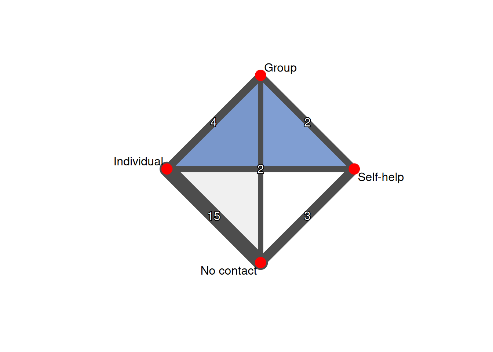
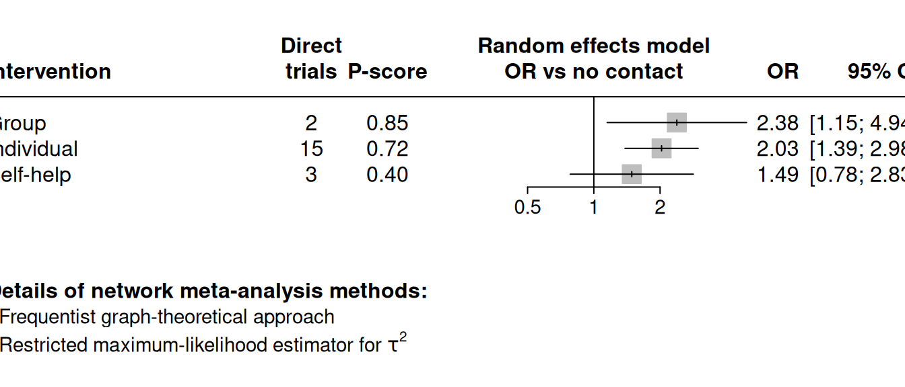
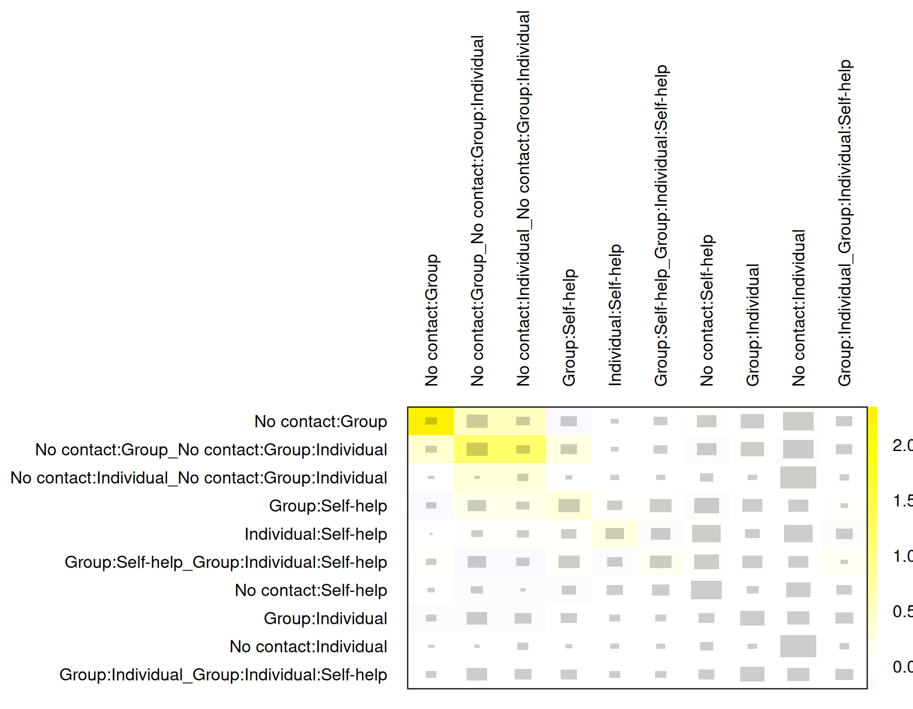
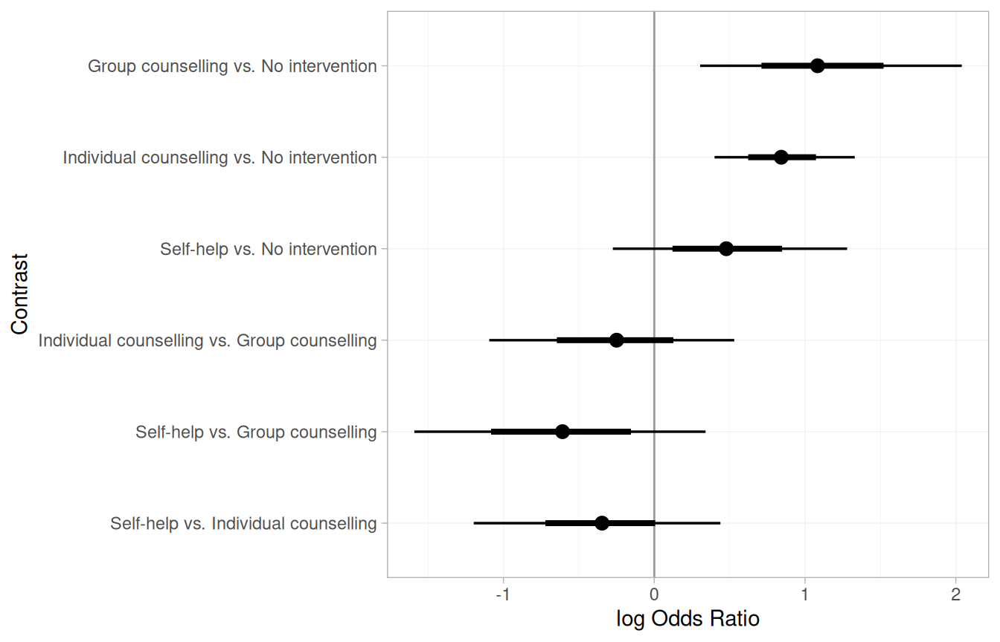

# Network Meta-Analysis {#sec-network}

A pairwise meta-analysis answers a narrow question: how does treatment B compare with treatment A? Clinical and policy decisions rarely look like that. A guideline panel choosing a first-line antidepressant faces a dozen drugs and several psychotherapies; a marketing team comparing promotional formats faces many alternatives, most of which have never been tested against each other in the same experiment. Trials are designed to answer the sponsor's question, usually "is our product better than placebo or the current standard?", so the evidence base is a patchwork of comparisons that rarely contains every pair a decision maker cares about.

Network meta-analysis (NMA) synthesizes such a patchwork in a single model. It combines *direct* evidence (trials that compare two treatments head to head) with *indirect* evidence (comparisons inferred through a common comparator) and returns a coherent set of relative effects for every pair of treatments in a connected network. The method has many names, including mixed treatment comparison and multiple-treatments meta-analysis [@salanti2012indirect], but the core idea is the same in every variant: if the trials in the network are similar enough in the ways that matter, then the relative effects they estimate must fit together like the sides of a triangle.

This chapter develops NMA from the simplest indirect comparison to full frequentist and Bayesian models. It builds on the random-effects machinery of Chapter \@ref(sec-models), the heterogeneity concepts of Chapter \@ref(sec-heterogeneity), and the Bayesian workflow of Chapter \@ref(sec-bayesian). We work through one network in detail, a classic data set on smoking cessation interventions [@hasselblad1998meta; @dias2013evidence], fitting it with `netmeta`, `multinma`, and `gemtc` so that the reader can see what is common across implementations and where they differ. A component NMA on a large depression network rounds out the frequentist part.

## Why network meta-analysis {#sec-network-why}

### Indirect comparisons {#sec-network-indirect}

Suppose a set of trials compares treatment B with A and another set compares C with A, but no trial compares B with C. Write $d_{AB}$ for the true relative effect of B versus A on some additive scale (a log odds ratio, a mean difference, a log hazard ratio). Pooling each set separately gives estimates $\hat d_{AB}$ and $\hat d_{AC}$ with variances $v_{AB}$ and $v_{AC}$. @bucher1997results proposed the *adjusted indirect comparison*

$$
\hat d^{\,\text{ind}}_{BC} = \hat d_{AC} - \hat d_{AB}, \qquad
\operatorname{Var}\!\left(\hat d^{\,\text{ind}}_{BC}\right) = v_{AB} + v_{AC},
$$

where the variances add because the two sets of trials are independent. The word "adjusted" matters. A *naive* indirect comparison would contrast the B arms of the AB trials with the C arms of the AC trials as if they came from one big trial, throwing away randomization and inviting confounding by any difference between the trial populations. The adjusted comparison preserves randomization within each trial and only asks that the relative effect of the common comparator transfers between the two sets. In an empirical comparison using 44 published meta-analyses, adjusted indirect estimates usually agreed with direct estimates of the same comparison, but a statistically significant discrepancy appeared in three of the 44, and its direction was not consistent [@song2003validity].

The price of an indirect comparison is precision. Because the variances add, an indirect estimate built from two comparisons each as precise as a single direct comparison has twice the variance. Indirect evidence is therefore most valuable when direct evidence is absent or sparse, and least valuable when a large body of head-to-head trials already exists.

### Mixed treatment comparisons {#sec-network-mixed}

When both direct and indirect evidence exist for the same comparison, they can be combined. Under the assumption that both estimate the same quantity, the inverse-variance weighted average

$$
\hat d^{\,\text{mix}}_{BC} = \frac{w_D \hat d^{\,\text{dir}}_{BC} + w_I \hat d^{\,\text{ind}}_{BC}}{w_D + w_I},
\qquad w_D = 1/v^{\text{dir}}_{BC},\; w_I = 1/v^{\text{ind}}_{BC},
$$

is more precise than either component. @lumley2002network generalized this to networks with many loops, and @lu2004combination formulated the Bayesian hierarchical model that most later work builds on. A *network meta-analysis* fits all comparisons jointly, so every estimate borrows strength from every path through the network that connects the two treatments. The same model also delivers what pairwise analyses cannot: a single, internally coherent set of relative effects in which $d_{BC} = d_{AC} - d_{AB}$ holds exactly, and from which treatments can be ranked.

## Assumptions: transitivity and consistency {#sec-network-assumptions}

### Transitivity {#sec-network-transitivity}

The indirect estimate $\hat d_{AC} - \hat d_{AB}$ is an unbiased estimate of $d_{BC}$ only if the AB trials and the AC trials estimate effects that would be transferable to one another. This is the *transitivity* assumption. A useful way to state it is that A, B and C are jointly randomizable: one could imagine a three-arm trial in which any participant in the network could have been assigned to any of the three treatments. Transitivity fails when the distribution of *effect modifiers* differs across comparisons [@jansen2013network]. If AB trials enrolled patients with mild disease and AC trials enrolled patients with severe disease, and severity modifies the effect of treatment relative to A, then the indirect comparison mixes a mild-disease B effect with a severe-disease C effect.

Two consequences follow. First, transitivity is a conceptual assumption about the clinical and methodological features of the trials and cannot be tested statistically in a network without closed loops. It is assessed by tabulating potential effect modifiers by comparison (age, severity, dose, follow-up length, risk of bias, year of publication) and asking whether the comparisons look exchangeable. Second, differences in prognostic factors that do *not* modify relative effects do not threaten transitivity, which is why adjusted indirect comparisons are much more robust than naive ones. The common comparator A also needs to be the same treatment in both sets: "placebo" in a 1990s trial and "placebo" in a trial with a large nocebo-run-in may not be.

### Consistency {#sec-network-consistency}

Transitivity has a statistical manifestation. When a comparison is informed by both direct and indirect evidence, the two sources should agree up to sampling error. This is called *consistency* (or *coherence*): for any three treatments,

$$
d_{BC} = d_{AC} - d_{AB}.
$$

In a network with $T$ treatments, the consistency equations mean that all $T(T-1)/2$ pairwise effects are determined by $T-1$ *basic parameters*, usually the effects of each treatment versus a reference, $d_{1k}$ for $k = 2, \dots, T$. Every other contrast is a *functional parameter* $d_{jk} = d_{1k} - d_{1j}$. Inconsistency is the observed disagreement between direct and indirect evidence. It can only be detected where the network has closed loops, and it can only be detected with low power, because indirect estimates are imprecise. Absence of statistically significant inconsistency is therefore weak evidence that transitivity holds [@dias2013evidence; @cipriani2013conceptual].

### Heterogeneity in a network {#sec-network-heterogeneity}

Within each comparison, trials can differ in their true effects just as in a pairwise random-effects model. Most NMA models assume a *common* between-study variance $\tau^2$ for all comparisons. This is a strong simplification, but it lets comparisons with only one or two trials borrow information about heterogeneity from the rest of the network. Heterogeneity and inconsistency are closely related: heterogeneity is variability in true effects between trials of the *same* design, inconsistency is variability between trials of *different* designs. When effect modifiers vary within comparisons we see heterogeneity; when they vary between comparisons we see inconsistency [@higgins2012consistency].

## Network geometry {#sec-network-geometry}

A network is a graph whose *nodes* are treatments and whose *edges* connect treatments that have been compared directly in at least one trial. The shape of this graph, its geometry, determines what the NMA can deliver [@salanti2011graphical; @chaimani2019undertaking].

A *star* network, in which every active treatment has been compared only with placebo, has no closed loops. Every active-versus-active comparison is purely indirect and consistency cannot be checked. A *well-connected* network with many closed loops allows direct and indirect evidence to be compared and allows inconsistency to be localized. A *disconnected* network falls into two or more components that share no treatment; relative effects between components are not identified without additional assumptions (for example, population adjustment or component models). Edge thickness is usually drawn proportional to the number of trials or the precision of the direct evidence, and node size proportional to the number of participants. A network dominated by one heavily studied comparison (a "thick" edge) and a periphery of single-trial edges warns that much of the evidence on peripheral comparisons is indirect.

A *design* is the set of treatments compared in a trial. Two-arm trials of A versus C share the design A:C; a three-arm trial of A, C and D has design A:C:D. Multi-arm trials are informative because they contribute internally consistent evidence on several comparisons at once, but they also introduce correlations between the contrasts they contribute, a point we take up in Section \@ref(sec-network-multiarm).

## Statistical models {#sec-network-models}

### Contrast-based models {#sec-network-contrast}

The standard NMA model is *contrast-based*: it models relative effects within trials and treats the trial-specific baseline as a nuisance. Let trial $i$ have arms $k = 1, \dots, a_i$ with treatments $t_{ik}$, and let arm 1 be the trial's baseline $b_i = t_{i1}$. With arm-level binary data $r_{ik} \sim \text{Binomial}(n_{ik}, p_{ik})$, the model of @lu2004combination and @dias2012evidence is

$$
\operatorname{logit}(p_{ik}) = \mu_i + \delta_{i, b_i t_{ik}}, \qquad \delta_{i, b_i b_i} = 0,
$$

$$
\delta_{i, b_i t_{ik}} \sim N\!\left(d_{1 t_{ik}} - d_{1 b_i},\; \tau^2\right),
$$

where $\mu_i$ is a study-specific baseline log odds, $d_{1k}$ are the basic parameters with $d_{11}=0$, and the mean of the random effect is written using the consistency equations. Because the $\mu_i$ are unconstrained study effects, the model uses only within-trial contrasts, respecting randomization. A common-effect (fixed-effect) NMA sets $\tau^2 = 0$. The same structure works with any generalized linear model likelihood and link [@dias2012evidence], and with contrast-level data (estimated log odds ratios and standard errors) in place of arm-level counts.

### Arm-based models {#sec-network-arm}

*Arm-based* models instead put the random effects on the absolute outcome in each arm, for instance

$$
\operatorname{logit}(p_{ik}) = \alpha_{t_{ik}} + \nu_{i t_{ik}}, \qquad
(\nu_{i1}, \dots, \nu_{iT})^\top \sim N(\mathbf{0}, \boldsymbol{\Sigma}),
$$

and define relative effects as contrasts of the treatment-specific mean parameters $\alpha_k$ (or of marginal absolute risks). Treatments a trial did not include are treated as missing at random [@hong2015bayesian]. Arm-based models make it easy to report absolute effects and allow treatment-specific heterogeneity, but they draw information from comparisons *between* trials of the absolute outcome, so they rely on more than randomization. When baseline risk varies across trials for reasons related to the treatments chosen, the two families can give different answers. @white2019comparison trace most differences between the two families to whether study intercepts are fixed (only within-study information is used) or random (between-study information is also used, which can cause bias). They conclude that both families are usable but that random study intercepts need a strong rationale. Contrast-based models remain the default in health technology assessment and in the software used below, and we use them throughout. Note that "arm-level data" (counts per arm) is not the same as an "arm-based model": all the Bayesian models below use arm-level data in a contrast-based model.

### Multi-arm trials {#sec-network-multiarm}

A trial with $a_i$ arms contributes $a_i - 1$ independent contrasts. If we compute the log odds ratios of C versus A and D versus A from a three-arm trial, they share the A arm, so their sampling errors are positively correlated: $\operatorname{Cov}(\hat\delta_{AC}, \hat\delta_{AD}) = \operatorname{Var}(\log \text{odds}_A)$. The random effects are also correlated. Under a common $\tau^2$ and consistency within the trial, $\delta_{AD} - \delta_{AC} = \delta_{CD}$ must also have variance $\tau^2$, which forces

$$
\operatorname{Cov}\!\left(\delta_{i,AC}, \delta_{i,AD}\right) = \tau^2 / 2 .
$$

Bayesian arm-level models build these correlations directly into the likelihood and the multivariate normal random effects. Contrast-level frequentist software must handle them explicitly. Ignoring the correlation by treating each pairwise contrast of a multi-arm trial as an independent study double-counts the shared arm and overstates precision. `netmeta` takes all $a_i(a_i-1)/2$ pairwise contrasts of a multi-arm trial and inflates their variances so that, taken together, they carry exactly the information of the $a_i - 1$ independent contrasts [@rucker2012network; @rucker2014reduce].

### The graph-theoretical frequentist estimator {#sec-network-graph}

@rucker2012network showed that frequentist NMA is a weighted least squares problem with an elegant interpretation. Stack all $m$ observed pairwise contrasts in a vector $\mathbf{y}$ with (adjusted) variances collected in a diagonal weight matrix $\mathbf{W}$, $w_j = 1/(v_j + \hat\tau^2)$. Let $\mathbf{B}$ be the $m \times T$ edge-vertex incidence matrix, with a $+1$ and a $-1$ in the columns of the two treatments in each contrast. The consistent fitted contrasts are

$$
\hat{\boldsymbol\theta} = \mathbf{B}\, \mathbf{L}^{+} \mathbf{B}^\top \mathbf{W} \mathbf{y}, \qquad \mathbf{L} = \mathbf{B}^\top \mathbf{W} \mathbf{B},
$$

where $\mathbf{L}$ is the weighted Laplacian matrix of the network graph and $\mathbf{L}^{+}$ its Moore-Penrose pseudoinverse. The variance of the estimated contrast between treatments $j$ and $k$ is the *effective resistance* between nodes $j$ and $k$ when each edge is a resistor with resistance equal to its variance, so direct and indirect paths combine exactly like resistors in parallel and series. This is the estimator implemented in `netmeta` [@balduzzi2023netmeta]. Heterogeneity is summarized by the generalized Cochran statistic $Q = (\mathbf{y} - \hat{\boldsymbol\theta})^\top \mathbf{W}_0 (\mathbf{y} - \hat{\boldsymbol\theta})$ computed with common-effect weights $\mathbf{W}_0$, with degrees of freedom equal to the number of independent contrasts minus $T - 1$, and $I^2 = \max\{0, (Q - \text{df})/Q\}$.

## Frequentist NMA with netmeta {#sec-network-netmeta}

### The smoking cessation network {#sec-network-smoking-data}

The `smokingcessation` data in `netmeta` contain 24 trials of four interventions to help people stop smoking: no contact (A), self-help material (B), individual counselling (C) and group counselling (D). The outcome is the number of participants who successfully quit, so larger odds ratios are better. Two trials have three arms. The data were first analyzed by @hasselblad1998meta and are a standard example for inconsistency methods [@dias2013evidence].


``` r
library(netmeta)

data(smokingcessation)
lab <- c(A = "No contact", B = "Self-help", C = "Individual", D = "Group")
sc <- smokingcessation
for (v in c("treat1", "treat2", "treat3")) {
  sc[[v]] <- ifelse(sc[[v]] == "", NA, lab[sc[[v]]])
}
sc$study <- seq_len(nrow(sc))
head(sc, 4)
#>   event1  n1 event2  n2 event3  n3     treat1     treat2 treat3 study
#> 1      9 140     23 140     10 138 No contact Individual  Group     1
#> 2     11  78     12  85     29 170  Self-help Individual  Group     2
#> 3     75 731    363 714     NA  NA No contact Individual   <NA>     3
#> 4      2 106      9 205     NA  NA No contact Individual   <NA>     4
```

The data are in "wide" arm-level format, one row per trial with up to three arms. The function `pairwise()` converts this to contrast-level format, computing a log odds ratio and its standard error for every pair of arms within each trial. For three-arm trials it returns all three pairwise contrasts.


``` r
pw <- pairwise(treat = list(treat1, treat2, treat3),
               event = list(event1, event2, event3),
               n = list(n1, n2, n3), studlab = study,
               data = sc, sm = "OR")
nrow(pw)
#> [1] 28
head(pw[, c("studlab", "treat1", "treat2", "TE", "seTE")])
#>   studlab     treat1     treat2        TE   seTE
#> 1       1 No contact Individual -1.051293 0.4132
#> 2       1 No contact      Group -0.128528 0.4760
#> 3       1 Individual      Group  0.922765 0.3998
#> 4       2  Self-help Individual -0.001245 0.4504
#> 5       2  Self-help      Group -0.225333 0.3839
#> 6       2 Individual      Group -0.224089 0.3723
```

The 24 trials yield 28 pairwise contrasts, two times three from the multi-arm trials and one from each of the 22 two-arm trials. The first row says that in trial 1 the log odds of quitting was about 1.05 lower with no contact than with individual counselling. `pairwise()` adds 0.5 to all cells of a 2-by-2 table containing a zero, which matters for trials with no quitters in an arm.

### An indirect comparison by hand {#sec-network-bucher-example}

Before fitting the network, it is instructive to compute one Bucher indirect comparison. We pool the direct evidence on individual counselling versus no contact and on self-help versus no contact separately with `metafor`, then contrast the two to obtain an indirect estimate of individual counselling versus self-help.


``` r
pw_df <- as.data.frame(pw)
# orient every contrast as "treat2 versus treat1" with treat1 = No contact
get_direct <- function(trt) {
  d <- subset(pw_df, (treat1 == "No contact" & treat2 == trt) |
                     (treat2 == "No contact" & treat1 == trt))
  yi <- ifelse(d$treat1 == "No contact", -d$TE, d$TE)  # log OR trt vs No contact
  rma(yi = yi, sei = d$seTE, method = "REML")
}
ind_vs_nc <- get_direct("Individual")
sh_vs_nc  <- get_direct("Self-help")
d_ind <- coef(ind_vs_nc) - coef(sh_vs_nc)
se_ind <- sqrt(vcov(ind_vs_nc) + vcov(sh_vs_nc))
round(c(k_IndNC = ind_vs_nc$k, k_SHNC = sh_vs_nc$k,
        logOR_ind = unname(d_ind), se = unname(se_ind),
        OR = exp(unname(d_ind)),
        lower = exp(unname(d_ind - 1.96 * se_ind)),
        upper = exp(unname(d_ind + 1.96 * se_ind))), 3)
#>   k_IndNC    k_SHNC logOR_ind        se        OR     lower     upper 
#>    15.000     3.000     0.526     0.312     1.692     0.917     3.121
```

Pooling 15 trials of individual counselling and 3 trials of self-help against no contact, the indirect odds ratio of individual counselling versus self-help is about 1.69 with a 95% confidence interval from 0.92 to 3.12. The interval is wide because it inherits the uncertainty of both pairwise pools, including the large heterogeneity among the 15 individual-counselling trials. The network model below combines this indirect path with the direct evidence from the trials that compared the two treatments and with every other path through group counselling.

### Fitting the network {#sec-network-fit}

`netmeta()` accepts the output of `pairwise()` directly. We request both common-effect and random-effects estimates, use REML for $\tau^2$, set no contact as the reference, and declare that small odds ratios are undesirable (because the event is quitting).


``` r
nm <- netmeta(pw, common = TRUE, random = TRUE,
              reference.group = "No contact",
              method.tau = "REML", small.values = "undesirable")
nm
#> Number of studies: k = 24
#> Number of pairwise comparisons: m = 28
#> Number of observations: o = 16740
#> Number of treatments: n = 4
#> Number of designs: d = 8
#> 
#> Common effects model
#> 
#> Treatment estimate (other treatments vs 'No contact'):
#>                OR           95% CI     z  p-value
#> Group      2.0479 [1.4170; 2.9598]  3.81   0.0001
#> Individual 1.9202 [1.7107; 2.1554] 11.07 < 0.0001
#> No contact      .                .     .        .
#> Self-help  1.2211 [0.9539; 1.5631]  1.59   0.1128
#> 
#> Random effects model
#> 
#> Treatment estimate (other treatments vs 'No contact'):
#>                OR           95% CI    z p-value
#> Group      2.3839 [1.1497; 4.9431] 2.33  0.0196
#> Individual 2.0320 [1.3859; 2.9793] 3.63  0.0003
#> No contact      .                .    .       .
#> Self-help  1.4876 [0.7812; 2.8329] 1.21  0.2268
#> 
#> Quantifying heterogeneity / inconsistency:
#> tau^2 = 0.4502; tau = 0.6710; I^2 = 88.6% [84.4%; 91.7%]
#> 
#> Tests of heterogeneity (within designs) and inconsistency (between designs):
#>                      Q d.f.  p-value
#> Total           202.62   23 < 0.0001
#> Within designs  187.40   16 < 0.0001
#> Between designs  15.22    7   0.0333
#> 
#> Details of network meta-analysis methods:
#> - Frequentist graph-theoretical approach
#> - Restricted maximum-likelihood estimator for tau^2
#> - Calculation of I^2 based on Q
```

The header confirms the structure: $k = 24$ studies, $m = 28$ pairwise comparisons, $n = 4$ treatments and $d = 8$ distinct designs, with 16,740 participants. The common-effect model estimates that individual counselling roughly doubles the odds of quitting relative to no contact (OR 1.92, 95% CI 1.71 to 2.16). These intervals are too narrow to believe, because heterogeneity is enormous: the generalized $Q$ is 202.62 on 23 degrees of freedom and $I^2 = 88.6\%$. The random-effects model, with $\hat\tau^2 = 0.450$ ($\hat\tau = 0.67$ on the log odds ratio scale), gives OR 2.03 (1.39 to 2.98) for individual counselling, 2.38 (1.15 to 4.94) for group counselling and 1.49 (0.78 to 2.83) for self-help, all versus no contact. A between-trial standard deviation of 0.67 means that the true odds ratio for the same intervention can easily vary by a factor of three or more across settings, which is substantively more important than the point estimates.

The lower part of the output partitions the total $Q$ into heterogeneity *within* designs ($Q = 187.40$, 16 df) and inconsistency *between* designs ($Q = 15.22$, 7 df, $p = 0.033$). We return to this decomposition in Section \@ref(sec-network-inconsistency). The 23 degrees of freedom for the total $Q$ equal the 26 independent contrasts (22 from two-arm trials plus 2 from each three-arm trial) minus the 3 basic parameters.

### Network graph {#sec-network-netgraph}


``` r
netgraph(nm, plastic = FALSE, thickness = "se.common",
         multiarm = TRUE, points = TRUE, cex.points = 3,
         col = "grey30", number.of.studies = TRUE)
```

<div class="figure" style="text-align: center">

<p class="caption">(\#fig:nma-netgraph)Network graph of the smoking cessation data. Edge width is proportional to the inverse standard error of the direct common-effect estimate; shaded triangles mark the two three-arm designs.</p>
</div>

Figure \@ref(fig:nma-netgraph) shows that every pair of treatments has some direct evidence, so the network is fully connected and contains several closed loops. The edge between no contact and individual counselling dominates, with 15 trials, while each of the other edges rests on two to four trials. This asymmetry is typical: much of the information about comparisons that do not involve the dominant edge is indirect.

### Forest plot and league table {#sec-network-forest}


``` r
forest(nm, pooled = "random", sortvar = -Pscore,
       smlab = "Random effects model\nOR vs no contact",
       leftcols = c("studlab", "k", "Pscore"),
       leftlabs = c("Intervention", "Direct\ntrials", "P-score"))
```

<div class="figure" style="text-align: center">

<p class="caption">(\#fig:nma-forest)Random-effects network estimates of each intervention versus no contact (odds ratio of quitting), sorted by P-score.</p>
</div>

Figure \@ref(fig:nma-forest) shows the random-effects relative effects with the reference fixed at 1. A *league table* reports every pairwise comparison at once. In `netleague()` output, the lower triangle holds the network estimates (column treatment versus row treatment) and the upper triangle the direct estimates alone (row versus column), which makes it easy to see how much the network has changed each comparison.


``` r
netleague(nm, common = FALSE, digits = 2, bracket = "(")
#> League table (random effects model):
#>                                                                         
#>              Group 0.93 (0.42; 2.06) 2.25 (0.53; 9.51) 1.85 (0.62; 5.53)
#>  1.17 (0.59; 2.34)        Individual 2.06 (1.38; 3.08) 0.93 (0.30; 2.82)
#>  2.38 (1.15; 4.94) 2.03 (1.39; 2.98)        No contact 0.73 (0.31; 1.69)
#>  1.60 (0.72; 3.55) 1.37 (0.70; 2.66) 0.67 (0.35; 1.28)         Self-help
#> 
#> Lower triangle: results from network meta-analysis (column vs row)
#> Upper triangle: results from direct comparisons (row vs column)
```

Reading down the first column, the network odds ratio of group counselling versus no contact is 2.38 (1.15 to 4.94); the direct estimate from the two trials that made this comparison, in the upper triangle, is 2.25 with a far wider interval (0.53 to 9.51). The network borrows strength from the indirect paths through individual counselling and self-help and roughly halves the width of the interval on the log scale. Conversely, the direct estimate of individual counselling versus self-help is 0.93 (0.30 to 2.82), favouring self-help slightly, whereas the network estimate of individual counselling versus self-help is 1.37 (0.70 to 2.66). Such reversals between direct and network estimates are exactly what the inconsistency checks are designed to scrutinize.

### Ranking treatments {#sec-network-ranking}

Decision makers often want an ordering. Bayesian NMA traditionally reports the probability that each treatment is best and the *surface under the cumulative ranking curve* (SUCRA) [@salanti2011graphical]. If $p_{k,r}$ is the probability that treatment $k$ has rank $r$ and $F_{k,r} = \sum_{s \le r} p_{k,s}$ its cumulative ranking probability, then

$$
\text{SUCRA}_k = \frac{1}{T - 1} \sum_{r=1}^{T-1} F_{k,r},
$$

which is 1 for a treatment certain to be best and 0 for one certain to be worst. @rucker2015ranking introduced the frequentist analogue, the *P-score*,

$$
P_k = \frac{1}{T-1} \sum_{j \ne k} \Phi\!\left( \frac{\hat d_{jk}}{\operatorname{se}(\hat d_{jk})} \right),
$$

for outcomes where larger is better, with $\hat d_{jk}$ the estimated effect of $k$ versus $j$. Each term is the one-sided "probability" (in the sense of a one-sided $p$-value) that $k$ is better than $j$, and the P-score averages these over competitors. P-scores and SUCRAs are numerically very close when computed from the same model, and P-scores require no resampling.


``` r
netrank(nm)
#>            P-score (common) P-score (random)
#> Group                0.8771           0.8474
#> Individual           0.7878           0.7155
#> Self-help            0.3163           0.3960
#> No contact           0.0188           0.0411
```

Under the random-effects model the P-scores are 0.85 for group counselling, 0.72 for individual counselling, 0.40 for self-help and 0.04 for no contact. Group counselling is, on average, more certain to outperform its competitors than individual counselling.

::: {.rmdwarning}
Rankings are among the most over-interpreted outputs of NMA. A P-score or SUCRA summarizes both the size of an effect and its uncertainty in a single number, so a treatment with a large but imprecise estimate can outrank one with a slightly smaller but well-estimated effect. The ranking says nothing about whether differences are clinically important: group and individual counselling differ by an odds ratio of only 1.17 (0.59 to 2.34) in the league table, so their ordering is essentially a coin flip with a lean. A reanalysis of published networks found that treatment rankings were typically highly uncertain [@trinquart2016uncertainty]. Report rankings, if at all, together with the relative effects and their intervals, and define in advance what question the ranking is supposed to answer, for example "which treatment is most likely to beat placebo by a clinically important margin?" [@salanti2021introducing].
:::

## Assessing inconsistency {#sec-network-inconsistency}

Inconsistency methods divide into *global* approaches, which ask whether the network as a whole is consistent, and *local* approaches, which locate the comparisons or loops responsible [@dias2013evidence; @higgins2012consistency; @white2012consistency].

### Global assessment: the design-by-treatment decomposition {#sec-network-decomp}

@higgins2012consistency introduced the *design-by-treatment interaction* model, which allows the relative effects to differ across designs. It handles multi-arm trials coherently because inconsistency is defined between designs rather than between loops. In the frequentist framework the total $Q$ decomposes into a within-design heterogeneity part and a between-design inconsistency part, $Q_{\text{total}} = Q_{\text{het}} + Q_{\text{inc}}$. `decomp.design()` reports this decomposition, the contribution of each design, and two refinements.


``` r
decomp.design(nm)
#> Q statistics to assess homogeneity / consistency
#> 
#>                      Q df  p-value
#> Total           202.62 23 < 0.0001
#> Within designs  187.40 16 < 0.0001
#> Between designs  15.22  7   0.0333
#> 
#> Design-specific decomposition of within-designs Q statistic
#> 
#>                 Design      Q df  p-value
#>  No contact:Individual 182.72 13 < 0.0001
#>       Group:Individual   1.74  1   0.1868
#>   No contact:Self-help   2.94  2   0.2299
#> 
#> Between-designs Q statistic after detaching of single designs
#> (influential designs have p-value markedly different from 0.0333)
#> 
#>              Detached design     Q df p-value
#>  No contact:Group:Individual  7.46  5  0.1883
#>             No contact:Group 11.65  6  0.0702
#>         Individual:Self-help 13.02  6  0.0427
#>              Group:Self-help 13.51  6  0.0357
#>             Group:Individual 13.90  6  0.0307
#>         No contact:Self-help 14.28  6  0.0267
#>        No contact:Individual 15.09  6  0.0196
#>   Group:Individual:Self-help 14.05  5  0.0153
#> 
#> Q statistic to assess consistency under the assumption of
#> a full design-by-treatment interaction random effects model
#> 
#>                    Q df p-value tau.within tau2.within
#> Between designs 4.66  7  0.7009     0.8131      0.6611
```

The within-design heterogeneity comes almost entirely from the no contact versus individual counselling design ($Q = 182.72$ on 13 df); the other two designs with replication are compatible with homogeneity. The between-design statistic $Q = 15.22$ (7 df, $p = 0.033$) suggests inconsistency, and the "detaching" table shows which design drives it: removing the three-arm no contact/group/individual trial reduces it to $Q = 7.46$ on 5 df ($p = 0.19$). The last table reruns the test under a full design-by-treatment random-effects model, which allows for heterogeneity *within* designs when judging differences *between* designs. Here $Q = 4.66$ on 7 df ($p = 0.70$). The common-effect test is too liberal in a network this heterogeneous, because it treats every between-design difference as signal. The random-effects version is the more relevant test, and it does not support inconsistency.

### Local assessment: node-splitting {#sec-network-netsplit}

*Node-splitting* separates, for each comparison, the direct evidence from the indirect evidence contributed by the rest of the network, and tests their agreement [@dias2010checking]. If $\hat d^{\,\text{dir}}$ and $\hat d^{\,\text{ind}}$ are the two estimates on the log scale, the inconsistency factor $\hat\omega = \hat d^{\,\text{dir}} - \hat d^{\,\text{ind}}$ has $z = \hat\omega / \sqrt{v^{\text{dir}} + v^{\text{ind}}}$. `netsplit()` computes the indirect estimate by back-calculation from the network and direct estimates (the "SIDE" approach), which is fast and closely approximates explicit node-splitting.


``` r
netsplit(nm)
#> Separate indirect from direct evidence (SIDE) using back-calculation method
#> 
#> Common effects model: 
#> 
#>             comparison  k prop    nma direct indir.    RoR     z p-value
#>       Group:Individual  4 0.73 1.0665 0.9594 1.4236 0.6739 -0.95  0.3444
#>       Group:No contact  2 0.17 2.0479 1.5529 2.1687 0.7161 -0.67  0.5028
#>        Group:Self-help  2 0.47 1.6771 1.7699 1.5991 1.1068  0.25  0.8000
#>  Individual:No contact 15 0.96 1.9202 1.9465 1.3534 1.4383  1.17  0.2418
#>   Individual:Self-help  2 0.19 1.5725 0.9241 1.7742 0.5208 -1.90  0.0580
#>   Self-help:No contact  3 0.78 1.2211 1.1444 1.5372 0.7445 -0.97  0.3320
#> 
#> Random effects model: 
#> 
#>             comparison  k prop    nma direct indir.    RoR     z p-value
#>       Group:Individual  4 0.75 1.1732 0.9274 2.3635 0.3924 -1.15  0.2507
#>       Group:No contact  2 0.26 2.3839 2.2491 2.4321 0.9248 -0.09  0.9269
#>        Group:Self-help  2 0.53 1.6025 1.8528 1.3630 1.3593  0.38  0.7054
#>  Individual:No contact 15 0.90 2.0320 2.0577 1.8109 1.1363  0.20  0.8453
#>   Individual:Self-help  2 0.36 1.3659 0.9265 1.6950 0.5466 -0.85  0.3933
#>   Self-help:No contact  3 0.59 1.4876 1.3742 1.6650 0.8254 -0.29  0.7737
#> 
#> Legend:
#>  comparison - Treatment comparison
#>  k          - Number of studies providing direct evidence
#>  prop       - Direct evidence proportion
#>  nma        - Estimated treatment effect (OR) in network meta-analysis
#>  direct     - Estimated treatment effect (OR) derived from direct evidence
#>  indir.     - Estimated treatment effect (OR) derived from indirect evidence
#>  RoR        - Ratio of Ratios (direct versus indirect)
#>  z          - z-value of test for disagreement (direct versus indirect)
#>  p-value    - p-value of test for disagreement (direct versus indirect)
```

For each comparison the output reports the number of trials with direct evidence ($k$), the proportion of the network estimate that comes from direct evidence (`prop`), the network, direct and indirect odds ratios, their ratio (RoR), and a $z$ test. Under the random-effects model, no comparison shows convincing disagreement: the largest discrepancy is for group versus individual counselling, where the direct odds ratio is 0.93 and the indirect 2.36 (ratio of odds ratios 0.39, $p = 0.25$). The common-effect version flags individual counselling versus self-help ($p = 0.058$), illustrating again that conclusions about inconsistency depend on how heterogeneity is modelled. With 6 comparisons tested, multiplicity also matters, and the low power of each test means that $p > 0.05$ cannot be read as evidence of consistency.

### The net heat plot {#sec-network-netheat}

@krahn2013graphical proposed the *net heat plot*, a matrix display that shows, for each design (columns), how much detaching it changes the inconsistency attributed to each other design (rows). Warm colours on the off-diagonal indicate designs whose removal reduces inconsistency elsewhere; grey squares show the contribution of each design to each network estimate.


``` r
netheat(nm, random = TRUE)
```

<div class="figure" style="text-align: center">

<p class="caption">(\#fig:nma-netheat)Net heat plot for the random-effects model. Coloured off-diagonal cells show how detaching the column design changes the inconsistency at the row design.</p>
</div>

Figure \@ref(fig:nma-netheat) should be read as a pointer for further investigation, not as a test. @freeman2019identifying showed that the calculations behind the net heat plot amount to an arbitrary weighting of direct and indirect evidence, and concluded from theory, simulation and two example networks that the plot does not reliably signal inconsistency or identify the designs that cause it. Node-splitting and careful inspection of the trials remain the primary tools.

::: {.rmdtip}
When inconsistency is found, the first response is substantive, not statistical. Tabulate the effect modifiers by comparison, check data extraction for the trials in the implicated loop, and consider whether the treatments are really the same across designs (for instance, "group counselling" delivered as a single session versus a multi-week program). Fitting an inconsistency model and reporting the network estimates anyway is not a solution; at a minimum the affected comparisons should be downgraded in the certainty assessment (Section \@ref(sec-network-certainty)).
:::

## Component network meta-analysis {#sec-network-cnma}

Many interventions are combinations of components: psychotherapy plus a drug, a counselling session plus nicotine replacement, an advertisement plus a price promotion. A standard NMA treats each combination as a separate node, which fragments the network and wastes information. *Component NMA* models the effect of a combination as a function of its components [@welton2009mixed; @rucker2019network]. The simplest version is *additive*: the effect of "CBT + SSRI" versus placebo equals the effect of CBT plus the effect of SSRI. Formally, with a $T \times C$ matrix $\mathbf{C}$ indicating which of $C$ components each treatment contains, the treatment effects are $\mathbf{d} = \mathbf{C}\boldsymbol\beta$, and the component effects $\boldsymbol\beta$ are estimated by weighted least squares on the contrasts. Interaction terms can be added for specific combinations, and an additive model can connect a network that is disconnected at the treatment level as long as it is connected at the component level.

The `Linde2016` data in `netmeta` contain 93 trials of 22 treatments for depression in primary care, including three combinations of a psychotherapy with an SSRI. We fit a standard random-effects NMA and then an additive component model with placebo as the inactive component.


``` r
data(Linde2016)
nm_dep <- netmeta(lnOR, selnOR, treat1, treat2, id, data = Linde2016,
                  sm = "OR", reference.group = "Placebo",
                  common = FALSE, small.values = "undesirable")
cnma <- netcomb(nm_dep, inactive = "Placebo")
c(standard_Q = cnma$Q.standard, df = cnma$df.Q.standard,
  additive_Q = cnma$Q.additive, df = cnma$df.Q.additive,
  diff_Q = cnma$Q.diff, df = cnma$df.Q.diff, p_diff = cnma$pval.Q.diff)
#> standard_Q         df additive_Q         df     diff_Q         df     p_diff 
#>  102.44750   87.00000  109.11894   90.00000    6.67145    3.00000    0.08314
```

The additive model replaces 21 treatment parameters with 18 component parameters and fits almost as well: the difference in $Q$ between the additive and the standard model is 6.67 on 3 df ($p = 0.08$), weak evidence against additivity. The combinations are where the two models differ.


``` r
combos <- c("Face-to-face CBT + SSRI", "Face-to-face interpsy + SSRI",
            "Face-to-face PST + SSRI")
# effect matrices are "row treatment versus column treatment"
cmp <- data.frame(
  standard = exp(nm_dep$TE.random[combos, "Placebo"]),
  std_lower = exp(nm_dep$lower.random[combos, "Placebo"]),
  std_upper = exp(nm_dep$upper.random[combos, "Placebo"]),
  additive = exp(cnma$TE.random[combos, "Placebo"]),
  add_lower = exp(cnma$lower.random[combos, "Placebo"]),
  add_upper = exp(cnma$upper.random[combos, "Placebo"])
)
names(cnma$Comp.random) <- cnma$comps
cmp$product <- exp(cnma$Comp.random[c("Face-to-face CBT",
                                      "Face-to-face interpsy",
                                      "Face-to-face PST")] +
                   cnma$Comp.random["SSRI"])
round(cmp, 2)
#>                              standard std_lower std_upper additive add_lower
#> Face-to-face CBT + SSRI         30.86      4.94    192.81     3.91      2.32
#> Face-to-face interpsy + SSRI     1.75      1.12      2.74     1.86      1.25
#> Face-to-face PST + SSRI          1.54      0.66      3.59     2.32      1.52
#>                              add_upper product
#> Face-to-face CBT + SSRI           6.59    3.91
#> Face-to-face interpsy + SSRI      2.78    1.86
#> Face-to-face PST + SSRI           3.53    2.32
```

The contrast is striking for CBT plus an SSRI. That combination appears in a single trial with 17 participants per arm, in which 12 responded on the combination and only 2 on the SSRI alone. The standard NMA must estimate the combination from that trial alone and returns an odds ratio versus placebo of 30.9 with a 95% confidence interval from 4.9 to 193. The additive model estimates it as the product of the CBT and SSRI component effects, 3.91 (2.32 to 6.59), using every trial in the network that included either component. Under the additive model, the odds ratio for each combination is exactly the product of the component odds ratios (the `additive` and `product` columns agree). The additive model is attractive when combinations are numerous and sparsely studied, but additivity is a substantive assumption. Two treatments that act on the same mechanism may be sub-additive, and a model check like the $Q$ difference above has little power. Interaction CNMA models, specified through `C.matrix` in `netcomb()`, relax additivity where the data permit.

## Bayesian network meta-analysis {#sec-network-bayesian}

Bayesian NMA fits the contrast-based model of Section \@ref(sec-network-contrast) with an exact likelihood for arm-level data, propagates uncertainty in $\tau$ into all estimates, and delivers rank probabilities as posterior summaries [@lu2004combination; @dias2018network]. Priors matter in the usual places (see Chapter \@ref(sec-bayesian)): the heterogeneity standard deviation in sparse networks, and treatment effects when some comparisons rest on very few events. Vague normal priors on the $d_{1k}$ and the study baselines $\mu_i$ are standard; for $\tau$ a half-normal or uniform prior on a plausible range is common, and empirically based informative priors are available for many outcome types.

### Bayesian NMA with multinma {#sec-network-multinma}

`multinma` fits contrast-based NMA and network meta-regression models in Stan [@carpenter2017stan] and also implements multilevel network meta-regression for combining individual and aggregate data [@phillippo2020multilevel]. Its models are precompiled, so fitting is fast. The package ships the smoking network as `smoking`, in long arm-level format with one row per arm.


``` r
library(multinma)
head(smoking)
#>   studyn trtn                   trtc  r   n
#> 1      1    1        No intervention  9 140
#> 2      1    3 Individual counselling 23 140
#> 3      1    4      Group counselling 10 138
#> 4      2    2              Self-help 11  78
#> 5      2    3 Individual counselling 12  85
#> 6      2    4      Group counselling 29 170
sm_net <- set_agd_arm(smoking, study = studyn, trt = trtc,
                      r = r, n = n, trt_ref = "No intervention")
sm_net
#> A network with 24 AgD studies (arm-based).
#> 
#> ------------------------------------------------------- AgD studies (arm-based) ---- 
#>  Study Treatment arms                                                 
#>  1     3: No intervention | Group counselling | Individual counselling
#>  2     3: Group counselling | Individual counselling | Self-help      
#>  3     2: No intervention | Individual counselling                    
#>  4     2: No intervention | Individual counselling                    
#>  5     2: No intervention | Individual counselling                    
#>  6     2: No intervention | Individual counselling                    
#>  7     2: No intervention | Individual counselling                    
#>  8     2: No intervention | Individual counselling                    
#>  9     2: No intervention | Individual counselling                    
#>  10    2: No intervention | Self-help                                 
#>  ... plus 14 more studies
#> 
#>  Outcome type: count
#> ------------------------------------------------------------------------------------
#> Total number of treatments: 4
#> Total number of studies: 24
#> Reference treatment is: No intervention
#> Network is connected
```

`set_agd_arm()` declares arm-level aggregate data with binomial outcomes, and the print method confirms that the network is connected with 24 studies and 4 treatments. We fit a random-effects consistency model with a binomial likelihood and logit link, vague normal priors on study baselines and treatment effects, and a half-normal prior with scale 5 on $\tau$. Two chains of 2,000 iterations (half warmup) are sufficient here.


``` r
fit_re <- nma(sm_net, trt_effects = "random",
              prior_intercept = normal(scale = 100),
              prior_trt = normal(scale = 10),
              prior_het = half_normal(scale = 5),
              iter = 2000, chains = 2, seed = 2026, refresh = 0)
print(fit_re, pars = c("d", "tau"))
#> A random effects NMA with a binomial likelihood (logit link).
#> Inference for Stan model: binomial_1par.
#> 2 chains, each with iter=2000; warmup=1000; thin=1; 
#> post-warmup draws per chain=1000, total post-warmup draws=2000.
#> 
#>                           mean se_mean   sd  2.5%  25%  50%  75% 97.5% n_eff
#> d[Group counselling]      1.11    0.01 0.44  0.30 0.82 1.08 1.39  2.04  1186
#> d[Individual counselling] 0.85    0.01 0.24  0.40 0.69 0.84 1.01  1.33   656
#> d[Self-help]              0.49    0.01 0.40 -0.27 0.23 0.48 0.74  1.28  1012
#> tau                       0.84    0.01 0.18  0.55 0.71 0.81 0.94  1.24   785
#>                           Rhat
#> d[Group counselling]         1
#> d[Individual counselling]    1
#> d[Self-help]                 1
#> tau                          1
#> 
#> Samples were drawn using NUTS(diag_e) at Wed Nov 25 01:23:40 2026.
#> For each parameter, n_eff is a crude measure of effective sample size,
#> and Rhat is the potential scale reduction factor on split chains (at 
#> convergence, Rhat=1).
```

All $\hat R$ values are 1.00 and effective sample sizes exceed 600, adequate for the posterior means and 95% intervals reported here. The posterior mean log odds ratios versus no intervention are about 1.09 for group counselling, 0.84 for individual counselling and 0.49 for self-help, corresponding to odds ratios of roughly 3.0, 2.3 and 1.6. These are larger than the frequentist random-effects estimates (2.38, 2.03, 1.49), and the posterior mean of $\tau$ (about 0.85, 95% credible interval roughly 0.54 to 1.32) is larger than the REML estimate of 0.67. Two features explain the difference: the Bayesian model uses the exact binomial likelihood instead of the normal approximation to log odds ratios with continuity corrections, and it averages over the posterior uncertainty in $\tau$ rather than plugging in a point estimate. The broad conclusions are unchanged.

`relative_effects()` returns all pairwise contrasts, not just those against the reference, and its `plot()` method draws them.


``` r
re_all <- relative_effects(fit_re, all_contrasts = TRUE)
re_all
#>                                                  mean   sd  2.5%   25%   50%
#> d[Group counselling vs. No intervention]         1.11 0.44  0.30  0.82  1.08
#> d[Individual counselling vs. No intervention]    0.85 0.24  0.40  0.69  0.84
#> d[Self-help vs. No intervention]                 0.49 0.40 -0.27  0.23  0.48
#> d[Individual counselling vs. Group counselling] -0.26 0.42 -1.09 -0.52 -0.25
#> d[Self-help vs. Group counselling]              -0.61 0.50 -1.59 -0.94 -0.61
#> d[Self-help vs. Individual counselling]         -0.35 0.40 -1.20 -0.60 -0.35
#>                                                   75% 97.5% Bulk_ESS Tail_ESS
#> d[Group counselling vs. No intervention]         1.39  2.04     1241     1279
#> d[Individual counselling vs. No intervention]    1.01  1.33      658      971
#> d[Self-help vs. No intervention]                 0.74  1.28     1045     1027
#> d[Individual counselling vs. Group counselling]  0.01  0.53     1801     1547
#> d[Self-help vs. Group counselling]              -0.28  0.34     1730     1279
#> d[Self-help vs. Individual counselling]         -0.09  0.44     1334     1309
#>                                                 Rhat
#> d[Group counselling vs. No intervention]           1
#> d[Individual counselling vs. No intervention]      1
#> d[Self-help vs. No intervention]                   1
#> d[Individual counselling vs. Group counselling]    1
#> d[Self-help vs. Group counselling]                 1
#> d[Self-help vs. Individual counselling]            1
plot(re_all, ref_line = 0)
```

<div class="figure" style="text-align: center">

<p class="caption">(\#fig:nma-multinma-releff)Posterior distributions of all pairwise log odds ratios from the Bayesian random-effects NMA (multinma).</p>
</div>

Among the active interventions, the credible intervals for every pairwise contrast include zero (Figure \@ref(fig:nma-multinma-releff)): for example, individual versus group counselling has posterior mean of about $-0.26$ with a 95% interval from about $-1.1$ to $0.6$ on the log odds ratio scale. As in the frequentist analysis, the data support "counselling beats no contact" much more firmly than any ordering among active interventions.

Rank probabilities come from `posterior_rank_probs()`. Because quitting is a good outcome we set `lower_better = FALSE`. The cumulative probabilities give SUCRA directly.


``` r
rp <- posterior_rank_probs(fit_re, lower_better = FALSE)
rp
#>                           p_rank[1] p_rank[2] p_rank[3] p_rank[4]
#> d[No intervention]             0.00      0.00      0.10       0.9
#> d[Group counselling]           0.72      0.21      0.07       0.0
#> d[Individual counselling]      0.23      0.62      0.15       0.0
#> d[Self-help]                   0.05      0.17      0.68       0.1
crp <- posterior_rank_probs(fit_re, lower_better = FALSE, cumulative = TRUE)
cum <- as.matrix(crp$summary[, grep("p_rank", names(crp$summary))])
sucra <- rowMeans(cum[, -ncol(cum)])
names(sucra) <- as.character(crp$summary$.trt)
round(sort(sucra, decreasing = TRUE), 3)
#>      Group counselling Individual counselling              Self-help 
#>                  0.880                  0.694                  0.392 
#>        No intervention 
#>                  0.035
```

Group counselling has the highest probability of being best (about 0.70) and the largest SUCRA (about 0.88), followed by individual counselling (SUCRA about 0.69), self-help (about 0.39) and no intervention (about 0.04). These values sit very close to the frequentist random-effects P-scores, which is expected because P-scores are the frequentist analogue of SUCRA [@rucker2015ranking]. The probability that group counselling is the single best option is far from certain, which is the honest message of the analysis.

### Checking consistency in multinma {#sec-network-ume}

A Bayesian global check compares the consistency model with an *unrelated mean effects* (UME) model, which estimates a separate relative effect for every directly observed comparison without imposing the consistency equations [@dias2013evidence]. If the UME model fits markedly better, judged by residual deviance or the deviance information criterion (DIC), the network is inconsistent.


``` r
fit_ume <- nma(sm_net, consistency = "ume", trt_effects = "random",
               prior_intercept = normal(scale = 100),
               prior_trt = normal(scale = 10),
               prior_het = half_normal(scale = 5),
               iter = 2000, chains = 2, seed = 2026, refresh = 0)
dic(fit_re)
#> Residual deviance: 54.2 (on 50 data points)
#>                pD: 44
#>               DIC: 98.2
dic(fit_ume)
#> Residual deviance: 54 (on 50 data points)
#>                pD: 45.2
#>               DIC: 99.2
```

The two models are practically indistinguishable: residual deviances are about 54 on 50 data points for both, and the DIC differs by well under the 3 to 5 points usually considered meaningful. The UME model spends extra parameters on unconstrained comparisons without improving fit, so there is no evidence of global inconsistency once heterogeneity is modelled, the same conclusion as the frequentist random-effects design-by-treatment test. `multinma` also supports node-splitting with `consistency = "nodesplit"`, which fits one model per split comparison.

### Bayesian NMA with gemtc {#sec-network-gemtc}

`gemtc` generates and runs NMA models in JAGS [@vanvalkenhoef2012automating] and automates the construction of node-splitting models [@vanvalkenhoef2015automated]. It ships the same smoking network as an `mtc.network` object in arm-level format, with treatments labelled A to D as in the original publication. The code below is evaluated only when JAGS is available.


``` r
library(gemtc)
gem_env <- new.env()
data("smoking", package = "gemtc", envir = gem_env)
gem_net <- gem_env$smoking
gem_net$treatments
#>   id           description
#> A  A            No Contact
#> B  B             Self-help
#> C  C Individual Counseling
#> D  D      Group Counseling

# mtc.model() draws random initial values, so seed before it
set.seed(2026)
gem_mod <- mtc.model(gem_net, type = "consistency",
                     likelihood = "binom", link = "logit",
                     linearModel = "random", n.chain = 2)
# reproducible JAGS chains: one RNG and seed per chain
gem_seeds <- sample.int(.Machine$integer.max, 2)
gem_mod$inits <- mapply(c, gem_mod$inits, list(
  list(.RNG.name = "base::Mersenne-Twister", .RNG.seed = gem_seeds[1]),
  list(.RNG.name = "base::Wichmann-Hill", .RNG.seed = gem_seeds[2])),
  SIMPLIFY = FALSE)
gem_fit <- mtc.run(gem_mod, n.adapt = 1000, n.iter = 10000, thin = 2)
#> Compiling model graph
#>    Resolving undeclared variables
#>    Allocating nodes
#> Graph information:
#>    Observed stochastic nodes: 50
#>    Unobserved stochastic nodes: 54
#>    Total graph size: 1075
#> 
#> Initializing model
summary(gem_fit)
#> 
#> Results on the Log Odds Ratio scale
#> 
#> Iterations = 1002:11000
#> Thinning interval = 2 
#> Number of chains = 2 
#> Sample size per chain = 5000 
#> 
#> 1. Empirical mean and standard deviation for each variable,
#>    plus standard error of the mean:
#> 
#>        Mean    SD Naive SE Time-series SE
#> d.A.B 0.488 0.399  0.00399        0.00528
#> d.A.C 0.829 0.236  0.00236        0.00407
#> d.A.D 1.091 0.439  0.00439        0.00753
#> sd.d  0.841 0.183  0.00183        0.00475
#> 
#> 2. Quantiles for each variable:
#> 
#>         2.5%   25%   50%   75% 97.5%
#> d.A.B -0.295 0.231 0.483 0.744  1.27
#> d.A.C  0.388 0.672 0.820 0.977  1.32
#> d.A.D  0.243 0.804 1.082 1.373  1.99
#> sd.d   0.550 0.710 0.816 0.946  1.27
#> 
#> -- Model fit (residual deviance):
#> 
#>  Dbar    pD   DIC 
#> 54.34 44.02 98.35 
#> 
#> 50 data points, ratio 1.087, I^2 = 10%
gelman.diag(as.mcmc.list(gem_fit), multivariate = FALSE)
#> Potential scale reduction factors:
#> 
#>       Point est. Upper C.I.
#> d.A.B          1          1
#> d.A.C          1          1
#> d.A.D          1          1
#> sd.d           1          1
```

`mtc.model()` builds the JAGS model with a binomial likelihood, logit link, and random effects; by default it uses a uniform prior on the heterogeneity standard deviation and vague normal priors whose scale is derived from the data. `mtc.run()` adapts and samples; the potential scale reduction factors from `gelman.diag()` should be close to 1. The basic parameters `d.A.B`, `d.A.C` and `d.A.D` are log odds ratios versus no contact and `sd.d` is $\tau$; they should agree with the `multinma` estimates above to within Monte Carlo error and the small differences implied by the different default priors.


``` r
summary(relative.effect(gem_fit, t1 = "B", t2 = c("A", "C", "D")))
#> 
#> Results on the Log Odds Ratio scale
#> 
#> Iterations = 1002:11000
#> Thinning interval = 2 
#> Number of chains = 2 
#> Sample size per chain = 5000 
#> 
#> 1. Empirical mean and standard deviation for each variable,
#>    plus standard error of the mean:
#> 
#>         Mean    SD Naive SE Time-series SE
#> d.B.A -0.488 0.399  0.00399        0.00528
#> d.B.C  0.342 0.408  0.00408        0.00531
#> d.B.D  0.604 0.493  0.00493        0.00712
#> sd.d   0.841 0.183  0.00183        0.00475
#> 
#> 2. Quantiles for each variable:
#> 
#>         2.5%     25%    50%    75% 97.5%
#> d.B.A -1.272 -0.7442 -0.483 -0.231 0.295
#> d.B.C -0.454  0.0748  0.339  0.609 1.168
#> d.B.D -0.352  0.2768  0.595  0.923 1.571
#> sd.d   0.550  0.7104  0.816  0.946 1.267
gem_ranks <- rank.probability(gem_fit, preferredDirection = 1)
gem_ranks
#> Rank probability; preferred direction = 1
#>     [,1]   [,2]   [,3]   [,4]
#> A 0.0000 0.0021 0.1066 0.8913
#> B 0.0560 0.1817 0.6597 0.1026
#> C 0.2388 0.5939 0.1670 0.0003
#> D 0.7052 0.2223 0.0667 0.0058
sucra(gem_ranks)
#>       A       B       C       D 
#> 0.03693 0.39703 0.69040 0.87563
```

`relative.effect()` re-expresses the posterior relative to any treatment, here self-help (B). `rank.probability()` with `preferredDirection = 1` treats larger log odds ratios as better, and `sucra()` returns the SUCRA values. The same workflow extends to node-splitting with `mtc.nodesplit()`, which fits one model per comparison that can be split and is correspondingly slower.

::: {.rmdnote}
Which software to choose? `netmeta` is fast, handles contrast-level data, has excellent tools for inconsistency and component models, and is the natural choice for frequentist work. `multinma` is the most actively developed Bayesian option, needs no external sampler, and adds population adjustment and network meta-regression with individual data. `gemtc` is mature and convenient for automated node-splitting but depends on JAGS. For a published analysis, fitting the main model in two frameworks is a cheap and informative sensitivity analysis.
:::

## Certainty of evidence and reporting {#sec-network-certainty}

An NMA produces many estimates whose credibility varies: a comparison supported by large, low-risk-of-bias, head-to-head trials deserves more confidence than one inferred through a long chain of small trials. Two frameworks extend GRADE (Chapter \@ref(sec-reporting)) to networks. The GRADE Working Group approach rates direct and indirect evidence separately and then rates the network estimate [@puhan2014grade]. *CINeMA* (Confidence in Network Meta-Analysis) evaluates each network estimate on six domains: within-study bias, reporting bias, indirectness, imprecision, heterogeneity, and incoherence [@nikolakopoulou2020cinema]. Its distinguishing feature is the use of the *contribution matrix*, which quantifies how much each direct comparison contributes to each network estimate, so that risk-of-bias judgements about individual trials propagate to the network estimates in proportion to their influence. A free web application implements the framework [@papakonstantinou2020cinema]. Imprecision and heterogeneity are judged against a pre-specified range of clinical equivalence, so the analyst must state what size of effect matters before looking at the results.

Reporting follows the PRISMA extension for network meta-analyses [@hutton2015prisma], which adds items on the network geometry (a network graph), the assessment of transitivity and inconsistency, the methods used to handle multi-arm trials, and the presentation of rankings. Practical points that reviewers often find missing are: the table of effect modifiers by comparison; the full league table rather than only effects versus placebo; the heterogeneity variance and its prior (in a Bayesian analysis); the results of both global and local inconsistency checks; and sensitivity analyses excluding trials at high risk of bias.

## Practical recommendations and common pitfalls {#sec-network-pitfalls}

**Define the nodes carefully.** Decide in the protocol which interventions are "the same treatment". Lumping different doses or delivery formats into one node creates heterogeneity and can create inconsistency; splitting too finely disconnects the network. Component models (Section \@ref(sec-network-cnma)) are one principled compromise.

**Examine transitivity before modelling.** Tabulate the distribution of plausible effect modifiers by comparison. If, for example, the placebo-controlled trials of one drug were done in treatment-resistant patients, no statistical method will rescue the indirect comparisons.

**Handle multi-arm trials correctly.** Never enter the pairwise contrasts of a multi-arm trial as independent studies. Use arm-level data in a Bayesian model or software that accounts for the correlations, as `netmeta` does.

**Model heterogeneity and report it on the effect scale.** In the smoking network, $\hat\tau = 0.67$ dwarfs most of the differences between active interventions. Prediction intervals (`prediction = TRUE` in `netmeta`) are as informative in a network as in pairwise meta-analysis (Chapter \@ref(sec-heterogeneity)).

**Do not equate "no significant inconsistency" with consistency.** Tests have low power, especially in sparse networks and when heterogeneity is large. Global and local checks should be read together, and their conclusions depend on whether heterogeneity is modelled, as the smoking example showed.

**Use rankings with restraint.** Present relative effects with intervals first. If rankings are reported, show the rank probabilities or rankograms, not only SUCRA or P-scores, and remember that a treatment can rank first merely because it was studied in few, small, optimistic trials.

**Think about small-study effects and missing evidence.** Publication bias (Chapter \@ref(sec-publication-bias)) can affect some comparisons in a network more than others, which then propagates through indirect paths. Comparison-adjusted funnel plots and network meta-regression on study size are available but have limited power.

## Key takeaways {#sec-network-takeaways}

- Network meta-analysis combines direct and indirect evidence on several treatments in one model and returns a coherent set of relative effects for every pair of treatments in a connected network.
- Its validity rests on transitivity: effect modifiers must be similarly distributed across comparisons. Consistency, the agreement of direct and indirect evidence, is the testable consequence, but tests for inconsistency have low power.
- Contrast-based models preserve within-trial randomization and are the default; arm-based models rely on additional assumptions about absolute outcomes. Multi-arm trials induce correlations that must be modelled.
- `netmeta` implements the frequentist graph-theoretical estimator with tools for league tables, P-scores, design-by-treatment decomposition, node-splitting, net heat plots and component NMA. `multinma` (Stan) and `gemtc` (JAGS) provide Bayesian models with exact likelihoods, rank probabilities and SUCRA.
- In the smoking cessation network, all counselling interventions outperform no contact, heterogeneity is large ($\tau \approx 0.7$ to $0.85$ on the log odds ratio scale), and the ordering of the active interventions is uncertain. Inconsistency suggested by a common-effect test disappears once heterogeneity is accounted for.
- Rankings summarize uncertainty and effect size in one number and are easily over-interpreted. Report relative effects first.
- The credibility of each network estimate should be rated (CINeMA or GRADE for NMA) and the analysis reported following PRISMA-NMA.

## Further reading {#sec-network-reading}

@dias2018network is the most complete treatment of Bayesian NMA for decision making, building on the NICE Decision Support Unit technical documents [@dias2012evidence; @dias2013evidence]. The Cochrane Handbook chapter by @chaimani2019undertaking is a concise guide to planning and conducting a network meta-analysis within a systematic review. @salanti2012indirect and @cipriani2013conceptual discuss the conceptual assumptions and the main controversies. For the frequentist theory, read @rucker2012network and the `netmeta` software paper by @balduzzi2023netmeta; for multi-arm trials, @rucker2014reduce. Inconsistency models are covered by @higgins2012consistency, @white2012consistency and @dias2010checking. @white2019comparison compares contrast-based and arm-based models. Component NMA is introduced by @welton2009mixed and @rucker2019network. Population-adjusted comparisons with individual data are developed in @phillippo2020multilevel. For certainty of evidence and reporting, see @nikolakopoulou2020cinema, @puhan2014grade and @hutton2015prisma.
