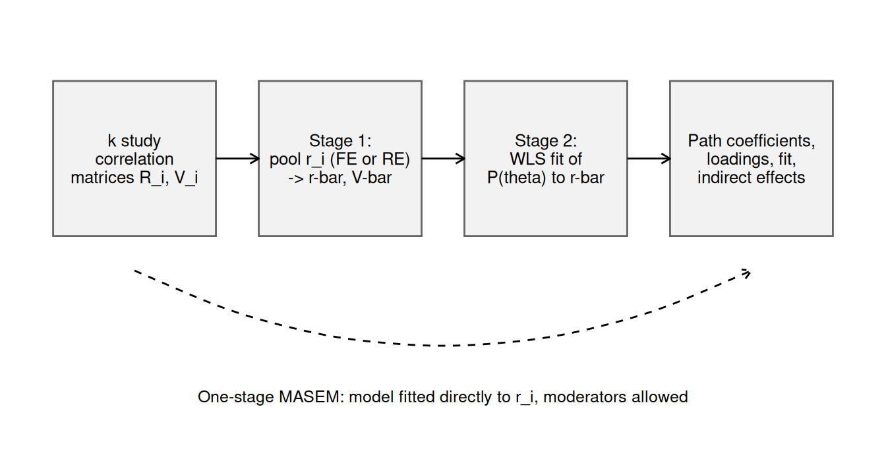
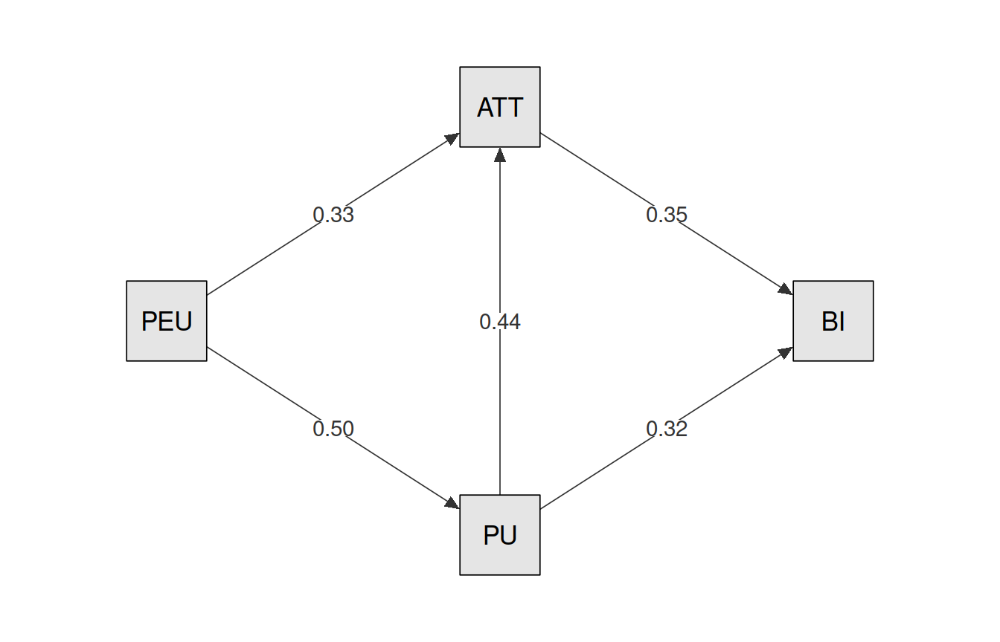

# Meta-Analytic Structural Equation Modeling {#sec-masem}

Most meta-analyses in this book summarize one effect at a time: a standardized mean difference, a log odds ratio, a single correlation. Theories in psychology, management, marketing and education are rarely that simple. The technology acceptance model says that perceived ease of use shapes perceived usefulness, both shape attitudes, and attitudes and usefulness drive intentions to use a technology. The theory of planned behavior, the job demands-resources model, and most models of consumer satisfaction and loyalty are networks of paths among several constructs, often with mediators and latent variables. Testing such a theory against a body of primary studies requires pooling many correlations at once and then fitting a structural model to the pooled matrix. That combination is meta-analytic structural equation modeling (MASEM).

This chapter develops MASEM from its statistical foundations. We begin with why the combination is attractive and where it is fragile, then formalize the correlation-structure problem and compare the three classical approaches: univariate pooling of each correlation, the generalized least squares (GLS) approach of @becker1992, and the two-stage structural equation modeling (TSSEM) approach of @cheung2005meta. A worked example on 50 samples of teachers' technology acceptance carries us through stage 1 (fixed- and random-effects pooling of correlation matrices), stage 2 (path models specified in `lavaan` syntax), likelihood-based confidence intervals, indirect effects and model comparison. We then fit a confirmatory factor model to Digman's Big Five data, treat missing correlations, and move to one-stage MASEM [@jak2020meta], which lets moderators act directly on structural parameters. A short section shows how the same software fits univariate, multivariate and three-level meta-analyses as structural equation models. We close with reporting guidance and common pitfalls.

All analyses use the `metaSEM` package [@cheung2015metasem], which is built on `OpenMx` [@neale2016openmx], together with `metafor` [@viechtbauer2010conducting], `lavaan` [@rosseel2012lavaan] and `semPlot` [@epskamp2015semplot]. Book-length treatments are @cheung2015metaanalysis and @jak2015metaanalytic.


``` r
library(metaSEM)
library(lavaan)
library(semPlot)
```

## Why combine meta-analysis and SEM? {#sec-masem-why}

A structural equation model (SEM) is a set of regression equations among observed and latent variables. Under multivariate normality, all the information needed to fit an SEM to standardized variables is contained in the correlation matrix and the sample size, so a theory that can be written as an SEM can in principle be tested on a meta-analytic correlation matrix. The literature uses many names for this idea, including meta-analytic path analysis, model-based meta-analysis, SEM of a meta-analytic correlation matrix, and meta-analysis of factor analysis. We follow @cheung2005meta and @cheung2015metaanalysis in calling the whole family MASEM.

@bergh2016using, writing for strategic management, emphasize two payoffs. MASEM can test intermediate mechanisms (mediation) and pit competing theoretical models against each other, which a list of bivariate meta-analytic correlations cannot do; and because the pooled matrix draws on many samples, settings and measures, the fitted model has greater external validity than any single study. Two further advantages are statistical. MASEM can combine studies that each observed only part of the model: one study may report the correlation between ease of use and attitudes, another between attitudes and intentions, and the pooled matrix can still support the full path model. And because the pooled matrix is estimated with known sampling uncertainty, the precision of each path coefficient can be quantified honestly, which is not true of every MASEM procedure (Section \@ref(sec-masem-univariate)).

The limitations are equally real. A meta-analytic correlation matrix is a summary of observational associations; turning it into causal paths requires the same strong assumptions as any SEM on cross-sectional data, namely correct causal ordering, no omitted common causes and no reverse causation [@steinmetz2022meta]. Effect size heterogeneity is a second problem. If studies differ in their true correlation matrices, the average matrix may not correspond to any population that actually exists, and a path model fitted to it describes an average of structures rather than a structure [@yu2016problem; @cheung2018issues]. Third, constructs are often operationalized differently across studies (a "firm performance" correlation may mix return on assets, sales growth and Tobin's q), and pooling them assumes they measure the same thing. Fourth, sparse cells in the correlation matrix, where few studies report a particular pair of variables, make the pooled matrix unstable and can produce a matrix that is not positive definite. @bergh2016using recommend that MASEM be reserved for questions with genuine competing hypotheses and enough primary studies to estimate every cell of the matrix with reasonable precision, and that the number of variables be kept modest.

## Notation and the correlation-structure problem {#sec-masem-notation}

Suppose study $i = 1, \dots, k$ measures $p$ variables on $n_i$ participants and reports a $p \times p$ correlation matrix $\mathbf{R}_i$. Stack the $p^* = p(p-1)/2$ non-redundant off-diagonal elements in a vector $\mathbf{r}_i = \operatorname{vechs}(\mathbf{R}_i)$. Some elements may be missing because study $i$ did not measure every variable. The large-sample sampling covariance matrix of $\mathbf{r}_i$, denoted $\mathbf{V}_i$, has elements given by the classical formulas for the covariance of two correlation coefficients [@olkin1990testing]; in practice these are evaluated at a pooled estimate of the correlations rather than at the study's own noisy values, which reduces the correlation between effect sizes and their weights [@cheung2015metaanalysis].

The target of MASEM is a structural model that implies a population correlation matrix $\mathbf{P}(\boldsymbol{\theta})$ as a function of parameters $\boldsymbol{\theta}$ (path coefficients, factor loadings, factor correlations). `metaSEM` uses the reticular action model (RAM) representation. With $\mathbf{A}$ the matrix of asymmetric paths (regression coefficients and loadings), $\mathbf{S}$ the matrix of symmetric paths (variances and covariances), and $\mathbf{F}$ a selection matrix that picks the observed variables out of the full set of observed and latent variables,

$$
\mathbf{P}(\boldsymbol{\theta}) = \mathbf{F}(\mathbf{I} - \mathbf{A})^{-1}\mathbf{S}(\mathbf{I} - \mathbf{A})^{-\top}\mathbf{F}^{\top},
$$

subject to the constraint that the diagonal of $\mathbf{P}(\boldsymbol{\theta})$ equals one. In a correlation structure analysis the residual variances in $\mathbf{S}$ are not free parameters; they are determined by the unit-diagonal constraint. The question every MASEM procedure must answer is how to get from the collection $\{\mathbf{r}_i, \mathbf{V}_i\}$ to estimates of $\boldsymbol{\theta}$ with correct standard errors and a valid test of fit.

<div class="figure" style="text-align: center">

<p class="caption">(\#fig:masem-workflow)The two-stage logic of MASEM. Stage 1 pools the study-level correlation matrices into a vector of average correlations and its asymptotic covariance matrix; stage 2 fits a structural model to the pooled matrix by weighted least squares. One-stage MASEM fits the structural model directly to the study-level correlations.</p>
</div>

## Approaches to MASEM {#sec-masem-approaches}

### Univariate pooling {#sec-masem-univariate}

The oldest approach, associated with psychometric meta-analysis in the Hunter-Schmidt tradition [@viswesvaran1995theory; @schmidt2015a], pools each correlation separately. For the pair $(j, l)$, the sample-size-weighted mean is

$$
\bar r_{jl} = \frac{\sum_{i \in \mathcal{S}_{jl}} n_i r_{ijl}}{\sum_{i \in \mathcal{S}_{jl}} n_i},
$$

where $\mathcal{S}_{jl}$ is the set of studies that report that pair, possibly after corrections for measurement error and range restriction. The pooled correlations are assembled into a matrix $\bar{\mathbf{R}}$, which is then analyzed in standard SEM software as if it were the covariance matrix of a single sample with some chosen sample size, often the harmonic mean of the cell-wise total sample sizes [@bergh2016using; @landis2013successfully].

The approach is simple and transparent, but it has three well-known defects [@cheung2005meta; @cheung2015metaanalysis]. Treating a correlation matrix as a covariance matrix gives incorrect standard errors and test statistics for many models [@cudeck1989]. Using one sample size for all cells ignores the fact that different correlations rest on different amounts of data, so some standard errors are too small and others too large. Finally, pooling each element separately ignores the dependence among correlations computed in the same sample, and with pairwise deletion the assembled matrix need not be positive definite. When the correlations are heterogeneous, a single $N$ also ignores between-study variance entirely, which makes the standard errors far too small.

### The GLS approach {#sec-masem-gls}

@becker1992 proposed pooling the vector of correlations by multivariate GLS. Stack all study vectors into $\mathbf{r} = (\mathbf{r}_1^\top, \dots, \mathbf{r}_k^\top)^\top$, let $\mathbf{X}$ be a matrix of zeros and ones indicating which population correlation each element estimates, and let $\mathbf{V} = \operatorname{diag}(\mathbf{V}_1, \dots, \mathbf{V}_k)$ be block diagonal. The fixed-effects GLS estimator and its covariance are

$$
\hat{\boldsymbol{\rho}} = (\mathbf{X}^\top \mathbf{V}^{-1} \mathbf{X})^{-1} \mathbf{X}^\top \mathbf{V}^{-1} \mathbf{r}, \qquad
\operatorname{Var}(\hat{\boldsymbol{\rho}}) = (\mathbf{X}^\top \mathbf{V}^{-1} \mathbf{X})^{-1}.
$$

A random-effects version replaces $\mathbf{V}_i$ by $\mathbf{V}_i + \mathbf{T}^2$, where $\mathbf{T}^2$ is the between-study covariance matrix of the true correlations. This is exactly the multivariate meta-analysis of Chapter \@ref(sec-multivariate-ipd) applied to correlations. In the second step, standardized regression coefficients are computed by matrix algebra, $\hat{\boldsymbol{\beta}} = \hat{\mathbf{R}}_{xx}^{-1}\hat{\mathbf{r}}_{xy}$, with standard errors from the multivariate delta method [@becker2007synthesis]. The GLS approach handles missing correlations and dependence correctly, but the second step works most naturally for recursive path models of observed variables. It does not directly provide a test of model fit for over-identified models or handle latent variables.

### Two-stage structural equation modeling {#sec-masem-tssem}

TSSEM [@cheung2005meta; @cheung2009] keeps the attractive first step of the GLS approach but replaces matrix algebra in the second step by a proper estimation of the structural model.

In **stage 1**, the correlation matrices are pooled. In the fixed-effects version, the $k$ studies are treated as groups in a multiple-group SEM in which every group shares the same population correlation matrix $\mathbf{P}$, and missing variables are handled by full-information maximum likelihood (FIML) within the multiple-group model. The likelihood-ratio test of this equality model is a test of homogeneity of correlation matrices. In the random-effects version [@cheung2013; @cheung2016], the study vectors follow

$$
\mathbf{r}_i = \boldsymbol{\rho} + \mathbf{u}_i + \mathbf{e}_i, \qquad \mathbf{u}_i \sim N(\mathbf{0}, \mathbf{T}^2), \qquad \mathbf{e}_i \sim N(\mathbf{0}, \mathbf{V}_i),
$$

which is a multivariate random-effects meta-analysis fitted by (restricted) maximum likelihood. With $p^*$ correlations, an unstructured $\mathbf{T}^2$ has $p^*(p^*+1)/2$ parameters, which is often too many; `metaSEM` therefore offers a diagonal structure (`RE.type = "Diag"`), in which each correlation has its own heterogeneity variance and the random effects are uncorrelated, as well as `"Symm"` (unstructured) and `"Zero"` (fixed effects). Stage 1 returns the pooled correlation vector $\hat{\boldsymbol{\rho}}$ and its asymptotic covariance matrix $\hat{\mathbf{V}}_{\rho}$.

In **stage 2**, the structural model is fitted to $\hat{\boldsymbol{\rho}}$ by weighted least squares (WLS), using the inverse of $\hat{\mathbf{V}}_{\rho}$ as the weight matrix:

$$
F_{\text{WLS}}(\boldsymbol{\theta}) = \bigl(\hat{\boldsymbol{\rho}} - \operatorname{vechs}\,\mathbf{P}(\boldsymbol{\theta})\bigr)^\top \hat{\mathbf{V}}_{\rho}^{-1} \bigl(\hat{\boldsymbol{\rho}} - \operatorname{vechs}\,\mathbf{P}(\boldsymbol{\theta})\bigr).
$$

Because each pooled correlation is weighted by its actual precision, no single "sample size" has to be chosen, standard errors reflect the amount of data and (under random effects) the heterogeneity behind each correlation, and the minimum of $F_{\text{WLS}}$ is asymptotically chi-square distributed with degrees of freedom equal to $p^*$ minus the number of free parameters. This provides a proper test of the structural model. @oort2016maximum discuss maximum likelihood alternatives with similar properties.

### Parameter-based and one-stage MASEM {#sec-masem-other-approaches}

Two further families deserve mention. In parameter-based MASEM, the structural model is fitted within each study and the resulting parameter estimates (for example, standardized regression slopes) are meta-analyzed [@becker2007synthesis; @gnambs2016parameter]. This requires that each study observe the full model, and slopes from differently specified models are not comparable, a problem we revisit for regression coefficients in Chapter \@ref(sec-causal-estimates). Bayesian variants relax some of these requirements [@ke2019bayesian].

One-stage MASEM (OSMASEM) fits the structural model directly to the study-level correlation vectors, $\mathbf{r}_i = \operatorname{vechs}\,\mathbf{P}(\boldsymbol{\theta}_i) + \mathbf{u}_i + \mathbf{e}_i$, which makes it possible to let study-level moderators change individual path coefficients [@jak2020meta]. We return to it in Section \@ref(sec-masem-osmasem).

## Worked example: teachers' technology acceptance {#sec-masem-tam}

The technology acceptance model (TAM) explains the intention to use a technology (BI) by attitudes toward it (ATT) and its perceived usefulness (PU), with perceived ease of use (PEU) acting on usefulness and attitudes. @scherer2019technology synthesized the TAM literature on teachers' adoption of digital technology with MASEM. The data below are uncorrected correlation matrices among the four TAM constructs from 50 samples drawn from that literature, each reporting all six correlations. The data-entry code is adapted from teaching materials prepared by Diego G. Campos.

### Data and preliminary checks {#sec-masem-tam-data}


``` r
# Upper triangles (including the unit diagonal) of 50 correlation matrices,
# one row per sample, variables in the order PU, PEU, ATT, BI
tam_vec <- matrix(
  c(1,0.61,1,0.6776,0.5138,1,0.599184,0.449892,0.860328,1,
    1,0.661,1,0.59,0.584,1,0.75,0.746,0.684,1,
    1,0.5,1,0.64,0.55,1,0.55,0.48,0.59,1,
    1,0.512,1,0.461,0.754,1,0.364,0.669,0.595,1,
    1,0.279,1,0.63,0.873,1,0.319,0.441,0.505,1,
    1,0.68,1,0.68,0.73,1,0.34,0.3,0.3,1,
    1,0.4,1,0.56,0.43,1,0.23,0.32,0.36,1,
    1,0.329,1,0.565,0.349,1,0.523,0.327,0.462,1,
    1,0.136,1,0.625,0.1,1,0.436,0.1,0.514,1,
    1,0.467,1,0.634,0.61,1,0.562,0.494,0.681,1,
    1,0.62,1,0.72,0.73,1,0.76,0.6,0.71,1,
    1,0.69,1,0.76,0.71,1,0.03,0.18,0.27,1,
    1,0.067,1,0.207,0.426,1,0.199,0.076,0.006,1,
    1,0.649,1,0.525,0.408,1,0.521,0.406,0.418,1,
    1,0.3,1,0.66,0.52,1,0.57,0.26,0.5,1,
    1,0.44,1,0.62,0.51,1,0.43,0.29,0.36,1,
    1,0.449,1,0.791,0.509,1,0.362,0.217,0.412,1,
    1,0.392,1,0.682,0.446,1,0.327,0.188,0.442,1,
    1,0.11,1,0.75,0.11,1,0.62,0.2,0.67,1,
    1,0.41,1,0.54,0.51,1,0.4,0.43,0.54,1,
    1,0.656,1,0.8358,0.564,1,0.643,0.5431,0.5299,1,
    1,0.33,1,0.63,0.5,1,0.738,0.311,0.527,1,
    1,0.23,1,0.46,0.35,1,0.43,0.19,0.44,1,
    1,0.44,1,0.61,0.48,1,0.68,0.33,0.55,1,
    1,0.72,1,0.71,0.7,1,0.73,0.65,0.68,1,
    1,0.52,1,0.535,0.51,1,0.707,0.553,0.437,1,
    1,0.54,1,0.64,0.56,1,0.54,0.38,0.61,1,
    1,0.53,1,0.63,0.65,1,0.57,0.51,0.69,1,
    1,0.54,1,0.46,0.44,1,0.35,0.22,0.21,1,
    1,0.36,1,0.57,0.48,1,0.16,0.17,0.13,1,
    1,0.44,1,0.63,0.47,1,0.63,0.41,0.62,1,
    1,0.44,1,0.61,0.49,1,0.41,0.3,0.4,1,
    1,0.66,1,0.28,0.2,1,0.58,0.5,0.07,1,
    1,0.53,1,0.81,0.67,1,0.7,0.63,0.69,1,
    1,0.61,1,0.6,0.64,1,0.62,0.59,0.71,1,
    1,0.62,1,0.71,0.55,1,0.66,0.56,0.84,1,
    1,0.575,1,0.486,0.453,1,0.351,0.297,0.447,1,
    1,0.749,1,0.508,0.258,1,0.872,0.743,0.461,1,
    1,0.61,1,0.63,0.67,1,0.64,0.59,0.75,1,
    1,0.31,1,0.23,0.61,1,0.28,0.53,0.53,1,
    1,0.65,1,0.51,0.35,1,0.5,0.41,0.42,1,
    1,0.526,1,0.681,0.585,1,0.654,0.445,0.684,1,
    1,0.307,1,0.632,0.462,1,0.586,0.283,0.446,1,
    1,0.517,1,0.6,0.527,1,0.548,0.405,0.687,1,
    1,0.64,1,0.65,0.65,1,0.61,0.65,0.75,1,
    1,0.26,1,0.549,0.497,1,0.192,0.265,0.249,1,
    1,0.26,1,0.551,0.507,1,0.176,0.101,0.257,1,
    1,0.5376,1,0.6336,0.8396,1,0.8905,0.6887,0.8154,1,
    1,0.709,1,0.885,0.768,1,0.758,0.589,0.783,1,
    1,0.49,1,0.63,0.53,1,0.63,0.46,0.62,1),
  ncol = 10, byrow = TRUE)

tam_vars <- c("PU", "PEU", "ATT", "BI")
tam_cor <- lapply(seq_len(nrow(tam_vec)), function(i) {
  m <- matrix(1, 4, 4, dimnames = list(tam_vars, tam_vars))
  m[upper.tri(m, diag = TRUE)] <- tam_vec[i, ]
  m[lower.tri(m)] <- t(m)[lower.tri(m)]
  m
})
names(tam_cor) <- c(
  "Okazaki & Renda dos Santos (2012)",
  "Parkman (2015)",
  "Wong (2015)",
  "Cote & Miliner (2015)",
  "Teo & Milutinovic (2015)",
  "Teo & Fan et al. (2015)-1",
  "Teo & Fan et al. (2015)-2",
  "Koutromanos et al. (2015)-1",
  "Koutromanos et al. (2015)-2",
  "Wu et al. (2015)",
  "Kabakci-Yurdakul et al. (2014)",
  "Kirmizi (2014)",
  "Mac Callum et al. (2014)",
  "Wong et al. (2013)",
  "Teo & Ursavas et al. (2011a)",
  "Teo & Luan et al. (2008)",
  "Sumak & Sorgo (2016)-1",
  "Sumak & Sorgo (2016)-2",
  "Wu et al. (2016)",
  "Wong et al. (2016)",
  "Atif et al. (2015)",
  "Tokel & Isler (2015)",
  "Sadeghi et al. (2014)",
  "Pynoo et al. (2012)",
  "Aypay et al. (2012)",
  "Chen & Tseng (2012)",
  "Teo (2012a)",
  "Teo & van Schaik (2012)",
  "Teo & Noyes (2011)",
  "Teo & Lee et al. (2009a)-1",
  "Teo & Lee et al. (2009a)-2",
  "Teo (2009a)",
  "Park et al. (2007)",
  "Cheung & Sachs (2006)",
  "Teo (2011)",
  "Shiue (2007)",
  "Chiu (2017)",
  "Lai et al. (2013)",
  "Teo & Zhou et al. (2016)",
  "Teo (2008)",
  "Wong & Teo et al. (2012)",
  "Luan & Teo (2009)",
  "Teo & Ursavas et al. (2012)",
  "Teo & Zhou (2014)",
  "Teo (2013)",
  "Teo & Milutinovic et al. (2016a)-1",
  "Teo & Milutinovic et al. (2016a)-2",
  "Pittalis & Christou (2010)",
  "Fathema et al. (2015)",
  "Luan & Teo (2011)")
tam_n <- c(446, 88, 234, 29, 313, 169, 170, 151, 106, 340, 579,
           213, 196, 302, 197, 495, 438, 460, 144, 185, 184, 46, 275,
           919, 754, 402, 157, 429, 153, 250, 245, 475, 191, 57, 592,
           242, 306, 160, 592, 139, 302, 245, 487, 314, 385, 226,
           226, 105, 560, 245)
c(studies = length(tam_cor), total_N = sum(tam_n))
#> studies total_N 
#>      50   14918
tam_cor[[1]]
#>         PU    PEU    ATT     BI
#> PU  1.0000 0.6100 0.6776 0.5992
#> PEU 0.6100 1.0000 0.5138 0.4499
#> ATT 0.6776 0.5138 1.0000 0.8603
#> BI  0.5992 0.4499 0.8603 1.0000
```

Before pooling, every matrix should be checked for positive definiteness, because stage 1 needs to invert functions of each matrix. A correlation matrix that is not positive definite usually signals a typing error, correlations assembled from different subsamples, or extreme rounding. `is.pd()` returns `TRUE` for each acceptable matrix, and `pattern.n()` shows the cumulative sample size behind each correlation.


``` r
table(is.pd(tam_cor))
#> 
#> TRUE 
#>   50
pattern.n(tam_cor, tam_n)
#>        PU   PEU   ATT    BI
#> PU  14918 14918 14918 14918
#> PEU 14918 14918 14918 14918
#> ATT 14918 14918 14918 14918
#> BI  14918 14918 14918 14918
```

All 50 matrices are positive definite and there are no missing correlations, so every cell rests on all 14,918 participants. If a matrix failed the check, the analyst should first return to the source to look for transcription errors. Only if the matrix is correct as published should it be excluded or replaced, for example by the nearest positive definite matrix from `Matrix::nearPD()`, and that choice should be reported.

### Univariate and GLS pooling as baselines {#sec-masem-tam-baselines}

To see what TSSEM adds, we first apply the univariate approach. Each correlation is pooled as a sample-size-weighted mean, and the resulting matrix is passed to `lavaan` with the total sample size, which here equals the harmonic mean of the cell-wise sample sizes because every cell is complete.


``` r
vechs_mat <- t(sapply(tam_cor, function(m) m[lower.tri(m)]))
r_bar <- apply(vechs_mat, 2, weighted.mean, w = tam_n)
R_uni <- vec2symMat(r_bar, diag = FALSE)
dimnames(R_uni) <- list(tam_vars, tam_vars)
round(R_uni, 3)
#>        PU   PEU   ATT    BI
#> PU  1.000 0.504 0.625 0.538
#> PEU 0.504 1.000 0.547 0.419
#> ATT 0.625 0.547 1.000 0.545
#> BI  0.538 0.419 0.545 1.000

tam_lavaan <- "
  BI  ~ ATT + PU
  ATT ~ PEU + PU
  PU  ~ PEU
"
fit_uni <- sem(tam_lavaan, sample.cov = R_uni, sample.nobs = sum(tam_n))
parameterEstimates(fit_uni)[1:5, c("lhs", "op", "rhs", "est", "se")]
#>   lhs op rhs   est    se
#> 1  BI  ~ ATT 0.342 0.008
#> 2  BI  ~  PU 0.325 0.008
#> 3 ATT  ~ PEU 0.311 0.007
#> 4 ATT  ~  PU 0.468 0.007
#> 5  PU  ~ PEU 0.504 0.007
fitMeasures(fit_uni, c("chisq", "df", "pvalue", "cfi", "rmsea", "srmr"))
#>   chisq      df  pvalue     cfi   rmsea    srmr 
#> 167.699   1.000   0.000   0.992   0.106   0.022
```

The path coefficients look sensible (for example, BI on ATT is 0.342), but the standard errors are around 0.008, the precision one would expect from a single random sample of nearly 15,000 teachers. As Stage 1 below shows, the correlations vary substantially across samples, and that between-sample variance is invisible to this analysis. The chi-square test is likewise computed as if the matrix came from one homogeneous sample.

The GLS approach can be carried out with `metafor`. `rcalc()` converts the list of matrices into a long data set of correlations and the block-diagonal matrix of their within-study sampling covariances. A multivariate random-effects model with one heterogeneity variance per correlation (`struct = "DIAG"`) pools them, and `matreg()` computes the standardized regression of BI on ATT and PU from the pooled matrix with delta-method standard errors [@becker2007synthesis].


``` r
rc <- rcalc(tam_cor, ni = tam_n)
gls_dat <- rc$dat
gls_dat$pair <- gls_dat$var1.var2
gls <- rma.mv(yi, rc$V, mods = ~ pair - 1, random = ~ pair | id,
              struct = "DIAG", data = gls_dat)
round(cbind(estimate = coef(gls), se = sqrt(diag(vcov(gls))), tau2 = gls$tau2), 4)
#>             estimate     se   tau2
#> pairATT.BI    0.5331 0.0251 0.0291
#> pairATT.PEU   0.5421 0.0199 0.0174
#> pairATT.PU    0.6189 0.0160 0.0109
#> pairBI.PEU    0.4256 0.0222 0.0217
#> pairBI.PU     0.5277 0.0254 0.0298
#> pairPEU.PU    0.4971 0.0207 0.0187

b <- coef(gls)
names(b) <- sub("pair", "", names(b))
R_gls <- diag(4)
dimnames(R_gls) <- list(tam_vars, tam_vars)
for (nm in names(b)) {
  v <- strsplit(nm, ".", fixed = TRUE)[[1]]
  R_gls[v[1], v[2]] <- R_gls[v[2], v[1]] <- b[nm]
}
V_gls <- vcov(gls)
dimnames(V_gls) <- list(names(b), names(b))
matreg(y = "BI", x = c("ATT", "PU"), R = R_gls, cov = FALSE, V = V_gls)
#> 
#>      estimate      se    zval    pval   ci.lb   ci.ub      
#> ATT    0.3348  0.0364  9.1880  <.0001  0.2634  0.4062  *** 
#> PU     0.3205  0.0326  9.8193  <.0001  0.2565  0.3845  *** 
#> 
#> ---
#> Signif. codes:  0 '***' 0.001 '**' 0.01 '*' 0.05 '.' 0.1 ' ' 1
```

The GLS slopes for BI are close to the univariate ones, but their standard errors are four to five times larger because they now carry the between-study variances $\hat\tau^2$, which range from about 0.01 to 0.03 on the correlation scale. That is the honest precision of a summary of 50 heterogeneous samples. The GLS route stops here, however: it gives no test of the full path model, and latent variables would require a different machinery.

### Stage 1: pooling the correlation matrices {#sec-masem-stage1}

`tssem1()` performs the first stage. We start with the fixed-effects model, which tests whether a single population correlation matrix fits all 50 samples.


``` r
tam_fem <- tssem1(tam_cor, tam_n, method = "FEM")
summary(tam_fem)
#> 
#> Call:
#> tssem1FEM(Cov = Cov, n = n, cor.analysis = cor.analysis, model.name = model.name, 
#>     cluster = cluster, suppressWarnings = suppressWarnings, silent = silent, 
#>     run = run)
#> 
#> Coefficients:
#>        Estimate Std.Error z value Pr(>|z|)    
#> S[1,2]  0.52125   0.00607    85.9   <2e-16 ***
#> S[1,3]  0.64022   0.00491   130.4   <2e-16 ***
#> S[1,4]  0.56399   0.00573    98.5   <2e-16 ***
#> S[2,3]  0.56528   0.00568    99.6   <2e-16 ***
#> S[2,4]  0.44060   0.00671    65.7   <2e-16 ***
#> S[3,4]  0.57448   0.00565   101.6   <2e-16 ***
#> ---
#> Signif. codes:  0 '***' 0.001 '**' 0.01 '*' 0.05 '.' 0.1 ' ' 1
#> 
#> Goodness-of-fit indices:
#>                                     Value
#> Sample size                      14918.00
#> Chi-square of target model        3908.61
#> DF of target model                 294.00
#> p value of target model              0.00
#> Chi-square of independence model 25262.48
#> DF of independence model           300.00
#> RMSEA                                0.20
#> RMSEA lower 95% CI                   0.20
#> RMSEA upper 95% CI                   0.21
#> SRMR                                 0.14
#> TLI                                  0.85
#> CFI                                  0.86
#> AIC                               3320.61
#> BIC                               1083.17
#> OpenMx status1: 0 ("0" or "1": The optimization is considered fine.
#> Other values may indicate problems.)
```

The homogeneity hypothesis is clearly rejected: the chi-square statistic is about 3,908 on 294 degrees of freedom, RMSEA is 0.20 and CFI 0.86. A fixed-effects stage 1 would understate the uncertainty of the pooled correlations, and the stage 2 results would only describe these particular 50 samples. We therefore fit the random-effects model with a diagonal between-study covariance matrix.


``` r
tam_rem <- tssem1(tam_cor, tam_n, method = "REM", RE.type = "Diag")
summary(tam_rem)
#> 
#> Call:
#> meta(y = ES, v = acovR, RE.constraints = Diag(paste0(RE.startvalues, 
#>     "*Tau2_", 1:no.es, "_", 1:no.es)), RE.lbound = RE.lbound, 
#>     I2 = I2, model.name = model.name, suppressWarnings = suppressWarnings, 
#>     silent = silent, run = run)
#> 
#> 95% confidence intervals: z statistic approximation (robust=FALSE)
#> Coefficients:
#>            Estimate Std.Error  lbound  ubound z value Pr(>|z|)    
#> Intercept1  0.48288   0.02177 0.44021 0.52555   22.18  < 2e-16 ***
#> Intercept2  0.60682   0.01747 0.57258 0.64105   34.74  < 2e-16 ***
#> Intercept3  0.51530   0.02543 0.46546 0.56515   20.26  < 2e-16 ***
#> Intercept4  0.52764   0.02093 0.48663 0.56866   25.21  < 2e-16 ***
#> Intercept5  0.40899   0.02202 0.36583 0.45215   18.57  < 2e-16 ***
#> Intercept6  0.51871   0.02597 0.46781 0.56961   19.97  < 2e-16 ***
#> Tau2_1_1    0.02101   0.00471 0.01178 0.03025    4.46  8.2e-06 ***
#> Tau2_2_2    0.01345   0.00307 0.00744 0.01946    4.39  1.1e-05 ***
#> Tau2_3_3    0.02985   0.00648 0.01716 0.04254    4.61  4.0e-06 ***
#> Tau2_4_4    0.01953   0.00441 0.01088 0.02817    4.43  9.6e-06 ***
#> Tau2_5_5    0.02101   0.00485 0.01152 0.03051    4.34  1.4e-05 ***
#> Tau2_6_6    0.03128   0.00667 0.01821 0.04435    4.69  2.7e-06 ***
#> ---
#> Signif. codes:  0 '***' 0.001 '**' 0.01 '*' 0.05 '.' 0.1 ' ' 1
#> 
#> Q statistic on the homogeneity of effect sizes: 3623
#> Degrees of freedom of the Q statistic: 294
#> P value of the Q statistic: 0
#> 
#> Heterogeneity indices (based on the estimated Tau2):
#>                              Estimate
#> Intercept1: I2 (Q statistic)     0.92
#> Intercept2: I2 (Q statistic)     0.91
#> Intercept3: I2 (Q statistic)     0.95
#> Intercept4: I2 (Q statistic)     0.92
#> Intercept5: I2 (Q statistic)     0.90
#> Intercept6: I2 (Q statistic)     0.95
#> 
#> Number of studies (or clusters): 50
#> Number of observed statistics: 300
#> Number of estimated parameters: 12
#> Degrees of freedom: 288
#> -2 log likelihood: -241 
#> OpenMx status1: 0 ("0" or "1": The optimization is considered fine.
#> Other values may indicate problems.)
```

The output lists six intercepts, the pooled correlations in column-major order of the lower triangle (PU-PEU, PU-ATT, PU-BI, PEU-ATT, PEU-BI, ATT-BI), followed by six heterogeneity variances. All $I^2$ values exceed 0.90, so almost all of the observed variation in each correlation reflects real differences between samples rather than sampling error. The pooled matrix is


``` r
R_rem <- vec2symMat(coef(tam_rem, select = "fixed"), diag = FALSE)
dimnames(R_rem) <- list(tam_vars, tam_vars)
round(R_rem, 3)
#>        PU   PEU   ATT    BI
#> PU  1.000 0.483 0.607 0.515
#> PEU 0.483 1.000 0.528 0.409
#> ATT 0.607 0.528 1.000 0.519
#> BI  0.515 0.409 0.519 1.000
```

The random-effects correlations are somewhat smaller than the fixed-effects ones (for instance PU-ATT is 0.607 rather than 0.640), because random-effects weights are more nearly equal across samples, and smaller samples in this literature tend to report weaker correlations. They also differ slightly from the GLS estimates above, because `tssem1()` computes the within-study sampling covariances from the weighted average correlation rather than from each sample's own correlations.

::: {.rmdnote}
With `RE.type = "Symm"` the full $6 \times 6$ between-study covariance matrix is estimated (21 parameters instead of 6). With 50 samples that is feasible, but with fewer studies or more variables the unstructured model often fails to converge or produces boundary estimates. The diagonal structure is the default in `tssem1()`; the choice affects the standard errors of the pooled correlations more than the point estimates.
:::

### Stage 2: fitting the path model {#sec-masem-stage2}

The structural model is written in `lavaan` syntax and translated into RAM matrices by `lavaan2RAM()`. Labels attached to the paths (`b1`, `c1`, and so on) become parameter names, which we need later for indirect effects. Because stage 2 is a correlation structure analysis, the variance of the exogenous variable PEU is fixed at one and the residual variances are determined by the unit-diagonal constraint.


``` r
tam_model1 <- "
  BI  ~ b1*ATT + c1*PU
  ATT ~ a2*PEU + a1*PU
  PU  ~ p1*PEU
  PEU ~~ 1*PEU
"
RAM1 <- lavaan2RAM(tam_model1, obs.variables = tam_vars)
RAM1$A
#>     PU       PEU      ATT      BI 
#> PU  "0"      "0.1*p1" "0"      "0"
#> PEU "0"      "0"      "0"      "0"
#> ATT "0.1*a1" "0.1*a2" "0"      "0"
#> BI  "0.1*c1" "0"      "0.1*b1" "0"
```

The `A` matrix shows the five free regression paths with their labels and starting values. We fit the model to the random-effects stage 1 results and request likelihood-based confidence intervals [@neale1997use], which do not assume that the sampling distribution of a parameter is symmetric. The `mx.algebras` argument defines two functions of the parameters, the indirect effect of PU on BI through ATT ($a_1 b_1$) and the total indirect effect of PEU on BI through all three mediated routes ($p_1 c_1 + p_1 a_1 b_1 + a_2 b_1$), so that they receive likelihood-based intervals too.


``` r
tam_ts1 <- tssem2(tam_rem, RAM = RAM1, intervals.type = "LB",
  mx.algebras = list(
    ind_PU  = mxAlgebra(a1 * b1, name = "ind_PU"),
    ind_PEU = mxAlgebra(p1 * c1 + p1 * a1 * b1 + a2 * b1, name = "ind_PEU")
  ))
summary(tam_ts1)
#> 
#> Call:
#> wls(Cov = pooledS, aCov = aCov, n = tssem1.obj$total.n, RAM = RAM, 
#>     Amatrix = Amatrix, Smatrix = Smatrix, Fmatrix = Fmatrix, 
#>     diag.constraints = diag.constraints, cor.analysis = cor.analysis, 
#>     intervals.type = intervals.type, mx.algebras = mx.algebras, 
#>     mxModel.Args = mxModel.Args, subset.variables = subset.variables, 
#>     model.name = model.name, suppressWarnings = suppressWarnings, 
#>     silent = silent, run = run)
#> 
#> 95% confidence intervals: Likelihood-based statistic
#> Coefficients:
#>    Estimate Std.Error lbound ubound z value Pr(>|z|)
#> a2    0.327        NA  0.266  0.385      NA       NA
#> a1    0.437        NA  0.386  0.488      NA       NA
#> b1    0.355        NA  0.263  0.445      NA       NA
#> c1    0.323        NA  0.230  0.414      NA       NA
#> p1    0.500        NA  0.458  0.541      NA       NA
#> 
#> mxAlgebras objects (and their 95% likelihood-based CIs):
#>              lbound Estimate ubound
#> ind_PU[1,1]  0.1142   0.1548 0.2007
#> ind_PEU[1,1] 0.3273   0.3544 0.3822
#> 
#> Goodness-of-fit indices:
#>                                               Value
#> Sample size                                14918.00
#> Chi-square of target model                    10.09
#> DF of target model                             1.00
#> p value of target model                        0.00
#> Number of constraints imposed on "Smatrix"     0.00
#> DF manually adjusted                           0.00
#> Chi-square of independence model            3002.85
#> DF of independence model                       6.00
#> RMSEA                                          0.02
#> RMSEA lower 95% CI                             0.01
#> RMSEA upper 95% CI                             0.04
#> SRMR                                           0.03
#> TLI                                            0.98
#> CFI                                            1.00
#> AIC                                            8.09
#> BIC                                            0.48
#> OpenMx status1: 0 ("0" or "1": The optimization is considered fine.
#> Other values indicate problems.)
```

Standard errors are reported as `NA` when likelihood-based intervals are requested; inference rests on the intervals. All five paths are clearly positive. Perceived usefulness affects intention both directly ($\hat c_1 = 0.323$, 95% CI 0.230 to 0.414) and through attitudes ($\hat a_1 \hat b_1 = 0.155$, 95% CI 0.114 to 0.201), so roughly a third of the total effect of usefulness on intention is mediated by attitudes. Ease of use has no direct path to intention in the TAM, but its total indirect effect is substantial, 0.354 (95% CI 0.327 to 0.382). The chi-square test of the over-identified model is significant, $\chi^2(1) = 10.09$, $p = .0015$. The one missing path is PEU $\to$ BI, so this test says that ease of use has some association with intention beyond what the mediated paths reproduce. With a total sample of almost 15,000, even small discrepancies are detectable; the approximate fit indices (RMSEA = 0.025, SRMR = 0.029, CFI = 0.997) indicate that the discrepancy is small. Section \@ref(sec-masem-fit) discusses how to weigh these indices.

For comparison, fitting the same model to the fixed-effects stage 1 gives similar point estimates but standard errors of about 0.006 to 0.009, between a fifth and a third of the random-effects standard errors (about 0.02 to 0.05), and a chi-square of 147.7 instead of 10.1.


``` r
tam_ts1_fe <- tssem2(tam_fem, RAM = RAM1)
summary(tam_ts1_fe)$coefficients[, 1:2]
#>    Estimate Std.Error
#> a2   0.3235  0.007030
#> a1   0.4719  0.006603
#> b1   0.3665  0.008474
#> c1   0.3356  0.008513
#> p1   0.5281  0.006125
summary(tam_ts1_fe)$stat["Chi-square of target model", ]
#> [1] 147.7
```

### Comparing nested models {#sec-masem-model-comparison}

A strong form of the TAM claims that usefulness affects intentions only through attitudes. That hypothesis removes the direct path $c_1$.


``` r
tam_model2 <- "
  BI  ~ b1*ATT
  ATT ~ a2*PEU + a1*PU
  PU  ~ p1*PEU
  PEU ~~ 1*PEU
"
RAM2 <- lavaan2RAM(tam_model2, obs.variables = tam_vars)
tam_ts2 <- tssem2(tam_rem, RAM = RAM2)
summary(tam_ts2)$stat[c("Chi-square of target model", "DF of target model",
                        "RMSEA", "SRMR", "CFI"), ]
#> Chi-square of target model         DF of target model 
#>                   52.17165                    2.00000 
#>                      RMSEA                       SRMR 
#>                    0.04101                    0.07111 
#>                        CFI 
#>                    0.98326
anova(tam_ts1, tam_ts2)
#>                 base         comparison ep minus2LL df   AIC diffLL diffdf
#> 1 TSSEM2 Correlation               <NA>  5    10.09 -5 20.09     NA     NA
#> 2 TSSEM2 Correlation TSSEM2 Correlation  4    52.17 -4 60.17  42.08      1
#>           p
#> 1        NA
#> 2 8.754e-11
```

The full-mediation model fits markedly worse. The chi-square difference is 42.08 on one degree of freedom ($p < .001$), SRMR rises from 0.029 to 0.071, and without the direct path the coefficient of ATT on BI inflates from 0.35 to 0.63 because it must carry the whole effect of usefulness. The meta-analytic evidence therefore supports partial rather than full mediation. Because both models are fitted to the same stage 1 results with the same weight matrix, the chi-square difference test is valid in TSSEM [@cheung2015metaanalysis].

### Plotting the fitted model {#sec-masem-plot}

`meta2semPlot()` converts a `tssem2` object into a form that `semPlot` can draw (Figure \@ref(fig:masem-tam-plot)).


``` r
tam_plot <- meta2semPlot(tam_ts1)
semPaths(tam_plot, whatLabels = "est", rotation = 2, layout = "tree2",
         edge.label.cex = 1.1, sizeMan = 9, nCharNodes = 0,
         color = "grey90", edge.color = "grey20", residuals = FALSE)
```

<div class="figure" style="text-align: center">

<p class="caption">(\#fig:masem-tam-plot)Random-effects TSSEM estimates of the technology acceptance model (50 samples, N = 14,918). PEU = perceived ease of use, PU = perceived usefulness, ATT = attitudes, BI = behavioral intention.</p>
</div>

### What does the average model mean under heterogeneity? {#sec-masem-heterogeneous-structure}

Random-effects TSSEM fits the structural model to the *average* correlation matrix. When the $I^2$ values exceed 0.9, as here, the samples differ substantially in their true correlations, and the path coefficients in any particular population may differ from the average-model coefficients. @yu2016problem argued that this heterogeneity should be propagated into the structural parameters by sampling correlation matrices from the estimated random-effects distribution and fitting the model to each, and @cheung2018issues discusses the statistical issues raised by that proposal and by its interpretation. Without taking sides in that debate, a quick simulation from the stage 1 estimates is a useful descriptive device. We draw true correlation vectors from $N(\hat{\boldsymbol\rho}, \hat{\mathbf{T}}^2)$, discard the draws that do not form a positive definite matrix, and compute the standardized regression of BI on ATT and PU in each.


``` r
set.seed(2026)
rho_hat <- coef(tam_rem, select = "fixed")
T2_hat <- diag(coef(tam_rem, select = "random"))
draws <- MASS::mvrnorm(5000, mu = rho_hat, Sigma = T2_hat)
paths <- t(apply(draws, 1, function(r) {
  R <- vec2symMat(r, diag = FALSE)
  dimnames(R) <- list(tam_vars, tam_vars)
  if (min(eigen(R, only.values = TRUE)$values) <= 0) return(c(NA, NA))
  solve(R[c("ATT", "PU"), c("ATT", "PU")], R[c("ATT", "PU"), "BI"])
}))
colnames(paths) <- c("BI_on_ATT", "BI_on_PU")
mean(complete.cases(paths))
#> [1] 0.9452
round(apply(paths, 2, quantile, probs = c(0.10, 0.50, 0.90), na.rm = TRUE), 3)
#>     BI_on_ATT BI_on_PU
#> 10%    -0.096   -0.099
#> 50%     0.320    0.330
#> 90%     0.735    0.730
```

About 95% of the simulated matrices are positive definite. Among them, the coefficient of attitudes on intention has a median of 0.32, close to the average-model value of 0.35, but its 10th and 90th percentiles are -0.10 and 0.74; the coefficient of usefulness behaves almost identically. In some plausible populations, attitudes dominate intention; in others, usefulness does. This spread is not sampling error and will not shrink as more studies are added. It is a feature of the literature that the average path model hides, and it is the main reason to look for moderators of structural paths (Section \@ref(sec-masem-osmasem)). The simulation assumes independent normal random effects (`RE.type = "Diag"`), so it should be read as a rough indication of heterogeneity rather than a formal prediction interval.

## Assessing fit in MASEM {#sec-masem-fit}

Fit indices in TSSEM are computed from the stage 2 WLS statistic, and the "sample size" used in RMSEA and related indices is the total $N$ across studies. Two features of MASEM make the chi-square test strict. Total sample sizes are large, so trivial misfit is detected, and in random-effects stage 1 the pooled correlations may be very precise even when heterogeneity is large. @aguinis2009cautionary argue against dismissing a significant chi-square too quickly, and the residual correlations ($\hat{\boldsymbol{\rho}} - \operatorname{vechs}\,\mathbf{P}(\hat{\boldsymbol{\theta}})$) should always be inspected to locate misfit. The residuals are easy to obtain from the fitted `OpenMx` model inside the `tssem2` object, which stores the pooled matrix (`sampleS`) and the model-implied matrix (`impliedS`).


``` r
implied <- mxEval(impliedS, tam_ts1$mx.fit)
pooled <- tam_ts1$mx.fit$sampleS$values
dimnames(implied) <- dimnames(pooled) <- list(tam_vars, tam_vars)
round(pooled - implied, 3)
#>         PU    PEU    ATT     BI
#> PU   0.000 -0.017  0.007 -0.020
#> PEU -0.017  0.000 -0.017  0.055
#> ATT  0.007 -0.017  0.000 -0.029
#> BI  -0.020  0.055 -0.029  0.000
```

The largest residual belongs to the PEU-BI correlation, which the model under-reproduces by 0.055; all other residuals are below 0.03 in absolute value. That is exactly the omitted direct path that the chi-square test flagged. A residual of this size is modest relative to correlations around 0.4 to 0.6, so the significant chi-square and the residuals tell a consistent story: the model misses a small direct association between ease of use and intention. At the same time, the cutoffs proposed by @hu1999cutoff for single-sample SEM (RMSEA below about 0.06, SRMR below about 0.08, CFI above about 0.95) were not derived for MASEM and should be treated as rough guides rather than decision rules.

Three practical rules follow. Compare substantively motivated nested models with chi-square difference tests rather than judging one model in isolation. Report the stage 1 heterogeneity together with stage 2 fit, because a well-fitting average model can coexist with large between-study variation in the structure [@yu2016problem]. And do not interpret good fit as evidence that the causal ordering is correct: equivalent models with different causal orderings reproduce the same correlation matrix and fit identically.

## A confirmatory factor model: higher-order Big Five factors {#sec-masem-cfa}

MASEM handles latent variables in exactly the same way. @digman1997higher argued that the Big Five personality traits are organized under two higher-order factors: Alpha (agreeableness A, conscientiousness C, emotional stability ES) and Beta (extraversion E and intellect I). `Digman97` contains the correlation matrices among the five traits from 14 samples (total $N$ = 4,496).


``` r
data(Digman97)
table(is.pd(Digman97$data))
#> 
#> TRUE 
#>   14
big5_rem <- tssem1(Digman97$data, Digman97$n, method = "REM", RE.type = "Diag")
summary(big5_rem)$I2.values
#>                               lbound Estimate ubound
#> Intercept1: I2 (Q statistic)      NA   0.9326     NA
#> Intercept2: I2 (Q statistic)      NA   0.8872     NA
#> Intercept3: I2 (Q statistic)      NA   0.9325     NA
#> Intercept4: I2 (Q statistic)      NA   0.8703     NA
#> Intercept5: I2 (Q statistic)      NA   0.8797     NA
#> Intercept6: I2 (Q statistic)      NA   0.8480     NA
#> Intercept7: I2 (Q statistic)      NA   0.8887     NA
#> Intercept8: I2 (Q statistic)      NA   0.7669     NA
#> Intercept9: I2 (Q statistic)      NA   0.8590     NA
#> Intercept10: I2 (Q statistic)     NA   0.8193     NA
```

The between-sample heterogeneity is large again, with $I^2$ between 0.77 and 0.93 for the ten correlations. The two-factor model, with factor variances fixed at one (`std.lv = TRUE`), is fitted in stage 2 and compared with a one-factor model.


``` r
big5_model2 <- "
  Alpha =~ A + C + ES
  Beta  =~ E + I
  Alpha ~~ Beta
"
big5_model1 <- "G =~ A + C + ES + E + I"
obs <- c("A", "C", "ES", "E", "I")
big5_fit2 <- tssem2(big5_rem, RAM = lavaan2RAM(big5_model2, obs.variables = obs, std.lv = TRUE))
big5_fit1 <- tssem2(big5_rem, RAM = lavaan2RAM(big5_model1, obs.variables = obs, std.lv = TRUE))
summary(big5_fit2)
#> 
#> Call:
#> wls(Cov = pooledS, aCov = aCov, n = tssem1.obj$total.n, RAM = RAM, 
#>     Amatrix = Amatrix, Smatrix = Smatrix, Fmatrix = Fmatrix, 
#>     diag.constraints = diag.constraints, cor.analysis = cor.analysis, 
#>     intervals.type = intervals.type, mx.algebras = mx.algebras, 
#>     mxModel.Args = mxModel.Args, subset.variables = subset.variables, 
#>     model.name = model.name, suppressWarnings = suppressWarnings, 
#>     silent = silent, run = run)
#> 
#> 95% confidence intervals: z statistic approximation
#> Coefficients:
#>               Estimate Std.Error lbound ubound z value Pr(>|z|)    
#> AONAlpha        0.5694    0.0524 0.4667 0.6722   10.86  < 2e-16 ***
#> CONAlpha        0.5906    0.0526 0.4874 0.6938   11.22  < 2e-16 ***
#> EONBeta         0.6800    0.0757 0.5315 0.8284    8.98  < 2e-16 ***
#> ESONAlpha       0.7605    0.0620 0.6390 0.8819   12.27  < 2e-16 ***
#> IONBeta         0.6418    0.0725 0.4998 0.7839    8.86  < 2e-16 ***
#> AlphaWITHBeta   0.3777    0.0474 0.2848 0.4706    7.97  1.6e-15 ***
#> ---
#> Signif. codes:  0 '***' 0.001 '**' 0.01 '*' 0.05 '.' 0.1 ' ' 1
#> 
#> Goodness-of-fit indices:
#>                                              Value
#> Sample size                                4496.00
#> Chi-square of target model                    7.82
#> DF of target model                            4.00
#> p value of target model                       0.10
#> Number of constraints imposed on "Smatrix"    0.00
#> DF manually adjusted                          0.00
#> Chi-square of independence model            501.68
#> DF of independence model                     10.00
#> RMSEA                                         0.01
#> RMSEA lower 95% CI                            0.00
#> RMSEA upper 95% CI                            0.03
#> SRMR                                          0.04
#> TLI                                           0.98
#> CFI                                           0.99
#> AIC                                          -0.18
#> BIC                                         -25.82
#> OpenMx status1: 0 ("0" or "1": The optimization is considered fine.
#> Other values indicate problems.)
anova(big5_fit2, big5_fit1)
#>                 base         comparison ep minus2LL df    AIC diffLL diffdf
#> 1 TSSEM2 Correlation               <NA>  6     7.82 -6  19.82     NA     NA
#> 2 TSSEM2 Correlation TSSEM2 Correlation  5   101.73 -5 111.73  93.91      1
#>           p
#> 1        NA
#> 2 3.307e-22
```

The two-factor model fits well: $\chi^2(4) = 7.82$, $p = .098$, RMSEA = 0.015, SRMR = 0.044, CFI = 0.992. The standardized loadings range from 0.57 (agreeableness on Alpha) to 0.76 (emotional stability on Alpha), and the two higher-order factors correlate 0.38 (95% CI 0.28 to 0.47). Collapsing them into a single general factor is decisively rejected, with a chi-square difference of 93.9 on one degree of freedom. These results agree with Digman's conclusion while giving it a formal test and confidence intervals that account for between-sample heterogeneity.

The `Digman97` data also record whether each sample consisted of children, adolescents, young adults or mature adults. Subgroup MASEM fits stage 1 and stage 2 separately in each subgroup and compares the structures [@jak2018testing]. With only five samples of children or adolescents here, the random-effects variances in that subgroup would be poorly determined, which illustrates a general limitation: subgroup MASEM needs many studies per group and only handles categorical moderators. One-stage MASEM (Section \@ref(sec-masem-osmasem)) is the more flexible alternative.

## Missing correlations and positive definiteness {#sec-masem-missing}

In most MASEM applications the studies do not all measure the same variables. `Roorda11` contains 45 studies on how positive (pos) and negative (neg) teacher-student relationships relate to students' school engagement (enga) and achievement (achiev) [@roorda2011influence]. The pattern of available correlations is very uneven.


``` r
data(Roorda11)
pattern.na(Roorda11$data, show.na = FALSE)
#>        pos neg enga achiev
#> pos     37  16   26     30
#> neg     16  21   10     19
#> enga    26  10   25     13
#> achiev  30  19   13     33
pattern.n(Roorda11$data, Roorda11$n)
#>          pos   neg  enga achiev
#> pos    15305  4212 10636  21990
#> neg     4212 17284  3105  16788
#> enga   10636  3105 10583   4559
#> achiev 21990 16788  4559  23414
table(is.pd(Roorda11$data))
#> 
#> TRUE 
#>   45
```

The diagonal of `pattern.na()` counts how many studies include each variable, and the off-diagonal cells count how many report each correlation. The correlation between negative relationships and engagement rests on only 10 studies (3,105 students), while the correlation between positive relationships and achievement rests on 30 studies (21,990 students). Every matrix that is present is positive definite once missing rows and columns are dropped, which is what `is.pd()` checks.

Univariate pooling would use 10 studies for one cell and 30 for another and then pretend that all cells have the same precision. TSSEM handles the pattern by FIML in the fixed-effects model and by maximum likelihood with missing data in the random-effects model, and the stage 2 weight matrix automatically gives the sparse correlations less weight [@cheung2005meta; @jak2017accounting]. This is valid when correlations are missing at random given the observed data. If studies omit correlations because they were small or non-significant, a form of outcome reporting bias, no MASEM estimator can recover from that without additional assumptions.

@bergh2016using list strategies for filling gaps before analysis, in order of preference: searching again for studies that report the missing pairs, requesting the correlations from authors, and, more cautiously, using conceptually similar proxy variables or composite correlations. Imputing a constant, such as the mean of the other correlations, should be avoided because it understates uncertainty and can produce non-positive-definite pooled matrices. If the pooled matrix itself is not positive definite, the most common causes are sparse cells and near-redundant constructs, and the remedies are to reduce the number of variables or to merge constructs that are empirically indistinguishable.

## One-stage MASEM with moderators {#sec-masem-osmasem}

TSSEM tests moderators only through subgroups. In many applications, though, the question is whether a structural path changes with a continuous study characteristic: does the link between teacher-student relationships and engagement weaken in samples with higher socio-economic status (SES)? @jak2020meta developed one-stage MASEM for this purpose. The model for study $i$ is

$$
\mathbf{r}_i = \operatorname{vechs}\,\mathbf{P}(\boldsymbol{\theta}_i) + \mathbf{u}_i + \mathbf{e}_i, \qquad
\mathbf{A}_i = \mathbf{A}_0 + \mathbf{A}_1 x_i, \qquad
\mathbf{u}_i \sim N(\mathbf{0}, \mathbf{T}^2), \quad \mathbf{e}_i \sim N(\mathbf{0}, \mathbf{V}_i),
$$

so each path coefficient is a linear function of the moderator $x_i$, and the between-study variance $\mathbf{T}^2$ is now residual heterogeneity in the correlations after accounting for the moderator. The whole model is estimated in one step by maximum likelihood. A tutorial with a point-and-click web application is @jak2021metaanalytic.

`Cor2DataFrame()` reshapes the correlation matrices into one row per study with the correlations, their sampling covariances and any moderators. Standardizing the moderator improves numerical stability and makes the intercept matrix $\mathbf{A}_0$ the structure at average SES.


``` r
roorda_df <- Cor2DataFrame(Roorda11$data, Roorda11$n)
roorda_df$data <- data.frame(roorda_df$data, SES = scale(Roorda11$SES),
                             check.names = FALSE)
head(roorda_df$data[, c(roorda_df$ylabels, "SES")], 4)
#>   neg_pos enga_pos achiev_pos enga_neg achiev_neg achiev_enga     SES
#> 1   -0.54       NA       0.18       NA      -0.29          NA  0.4464
#> 2      NA     0.64       0.29       NA         NA        0.23  0.7145
#> 3      NA     0.29         NA       NA         NA          NA  0.8821
#> 4      NA     0.29         NA       NA         NA          NA -0.8942
```

The hypothesized model has positive and negative relationships predicting engagement, which in turn predicts achievement. `create.vechsR()` builds the model-implied correlation vector from the RAM matrices, and `create.Tau2()` builds the heterogeneity structure.


``` r
roorda_model <- "
  enga   ~ e1*pos + e2*neg
  achiev ~ a1*enga
  pos ~~ 1*pos
  neg ~~ 1*neg
  pos ~~ pn*neg
"
roorda_RAM <- lavaan2RAM(roorda_model, obs.variables = c("pos", "neg", "enga", "achiev"))
M0 <- create.vechsR(A0 = roorda_RAM$A, S0 = roorda_RAM$S)
T0 <- create.Tau2(RAM = roorda_RAM, RE.type = "Diag")
os_fit0 <- osmasem(model.name = "No moderator", Mmatrix = M0, Tmatrix = T0,
                   data = roorda_df)
summary(os_fit0, fitIndices = TRUE)
#> Summary of No moderator 
#>  
#> free parameters:
#>      name  matrix    row  col Estimate Std.Error A z value  Pr(>|z|)
#> 1      e1      A0   enga  pos   0.2650   0.03781     7.009 2.400e-12
#> 2      e2      A0   enga  neg  -0.2964   0.05475    -5.414 6.149e-08
#> 3      a1      A0 achiev enga   0.3501   0.04053     8.637 5.763e-18
#> 4      pn      S0    neg  pos  -0.2387   0.04058    -5.882 4.045e-09
#> 5  Tau1_1 vecTau1      1    1  -3.9389   0.43954    -8.961 3.205e-19
#> 6  Tau1_2 vecTau1      2    1  -3.7413   0.36747   -10.181 2.402e-24
#> 7  Tau1_3 vecTau1      3    1  -5.1271   0.45402   -11.293 1.428e-29
#> 8  Tau1_4 vecTau1      4    1  -4.1994   0.69798    -6.016 1.783e-09
#> 9  Tau1_5 vecTau1      5    1  -4.7600   0.54940    -8.664 4.559e-18
#> 10 Tau1_6 vecTau1      6    1  -3.9085   0.52666    -7.421 1.160e-13
#> 
#> To obtain confidence intervals re-run with intervals=TRUE
#> 
#> Model Statistics: 
#>                |  Parameters  |  Degrees of Freedom  |  Fit (-2lnL units)
#>        Model:             10                     91              -117.558
#>    Saturated:             12                     89              -127.199
#> Independence:              6                     95                 8.937
#> Number of observations/statistics: 29438/101
#> 
#> chi-square:  χ² ( df=2 ) = 9.641,  p = 0.008062
#> Information Criteria: 
#>       |  df Penalty  |  Parameters Penalty  |  Sample-Size Adjusted
#> AIC:         -299.6                 -97.56                   -97.55
#> BIC:        -1054.0                 -14.66                   -46.44
#> CFI: 0.9413 
#> TLI: 0.8239   (also known as NNFI) 
#> RMSEA:  0.01139  [95% CI (0.003446, 0.02035)]
#> Prob(RMSEA <= 0.05): 1
#> timestamp: 2026-11-25 01:24:16 
#> Wall clock time: 0.1456 secs 
#> optimizer:  SLSQP 
#> OpenMx version number: 2.22.11 
#> Need help?  See help(mxSummary)
```

Without moderators, OSMASEM is an alternative to random-effects TSSEM. The estimates (engagement on positive relationships 0.265, on negative relationships $-0.296$, achievement on engagement 0.350) are close to what TSSEM gives for these data. The `Tau1_` parameters are log standard deviations of the random effects; `VarCorr(os_fit0)` returns the variances. The model test, $\chi^2(2) = 9.64$, $p = .008$, with RMSEA = 0.011 and CFI = 0.94, compares the model with a saturated one-stage model and again suggests small misfit, notably the absence of direct paths from relationships to achievement.

To let SES moderate the three regression paths, we create a matrix `Ax` with the moderator in the positions of those paths. The `data.` prefix tells `OpenMx` to read the value from each study's row (a definition variable).


``` r
Ax <- matrix(0, 4, 4, dimnames = list(c("pos", "neg", "enga", "achiev"),
                                      c("pos", "neg", "enga", "achiev")))
Ax["enga", "pos"]    <- "0*data.SES"
Ax["enga", "neg"]    <- "0*data.SES"
Ax["achiev", "enga"] <- "0*data.SES"
M1 <- create.vechsR(A0 = roorda_RAM$A, S0 = roorda_RAM$S, Ax = Ax)
os_fit1 <- osmasem(model.name = "SES moderator", Mmatrix = M1, Tmatrix = T0,
                   data = roorda_df)
summary(os_fit1)$parameters[, c("name", "Estimate", "Std.Error", "z value", "Pr(>|z|)")]
#>      name  Estimate Std.Error  z value  Pr(>|z|)
#> 1      e1  0.265858   0.03772   7.0485 1.808e-12
#> 2      e2 -0.274080   0.05309  -5.1622 2.441e-07
#> 3      a1  0.350630   0.04062   8.6311 6.074e-18
#> 4      pn -0.239005   0.04060  -5.8874 3.922e-09
#> 5    e1_1  0.005017   0.03724   0.1347 8.928e-01
#> 6    e2_1 -0.035717   0.04355  -0.8201 4.122e-01
#> 7    a1_1 -0.055229   0.03289  -1.6795 9.306e-02
#> 8  Tau1_1 -3.937808   0.43975  -8.9547 3.405e-19
#> 9  Tau1_2 -3.758360   0.36767 -10.2221 1.580e-24
#> 10 Tau1_3 -5.137405   0.45075 -11.3975 4.303e-30
#> 11 Tau1_4 -4.570582   0.85502  -5.3456 9.013e-08
#> 12 Tau1_5 -4.664573   0.54648  -8.5356 1.394e-17
#> 13 Tau1_6 -4.068400   0.53835  -7.5571 4.121e-14
anova(os_fit1, os_fit0)
#>            base   comparison ep minus2LL df    AIC diffLL diffdf      p
#> 1 SES moderator         <NA> 13   -120.8 88 -94.78     NA     NA     NA
#> 2 SES moderator No moderator 10   -117.6 91 -97.56  3.224      3 0.3583
osmasemR2(os_fit1, os_fit0)$R2
#> Tau2_1_1 Tau2_2_2 Tau2_3_3 Tau2_4_4 Tau2_5_5 Tau2_6_6 
#>  0.00000  0.01689  0.01028  0.31010  0.00000  0.14775
```

The rows `e1_1`, `e2_1` and `a1_1` are the moderating effects in $\mathbf{A}_1$, that is, the change in each path for a one-standard-deviation increase in sample SES. None is distinguishable from zero individually. The largest, for the engagement-achievement path, is $-0.055$ ($p = .09$). Jointly, the likelihood-ratio test of the three moderator effects is $\chi^2(3) = 3.22$, $p = .36$. `osmasemR2()` reports the proportional reduction in each heterogeneity variance. It is 31% for the fourth correlation (negative relationships with engagement) and 15% for the sixth (engagement with achievement), but these figures rest on only 10 and 13 studies respectively and should not be over-read. The substantive conclusion is that the structure linking relationships, engagement and achievement looks similar across samples differing in SES.

::: {.rmdtip}
OSMASEM is a model for continuous and categorical moderators of structural parameters, but it inherits the limitations of meta-regression (Chapter \@ref(sec-heterogeneity)): moderators are study-level and observational, the number of studies limits how many moderated paths can be estimated, and ecological inferences about individuals are not justified. @jak2020meta recommend standardizing continuous moderators and testing moderators jointly with likelihood-ratio tests.
:::

## Univariate, multivariate and three-level meta-analysis in `metaSEM` {#sec-masem-metasem-meta}

Because a meta-analysis is a special case of an SEM [@cheung2008model], `metaSEM` also fits ordinary meta-analytic models. The advantages over the dedicated packages are likelihood-based confidence intervals, FIML treatment of missing covariates, and the possibility of embedding the meta-analysis in a larger structural model. `meta()` fits univariate and multivariate random-effects models, with moderators entered through `x`.


``` r
data(Becker83)
summary(meta(y = di, v = vi, x = log(items), data = Becker83))$coefficients
#>              Estimate Std.Error   lbound   ubound    z value  Pr(>|z|)
#> Intercept1 -3.202e-01   0.10981 -0.53539 -0.10492 -2.915e+00 3.552e-03
#> Slope1_1    2.109e-01   0.04508  0.12251  0.29924  4.677e+00 2.905e-06
#> Tau2_1_1    1.000e-10   0.02010 -0.03939  0.03939  4.976e-09 1.000e+00
```

For `Becker83`, ten studies of sex differences in conformity, the mixed-effects model gives a slope of 0.21 for the log number of items in the conformity measure, with the residual heterogeneity variance estimated at essentially zero. A bivariate model takes a matrix of effect sizes and the vectorized within-study covariance matrices.


``` r
data(Berkey98)
summary(meta(y = cbind(PD, AL), v = cbind(var_PD, cov_PD_AL, var_AL),
             data = Berkey98))$coefficients
#>             Estimate Std.Error    lbound   ubound z value  Pr(>|z|)
#> Intercept1  0.344839   0.05363  0.239724  0.44995  6.4298 1.278e-10
#> Intercept2 -0.337938   0.08125 -0.497181 -0.17870 -4.1593 3.192e-05
#> Tau2_1_1    0.007002   0.00905 -0.010735  0.02474  0.7737 4.391e-01
#> Tau2_2_1    0.009461   0.00997 -0.010080  0.02900  0.9489 3.427e-01
#> Tau2_2_2    0.026145   0.01774 -0.008627  0.06092  1.4737 1.406e-01
```

These are the periodontal disease data analysed in detail with `metafor` in Chapter \@ref(sec-multivariate-ipd), and the pooled estimates (0.34 for probing depth and $-0.34$ for attachment level) are close to the REML estimates reported there; `meta()` uses maximum likelihood by default. Finally, `meta3L()` fits the three-level model for effect sizes nested in clusters [@cheung2014modeling].


``` r
data(Cooper03)
summary(meta3L(y = y, v = v, cluster = District, data = Cooper03))$coefficients
#>           Estimate Std.Error    lbound ubound z value Pr(>|z|)
#> Intercept  0.18446   0.08054  0.026598 0.3423   2.290 0.022010
#> Tau2_2     0.03286   0.01114  0.011031 0.0547   2.950 0.003175
#> Tau2_3     0.05774   0.03074 -0.002515 0.1180   1.878 0.060362
```

The 56 effect sizes on modified school calendars come from 11 districts. The pooled effect is 0.18, with a between-district variance (`Tau2_3`) of 0.058 and a within-district variance (`Tau2_2`) of 0.033. Chapter \@ref(sec-dependent-effects) discusses three-level models, their alternatives, and robust variance estimation in detail.

## Measurement error and dependent matrices {#sec-masem-artifacts}

Observed correlations are attenuated by unreliability. In the psychometric tradition [@schmidt2015a], each correlation is disattenuated before pooling, $r^{c}_{ijl} = r_{ijl}/\sqrt{a_{ij} a_{il}}$, where $a_{ij}$ is the reliability of variable $j$ in study $i$, and its sampling variance is divided by the same product. For a full matrix this amounts to $\mathbf{R}^{c}_i = \mathbf{D}_i^{-1/2}(\mathbf{R}_i - \mathbf{I})\mathbf{D}_i^{-1/2} + \mathbf{I}$ with $\mathbf{D}_i = \operatorname{diag}(a_{i1}, \dots, a_{ip})$. Corrected matrices can then be passed to TSSEM. Two cautions apply. Corrected matrices are more often non-positive definite, especially when reliabilities are low or poorly estimated, and the corrected sampling covariances are larger, so the effective weight of studies with unreliable measures falls. The sampling error in the reliability estimates themselves is usually ignored, and dependent correlations require additional care in the correction [@cheung2018a]. An alternative that stays within SEM is to model each construct as a latent variable with a single indicator whose error variance is fixed at $1 - \bar a_j$, using an average reliability. This corrects the structural paths for unreliability without altering the stage 1 data. Whichever route is chosen, the uncorrected analysis should be reported as well, because the size of the correction is itself informative.

A second practical problem is that one study may contribute several matrices, for example from different subsamples that share participants, or several measures of the same construct. Stage 1 assumes that matrices are independent. The common solutions are to select one matrix per independent sample using a pre-specified rule, to average the correlations for multiple measures of the same construct into a composite correlation, or to model the dependence explicitly with a multilevel extension of the random-effects stage 1 model. @geyskens2006make illustrate such selection and compositing rules in a large management meta-analysis.

## Practical recommendations and reporting {#sec-masem-reporting}

A MASEM project starts with theory. @bergh2016using recommend specifying the competing models before data collection and stating whether each is a priori or post hoc. The literature search must then target every bivariate relation in the model, not only the focal ones, because sparsely populated cells limit everything downstream. Extraction should record, for each study, the full correlation matrix among the coded variables, the sample size, the measures used and their reliabilities, and the moderators of interest. If correlations are to be corrected for unreliability, the corrections should be applied consistently, and missing reliabilities should be imputed transparently; @bergh2016using discuss using the mean observed reliability for that purpose. Whether to analyze corrected or uncorrected matrices is a substantive choice that should be reported and, ideally, varied in a sensitivity analysis.

For estimation we recommend random-effects TSSEM as the default for testing structural models, OSMASEM when continuous moderators of paths are of interest, and likelihood-based confidence intervals for indirect effects. The univariate approach with a single harmonic-mean sample size should be avoided except for rough exploration. @sheng2016analyzing reviewed how meta-analytic correlation matrices are analyzed in published applications, documented the gaps between current and recommended practice, and offer recommendations covering planning, data collection, analysis and interpretation.

There is no MASEM-specific reporting guideline comparable to PRISMA (Chapter \@ref(sec-reporting)), but the recommendations of @bergh2016using, @sheng2016analyzing and @cheung2017 converge on a minimal set. Report a table of all pooled correlations with their confidence intervals, the number of studies $k$ and total $N$ behind each cell, and the heterogeneity estimates ($\hat\tau^2$ or $I^2$). Report the stage 1 model (fixed or random, structure of $\mathbf{T}^2$) and the homogeneity test. For each fitted model report $\chi^2$, df, RMSEA, SRMR and CFI, with chi-square difference tests for nested comparisons. Give a table of standardized parameter estimates with standard errors or confidence intervals, a path diagram, and the R code and extracted matrices as supplementary material. Report how positive definiteness problems, missing correlations, corrections for artifacts and dependent samples were handled. The MASEM literature also notes that a model containing only observed variables is a meta-analytic path analysis rather than a latent-variable SEM, so claims about constructs need to acknowledge measurement error [@bergh2016using].

## Common pitfalls {#sec-masem-pitfalls}

**Ignoring heterogeneity.** Fixed-effects TSSEM or univariate pooling with a single $N$ produces standard errors that are far too small when correlations vary between studies, as the TAM example showed (standard errors of about 0.007 for the univariate approach versus roughly 0.02 to 0.05 once heterogeneity is acknowledged). Use random-effects stage 1 by default, and report the heterogeneity.

**Treating good fit as causal evidence.** Equivalent models with reversed arrows fit identically. MASEM on observational correlations cannot establish causal direction [@steinmetz2022meta]; the theory, temporal ordering in the primary designs, and the presence of experimental studies do that work.

**Sparse cells.** A correlation based on two or three studies has a poorly estimated heterogeneity variance and can destabilize the whole model. Report $k$ per cell, consider dropping variables with sparse coverage, and examine the sensitivity of key paths to their removal.

**Dependent samples.** Several matrices from overlapping samples, or several measures of the same construct within one study, violate the independence assumed in stage 1. Choose one matrix per independent sample, form composite correlations, or use models for dependent effect sizes [@geyskens2006make; @cheung2015metaanalysis].

**Mixing constructs.** Pooling correlations for differently operationalized constructs is the MASEM version of comparing apples and oranges. Code the operationalization and test it as a moderator, or restrict the analysis to commensurable measures.

**Over-interpreting moderator results.** OSMASEM moderators are study-level associations with all the confounding problems of meta-regression, and with few studies per path, power is low. A non-significant moderator effect is not evidence that the structure is invariant.

## Key takeaways {#sec-masem-takeaways}

MASEM tests multivariate theories, including mediation and latent-variable structures, against a body of primary studies by fitting an SEM to pooled correlation matrices. Pooling each correlation separately and then treating the pooled matrix as a single sample gives incorrect standard errors and tests, especially under heterogeneity. Two-stage SEM pools the correlation matrices in stage 1 (fixed or random effects, with FIML for missing correlations) and fits the structural model by WLS in stage 2, weighting each pooled correlation by its precision, which yields valid standard errors, likelihood-based intervals for indirect effects, and chi-square tests of fit and of nested models. Random-effects stage 1 should be the default, because correlation matrices in applied literatures are typically heterogeneous. One-stage MASEM lets study-level moderators act on individual structural paths. Fit indices should be interpreted with care given the large total samples, and good fit never establishes causal direction. Transparent reporting includes the pooled matrix with $k$, $N$ and heterogeneity for each cell, the fit of all competing models, and the data and code.

## Further reading {#sec-masem-reading}

@cheung2015metaanalysis is the standard book-length treatment of meta-analysis as SEM, including TSSEM and the `metaSEM` package; @jak2015metaanalytic is a concise introduction. The foundational articles are @cheung2005meta on TSSEM, @cheung2013 and @cheung2016 on fixed and random-effects MASEM, and @jak2020meta on one-stage MASEM with moderators, with a practical tutorial in @jak2021metaanalytic. For management and strategy researchers, @bergh2016using give step-by-step guidance and an empirical illustration, and @steinmetz2022meta review recent developments and the causal-inference issues. @cheung2017 discuss applications in health psychology. The debate between @yu2016problem and @cheung2018issues is essential reading on what MASEM estimates under heterogeneity.
