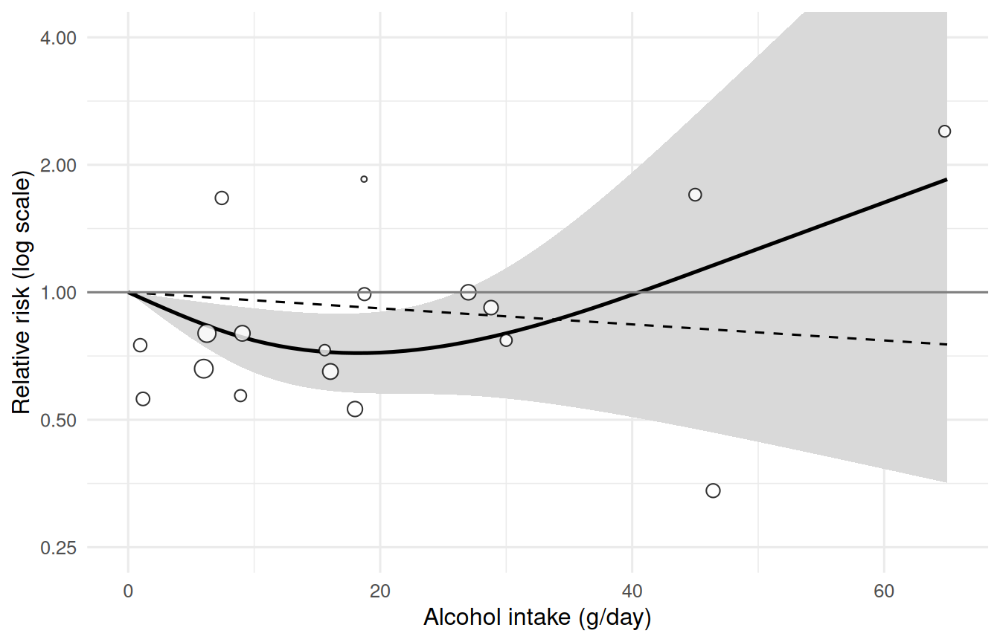
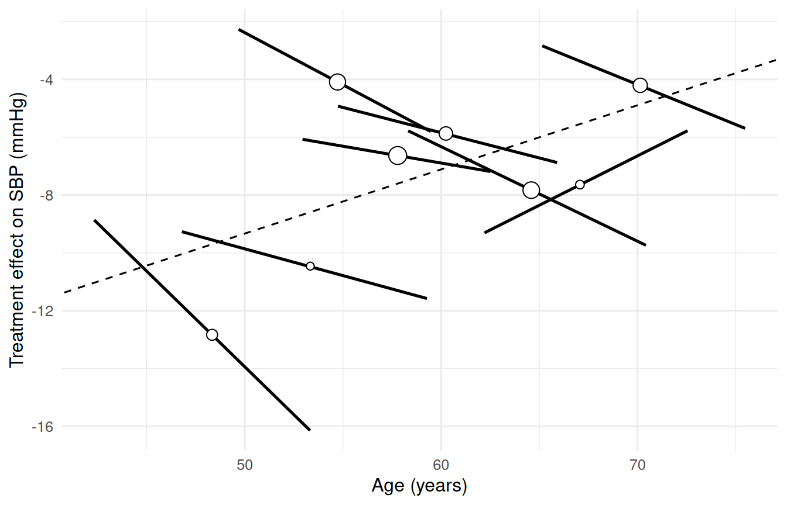

# Multivariate, Dose-Response, and IPD Meta-Analysis {#sec-multivariate-ipd}

The models in Part II treat each study as contributing one effect size, or several effect sizes whose dependence is a nuisance to be handled (Chapter \@ref(sec-dependent-effects)). This chapter covers three settings in which the structure inside a study is itself the object of interest. In **multivariate meta-analysis**, studies report several correlated outcomes, such as two clinical endpoints or one outcome at several time points, and the goal is to estimate all the average effects jointly, using their correlation to borrow strength. In **dose-response meta-analysis**, studies report effects at several exposure levels relative to a common reference, and the goal is the shape of the exposure-outcome curve. In **individual participant data (IPD) meta-analysis**, the analyst has the raw participant-level records from each study, which makes it possible to standardize analyses, examine who benefits most from a treatment, and avoid the ecological bias that afflicts meta-regression on aggregate data.

The three topics share one statistical idea. Each study supplies a vector of estimates $\hat{\boldsymbol\theta}_i$ with a within-study covariance matrix $\mathbf{S}_i$, and the meta-analysis combines these vectors with a between-study model. Getting $\mathbf{S}_i$ right is the central practical problem in all three.


``` r
library(dosresmeta)
library(rms)
library(lme4)
```

## Multivariate meta-analysis {#sec-mvipd-multivariate}

### The model {#sec-mvipd-mv-model}

Let study $i$ report estimates $\mathbf{y}_i = (y_{i1}, \dots, y_{ip_i})^\top$ of $p_i \le p$ outcomes, with within-study covariance matrix $\mathbf{S}_i$ treated as known. The random-effects multivariate model [@berkey1998metaanalysis; @jackson2011multivariate] is

$$
\mathbf{y}_i = \mathbf{X}_i \boldsymbol\beta + \mathbf{u}_i + \mathbf{e}_i, \qquad \mathbf{u}_i \sim N(\mathbf{0}, \boldsymbol\Sigma), \qquad \mathbf{e}_i \sim N(\mathbf{0}, \mathbf{S}_i),
$$

where $\mathbf{X}_i$ selects the outcomes that study $i$ reports (and may include moderators), $\boldsymbol\beta$ holds the average effects, and $\boldsymbol\Sigma$ is the between-study covariance matrix, with diagonal elements $\tau_j^2$ and between-study correlations $\rho_{jl}$. The marginal covariance of $\mathbf{y}_i$ is $\mathbf{S}_i + \mathbf{X}_i^{*}\boldsymbol\Sigma\mathbf{X}_i^{*\top}$, where $\mathbf{X}_i^{*}$ picks the rows of $\boldsymbol\Sigma$ for the reported outcomes. Given $\boldsymbol\Sigma$, the GLS estimator is

$$
\hat{\boldsymbol\beta} = \Bigl(\sum_i \mathbf{X}_i^\top \mathbf{W}_i \mathbf{X}_i\Bigr)^{-1} \sum_i \mathbf{X}_i^\top \mathbf{W}_i \mathbf{y}_i, \qquad \mathbf{W}_i = \bigl(\mathbf{S}_i + \mathbf{X}_i^{*}\boldsymbol\Sigma\mathbf{X}_i^{*\top}\bigr)^{-1},
$$

and $\boldsymbol\Sigma$ is estimated by REML or by multivariate extensions of the method of moments [@jackson2010extending]. Two correlations are involved and they should not be confused. The **within-study correlation** in $\mathbf{S}_i$ reflects the fact that the two outcomes were measured on the same participants; it is a property of sampling error. The **between-study correlation** in $\boldsymbol\Sigma$ describes whether studies with larger true effects on one outcome also have larger true effects on the other.

### Why model outcomes jointly? {#sec-mvipd-why-joint}

If every study reports every outcome and the interest lies only in the marginal averages, separate univariate meta-analyses often give similar point estimates. The joint model earns its keep in three situations [@jackson2011multivariate; @riley2009multivariate]. First, when some studies report only a subset of outcomes, the correlated outcomes that *are* reported carry information about the missing ones, an effect known as **borrowing of strength** [@jackson2015borrowing; @copas2018role]. If outcomes are missing because they were unfavorable, the multivariate model can partially correct the resulting outcome reporting bias [@kirkham2012multivariate]. Second, joint inference about functions of several effects, such as the difference between two outcomes or a joint confidence region, requires their covariance. Third, ignoring the within-study correlation can bias the estimates and their standard errors, particularly when outcomes are missing [@riley2009multivariate].

The price is that within-study correlations are rarely reported in aggregate data. Common responses are to obtain them from IPD for a subset of studies, to assume a plausible value and vary it in a sensitivity analysis [@ishak2007impact], to use the alternative model of @riley2007alternative, which estimates a single overall correlation in place of separate within- and between-study correlations, or to combine an assumed working correlation with robust variance estimation (Chapter \@ref(sec-dependent-effects)).

### Example: two periodontal outcomes {#sec-mvipd-berkey}

The classic example [@berkey1998metaanalysis] comprises five randomized trials comparing surgical and non-surgical treatment of periodontal disease. Each trial reports the mean difference between surgical and non-surgical treatment in the one-year improvement of probing depth (PD) and of attachment level (AL), coded so that positive values favor surgery for both outcomes (a larger reduction in probing depth, a larger gain in attachment level), together with the full $2 \times 2$ within-trial covariance matrix.


``` r
dat_pd <- dat.berkey1998
dat_pd[, c("trial", "author", "year", "ni", "outcome", "yi", "vi", "v1i", "v2i")]
#> 
#>    trial           author year ni outcome      yi     vi    v1i    v2i 
#> 1      1 Pihlstrom et al. 1983 14      PD  0.4700 0.0075 0.0075 0.0030 
#> 2      1 Pihlstrom et al. 1983 14      AL -0.3200 0.0077 0.0030 0.0077 
#> 3      2    Lindhe et al. 1982 15      PD  0.2000 0.0057 0.0057 0.0009 
#> 4      2    Lindhe et al. 1982 15      AL -0.6000 0.0008 0.0009 0.0008 
#> 5      3   Knowles et al. 1979 78      PD  0.4000 0.0021 0.0021 0.0007 
#> 6      3   Knowles et al. 1979 78      AL -0.1200 0.0014 0.0007 0.0014 
#> 7      4  Ramfjord et al. 1987 89      PD  0.2600 0.0029 0.0029 0.0009 
#> 8      4  Ramfjord et al. 1987 89      AL -0.3100 0.0015 0.0009 0.0015 
#> 9      5    Becker et al. 1988 16      PD  0.5600 0.0148 0.0148 0.0072 
#> 10     5    Becker et al. 1988 16      AL -0.3900 0.0304 0.0072 0.0304
```

Columns `v1i` and `v2i` contain each trial's covariance matrix, so the block-diagonal $\mathbf{S} = \operatorname{diag}(\mathbf{S}_1, \dots, \mathbf{S}_5)$ is assembled with `bldiag()`. The within-trial correlations range from about 0.34 to 0.43 (for the first trial, $0.0030/\sqrt{0.0075 \times 0.0077} = 0.39$).


``` r
S_pd <- bldiag(lapply(split(dat_pd[, c("v1i", "v2i")], dat_pd$trial), as.matrix))
mv_pd <- rma.mv(yi, S_pd, mods = ~ outcome - 1, random = ~ outcome | trial,
                struct = "UN", data = dat_pd)
mv_pd
#> 
#> Multivariate Meta-Analysis Model (k = 10; method: REML)
#> 
#> Variance Components:
#> 
#> outer factor: trial   (nlvls = 5)
#> inner factor: outcome (nlvls = 2)
#> 
#>             estim    sqrt  k.lvl  fixed  level 
#> tau^2.1    0.0327  0.1807      5     no     AL 
#> tau^2.2    0.0117  0.1083      5     no     PD 
#> 
#>     rho.AL  rho.PD    AL  PD 
#> AL       1             -   5 
#> PD  0.6088       1    no   - 
#> 
#> Test for Residual Heterogeneity:
#> QE(df = 8) = 128.2267, p-val < .0001
#> 
#> Test of Moderators (coefficients 1:2):
#> QM(df = 2) = 108.8616, p-val < .0001
#> 
#> Model Results:
#> 
#>            estimate      se     zval    pval    ci.lb    ci.ub      
#> outcomeAL   -0.3392  0.0879  -3.8589  0.0001  -0.5115  -0.1669  *** 
#> outcomePD    0.3534  0.0588   6.0057  <.0001   0.2381   0.4688  *** 
#> 
#> ---
#> Signif. codes:  0 '***' 0.001 '**' 0.01 '*' 0.05 '.' 0.1 ' ' 1
```

The pooled effect is 0.353 mm (95% CI 0.238 to 0.469) for probing depth and $-0.339$ mm ($-0.512$ to $-0.167$) for attachment level: surgery is better at reducing probing depth, non-surgical treatment at improving attachment level. The between-trial standard deviations are 0.108 (PD) and 0.181 (AL), and the estimated between-trial correlation is 0.61. With five trials, $\boldsymbol\Sigma$ is poorly determined; a profile likelihood plot (`profile(mv_pd)`) would show a very flat likelihood for the correlation.

Separate univariate random-effects analyses give


``` r
uni_pd <- rma(yi, vi, data = dat_pd, subset = outcome == "PD")
uni_al <- rma(yi, vi, data = dat_pd, subset = outcome == "AL")
est_se <- function(b, se) c(estimate = unname(b), se = unname(se))
round(rbind(
  multivariate_PD = est_se(coef(mv_pd)[2], mv_pd$se[2]),
  univariate_PD   = est_se(coef(uni_pd), uni_pd$se),
  multivariate_AL = est_se(coef(mv_pd)[1], mv_pd$se[1]),
  univariate_AL   = est_se(coef(uni_al), uni_al$se)
), 4)
#>                 estimate     se
#> multivariate_PD   0.3534 0.0588
#> univariate_PD     0.3606 0.0592
#> multivariate_AL  -0.3392 0.0879
#> univariate_AL    -0.3457 0.0885
```

With complete data, the two approaches agree closely: 0.353 versus 0.361 for probing depth and $-0.339$ versus $-0.346$ for attachment level, with standard errors that differ only in the third decimal. This illustrates a point stressed by @jackson2011multivariate: when every study reports every outcome and interest lies in the marginal averages, the multivariate model adds little, and with few studies any differences are driven mostly by how the heterogeneity parameters are estimated.

### Borrowing of strength when outcomes are missing {#sec-mvipd-bos}

The situation changes when outcomes are missing. To see this, suppose trials 1 and 3 had not reported attachment level.


``` r
dat_mis <- dat_pd[!(dat_pd$outcome == "AL" & dat_pd$trial %in% c(1, 3)), ]
S_mis <- bldiag(lapply(split(dat_mis, dat_mis$trial), function(d) {
  m <- as.matrix(d[, c("v1i", "v2i")])
  keep <- c(PD = 1, AL = 2)[as.character(d$outcome)]
  m[, keep, drop = FALSE]
}))
mv_mis <- rma.mv(yi, S_mis, mods = ~ outcome - 1, random = ~ outcome | trial,
                 struct = "UN", data = dat_mis)
uni_mis <- rma(yi, vi, data = dat_mis, subset = outcome == "AL")
round(rbind(multivariate_AL = est_se(coef(mv_mis)[1], mv_mis$se[1]),
            univariate_AL   = est_se(coef(uni_mis), uni_mis$se)), 4)
#>                 estimate     se
#> multivariate_AL  -0.4270 0.1019
#> univariate_AL    -0.4439 0.1048
c(variance_reduction = 1 - (mv_mis$se[1] / uni_mis$se)^2, between_rho = mv_mis$rho)
#> variance_reduction        between_rho 
#>            0.05469            0.24910
```

The univariate analysis of AL now rests on three trials. The multivariate analysis also uses the PD results of trials 1 and 3, which are informative about their unreported AL effects through both the within-trial and the between-trial correlations. The multivariate estimate for AL moves from $-0.444$ to $-0.427$, toward the complete-data value of $-0.339$, and its variance is about 5% smaller than in the univariate analysis. The gain is modest because the between-trial correlation, re-estimated from the reduced data, is only about 0.25 and the within-trial correlations are around 0.4. @jackson2015borrowing formalize the contribution of the other outcomes through study weights and a borrowing-of-strength statistic. The gain depends on the correlations: if both the within- and between-study correlations were zero, the PD results would carry no information about AL. With five trials, the between-trial correlation is also fragile. Removing AL from a different pair of trials (for example trials 3 and 4) drives the REML estimate of the correlation to the boundary of $\pm 1$, and the apparent borrowing of strength then becomes large but untrustworthy. Results like these should always be accompanied by a sensitivity analysis that fixes the between-study correlation at several plausible values (for example with the `rho` argument of `rma.mv()`).

::: {.rmdwarning}
Borrowing of strength is only as good as the assumption that outcomes are missing at random given the reported ones. If AL was left unreported precisely because it was disappointing, the multivariate model reduces but does not remove the bias [@kirkham2012multivariate]. It also relies on correct within-study correlations, which in practice are often assumed.
:::

Moderators enter as interactions with outcome, so each outcome gets its own slope. For example, publication year (centered at 1983):


``` r
mv_year <- rma.mv(yi, S_pd, mods = ~ outcome + outcome:I(year - 1983) - 1,
                  random = ~ outcome | trial, struct = "UN", data = dat_pd)
round(coef(summary(mv_year)), 4)
#>                          estimate     se    zval   pval   ci.lb   ci.ub
#> outcomeAL                 -0.3357 0.0980 -3.4260 0.0006 -0.5278 -0.1437
#> outcomePD                  0.3588 0.0735  4.8844 0.0000  0.2148  0.5027
#> outcomeAL:I(year - 1983)  -0.0115 0.0300 -0.3850 0.7002 -0.0703  0.0472
#> outcomePD:I(year - 1983)   0.0049 0.0219  0.2225 0.8239 -0.0380  0.0477
```

Neither slope is distinguishable from zero, which is unsurprising with five trials. The `metaSEM` package fits the same multivariate model by maximum likelihood (Chapter \@ref(sec-masem)), and `mvmeta` offers an alternative implementation [@gasparrini2012multivariate].

### When within-study correlations are unknown {#sec-mvipd-unknown-correlations}

The Berkey data are unusual in reporting the full within-trial covariance matrices. More often only the variances are available. A practical approach is to impute the covariances from an assumed within-study correlation $r$, $\operatorname{Cov}(y_{i1}, y_{i2}) = r\sqrt{v_{i1}v_{i2}}$, which `vcalc()` does, and to repeat the analysis over a plausible range of $r$.


``` r
sens <- t(sapply(c(0, 0.2, 0.4, 0.6, 0.8), function(r) {
  S_r <- vcalc(vi, cluster = trial, type = outcome, rho = r, data = dat_pd)
  fit <- rma.mv(yi, S_r, mods = ~ outcome - 1, random = ~ outcome | trial,
                struct = "UN", data = dat_pd)
  c(r_within = r, AL = unname(coef(fit)[1]), se_AL = fit$se[1],
    PD = unname(coef(fit)[2]), se_PD = fit$se[2], rho_between = fit$rho)
}))
round(sens, 3)
#>      r_within     AL se_AL    PD se_PD rho_between
#> [1,]      0.0 -0.325 0.088 0.345 0.055       0.775
#> [2,]      0.2 -0.334 0.088 0.350 0.057       0.681
#> [3,]      0.4 -0.341 0.088 0.355 0.060       0.589
#> [4,]      0.6 -0.349 0.088 0.361 0.062       0.499
#> [5,]      0.8 -0.356 0.089 0.367 0.065       0.409
```

Here `type = outcome` tells `vcalc()` that the two rows of a trial are different outcomes measured on the same participants, so they receive the assumed correlation. With complete data, the pooled estimates change only slightly (AL from $-0.325$ to $-0.356$ as $r$ goes from 0 to 0.8), while the estimated between-trial correlation falls from 0.78 to 0.41: part of the covariation between outcomes can be attributed either to sampling error or to true between-trial covariation. With missing outcomes, the borrowing of strength and hence the estimates themselves become more sensitive to $r$, which is why the sensitivity analysis matters most precisely when the multivariate model is most useful. An alternative is to fit the model with a working correlation and then use cluster-robust standard errors (Chapter \@ref(sec-dependent-effects)), which remain valid even if the assumed correlation is wrong, provided there are enough studies; with five trials, as here, robust standard errors would not be trustworthy.

### Longitudinal outcomes {#sec-mvipd-longitudinal}

A special case of correlated outcomes arises when the same effect is measured at several follow-up times. @ishak2007metaanalysis analyzed 46 studies of deep-brain stimulation in Parkinson's disease, which reported the mean change in motor function (UPDRS score, where negative values are improvements) at 3, 6, 12 months and a longer follow-up, with each study reporting only some of the four time points. Because the same patients are measured repeatedly, estimates from the same study are correlated, and the correlation is plausibly stronger for adjacent time points. A first-order autoregressive (AR(1)) structure captures this: the correlation between time points $t$ and $t'$ is $\phi^{|t-t'|}$. Following @ishak2007metaanalysis, we assume a within-study autocorrelation of $\phi = 0.97$ between successive measurement occasions and build the within-study covariance matrix with `vcalc()`.


``` r
dat_dbs <- reshape(dat.ishak2007, direction = "long", idvar = "study",
                   v.names = c("yi", "vi"), varying = list(c(2, 4, 6, 8), c(3, 5, 7, 9)))
dat_dbs <- dat_dbs[order(dat_dbs$study, dat_dbs$time), ]
dat_dbs <- dat_dbs[!is.na(dat_dbs$yi), ]
rownames(dat_dbs) <- NULL
table(dat_dbs$time)
#> 
#>  1  2  3  4 
#> 24 22 25 11
S_dbs <- vcalc(vi, cluster = study, time1 = time, phi = 0.97, data = dat_dbs)
```

The true effects are modeled with a heteroscedastic AR(1) structure (`struct = "HAR"`), which allows a different between-study variance at each time point but constrains the between-study correlations to decay as $\rho^{|t-t'|}$. A homoscedastic version (`struct = "AR"`) is nested within it.


``` r
dbs_har <- rma.mv(yi, S_dbs, mods = ~ factor(time) - 1, random = ~ time | study,
                  struct = "HAR", data = dat_dbs)
dbs_ar <- rma.mv(yi, S_dbs, mods = ~ factor(time) - 1, random = ~ time | study,
                 struct = "AR", data = dat_dbs)
dbs_har
#> 
#> Multivariate Meta-Analysis Model (k = 82; method: REML)
#> 
#> Variance Components:
#> 
#> outer factor: study (nlvls = 46)
#> inner factor: time  (nlvls = 4)
#> 
#>              estim    sqrt  k.lvl  fixed  level 
#> tau^2.1    22.7258  4.7672     24     no      1 
#> tau^2.2    33.7295  5.8077     22     no      2 
#> tau^2.3    26.1426  5.1130     25     no      3 
#> tau^2.4    31.1803  5.5839     11     no      4 
#> rho         0.8832                    no        
#> 
#> Test for Residual Heterogeneity:
#> QE(df = 78) = 856.1635, p-val < .0001
#> 
#> Test of Moderators (coefficients 1:4):
#> QM(df = 4) = 873.1568, p-val < .0001
#> 
#> Model Results:
#> 
#>                estimate      se      zval    pval     ci.lb     ci.ub      
#> factor(time)1  -25.9047  1.0118  -25.6022  <.0001  -27.8879  -23.9216  *** 
#> factor(time)2  -27.4608  1.1406  -24.0768  <.0001  -29.6963  -25.2254  *** 
#> factor(time)3  -28.6559  1.0321  -27.7634  <.0001  -30.6789  -26.6330  *** 
#> factor(time)4  -26.4934  1.3817  -19.1743  <.0001  -29.2015  -23.7853  *** 
#> 
#> ---
#> Signif. codes:  0 '***' 0.001 '**' 0.01 '*' 0.05 '.' 0.1 ' ' 1
anova(dbs_har, dbs_ar)
#> 
#>         df      AIC      BIC     AICc    logLik    LRT   pval       QE 
#> Full     9 480.7247 501.9351 483.3718 -231.3624               856.1635 
#> Reduced  6 476.5404 490.6806 477.7235 -232.2702 1.8156 0.6115 856.1635
```

The average improvement is about 26 UPDRS points at 3 months, 27 at 6 months, 29 at 12 months and 26 at the long-term follow-up, so the benefit of stimulation appears early and is sustained. The between-study autocorrelation is high (0.88): studies with larger effects at one time point tend to have larger effects at the next. The likelihood-ratio test does not favor time-specific heterogeneity variances over a common variance ($p$ well above 0.05), so the simpler AR structure would be adequate. When measurement times are irregular, `struct = "CAR"` (continuous-time AR) uses the actual time lags rather than occasion numbers.

## Dose-response meta-analysis {#sec-mvipd-dose-response}

### The data structure {#sec-mvipd-dr-structure}

Epidemiological studies of exposures such as alcohol, coffee or red meat often report relative risks for several categories of exposure, each compared with the same reference category. Study $i$ provides $m_i$ log relative risks $y_{ij}$ ($j = 1, \dots, m_i$) at assigned doses $x_{ij}$, all relative to a reference dose $x_{i0}$. Because every non-reference estimate shares the same reference group, the $y_{ij}$ within a study are correlated, and ignoring this correlation misstates the precision of a pooled trend. @greenland1992methods showed how to reconstruct the within-study covariance matrix $\mathbf{S}_i$ from the reported case and non-case (or person-time) counts in each category, together with the adjusted relative risks; @orsini2006generalized describe the estimation in detail.

The dose-response function is specified as $y_{ij} = f(x_{ij}) - f(x_{i0})$, typically through a linear combination of transformations of dose, $f(x) = \sum_q \beta_q g_q(x)$. In the **two-stage** approach [@orsini2011metaanalysis; @crippa2016multivariate], each study's curve is first estimated by GLS,

$$
\hat{\boldsymbol\beta}_i = (\mathbf{X}_i^\top \mathbf{S}_i^{-1}\mathbf{X}_i)^{-1}\mathbf{X}_i^\top \mathbf{S}_i^{-1}\mathbf{y}_i,
$$

where the rows of $\mathbf{X}_i$ are $g(x_{ij}) - g(x_{i0})$, and the study-specific coefficient vectors are then pooled by a multivariate random-effects meta-analysis, exactly as in Section \@ref(sec-mvipd-mv-model). Because no intercept is estimated (the curve passes through the reference by construction), a linear trend has one coefficient and a restricted cubic spline with three knots has two. The **one-stage** approach of @crippa2018onestage fits a linear mixed model to all the $y_{ij}$ at once, which allows studies with only two exposure categories to contribute to a nonlinear curve. The `dosresmeta` package implements both [@crippa2016multivariate].

### Example: alcohol and cardiovascular disease {#sec-mvipd-dr-example}

The `alcohol_cvd` data contain six studies of alcohol intake (grams per day) and cardiovascular disease risk. Four are case-control (`type = "cc"`) and two report cumulative incidence (`"ci"`). The first row of each study is the reference category with log relative risk 0 and no standard error.


``` r
data("alcohol_cvd")
head(alcohol_cvd, 9)
#>   id  author type  dose cases   n   logrr     se
#> 1  1 Bianchi   cc  0.00   126 414  0.0000     NA
#> 2  1 Bianchi   cc  9.06    61 261 -0.2231 0.2233
#> 3  1 Bianchi   cc 27.00    69 228 -0.0001 0.2338
#> 4  1 Bianchi   cc 45.00    22  44  0.5306 0.3765
#> 5  1 Bianchi   cc 64.80    19  34  0.8755 0.4440
#> 6  2   Bobak   cc  0.00    77 258  0.0000     NA
#> 7  2   Bobak   cc 16.05    88 413 -0.4308 0.2213
#> 8  2   Bobak   cc 46.42    24 202 -1.0788 0.2976
#> 9  2   Bobak   cc 77.16    13  64 -0.6162 0.3871
```

A linear trend is the simplest model. The `type`, `cases` and `n` arguments let `dosresmeta()` reconstruct the Greenland-Longnecker covariances.


``` r
dr_lin <- dosresmeta(formula = logrr ~ dose, id = id, se = se, type = type,
                     cases = cases, n = n, data = alcohol_cvd)
summary(dr_lin)
#> Call:  dosresmeta(formula = logrr ~ dose, id = id, type = type, cases = cases, 
#>     n = n, data = alcohol_cvd, se = se)
#> 
#> Two-stage random-effects meta-analysis
#> Estimation method: REML
#> Covariance approximation: Greenland & Longnecker
#> 
#> Chi2 model: X2 = 0.549 (df = 1), p-value = 0.459
#> 
#> Fixed-effects coefficients
#>              Estimate  Std. Error       z  Pr(>|z|)  95%ci.lb  95%ci.ub   
#> (Intercept)    -0.004       0.006  -0.741     0.459    -0.016     0.007   
#> ---
#> Signif. codes:  0 '***' 0.001 '**' 0.01 '*' 0.05 '.' 0.1 ' ' 1 
#> 
#> Between-study random-effects (co)variance components
#>   Std. Dev
#>      0.010
#> 
#> Univariate Cochran Q-test for residual heterogeneity:
#> Q = 14.146 (df = 5), p-value = 0.015
#> I-square statistic = 64.7%
#> 
#> 6 studies, 6 values, 1 fixed and 1 random-effects parameters
#>  logLik      AIC      BIC  
#>  14.034  -24.068  -24.849
```

The pooled linear slope is $-0.0044$ per gram per day (95% CI $-0.016$ to $0.007$), which corresponds to a relative risk of $\exp(-0.0044 \times 12) = 0.95$ for one standard drink of about 12 g per day, with a confidence interval that includes 1. The Q test ($p = 0.015$, $I^2 = 65\%$) indicates heterogeneity in the study-specific slopes. A linear model, however, cannot represent the hypothesis that moderate drinking is associated with lower and heavy drinking with higher risk.

### Restricted cubic splines {#sec-mvipd-dr-spline}

A restricted cubic spline (RCS) is cubic between knots and linear beyond the outer knots. With three knots it has two coefficients, the first for the linear component and the second for the departure from linearity. Knots are conventionally placed at the 10th, 50th and 90th percentiles of the dose distribution [@orsini2011metaanalysis].


``` r
knots_alc <- quantile(alcohol_cvd$dose, c(0.10, 0.50, 0.90))
knots_alc
#>   10%   50%   90% 
#>  0.00  9.06 45.85
dr_spl <- dosresmeta(formula = logrr ~ rcs(dose, knots_alc), id = id, se = se,
                     type = type, cases = cases, n = n, data = alcohol_cvd)
summary(dr_spl)
#> Call:  dosresmeta(formula = logrr ~ rcs(dose, knots_alc), id = id, type = type, 
#>     cases = cases, n = n, data = alcohol_cvd, se = se)
#> 
#> Two-stage random-effects meta-analysis
#> Estimation method: REML
#> Covariance approximation: Greenland & Longnecker
#> 
#> Chi2 model: X2 = 9.238 (df = 2), p-value = 0.010
#> 
#> Fixed-effects coefficients
#>                            Estimate  Std. Error       z  Pr(>|z|)  95%ci.lb
#> rcs(dose, knots_alc)dose     -0.031       0.011  -2.805     0.005    -0.052
#> rcs(dose, knots_alc)dose'     0.094       0.050   1.879     0.060    -0.004
#>                            95%ci.ub    
#> rcs(dose, knots_alc)dose     -0.009  **
#> rcs(dose, knots_alc)dose'     0.193   .
#> ---
#> Signif. codes:  0 '***' 0.001 '**' 0.01 '*' 0.05 '.' 0.1 ' ' 1 
#> 
#> Between-study random-effects (co)variance components
#>                            Std. Dev                      Corr
#> rcs(dose, knots_alc)dose      0.014  rcs(dose, knots_alc)dose
#> rcs(dose, knots_alc)dose'     0.080                    -0.931
#> 
#> Univariate Cochran Q-test for residual heterogeneity:
#> Q = 32.357 (df = 10), p-value = 0.000
#> I-square statistic = 69.1%
#> 
#> 6 studies, 12 values, 2 fixed and 3 random-effects parameters
#>  logLik      AIC      BIC  
#>  12.149  -14.298  -12.785
waldtest(b = coef(dr_spl), Sigma = vcov(dr_spl), Terms = 2)
#> Wald test:
#> ----------
#> 
#> Chi-squared test:
#> X2 = 3.5, df = 1, P(> X2) = 0.06
```

The 10th percentile of dose is 0 because each study contributes a reference category at zero, so the first knot sits at no drinking. The first spline coefficient is clearly negative ($-0.031$, $p = 0.005$), and the Wald test of the nonlinear term gives $\chi^2(1) = 3.5$, $p = 0.06$, which is weak evidence of departure from linearity. The two-coefficient random-effects model estimates a strong negative correlation ($-0.93$) between the study-specific coefficients, a sign that six studies barely identify the $2 \times 2$ between-study covariance matrix. Predicted relative risks relative to non-drinkers are obtained with `predict()`.


``` r
new_dose <- data.frame(dose = c(0, 6, 12, 24, 36, 48, 60))
round(predict(dr_spl, new_dose, xref = 0, expo = TRUE), 3)
#>   rcs(dose, knots_alc)dose rcs(dose, knots_alc)dose'  pred ci.lb ci.ub
#> 1                        0                     0.000 1.000 1.000 1.000
#> 2                        6                     0.103 0.840 0.745 0.947
#> 3                       12                     0.807 0.747 0.616 0.905
#> 4                       24                     4.598 0.739 0.575 0.949
#> 5                       36                    10.601 0.900 0.532 1.524
#> 6                       48                    17.601 1.205 0.456 3.182
#> 7                       60                    24.714 1.630 0.383 6.941
```

The spline curve reaches its minimum around 12 to 24 g per day, where the risk is about 25% lower than for non-drinkers (RR 0.75, 95% CI 0.62 to 0.90 at 12 g), and rises above 1 at higher intakes, although the confidence intervals widen rapidly beyond about 40 g per day because few participants drink that much. Figure \@ref(fig:mvipd-dr-plot) shows both fitted curves.


``` r
grid <- data.frame(dose = seq(0, 65, by = 1))
pr_spl <- predict(dr_spl, grid, xref = 0, expo = TRUE)
pr_lin <- predict(dr_lin, grid, xref = 0, expo = TRUE)
curve_df <- data.frame(dose = grid$dose, spline = pr_spl$pred, lo = pr_spl$ci.lb,
                       hi = pr_spl$ci.ub, linear = pr_lin$pred)
pts <- subset(alcohol_cvd, !is.na(se))
ggplot(curve_df, aes(dose)) +
  geom_ribbon(aes(ymin = lo, ymax = hi), fill = "grey85") +
  geom_line(aes(y = spline), linewidth = 0.9) +
  geom_line(aes(y = linear), linetype = "dashed") +
  geom_point(data = pts, aes(x = dose, y = exp(logrr), size = 1 / se),
             shape = 21, fill = "white", alpha = 0.8) +
  geom_hline(yintercept = 1, colour = "grey50") +
  scale_y_log10(breaks = c(0.25, 0.5, 1, 2, 4)) +
  coord_cartesian(xlim = c(0, 65), ylim = c(0.25, 4)) +
  scale_size_continuous(range = c(1, 4), guide = "none") +
  labs(x = "Alcohol intake (g/day)", y = "Relative risk (log scale)")
```

<div class="figure" style="text-align: center">

<p class="caption">(\#fig:mvipd-dr-plot)Pooled dose-response curves for alcohol intake and cardiovascular disease risk (six studies). Solid line and band: restricted cubic spline with 95% confidence interval; dashed line: linear trend. Points are the study-specific relative risks, sized by inverse standard error (one point above 65 g/day lies outside the plotted range).</p>
</div>

### One-stage dose-response models {#sec-mvipd-dr-one-stage}

The two-stage approach has a hidden eligibility rule. A study can estimate its own curve only if it reports at least as many non-referent categories as the curve has coefficients, so a three-knot spline needs three exposure groups per study, and studies that report only "exposed versus unexposed" or two exposure levels must be dropped. In large reviews this can exclude a substantial share of the evidence, and the excluded studies need not resemble the included ones. @crippa2018onestage reformulated the analysis as a single linear mixed model for all the reported log relative risks,
$$
\mathbf{y}_i = \mathbf{X}_i\boldsymbol\beta + \mathbf{Z}_i\mathbf{b}_i + \boldsymbol\varepsilon_i, \qquad
\mathbf{b}_i \sim N(\mathbf{0}, \boldsymbol\Psi), \qquad \boldsymbol\varepsilon_i \sim N(\mathbf{0}, \mathbf{S}_i),
$$
where $\mathbf{X}_i$ holds the dose transformations of study $i$ relative to its reference, $\mathbf{Z}_i$ is usually equal to $\mathbf{X}_i$, and $\mathbf{S}_i$ is the Greenland-Longnecker covariance matrix. A study with a single non-referent category contributes one row and constrains one linear combination of the coefficients; the random effects $\mathbf{b}_i$ need not be estimable within each study because they are integrated out of the marginal likelihood. The pooled curve and the between-study covariance $\boldsymbol\Psi$ are therefore estimated from all studies, and because the model has a proper likelihood, alternative curves can be compared by AIC. In `dosresmeta`, `proc = "1stage"` requests this model.


``` r
dr_spl1 <- dosresmeta(formula = logrr ~ rcs(dose, knots_alc), id = id, se = se,
                      type = type, cases = cases, n = n, data = alcohol_cvd,
                      proc = "1stage")
round(rbind(two_stage = coef(dr_spl), one_stage = coef(dr_spl1)), 4)
#>           rcs(dose, knots_alc)dose rcs(dose, knots_alc)dose'
#> two_stage                  -0.0307                    0.0942
#> one_stage                  -0.0308                    0.0943
```

When every study can be analysed on its own, as here, the two approaches give practically the same coefficients. The difference appears when some studies report fewer categories. To mimic this, we keep only the reference and one other category for three of the six studies. A two-stage spline analysis would now have to drop those three studies (`dosresmeta()` stops with an error if asked to fit it), whereas the one-stage model uses all of them.


``` r
alcohol_sparse <- do.call(rbind, lapply(split(alcohol_cvd, alcohol_cvd$id), function(d) {
  if (d$id[1] %in% c(1, 3, 5)) d[c(1, 3), ] else d   # reference + one exposed category
}))
table(non_referent = tapply(!is.na(alcohol_sparse$se), alcohol_sparse$id, sum))
#> non_referent
#> 1 3 
#> 3 3
dr_sparse1 <- dosresmeta(formula = logrr ~ rcs(dose, knots_alc), id = id, se = se,
                         type = type, cases = cases, n = n, data = alcohol_sparse,
                         proc = "1stage")
dr_three <- dosresmeta(formula = logrr ~ rcs(dose, knots_alc), id = id, se = se,
                       type = type, cases = cases, n = n,
                       data = subset(alcohol_cvd, !id %in% c(1, 3, 5)))
dose_pts <- data.frame(dose = c(0, 12, 24, 48))   # predict() needs the reference dose
pred_rr <- function(fit, analysis) {
  p <- predict(fit, dose_pts, xref = 0, expo = TRUE)[-1, ]
  data.frame(analysis = analysis, dose = p[, 1], RR = p$pred, lower = p$ci.lb, upper = p$ci.ub)
}
dr_sparse_pred <- rbind(pred_rr(dr_spl1, "full data, one-stage"),
                        pred_rr(dr_sparse1, "sparse data, one-stage (6 studies)"),
                        pred_rr(dr_three, "sparse data, two-stage (3 studies)"))
knitr::kable(dr_sparse_pred, digits = 2, row.names = FALSE,
             caption = "Predicted relative risks of cardiovascular disease versus non-drinkers from the full data and from the artificially sparse data.")
```


Table: (\#tab:mvipd-dr-onestage-sparse)Predicted relative risks of cardiovascular disease versus non-drinkers from the full data and from the artificially sparse data.

|analysis                           | dose|   RR| lower| upper|
|:----------------------------------|----:|----:|-----:|-----:|
|full data, one-stage               |   12| 0.75|  0.62|  0.90|
|full data, one-stage               |   24| 0.74|  0.58|  0.94|
|full data, one-stage               |   48| 1.20|  0.45|  3.17|
|sparse data, one-stage (6 studies) |   12| 0.77|  0.63|  0.94|
|sparse data, one-stage (6 studies) |   24| 0.69|  0.49|  0.96|
|sparse data, one-stage (6 studies) |   48| 0.74|  0.33|  1.67|
|sparse data, two-stage (3 studies) |   12| 0.81|  0.60|  1.08|
|sparse data, two-stage (3 studies) |   24| 0.69|  0.46|  1.05|
|sparse data, two-stage (3 studies) |   48| 0.58|  0.36|  0.92|


With the sparse data, the one-stage model uses all six studies and the two-stage model only the three that kept every category. The one-stage intervals at 12 and 24 g per day are correspondingly narrower, and they exclude 1 where the two-stage intervals do not. Neither analysis reproduces the full-data curve at 48 g per day, where the full data suggest a rise in risk, because the categories we deleted carried most of the information about heavy drinking: the one-stage model uses everything a study reports, but it cannot recover what the study did not report. In a real review, the gain from the one-stage model is largest when many studies report only two or three categories, which is common in nutritional and occupational epidemiology. The one-stage model makes the same exchangeability and normality assumptions as the two-stage model, and with sparse studies the between-study covariance $\boldsymbol\Psi$ of a spline is often weakly identified (here it is estimated as nearly singular), so its estimates should not be over-interpreted.

### Practical issues in dose-response synthesis {#sec-mvipd-dr-practical}

Most of the work in a dose-response meta-analysis lies in data extraction. Each exposure category needs an assigned dose. The usual convention is the reported median or mean within the category, or the midpoint of closed intervals; for open-ended upper categories the width of the adjacent interval is often borrowed. These choices should be prespecified and varied in sensitivity analyses. When a study's reference category is not the lowest one, the relative risks must be re-expressed relative to a common reference before analysis. The Greenland-Longnecker covariance requires the number of cases and of non-cases or person-years per category; when these are not reported, they can sometimes be reconstructed, or the within-study correlations can be set to zero as a last resort, which usually overstates the precision of the trend. Finally, spline curves are sensitive to knot placement and to sparse data at the extremes. The curve should be reported only over the dose range where most studies contribute, and alternative knot positions and fractional polynomials are useful sensitivity checks [@orsini2011metaanalysis]. For continuous outcomes such as blood pressure, the same machinery applies to mean differences [@crippa2016multivariate].

## Individual participant data meta-analysis {#sec-mvipd-ipd}

### Why collect IPD? {#sec-mvipd-ipd-why}

An IPD meta-analysis obtains and reanalyzes the participant-level data from each study rather than the published summaries [@riley2010metaanalysis; @riley2021individual]. The effort is considerable, often taking years of negotiation with trialists, but it brings advantages that no aggregate-data method can replicate. The analyst can check data quality, apply consistent inclusion criteria, outcome definitions and follow-up times across studies, and adjust for the same prognostic covariates everywhere. Unreported outcomes and subgroups can be analyzed. Time-to-event outcomes can be modeled properly. Most importantly, treatment-covariate interactions can be estimated *within* trials, using the variation of patient characteristics inside each trial, instead of by regressing trial-level effects on trial-level averages, an analysis that is both low-powered and prone to ecological bias [@berlin2002individual]. @debray2015get review the methodology, and reporting is governed by PRISMA-IPD [@stewart2015preferred].

### A simulated IPD example {#sec-mvipd-ipd-data}

To illustrate the methods without access to restricted trial data, we **simulate** IPD from eight hypothetical randomized trials of an antihypertensive treatment. Each participant has an age, a randomized treatment indicator and an outcome, systolic blood pressure (mmHg) at follow-up. The data-generating model has an average treatment effect of $-6$ mmHg at age 60 with between-trial standard deviation 1, a *within-trial* treatment-by-age interaction of $-0.20$ mmHg per year (older patients benefit more), and trial-level differences that make the average effect smaller in trials with older populations (for instance because those trials used lower doses). The trials differ in size and in mean age.


``` r
set.seed(2026)
K <- 8
n_k <- c(180, 120, 350, 500, 220, 400, 150, 300)
mean_age <- c(48, 52, 55, 58, 61, 64, 67, 70)
theta <- -6        # average effect at age 60
tau <- 1           # between-trial SD of the treatment effect
gamma_w <- -0.20   # within-trial interaction per year of age
# trial-level departures: trials with older populations have weaker effects
u_k <- rnorm(K, 0, tau) + 0.45 * (mean_age - 60)

ipd <- do.call(rbind, lapply(seq_len(K), function(k) {
  age <- rnorm(n_k[k], mean_age[k], 8)
  treat <- rbinom(n_k[k], 1, 0.5)
  base <- rnorm(1, 0, 3)                       # trial-specific baseline level
  sbp <- 140 + base + 0.3 * (age - 60) +
    treat * (theta + u_k[k] + gamma_w * (age - 60)) + rnorm(n_k[k], 0, 12)
  data.frame(trial = k, age = age, treat = treat, sbp = sbp)
}))
ipd$trial <- factor(ipd$trial)
ipd$age60 <- ipd$age - 60
head(ipd, 4)
#>   trial   age treat   sbp  age60
#> 1     1 48.91     1 112.0 -11.09
#> 2     1 44.21     0 141.2 -15.79
#> 3     1 44.73     0 150.2 -15.27
#> 4     1 42.16     0 113.7 -17.84
rbind(n = table(ipd$trial), mean_age = round(tapply(ipd$age, ipd$trial, mean), 1))
#>              1     2     3     4     5     6     7     8
#> n        180.0 120.0 350.0 500.0 220.0 400.0 150.0 300.0
#> mean_age  48.3  53.3  54.7  57.8  60.2  64.6  67.1  70.1
```

### Two-stage IPD meta-analysis {#sec-mvipd-ipd-two-stage}

In the two-stage approach, each trial is analyzed separately, here by linear regression of blood pressure on treatment adjusted for age, and the treatment effect estimates are then pooled with a standard random-effects model. Adjusting for a prognostic covariate in each trial increases precision for continuous outcomes, one of the benefits of having IPD.


``` r
stage1 <- do.call(rbind, lapply(split(ipd, ipd$trial), function(d) {
  f <- lm(sbp ~ treat + age60, data = d)
  data.frame(trial = d$trial[1], n = nrow(d), mean_age = mean(d$age),
             yi = unname(coef(f)["treat"]), vi = vcov(f)["treat", "treat"])
}))
round(stage1[, -1], 3)
#>     n mean_age      yi    vi
#> 1 180    48.34 -12.833 3.504
#> 2 120    53.34 -10.459 4.412
#> 3 350    54.73  -4.090 1.568
#> 4 500    57.79  -6.633 1.201
#> 5 220    60.24  -5.872 2.402
#> 6 400    64.59  -7.831 1.456
#> 7 150    67.07  -7.640 4.339
#> 8 300    70.14  -4.206 2.085
two_stage <- rma(yi, vi, data = stage1, method = "REML", test = "knha")
two_stage
#> 
#> Random-Effects Model (k = 8; tau^2 estimator: REML)
#> 
#> tau^2 (estimated amount of total heterogeneity): 5.6674 (SE = 4.3156)
#> tau (square root of estimated tau^2 value):      2.3806
#> I^2 (total heterogeneity / total variability):   72.31%
#> H^2 (total variability / sampling variability):  3.61
#> 
#> Test for Heterogeneity:
#> Q(df = 7) = 22.6054, p-val = 0.0020
#> 
#> Model Results:
#> 
#> estimate      se     tval  df    pval    ci.lb    ci.ub      
#>  -7.2072  1.0321  -6.9829   7  0.0002  -9.6478  -4.7666  *** 
#> 
#> ---
#> Signif. codes:  0 '***' 0.001 '**' 0.01 '*' 0.05 '.' 0.1 ' ' 1
```

The pooled treatment effect is $-7.2$ mmHg (95% CI $-9.6$ to $-4.8$, with the Hartung-Knapp adjustment), with an estimated between-trial standard deviation of 2.4 mmHg. The second stage is an ordinary meta-analysis, so all the tools of Part II (forest plots, prediction intervals, meta-regression, sensitivity analyses) apply directly.

### One-stage IPD meta-analysis {#sec-mvipd-ipd-one-stage}

The one-stage approach fits a single hierarchical model to all participants. For a continuous outcome,

$$
y_{ki} = \alpha_k + \lambda_k \,\text{age}_{ki} + (\theta + u_k)\,\text{treat}_{ki} + \varepsilon_{ki}, \qquad u_k \sim N(0, \tau^2), \qquad \varepsilon_{ki} \sim N(0, \sigma^2),
$$

where participant $i$ is in trial $k$. The trial-specific intercepts $\alpha_k$ (and here the trial-specific age effects $\lambda_k$) are **stratified**, that is, estimated as fixed parameters, which preserves the within-trial randomized comparison. Placing a random effect on the intercepts instead would let between-trial differences in baseline blood pressure leak into the treatment effect estimate if the allocation ratio differs between trials [@burke2016metaanalysis; @riley2021individual]. The treatment effect has a random component $u_k$, as in a random-effects meta-analysis.


``` r
one_stage <- lmer(sbp ~ 0 + trial + trial:age60 + treat + (0 + treat | trial),
                  data = ipd, REML = TRUE)
round(summary(one_stage)$coefficients["treat", ], 3)
#>   Estimate Std. Error    t value 
#>     -7.217      1.015     -7.113
lme4::VarCorr(one_stage)
#>  Groups   Name  Std.Dev.
#>  trial    treat  2.4    
#>  Residual       12.1
```

The one-stage estimate is $-7.22$ mmHg (SE 1.01) with $\hat\tau = 2.40$, almost identical to the two-stage result. This is the typical finding when both approaches use the same specification [@burke2016metaanalysis]: with continuous outcomes, stratified intercepts and REML in both stages, one- and two-stage analyses usually agree closely. They diverge when the specifications differ, for example a one-stage model with random rather than stratified intercepts, a common residual variance $\sigma^2$ across trials where the two-stage approach allows trial-specific variances (as here, strictly speaking), different estimators of $\tau^2$, or binary outcomes in small trials, where the exact binomial likelihood of the one-stage model is more accurate than the normal approximation used in stage 2. @burke2016metaanalysis recommend that the analysis report which of these choices was made, since the choices, rather than the number of stages, drive any differences. The `nlme` package can relax the common residual variance assumption by allowing a separate residual variance per trial.

For a binary outcome the same logic applies with logistic models. Define blood pressure control as $\text{SBP} < 135$ mmHg:


``` r
ipd$controlled <- as.integer(ipd$sbp < 135)
stage1_bin <- do.call(rbind, lapply(split(ipd, ipd$trial), function(d) {
  f <- glm(controlled ~ treat + age60, family = binomial, data = d)
  data.frame(yi = unname(coef(f)["treat"]), vi = vcov(f)["treat", "treat"])
}))
two_stage_bin <- rma(yi, vi, data = stage1_bin, method = "REML")
one_stage_bin <- glmer(controlled ~ 0 + trial + trial:age60 + treat + (0 + treat | trial),
                       family = binomial, data = ipd)
round(rbind(two_stage = c(logOR = unname(coef(two_stage_bin)), se = two_stage_bin$se),
            one_stage = c(logOR = unname(fixef(one_stage_bin)["treat"]),
                          se = sqrt(vcov(one_stage_bin)["treat", "treat"]))), 3)
#>           logOR    se
#> two_stage 0.952 0.176
#> one_stage 0.932 0.146
```

Treatment increases the odds of blood pressure control about 2.5-fold in both analyses (log odds ratios of 0.95 and 0.93), with a somewhat smaller standard error in the one-stage model. With trials of this size, the two approaches again agree.

### Treatment-covariate interactions and ecological bias {#sec-mvipd-ipd-interactions}

The main scientific motivation for IPD is often the question "who benefits most?" Suppose we want to know whether the treatment effect changes with age. Three analyses are possible, and they answer different questions.

The **aggregate-data meta-regression** regresses the trial-level treatment effects on trial mean age. This uses only *across-trial* information, eight data points, and is confounded by every other trial characteristic that correlates with mean age.


``` r
metareg_age <- rma(yi, vi, mods = ~ I(mean_age - 60), data = stage1)
round(coef(summary(metareg_age)), 3)
#>                  estimate    se   zval  pval  ci.lb  ci.ub
#> intrcpt            -7.114 0.939 -7.575 0.000 -8.954 -5.273
#> I(mean_age - 60)    0.222 0.140  1.590 0.112 -0.052  0.495
```

The **within-trial** interaction is obtained by estimating the treatment-by-age interaction in each trial and pooling the eight interaction estimates (a two-stage approach), or equivalently in one stage by centering age at each trial's mean and including the trial mean age as a separate term [@hua2016onestage; @riley2020individual]:

$$
y_{ki} = \alpha_k + \lambda_k\,\text{age}_{ki} + \text{treat}_{ki}\bigl[\theta + u_k + \gamma_W(\text{age}_{ki} - \overline{\text{age}}_k) + \gamma_A(\overline{\text{age}}_k - 60)\bigr] + \varepsilon_{ki}.
$$

Here $\gamma_W$ is the within-trial interaction and $\gamma_A$ the across-trial association. A **naive one-stage model** that includes $\text{treat} \times \text{age}$ without centering estimates a weighted average of $\gamma_W$ and $\gamma_A$, and it is therefore exposed to ecological bias whenever the two differ.


``` r
ipd$age_mean <- ave(ipd$age, ipd$trial)
ipd$age_within <- ipd$age - ipd$age_mean
ipd$age_across <- ipd$age_mean - 60

naive <- lmer(sbp ~ 0 + trial + trial:age60 + treat + treat:age60 +
                (0 + treat | trial), data = ipd)
separated <- lmer(sbp ~ 0 + trial + trial:age60 + treat + treat:age_within +
                    treat:age_across + (0 + treat | trial), data = ipd)
stage1_int <- do.call(rbind, lapply(split(ipd, ipd$trial), function(d) {
  f <- lm(sbp ~ treat * age60, data = d)
  data.frame(yi = unname(coef(f)["treat:age60"]), vi = vcov(f)["treat:age60", "treat:age60"])
}))
two_stage_int <- rma(yi, vi, data = stage1_int, method = "REML")

round(rbind(
  aggregate_metaregression = coef(summary(metareg_age))[2, 1:2],
  naive_one_stage          = summary(naive)$coefficients["age60:treat", 1:2],
  within_one_stage         = summary(separated)$coefficients["treat:age_within", 1:2],
  across_one_stage         = summary(separated)$coefficients["treat:age_across", 1:2],
  within_two_stage         = c(coef(two_stage_int), two_stage_int$se)
), 3)
#>                          estimate    se
#> aggregate_metaregression    0.222 0.140
#> naive_one_stage            -0.197 0.062
#> within_one_stage           -0.242 0.065
#> across_one_stage            0.223 0.138
#> within_two_stage           -0.245 0.065
```

The results show ecological bias in action. The true within-trial interaction is $-0.20$ mmHg per year: older patients benefit more. The within-trial estimates recover this ($-0.24$ in both the one-stage model with separated terms and the two-stage pooling of interactions, SE about 0.065). The aggregate meta-regression, by contrast, estimates a slope of $+0.22$ per year of mean age, with the opposite sign, because trials with older populations differed in other ways that weakened the effect. Anyone who relied on the aggregate analysis would conclude that the treatment works *less* well in older patients. The naive one-stage interaction ($-0.20$) happens to land close to the truth here because the within-trial information dominates, but it is a blend of within- and across-trial information and its validity depends on how large and how biased the across-trial component is. Figure \@ref(fig:mvipd-ipd-ecological) displays the two sources of information.


``` r
seg <- do.call(rbind, lapply(split(ipd, ipd$trial), function(d) {
  f <- lm(sbp ~ treat * age_within, data = d)
  q <- quantile(d$age_within, c(0.25, 0.75))
  data.frame(trial = d$trial[1], x0 = d$age_mean[1] + q[1], x1 = d$age_mean[1] + q[2],
             y0 = coef(f)["treat"] + coef(f)["treat:age_within"] * q[1],
             y1 = coef(f)["treat"] + coef(f)["treat:age_within"] * q[2])
}))
ggplot(stage1, aes(mean_age, yi)) +
  geom_abline(intercept = coef(metareg_age)[1] - 60 * coef(metareg_age)[2],
              slope = coef(metareg_age)[2], linetype = "dashed") +
  geom_segment(data = seg, aes(x = x0, xend = x1, y = y0, yend = y1), linewidth = 0.9) +
  geom_point(aes(size = 1 / vi), shape = 21, fill = "white") +
  scale_size_continuous(range = c(2, 5), guide = "none") +
  labs(x = "Age (years)", y = "Treatment effect on SBP (mmHg)")
```

<div class="figure" style="text-align: center">

<p class="caption">(\#fig:mvipd-ipd-ecological)Within-trial versus across-trial information about the treatment-by-age interaction in the simulated IPD. Points: each trial's treatment effect at its mean age, plotted against mean age; the dashed line is the aggregate meta-regression. Short solid segments: each trial's own estimated treatment-by-age slope, drawn over the trial's interquartile age range.</p>
</div>

These recommendations are now standard. @fisher2017metaanalytical classify approaches to identifying who benefits as "daft" (pooling the treatment effect separately within each subgroup and comparing the pooled results), "deluded" (amalgamating within- and across-trial information) or "deft" (pooling within-trial interactions only). @riley2020individual recommend that interactions be estimated directly rather than by comparing subgroup meta-analyses, be based solely on within-study information, keep continuous covariates and outcomes on their continuous scale, and examine nonlinear relationships, for instance by a multivariate meta-analysis of spline coefficients, which connects this section to the dose-response methods above. They also note that the decision to start an IPD project should not hinge on between-study heterogeneity in the overall effect, because interactions can exist when the overall effect is homogeneous.

### Combining IPD with aggregate data {#sec-mvipd-ipd-ad}

IPD are rarely available for every eligible trial, and restricting the analysis to trials that shared their data invites availability bias. The two-stage framework makes it straightforward to add trials that provide only aggregate data (AD): their published effect estimates and standard errors enter the second stage alongside the IPD-derived estimates [@riley2007metaanalysis; @riley2021individual]. Suppose three further trials, of the same design, report only their treatment effect and standard error.


``` r
set.seed(11)
ad <- data.frame(trial = c("AD1", "AD2", "AD3"), n = c(250, 160, 400),
                 mean_age = c(57, 63, 59))
ad$vi <- 4 * 12^2 / ad$n                     # approximate variance of a mean difference
ad$yi <- rnorm(3, theta + 0.45 * (ad$mean_age - 60), sqrt(1 + ad$vi))
combined <- rbind(data.frame(stage1[, c("trial", "n", "mean_age", "yi", "vi")], source = "IPD"),
                  data.frame(ad[, c("trial", "n", "mean_age", "yi", "vi")], source = "AD"))
ipd_ad <- rma(yi, vi, data = combined, method = "REML", test = "knha")
ipd_ad_src <- rma(yi, vi, mods = ~ source, data = combined, method = "REML", test = "knha")
round(rbind(IPD_only = c(estimate = unname(coef(two_stage)), se = two_stage$se),
            IPD_plus_AD = c(estimate = unname(coef(ipd_ad)), se = ipd_ad$se)), 3)
#>             estimate    se
#> IPD_only      -7.207 1.032
#> IPD_plus_AD   -7.254 0.791
round(coef(summary(ipd_ad_src))[2, ], 3)
#>           estimate    se  tval df  pval  ci.lb ci.ub
#> sourceIPD    0.305 1.871 0.163  9 0.874 -3.926 4.537
```

Adding the three AD trials changes the pooled estimate only slightly and narrows its uncertainty. The coefficient for data source tests whether trials that provided IPD differ systematically from those that did not; here there is no evidence of a difference. For the overall treatment effect this combination is simple. For interactions it is not: the AD trials contribute only across-trial information about age, so they should not be pooled with within-trial interaction estimates, although they can inform the across-trial term in a model that separates the two [@riley2007metaanalysis; @riley2021individual].

### Planning and reporting an IPD meta-analysis {#sec-mvipd-ipd-reporting}

An IPD project needs a protocol that specifies, in addition to the usual systematic review elements, the variables requested from each trial and their harmonized definitions, how data will be checked (for example by reproducing published results), how missing covariate values will be handled, the one- or two-stage model and its specification (stratified or random intercepts, estimator of $\tau^2$, treatment of residual variances), and how trials without IPD will be handled. PRISMA-IPD [@stewart2015preferred] adds items on data provision, integrity checks and the comparison of trials with and without IPD. The handbook by @riley2021individual covers these steps in detail, including power calculations for detecting treatment-covariate interactions and multivariate IPD meta-analysis [@riley2014multivariate].

## Common pitfalls {#sec-mvipd-pitfalls}

**Ignoring within-study correlations.** Analyzing correlated outcomes, time points or dose categories as if they were independent misstates precision. In dose-response analysis it typically overstates the precision of the trend. When correlations are unknown, assume plausible values and show that conclusions are robust to them.

**Over-parameterized between-study models.** An unstructured $\boldsymbol\Sigma$ for $p$ outcomes has $p(p+1)/2$ parameters. With few studies, between-study correlations are often estimated at $\pm 1$ or with very wide uncertainty [@riley2007bivariate]. Structured alternatives (compound symmetry, AR, diagonal) or a Bayesian prior on $\boldsymbol\Sigma$ (Chapter \@ref(sec-bayesian)) are more stable.

**Expecting borrowing of strength to fix selective reporting.** Multivariate models help when outcomes are missing at random given the observed outcomes. They are not a cure for strongly selective reporting.

**Unrealistic spline curves.** Spline-based dose-response curves become unstable at sparsely observed doses. Restrict reporting to the supported range and check sensitivity to knot positions.

**Random intercepts in one-stage IPD models.** Unless there is a reason to do otherwise, stratify the trial intercepts (and prognostic covariate effects) so that the treatment effect is estimated from within-trial comparisons only.

**Amalgamating within- and across-trial information.** A single treatment-by-covariate term in a one-stage model, or a meta-regression on trial-level means, can give answers with the wrong sign. Center covariates within trials and report the within-trial interaction.

**Availability bias.** Trials that share IPD may differ from those that do not. Compare them, and include AD from non-providing trials where possible.

## Key takeaways {#sec-mvipd-takeaways}

Multivariate meta-analysis models several correlated effect sizes per study jointly, through a within-study covariance matrix and a between-study covariance matrix. Its main benefits arise when outcomes are missing for some studies, where correlated outcomes allow borrowing of strength, and when inference concerns functions of several outcomes. With complete data and few studies, it need not be more precise than separate analyses. Longitudinal outcomes are a special case for which autoregressive structures are natural. Dose-response meta-analysis treats the log relative risks at several exposure levels as a correlated vector, reconstructs their covariance from the reported counts, and pools linear or spline curves in a multivariate model; reporting should be restricted to the well-supported dose range. IPD meta-analysis permits standardized analyses and, above all, valid estimation of treatment-covariate interactions using within-trial information only. One- and two-stage IPD analyses usually agree when specified consistently; what matters is stratifying trial intercepts, choosing the heterogeneity estimator deliberately and separating within- from across-trial information. Aggregate-data meta-regression on trial-level covariate means can be misleading about individual-level effect modification, even reversing its direction.

## Further reading {#sec-mvipd-reading}

@jackson2011multivariate is the standard review of multivariate meta-analysis, with discussion and rejoinder in the same issue; @riley2009multivariate examines the consequences of ignoring within-study correlation, and @jackson2015borrowing quantifies borrowing of strength. For dose-response meta-analysis, start with @greenland1992methods and @orsini2011metaanalysis, then @crippa2016multivariate for the `dosresmeta` software and @crippa2018onestage for the one-stage model. For IPD meta-analysis, @riley2010metaanalysis is a concise introduction, @riley2021individual the comprehensive handbook, @burke2016metaanalysis the definitive comparison of one- and two-stage approaches, and @riley2020individual and @fisher2017metaanalytical the key references on treatment-covariate interactions. @debray2015get review IPD methodology more broadly.
