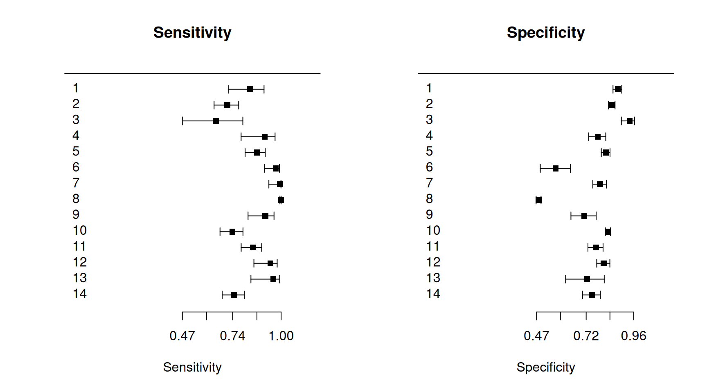
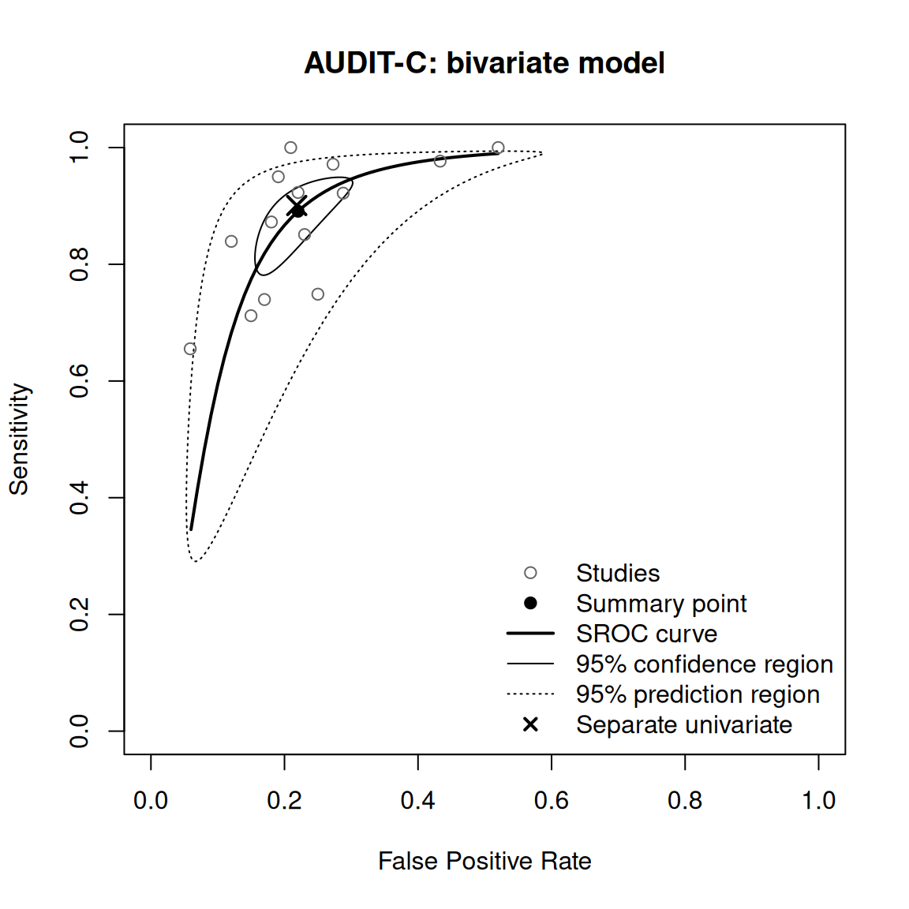
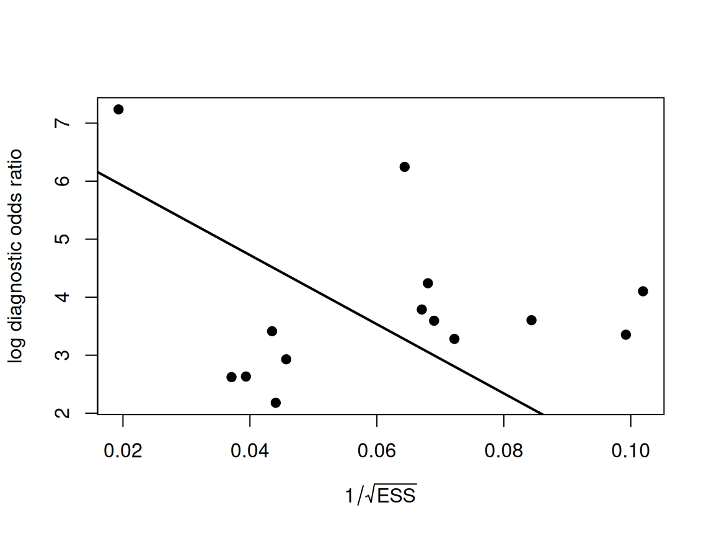

# Diagnostic Test Accuracy {#sec-dta}

Not every research synthesis asks whether an intervention works. In medicine, psychology and many applied fields, a large share of evidence concerns *classification*: how well does a screening questionnaire detect hazardous drinking, a cognitive test detect dementia, a credit score flag default, or a fraud model flag fraudulent claims? A diagnostic test accuracy (DTA) study applies an *index test* and a *reference standard* to the same people and cross-classifies the results. A DTA meta-analysis combines such studies to estimate how accurate the test is and how much that accuracy varies across settings.

DTA meta-analysis differs from the effect-size meta-analysis of earlier chapters in two fundamental ways. First, test accuracy is intrinsically *bivariate*. A test is described by two numbers, its sensitivity and its specificity, which trade off against each other as the positivity threshold changes. Collapsing them into a single effect size loses essential information, and analysing them separately ignores their dependence. Second, between-study heterogeneity in DTA is typically large and partly systematic, because studies use different thresholds, populations and reference standards. Methods that work well for treatment effects can therefore mislead here. The modern consensus, reflected in the Cochrane handbook for DTA reviews [@deeks2023cochrane], is to use *hierarchical* models: the bivariate random-effects model [@reitsma2005bivariate] or the equivalent hierarchical summary ROC model [@rutter2001hierarchical; @harbord2006unification].

This chapter defines the accuracy measures, explains why naive pooling fails, develops the bivariate and HSROC models and their equivalence, and fits them in R in three ways: with `mada` [@doebler2012mixed], as a bivariate binomial generalized linear mixed model with `lme4` [@bates2015fitting], and as a bivariate normal model with `metafor` [@viechtbauer2010conducting]. We then turn to meta-regression, heterogeneity, small-study effects, risk of bias, and reporting. The bivariate model is a special case of the multivariate meta-analysis treated in Chapter \@ref(sec-multivariate-ipd).

## Measures of test accuracy {#sec-dta-measures}

### The two-by-two table {#sec-dta-2x2}

Each primary study yields a two-by-two table of index test result against true disease status as determined by the reference standard:

|                  | Disease present ($D^+$) | Disease absent ($D^-$) |
|------------------|:-----------------------:|:----------------------:|
| Test positive    | TP                      | FP                     |
| Test negative    | FN                      | TN                     |
| Total            | $n_1 = \text{TP} + \text{FN}$ | $n_0 = \text{FP} + \text{TN}$ |

The two basic measures condition on true status:

$$
\text{Se} = P(T^+ \mid D^+) = \frac{\text{TP}}{\text{TP} + \text{FN}}, \qquad
\text{Sp} = P(T^- \mid D^-) = \frac{\text{TN}}{\text{TN} + \text{FP}}.
$$

Sensitivity (the true positive rate, TPR) is the proportion of diseased people the test detects, and specificity is the proportion of non-diseased people the test correctly clears; $1 - \text{Sp}$ is the false positive rate (FPR). Because TP and FN come from the diseased participants and FP and TN from the non-diseased, the estimates of sensitivity and specificity within a study are based on *disjoint* samples and are therefore statistically independent. This fact will simplify the within-study part of the models below.

Several derived measures combine the two. The *likelihood ratios* are

$$
\text{LR}^+ = \frac{\text{Se}}{1 - \text{Sp}}, \qquad \text{LR}^- = \frac{1 - \text{Se}}{\text{Sp}},
$$

and they update pre-test odds of disease to post-test odds by Bayes' theorem: post-test odds $=$ pre-test odds $\times$ LR. A positive likelihood ratio above 10 or a negative likelihood ratio below 0.1 is often described as producing a large change in probability. The *diagnostic odds ratio* (DOR) is

$$
\text{DOR} = \frac{\text{LR}^+}{\text{LR}^-} = \frac{\text{Se}/(1 - \text{Se})}{(1 - \text{Sp})/\text{Sp}} = \frac{\text{TP} \times \text{TN}}{\text{FP} \times \text{FN}},
$$

a single summary of discrimination that equals 1 for a useless test [@glas2003diagnostic]. On the logit scale, $\log \text{DOR} = \operatorname{logit}(\text{Se}) + \operatorname{logit}(\text{Sp})$. The DOR is convenient for modelling but hard to interpret clinically, because very different combinations of sensitivity and specificity share the same DOR.

*Predictive values* condition on the test result: $\text{PPV} = P(D^+ \mid T^+)$ and $\text{NPV} = P(D^- \mid T^-)$. They depend directly on the prevalence $\pi$,

$$
\text{PPV} = \frac{\text{Se}\, \pi}{\text{Se}\, \pi + (1 - \text{Sp})(1 - \pi)},
$$

so they should not be pooled across studies with different prevalence. They are better computed from the pooled sensitivity and specificity at a prevalence relevant to the intended setting.

### Thresholds and the trade-off between sensitivity and specificity {#sec-dta-thresholds}

Most tests dichotomize an underlying continuous quantity: a questionnaire score, a biomarker concentration, a radiologist's degree of suspicion. Suppose the measurement $Y$ follows one distribution among diseased people and another among non-diseased people, and the test is called positive when $Y > c$. Lowering the threshold $c$ increases sensitivity and decreases specificity; raising it does the reverse. Tracing all thresholds gives the receiver operating characteristic (ROC) curve, sensitivity plotted against $1 - $specificity.

Across studies, thresholds differ *explicitly* (one study uses a score of 3 or more, another 5 or more) and *implicitly* (different observers, equipment, or populations shift the effective cut-off even when the nominal threshold is the same). This *threshold effect* induces a negative correlation between sensitivity and specificity across studies, equivalently a positive correlation between sensitivity and FPR. Study results then scatter along a curve in ROC space rather than around a point. A meta-analysis must model this correlation and should report results that respect the trade-off. Sensitivity and specificity are also not fixed properties of a test: they can vary with the spectrum of disease and with prevalence [@leeflang2013variation], which is one reason heterogeneity in DTA meta-analyses is so large.

## The AUDIT-C example {#sec-dta-example}

Our running example is the `AuditC` data set in `mada`, from a meta-analysis of the three-item AUDIT-C questionnaire for detecting unhealthy alcohol use [@kriston2008meta]. Each of the 14 rows is one study's two-by-two table. `madad()` computes study-level descriptive statistics.


``` r
library(mada)
data(AuditC)
AuditC
#>     TP FN   FP   TN
#> 1   47  9  101  738
#> 2  126 51  272 1543
#> 3   19 10   12  192
#> 4   36  3   78  276
#> 5  130 19  211  959
#> 6   84  2   68   89
#> 7   68  0  112  423
#> 8  752  0 3226 2977
#> 9   59  5   55  136
#> 10 142 50  571 2788
#> 11 137 24  107  358
#> 12  57  3  103  437
#> 13  34  1   21   56
#> 14 152 51   88  264
md <- madad(AuditC)
md
#> Descriptive summary of AuditC with 14 primary studies.
#> Confidence level for all calculations set to 95 %
#> Using a continuity correction of 0.5 if applicable 
#> 
#> Diagnostic accuracies 
#>        sens  2.5% 97.5%  spec  2.5% 97.5%
#>  [1,] 0.833 0.716 0.908 0.879 0.855 0.899
#>  [2,] 0.711 0.640 0.772 0.850 0.833 0.866
#>  [3,] 0.650 0.471 0.795 0.939 0.898 0.964
#>  [4,] 0.912 0.785 0.967 0.779 0.733 0.819
#>  [5,] 0.870 0.807 0.915 0.819 0.796 0.840
#>  [6,] 0.971 0.912 0.991 0.566 0.489 0.641
#>  [7,] 0.993 0.934 0.999 0.790 0.754 0.822
#>  [8,] 0.999 0.994 1.000 0.480 0.468 0.492
#>  [9,] 0.915 0.822 0.962 0.711 0.643 0.770
#> [10,] 0.738 0.672 0.795 0.830 0.817 0.842
#> [11,] 0.849 0.786 0.896 0.769 0.729 0.805
#> [12,] 0.943 0.854 0.979 0.809 0.773 0.840
#> [13,] 0.958 0.838 0.990 0.724 0.616 0.811
#> [14,] 0.748 0.684 0.802 0.749 0.702 0.792
#> 
#> Test for equality of sensitivities: 
#> X-squared = 272.4, df = 13, p-value = <2e-16
#> Test for equality of specificities: 
#> X-squared = 2205, df = 13, p-value = <2e-16
#> 
#> 
#> Diagnostic OR and likelihood ratios 
#>           DOR   2.5%    97.5%  posLR  2.5%  97.5% negLR  2.5% 97.5%
#>  [1,]   36.38 17.587    75.25  6.897 5.556  8.561 0.190 0.106 0.339
#>  [2,]   13.91  9.818    19.72  4.736 4.100  5.470 0.340 0.270 0.429
#>  [3,]   28.60 11.133    73.47 10.660 5.862 19.384 0.373 0.229 0.608
#>  [4,]   36.73 11.925   113.14  4.127 3.320  5.129 0.112 0.041 0.306
#>  [5,]   30.36 18.440    49.99  4.817 4.201  5.523 0.159 0.105 0.240
#>  [6,]   44.16 12.077   161.49  2.240 1.868  2.687 0.051 0.015 0.173
#>  [7,]  515.73 31.687  8393.75  4.730 4.009  5.581 0.009 0.001 0.145
#>  [8,] 1388.85 86.752 22234.71  1.922 1.876  1.968 0.001 0.000 0.022
#>  [9,]   26.61 10.523    67.27  3.167 2.506  4.001 0.119 0.053 0.266
#> [10,]   13.77  9.865    19.22  4.341 3.879  4.857 0.315 0.249 0.400
#> [11,]   18.72 11.572    30.27  3.679 3.079  4.397 0.197 0.136 0.284
#> [12,]   69.44 23.113   208.65  4.927 4.099  5.922 0.071 0.026 0.196
#> [13,]   60.44 10.948   333.68  3.477 2.411  5.014 0.058 0.012 0.277
#> [14,]    8.85  5.949    13.16  2.982 2.448  3.632 0.337 0.264 0.430
#> 
#> Correlation of sensitivities and false positive rates: 
#>    rho  2.5 % 97.5 % 
#>  0.677  0.228  0.888
```

Sensitivities range from 0.65 to 0.999 and specificities from 0.48 to 0.94. The chi-square tests for equality reject homogeneity overwhelmingly for both (sensitivities $\chi^2 = 272.4$, specificities $\chi^2 = 2205$, 13 df each). Diagnostic odds ratios range from about 9 to over 1,000, and the correlation between sensitivity and FPR across studies is 0.68 (95% CI 0.23 to 0.89). This positive correlation is the signature of a threshold effect: studies that achieved higher sensitivity paid for it with more false positives. Two studies (rows 7 and 8) have no false negatives at all, so their sensitivities, and any measure involving $\log \text{FN}$, need special handling.


``` r
op <- par(mfrow = c(1, 2))
mada::forest(md, type = "sens", xlab = "Sensitivity", snames = 1:14,
             main = "Sensitivity", plotci = FALSE)
mada::forest(md, type = "spec", xlab = "Specificity", snames = 1:14,
             main = "Specificity", plotci = FALSE)
```

<div class="figure" style="text-align: center">

<p class="caption">(\#fig:dta-forest)Paired forest plots of study-level sensitivity (left) and specificity (right) with 95% confidence intervals for the 14 AUDIT-C studies.</p>
</div>

``` r
par(op)
```

Paired forest plots (Figure \@ref(fig:dta-forest)) are the standard way to display DTA data study by study. They show the heterogeneity at a glance, but they hide the correlation between the two measures, which is what the ROC-space plots below make visible.

## Why separate pooling is misleading {#sec-dta-univariate}

The tempting approach is to run two ordinary random-effects meta-analyses, one of logit sensitivities and one of logit specificities, and report the two pooled values. With `metafor` this takes a few lines.


``` r
d <- AuditC
d$study <- seq_len(nrow(d))
es_se <- escalc(measure = "PLO", xi = TP, ni = TP + FN, data = d)
es_sp <- escalc(measure = "PLO", xi = TN, ni = TN + FP, data = d)
uni_se <- rma(yi, vi, data = es_se, method = "REML")
uni_sp <- rma(yi, vi, data = es_sp, method = "REML")
round(rbind(
  sensitivity = plogis(c(est = unname(coef(uni_se)), lower = uni_se$ci.lb, upper = uni_se$ci.ub)),
  specificity = plogis(c(est = unname(coef(uni_sp)), lower = uni_sp$ci.lb, upper = uni_sp$ci.ub))
), 3)
#>               est lower upper
#> sensitivity 0.901 0.820 0.948
#> specificity 0.782 0.716 0.836
round(c(tau2_logit_sens = uni_se$tau2, tau2_logit_spec = uni_sp$tau2), 3)
#> tau2_logit_sens tau2_logit_spec 
#>           1.400           0.432
```

The separate analyses give a summary sensitivity of 0.90 (0.82 to 0.95) and specificity of 0.78 (0.72 to 0.84), with between-study variances of 1.40 and 0.43 on the logit scale. As we will see, these point estimates are close to those of the bivariate model in this example. The problem is not primarily bias in the two marginal summaries. It is that the separate analyses:

1. ignore the correlation between sensitivity and specificity, so they cannot produce a joint confidence region or a prediction region for where the accuracy in a new setting will fall;
2. say nothing about the trade-off, so they cannot distinguish a test whose studies differ mainly in threshold (points on one curve) from a test whose studies differ in discrimination (different curves);
3. when thresholds vary a lot, can produce a summary pair of sensitivity and specificity that corresponds to no realistic operating point, because each margin is averaged over different thresholds.

Pooling derived measures separately is worse. Pooled likelihood ratios from two univariate analyses can imply a sensitivity or specificity outside $[0, 1]$, and @zwinderman2007we advise synthesizing sensitivity and specificity and deriving likelihood ratios from the result, instead of pooling likelihood ratios directly. A univariate meta-analysis of the log DOR is legitimate as a summary of discrimination, but it discards the information needed to say how many false positives and false negatives a clinician should expect.


``` r
madauni(AuditC, type = "DOR", method = "DSL")
#> Call:
#> madauni(x = AuditC, type = "DOR", method = "DSL")
#> 
#>    DOR  tau^2 
#> 26.337  0.311
```

The DerSimonian-Laird pooled DOR is 26.3 with $\hat\tau^2 = 0.31$ on the log scale, a perfectly reasonable summary of discrimination, but it is compatible with sensitivity 0.95 and specificity 0.58 as much as with sensitivity 0.78 and specificity 0.88.

## Historical context: the Moses-Littenberg SROC {#sec-dta-moses}

Before hierarchical models became practical, the standard method was the summary ROC (SROC) approach of @littenberg1993estimating and @moses1993combining. For each study, define

$$
D_i = \operatorname{logit}(\text{TPR}_i) - \operatorname{logit}(\text{FPR}_i) = \log \text{DOR}_i, \qquad
S_i = \operatorname{logit}(\text{TPR}_i) + \operatorname{logit}(\text{FPR}_i),
$$

where $S_i$ is a proxy for the positivity threshold. Fit the linear regression $D_i = a + b S_i$ by ordinary or weighted least squares. If $b = 0$, the DOR is constant across thresholds and the SROC curve is symmetric; $b \ne 0$ allows the DOR to change with threshold. Back-transforming the fitted line gives the SROC curve

$$
\operatorname{logit}(\text{TPR}) = \frac{a}{1 - b} + \frac{1 + b}{1 - b}\operatorname{logit}(\text{FPR}).
$$


``` r
cc <- d[, c("TP", "FN", "FP", "TN")] + 0.5   # continuity correction
tpr <- cc$TP / (cc$TP + cc$FN)
fpr <- cc$FP / (cc$FP + cc$TN)
D <- qlogis(tpr) - qlogis(fpr)
S <- qlogis(tpr) + qlogis(fpr)
ml_fit <- lm(D ~ S)
round(summary(ml_fit)$coefficients, 3)
#>             Estimate Std. Error t value Pr(>|t|)
#> (Intercept)    3.179      0.226  14.089        0
#> S              0.502      0.087   5.771        0
```

For AUDIT-C, $\hat a = 3.18$ and $\hat b = 0.50$ ($p < 0.001$), suggesting that the DOR increases with $S$, that is, in studies operating at more lenient thresholds. The method is simple, but it has serious statistical defects. $S$ and $D$ are both functions of the same noisy data, so $S$ is measured with error and correlated with the residual; there is no proper account of within-study sampling variability or of between-study heterogeneity; the choice of weights is arbitrary; and there is no summary point with a valid standard error. Empirical comparisons found that it gives systematically different results from hierarchical models [@harbord2008empirical; @dinnes2016moses]. It survives in older reviews and some software, but should not be used for new analyses.

## The bivariate random-effects model {#sec-dta-bivariate}

### Model {#sec-dta-bivariate-model}

@reitsma2005bivariate proposed modelling the logit sensitivity and logit specificity of each study jointly. Let $\mu_{Ai} = \operatorname{logit}(\text{Se}_i)$ and $\mu_{Bi} = \operatorname{logit}(\text{Sp}_i)$ be the true values in study $i$. The *within-study* level uses the observed logits,

$$
\hat\mu_{Ai} \sim N\!\left(\mu_{Ai}, s^2_{Ai}\right), \qquad \hat\mu_{Bi} \sim N\!\left(\mu_{Bi}, s^2_{Bi}\right),
\qquad s^2_{Ai} = \frac{1}{\text{TP}_i} + \frac{1}{\text{FN}_i},\; s^2_{Bi} = \frac{1}{\text{TN}_i} + \frac{1}{\text{FP}_i},
$$

with zero within-study covariance because the two estimates come from different participants. The *between-study* level is bivariate normal,

$$
\begin{pmatrix} \mu_{Ai} \\ \mu_{Bi} \end{pmatrix} \sim N\!\left( \begin{pmatrix} \mu_A \\ \mu_B \end{pmatrix},\;
\boldsymbol\Sigma = \begin{pmatrix} \sigma_A^2 & \sigma_{AB} \\ \sigma_{AB} & \sigma_B^2 \end{pmatrix} \right).
$$

The model has five parameters. The means $\mu_A$ and $\mu_B$ define the *summary operating point* $(\operatorname{logit}^{-1}\mu_A, \operatorname{logit}^{-1}\mu_B)$, which is the median sensitivity and specificity across studies (not the mean, because the inverse logit is nonlinear). The variances $\sigma_A^2$ and $\sigma_B^2$ quantify heterogeneity, and the correlation $\rho = \sigma_{AB}/(\sigma_A \sigma_B)$ captures the threshold effect; a negative $\rho$ between logit sensitivity and logit specificity is the expected pattern. The model is the bivariate case of the multivariate random-effects meta-analysis model, and it is usually fitted by (restricted) maximum likelihood.

Three quantities are derived from the fit. A *confidence region* for the summary point is an ellipse on the logit scale based on $\operatorname{Var}(\hat\mu_A, \hat\mu_B)$. A *prediction region*, based on $\hat{\boldsymbol\Sigma} + \operatorname{Var}(\hat\mu_A, \hat\mu_B)$, shows where the true sensitivity and specificity of a new study are expected to fall, which is the DTA analogue of the prediction interval of Chapter \@ref(sec-heterogeneity). And an SROC curve summarizes the trade-off between sensitivity and specificity. Several SROC curves can be derived from the same bivariate model, depending on which conditional relationship between the two logits is used [@arends2008bivariate]; the one most often reported is the curve implied by the HSROC parameterization discussed in Section \@ref(sec-dta-hsroc).

### Fitting with mada {#sec-dta-reitsma}

`mada::reitsma()` fits the bivariate model by REML. Following the convention of ROC space, it parameterizes the model in terms of logit sensitivity (`tsens`) and logit false positive rate (`tfpr`), so the means and correlations have the opposite sign for the specificity part compared with the formulas above.


``` r
fit <- reitsma(AuditC)
summary(fit)
#> Call:  reitsma.default(data = AuditC)
#> 
#> Bivariate diagnostic random-effects meta-analysis
#> Estimation method: REML
#> 
#> Fixed-effects coefficients
#>                   Estimate Std. Error      z Pr(>|z|) 95%ci.lb 95%ci.ub    
#> tsens.(Intercept)    2.100      0.338  6.215    0.000    1.438    2.762 ***
#> tfpr.(Intercept)    -1.264      0.174 -7.249    0.000   -1.605   -0.922 ***
#> sensitivity          0.891          -      -        -    0.808    0.941    
#> false pos. rate      0.220          -      -        -    0.167    0.285    
#> ---
#> Signif. codes:  0 '***' 0.001 '**' 0.01 '*' 0.05 '.' 0.1 ' ' 1 
#> 
#> Variance components: between-studies Std. Dev and correlation matrix
#>       Std. Dev tsens  tfpr
#> tsens    1.175 1.000     .
#> tfpr     0.638 0.854 1.000
#> 
#>  logLik     AIC     BIC 
#>  31.564 -53.128 -46.467 
#> 
#> AUC:  0.887
#> Partial AUC (restricted to observed FPRs and normalized):  0.861
#> 
#> I2 estimates 
#> Zhou and Dendukuri approach:  40.4 % 
#> Holling sample size unadjusted approaches:  35.6 - 79.3 % 
#> Holling sample size adjusted approaches:  0.2 - 2.4 %
```

The summary sensitivity is 0.891 (95% CI 0.808 to 0.941) and the summary false positive rate 0.220 (0.167 to 0.285), that is, a summary specificity of 0.780. The between-study standard deviations are 1.18 for logit sensitivity and 0.64 for logit FPR, both large: a standard deviation of 1.18 on the logit scale means that the middle 95% of true study sensitivities spans roughly 0.45 to 0.99 around the summary value. The between-study correlation of logit sensitivity and logit FPR is 0.85, a strong threshold effect. The area under the SROC curve is 0.887.

`summary()` also prints several versions of a bivariate $I^2$ statistic. They range from 0.2% to 79% for the same data, depending on the definition. This instability is one reason to report the between-study standard deviations, correlation and prediction region rather than a single $I^2$ in DTA reviews.

::: {.rmdwarning}
By default, `reitsma()` adds 0.5 to *every* cell of *every* study when any single cell in the data is zero (`correction.control = "all"`). In AUDIT-C two studies have FN = 0, so all 56 cells are corrected. The correction pulls every sensitivity and specificity toward 0.5 and therefore biases the summary point, most strongly for studies with small cell counts and accuracy near 1. Setting `correction.control = "single"` corrects only the affected studies. The exact binomial likelihood of Section \@ref(sec-dta-glmm) avoids continuity corrections entirely.
:::

### Confidence region, prediction region and SROC curve {#sec-dta-sroc}


``` r
plot(fit, sroclwd = 2, predict = TRUE, pch = 19, xlim = c(0, 1), ylim = c(0, 1),
     main = "AUDIT-C: bivariate model")
points(fpr(AuditC), sens(AuditC), pch = 1, col = "grey40")
points(1 - plogis(coef(uni_sp)), plogis(coef(uni_se)), pch = 4, cex = 1.6, lwd = 2)
legend("bottomright", bty = "n",
       legend = c("Studies", "Summary point", "SROC curve", "95% confidence region",
                  "95% prediction region", "Separate univariate"),
       pch = c(1, 19, NA, NA, NA, 4), lty = c(NA, NA, 1, 1, 3, NA),
       lwd = c(NA, NA, 2, 1, 1, 2), col = c("grey40", 1, 1, 1, 1, 1))
```

<div class="figure" style="text-align: center">

<p class="caption">(\#fig:dta-sroc-plot)AUDIT-C studies in ROC space (circles), the bivariate summary point with its 95% confidence region (solid ellipse) and 95% prediction region (dotted), the SROC curve, and the summary point from two separate univariate analyses (cross).</p>
</div>

Figure \@ref(fig:dta-sroc-plot) contains the essential results of a DTA meta-analysis. The confidence region around the summary point is small, but the prediction region is very large and elongated along the SROC curve: a new study could plausibly operate anywhere from high sensitivity with modest specificity to moderate sensitivity with high specificity. The elongation is the threshold effect, and it is invisible in two separate univariate analyses, whose summary point (the cross) lies close to the bivariate one here.

### Summary likelihood ratios and predictive values {#sec-dta-summarypts}

Likelihood ratios and the DOR should be derived from the bivariate fit, not pooled separately [@zwinderman2007we]. `SummaryPts()` draws from the approximate sampling distribution of the summary logits and transforms each draw.


``` r
set.seed(2026)
sp <- SummaryPts(fit, n.iter = 1e5)
summary(sp)
#>            Mean Median    2.5%  97.5%
#> posLR     4.050   4.03  3.2600  4.990
#> negLR     0.145   0.14  0.0813  0.235
#> invnegLR  7.440   7.14  4.2600 12.300
#> DOR      29.700  28.90 18.4000 45.400
```

The summary positive likelihood ratio is about 4.0 (95% interval 3.3 to 5.0) and the negative likelihood ratio about 0.15 (0.08 to 0.24), with a DOR near 30 (18 to 45). By conventional rules of thumb, a negative AUDIT-C result is fairly informative for ruling out unhealthy alcohol use, whereas a positive result shifts the odds only moderately. Predictive values follow from the summary point at a prevalence chosen for the target setting:


``` r
se_hat <- plogis(coef(fit)[1, "tsens"])
sp_hat <- 1 - plogis(coef(fit)[1, "tfpr"])
prev <- c(0.05, 0.15, 0.30)
round(data.frame(
  prevalence = prev,
  PPV = se_hat * prev / (se_hat * prev + (1 - sp_hat) * (1 - prev)),
  NPV = sp_hat * (1 - prev) / (sp_hat * (1 - prev) + (1 - se_hat) * prev)
), 3)
#>   prevalence   PPV   NPV
#> 1       0.05 0.175 0.993
#> 2       0.15 0.416 0.976
#> 3       0.30 0.634 0.943
```

At a prevalence of 5%, only about 18% of people who screen positive actually have unhealthy alcohol use, while 99% of those who screen negative do not. At 30% prevalence the positive predictive value rises to about 63%. The same test is a reasonable rule-out tool in primary care and a weak rule-in tool everywhere, which is the kind of statement decision makers need.

## The HSROC model and its equivalence to the bivariate model {#sec-dta-hsroc}

@rutter2001hierarchical proposed a hierarchical model built on the latent-threshold picture of Section \@ref(sec-dta-thresholds). For study $i$ and disease group $j$, with $X_{ij} = +\tfrac12$ for diseased and $-\tfrac12$ for non-diseased participants, the probability of a positive test is

$$
\operatorname{logit}(\pi_{ij}) = \left(\theta_i + \alpha_i X_{ij}\right) \exp(-\beta X_{ij}),
\qquad \theta_i \sim N(\Theta, \sigma^2_\theta), \quad \alpha_i \sim N(\Lambda, \sigma^2_\alpha).
$$

Here $\theta_i$ is the study's *positivity threshold* (on the logit scale), $\alpha_i$ its *accuracy* (a log DOR-type parameter), and $\beta$ a *shape* parameter that allows accuracy to change with threshold. When $\beta = 0$ the SROC curve is symmetric and the DOR is constant along it. Because $\pi_{i1}$ is the sensitivity and $\pi_{i0}$ the FPR, the HSROC model is another way to describe the same pair of study-level quantities.

@harbord2006unification showed that, without covariates, the HSROC model and the bivariate model are reparameterizations of each other. With $\mu_A, \mu_B$ the logit sensitivity and specificity means and $\sigma_A, \sigma_B, \sigma_{AB}$ the between-study (co)variances,

$$
\beta = \log\frac{\sigma_B}{\sigma_A}, \qquad
\Lambda = \left(\frac{\sigma_B}{\sigma_A}\right)^{1/2}\mu_A + \left(\frac{\sigma_A}{\sigma_B}\right)^{1/2}\mu_B, \qquad
\Theta = \frac12\left[\left(\frac{\sigma_B}{\sigma_A}\right)^{1/2}\mu_A - \left(\frac{\sigma_A}{\sigma_B}\right)^{1/2}\mu_B\right],
$$

$$
\sigma^2_\alpha = 2\left(\sigma_A\sigma_B + \sigma_{AB}\right), \qquad
\sigma^2_\theta = \tfrac12\left(\sigma_A\sigma_B - \sigma_{AB}\right),
$$

and the HSROC curve is

$$
\operatorname{logit}(\text{TPR}) = \Lambda e^{-\beta/2} + e^{-\beta}\operatorname{logit}(\text{FPR}).
$$

The two models therefore give identical summary points, likelihoods and SROC curves; they differ only in emphasis. The bivariate model is natural when the summary operating point is the target (a test used at a common threshold), the HSROC model when the curve is the target (studies at many different thresholds). The equivalence breaks down once covariates are added, because a covariate can then act on accuracy, threshold, or shape in the HSROC model, and on sensitivity or specificity in the bivariate model, which are different hypotheses.

We can verify the equivalence numerically by converting the `reitsma()` estimates. Remember that `mada` uses logit FPR, so $\mu_B = -\mu_{\text{FPR}}$ and $\sigma_{AB} = -\operatorname{Cov}(\text{logit Se}, \text{logit FPR})$.


``` r
mu_A <- coef(fit)[1, "tsens"]
mu_B <- -coef(fit)[1, "tfpr"]
Psi <- fit$Psi                     # between-study covariance (tsens, tfpr)
s_A <- sqrt(Psi[1, 1]); s_B <- sqrt(Psi[2, 2]); s_AB <- -Psi[1, 2]
hsroc <- c(
  Lambda  = sqrt(s_B / s_A) * mu_A + sqrt(s_A / s_B) * mu_B,
  Theta   = 0.5 * (sqrt(s_B / s_A) * mu_A - sqrt(s_A / s_B) * mu_B),
  beta    = log(s_B / s_A),
  s2alpha = 2 * (s_A * s_B + s_AB),
  s2theta = 0.5 * (s_A * s_B - s_AB)
)
round(hsroc, 3)
#>  Lambda   Theta    beta s2alpha s2theta 
#>   3.262  -0.083  -0.610   0.218   0.695

fpr_grid <- c(0.05, 0.10, 0.20, 0.40)
hsroc_curve <- plogis(hsroc[["Lambda"]] * exp(-hsroc[["beta"]] / 2) +
                      exp(-hsroc[["beta"]]) * qlogis(fpr_grid))
round(rbind(fpr = fpr_grid, HSROC_formula = hsroc_curve,
            mada_sroc = sroc(fit, fpr = fpr_grid)[, 2]), 4)
#>                 [,1]   [,2]   [,3]   [,4]
#> fpr           0.0500 0.1000 0.2000 0.4000
#> HSROC_formula 0.2701 0.5942 0.8669 0.9754
#> mada_sroc     0.2701 0.5942 0.8669 0.9754
```

The mean accuracy is $\hat\Lambda = 3.26$, the mean threshold $\hat\Theta = -0.08$ (close to a symmetric operating point), and the shape parameter $\hat\beta = -0.61$. The negative $\beta$ reflects $\hat\sigma_A > \hat\sigma_B$: sensitivity varies more between studies than specificity, so the curve is asymmetric. Most of the between-study variation is in threshold ($\hat\sigma^2_\theta = 0.70$) rather than in accuracy ($\hat\sigma^2_\alpha = 0.22$), the quantitative version of what the ROC plot shows. The SROC curve computed from the HSROC formula matches the curve that `mada` draws to all printed digits.

## The bivariate binomial GLMM {#sec-dta-glmm}

The bivariate model above approximates the within-study distribution of the observed logits by a normal distribution with a *known* variance. That approximation is poor when counts are small or when sensitivity or specificity is close to 1, which is common in DTA, and it requires continuity corrections for zero cells. @chu2006bivariate replaced the normal within-study model by the exact binomial likelihood,

$$
\text{TP}_i \sim \text{Binomial}(n_{1i}, \text{Se}_i), \qquad \text{TN}_i \sim \text{Binomial}(n_{0i}, \text{Sp}_i),
$$

with the same bivariate normal distribution for $(\operatorname{logit} \text{Se}_i, \operatorname{logit} \text{Sp}_i)$. This is a generalized linear mixed model (GLMM) that can be fitted with standard software; @hamza2008binomial found the binomial within-study model preferable to the normal approximation. The trick is to reshape the data to "long" format with two rows per study, one for the diseased group (successes are TP) and one for the non-diseased group (successes are TN), and two indicator variables.


``` r
library(lme4)
long <- rbind(
  data.frame(study = d$study, sens = 1, spec = 0, y = d$TP, n = d$TP + d$FN),
  data.frame(study = d$study, sens = 0, spec = 1, y = d$TN, n = d$TN + d$FP)
)
glmm <- glmer(cbind(y, n - y) ~ 0 + sens + spec + (0 + sens + spec | study),
              data = long, family = binomial)
summary(glmm)
#> Generalized linear mixed model fit by maximum likelihood (Laplace
#>   Approximation) [glmerMod]
#>  Family: binomial  ( logit )
#> Formula: cbind(y, n - y) ~ 0 + sens + spec + (0 + sens + spec | study)
#>    Data: long
#> 
#>       AIC       BIC    logLik -2*log(L)  df.resid 
#>     255.6     262.2    -122.8     245.6        23 
#> 
#> Scaled residuals: 
#>     Min      1Q  Median      3Q     Max 
#> -0.5646 -0.2183 -0.0235  0.2191  1.2448 
#> 
#> Random effects:
#>  Groups Name Variance Std.Dev. Corr  
#>  study  sens 2.601    1.613          
#>         spec 0.381    0.617    -0.82 
#> Number of obs: 28, groups:  study, 14
#> 
#> Fixed effects:
#>      Estimate Std. Error z value Pr(>|z|)    
#> sens    2.511      0.462    5.44  5.4e-08 ***
#> spec    1.276      0.169    7.56  4.1e-14 ***
#> ---
#> Signif. codes:  0 '***' 0.001 '**' 0.01 '*' 0.05 '.' 0.1 ' ' 1
#> 
#> Correlation of Fixed Effects:
#>      sens  
#> spec -0.748
round(plogis(fixef(glmm)), 3)
#>  sens  spec 
#> 0.925 0.782
round(plogis(confint(glmm, parm = "beta_", method = "Wald")), 3)
#>      2.5 % 97.5 %
#> sens 0.833  0.968
#> spec 0.720  0.833
```

The formula has no intercept, so the two fixed effects are the mean logit sensitivity and logit specificity directly, and `(0 + sens + spec | study)` specifies a bivariate random effect with unstructured covariance. The GLMM estimates a summary sensitivity of 0.925 (95% Wald CI 0.834 to 0.968) and specificity of 0.782 (0.720 to 0.833). The between-study standard deviations are 1.61 (logit sensitivity) and 0.62 (logit specificity), with correlation $-0.82$.

The specificity agrees with `reitsma()` but the sensitivity is higher (0.925 versus 0.891) and its heterogeneity larger. The difference arises in the studies with sensitivity near 1, especially the two with no false negatives: the normal approximation with continuity correction shrinks them toward 0.5 and assigns them large within-study variances on the logit scale (the $1/\text{FN}$ term becomes $1/0.5 = 2$), so they carry little weight, whereas the binomial likelihood uses the counts as they are. The GLMM is the preferred model when sparse cells are present. Its costs are that the likelihood involves an intractable integral over the random effects (approximated by the Laplace method in `glmer()`), which occasionally fails to converge with few studies, and that the between-study correlation is poorly estimated and often lands on the boundary $\pm 1$ when studies are few [@riley2007bivariate; @takwoingi2015performance].

## The bivariate normal model with metafor {#sec-dta-metafor}

The bivariate normal model of Section \@ref(sec-dta-bivariate-model) is also a standard multivariate meta-analysis and can be fitted with `metafor::rma.mv()`. We stack the logit sensitivities and logit specificities in one data frame with a variable identifying the outcome, and supply the within-study sampling variances. Because sensitivity and specificity come from different participants, the within-study covariance matrix of each study is diagonal, so the variance vector fully describes the known within-study structure.


``` r
es_bv <- rbind(
  data.frame(study = d$study, outcome = "sens", es_se[, c("yi", "vi")]),
  data.frame(study = d$study, outcome = "spec", es_sp[, c("yi", "vi")])
)
es_bv <- es_bv[order(es_bv$study, es_bv$outcome), ]
V <- diag(es_bv$vi)    # block diagonal: zero within-study covariance
bv <- rma.mv(yi, V, mods = ~ 0 + outcome,
             random = ~ outcome | study, struct = "UN",
             data = es_bv, method = "REML")
bv
#> 
#> Multivariate Meta-Analysis Model (k = 28; method: REML)
#> 
#> Variance Components:
#> 
#> outer factor: study   (nlvls = 14)
#> inner factor: outcome (nlvls = 2)
#> 
#>             estim    sqrt  k.lvl  fixed  level 
#> tau^2.1    1.5839  1.2585     14     no   sens 
#> tau^2.2    0.4109  0.6410     14     no   spec 
#> 
#>       rho.sens  rho.spec    sens  spec 
#> sens         1                 -    14 
#> spec   -0.8473         1      no     - 
#> 
#> Test for Residual Heterogeneity:
#> QE(df = 26) = 2096.8074, p-val < .0001
#> 
#> Test of Moderators (coefficients 1:2):
#> QM(df = 2) = 388.1308, p-val < .0001
#> 
#> Model Results:
#> 
#>              estimate      se    zval    pval   ci.lb   ci.ub      
#> outcomesens    2.1872  0.3620  6.0420  <.0001  1.4777  2.8967  *** 
#> outcomespec    1.2677  0.1752  7.2378  <.0001  0.9244  1.6110  *** 
#> 
#> ---
#> Signif. codes:  0 '***' 0.001 '**' 0.01 '*' 0.05 '.' 0.1 ' ' 1
round(plogis(cbind(est = coef(bv), lower = bv$ci.lb, upper = bv$ci.ub)), 3)
#>               est lower upper
#> outcomesens 0.899 0.814 0.948
#> outcomespec 0.780 0.716 0.834
```

`random = ~ outcome | study` with `struct = "UN"` gives each study a pair of correlated random effects with separate variances, exactly the $\boldsymbol\Sigma$ of the bivariate model. The summary sensitivity is 0.899 (0.814 to 0.948) and specificity 0.780 (0.716 to 0.834), with between-study standard deviations 1.26 and 0.64 and correlation $-0.85$. These match `reitsma(AuditC, correction.control = "single")`, because `escalc()` adds 0.5 only to the studies with a zero cell; the small difference from the default `reitsma()` fit is the effect of correcting every study. The `metafor` route is useful because it gives access to the full `rma.mv()` toolkit: profile likelihood plots for the variance components, likelihood-ratio tests, robust variance estimation, and cluster structures (for instance, several thresholds or several index tests nested within the same study). The QE test of residual heterogeneity ($Q_E = 2096.8$ on 26 df) is overwhelmingly significant, as expected.

The three implementations, side by side:


``` r
fit_single <- reitsma(AuditC, correction.control = "single")
cmp <- rbind(
  "univariate (metafor)"      = plogis(c(coef(uni_se), coef(uni_sp))),
  "reitsma, correct all"      = plogis(coef(fit)[1, ] * c(1, -1)),
  "reitsma, correct single"   = plogis(coef(fit_single)[1, ] * c(1, -1)),
  "rma.mv bivariate normal"   = plogis(coef(bv)),
  "glmer bivariate binomial"  = plogis(fixef(glmm))
)
colnames(cmp) <- c("sensitivity", "specificity")
round(cmp, 3)
#>                          sensitivity specificity
#> univariate (metafor)           0.901       0.782
#> reitsma, correct all           0.891       0.780
#> reitsma, correct single        0.899       0.780
#> rma.mv bivariate normal        0.899       0.780
#> glmer bivariate binomial       0.925       0.782
```

Specificity is stable across methods at about 0.78. Sensitivity ranges from 0.891 to 0.925, and the ordering is informative: the more aggressive the continuity correction, the lower the summary sensitivity. In a review whose conclusion hinges on whether sensitivity exceeds 0.90, this choice would matter and should be reported as a sensitivity analysis.

## Heterogeneity and meta-regression {#sec-dta-metaregression}

### Describing heterogeneity {#sec-dta-heterogeneity}

Heterogeneity is the rule in DTA reviews, and its sources are often more interesting than the summary point. The recommended descriptions are the paired forest plots, the ROC-space plot with the prediction region, and the estimated between-study standard deviations and correlation [@deeks2023cochrane]. A meta-analysis that reports a summary sensitivity of 0.89 without saying that the prediction region in Figure \@ref(fig:dta-sroc-plot) includes sensitivities from about 0.3 to nearly 1 is misleading. Heterogeneity should then be investigated with pre-specified covariates: the threshold, the reference standard, the spectrum of patients, setting, study design, and the QUADAS-2 risk-of-bias domains (Section \@ref(sec-dta-rob)). The usual caveats of meta-regression apply (Chapter \@ref(sec-heterogeneity)): few studies, ecological confounding, and multiple testing.

### Meta-regression in the bivariate model {#sec-dta-reitsma-regression}

Covariates can enter the bivariate model separately for logit sensitivity and logit specificity. In `reitsma()` they are specified with a formula whose left-hand side is `cbind(tsens, tfpr)`. We use the `smoking` data in `mada`, from a review of the validity of self-reported smoking against biochemical verification [@patrick1994validity]. The "test" is self-report and the covariate `type` records whether the questionnaire was interviewer-administered (IAQ) or self-administered (SAQ). Some studies contribute several two-by-two tables (for different subgroups); to keep the observations independent we use the first table from each of the 26 studies.


``` r
data("smoking", package = "mada")
smk <- subset(smoking, result_id == 1)
table(smk$type)
#> 
#> IAQ SAQ 
#>  10  16
mr <- reitsma(smk, formula = cbind(tsens, tfpr) ~ type)
summary(mr)
#> Call:  reitsma.default(data = smk, formula = cbind(tsens, tfpr) ~ type)
#> 
#> Bivariate diagnostic random-effects meta-analysis
#> Estimation method: REML
#> 
#> Fixed-effects coefficients
#>                   Estimate Std. Error       z Pr(>|z|) 95%ci.lb 95%ci.ub    
#> tsens.(Intercept)    2.813      0.491   5.735    0.000    1.852    3.775 ***
#> tsens.typeSAQ       -1.166      0.634  -1.838    0.066   -2.409    0.077   .
#> tfpr.(Intercept)    -3.337      0.311 -10.733    0.000   -3.946   -2.727 ***
#> tfpr.typeSAQ         0.882      0.389   2.269    0.023    0.120    1.645   *
#> ---
#> Signif. codes:  0 '***' 0.001 '**' 0.01 '*' 0.05 '.' 0.1 ' ' 1 
#> 
#> Variance components: between-studies Std. Dev and correlation matrix
#>       Std. Dev tsens  tfpr
#> tsens    1.508 1.000     .
#> tfpr     0.875 0.551 1.000
#> 
#>   logLik      AIC      BIC 
#>   70.721 -127.441 -113.783 
#> 
#> 
#> I2 estimates 
#> Zhou and Dendukuri approach:  66 % 
#> Holling sample size unadjusted approaches:  83.7 - 96.8 % 
#> Holling sample size adjusted approaches:  5.3 - 12.7 %
```

Each covariate gets two coefficients, `tsens.typeSAQ` for logit sensitivity and `tfpr.typeSAQ` for logit FPR. Relative to interviewer administration, self-administered questionnaires have lower sensitivity (difference $-1.17$ on the logit scale, 95% CI $-2.41$ to $0.08$) and a higher false positive rate ($+0.88$, 0.12 to 1.65). The fitted values are easier to read on the probability scale:


``` r
b <- coef(mr)
round(rbind(
  IAQ = c(sens = plogis(b[1, "tsens"]), spec = 1 - plogis(b[1, "tfpr"])),
  SAQ = c(sens = plogis(sum(b[, "tsens"])), spec = 1 - plogis(sum(b[, "tfpr"])))
), 3)
#>      sens  spec
#> IAQ 0.943 0.966
#> SAQ 0.839 0.921
```

Interviewer-administered questionnaires have an estimated sensitivity of 0.94 and specificity of 0.97 for detecting biochemically verified smoking, self-administered questionnaires 0.84 and 0.92. A joint test of the covariate uses a likelihood-ratio test between maximum likelihood fits (REML likelihoods are not comparable across models with different fixed effects).


``` r
m0_ml <- reitsma(smk, method = "ml")
m1_ml <- reitsma(smk, formula = cbind(tsens, tfpr) ~ type, method = "ml")
lr <- 2 * (m1_ml$logLik - m0_ml$logLik)
c(LR = lr, df = 2, p = pchisq(lr, df = 2, lower.tail = FALSE))
#>        LR        df         p 
#> 13.250963  2.000000  0.001326
```

The likelihood-ratio statistic is 13.3 on 2 df ($p = 0.001$), so the mode of administration is associated with accuracy. This is an observational comparison across studies, and IAQ and SAQ studies may differ in population and setting as well as in mode. The same model can be fitted as a GLMM by adding the covariate and its interactions with `sens` and `spec` to the `glmer()` formula, or with `rma.mv()` using `mods = ~ 0 + outcome + outcome:type`.

## Small-study effects: Deeks' funnel plot test {#sec-dta-deeks}

Publication bias in DTA research is poorly understood. Accuracy studies are often not registered, and there is no single "positive" result that would drive selective publication in the way a significant treatment effect does. Standard funnel plot tests (Chapter \@ref(sec-publication-bias)) based on the DOR and its standard error have badly inflated type I error in DTA, because the standard error of the log DOR depends on the DOR itself and on the threshold. @deeks2005performance proposed instead to regress the log DOR on $1/\sqrt{\text{ESS}}$, where the *effective sample size* is

$$
\text{ESS}_i = \frac{4\, n_{1i}\, n_{0i}}{n_{1i} + n_{0i}},
$$

weighting by ESS; a slope different from zero indicates funnel plot asymmetry.


``` r
n1 <- d$TP + d$FN
n0 <- d$FP + d$TN
ess <- 4 * n1 * n0 / (n1 + n0)
lndor <- log((cc$TP * cc$TN) / (cc$FP * cc$FN))
deeks <- lm(lndor ~ I(1 / sqrt(ess)), weights = ess)
round(summary(deeks)$coefficients, 3)
#>                Estimate Std. Error t value Pr(>|t|)
#> (Intercept)        7.11      1.043   6.818    0.000
#> I(1/sqrt(ess))   -59.61     23.313  -2.557    0.025
plot(1 / sqrt(ess), lndor, xlab = expression(1 / sqrt(ESS)),
     ylab = "log diagnostic odds ratio", pch = 19)
abline(deeks, lwd = 2)
```

<div class="figure" style="text-align: center">

<p class="caption">(\#fig:dta-deeks)Deeks' funnel plot for the AUDIT-C studies: log diagnostic odds ratio against the inverse square root of the effective sample size, with the weighted regression line.</p>
</div>

The slope is $-59.6$ ($p = 0.025$): there is statistically significant asymmetry, but in the opposite direction from the usual publication-bias pattern. Larger studies (left of Figure \@ref(fig:dta-deeks)) have *larger* DORs, driven by the two large studies with no false negatives. Small-study effects in the classical sense would show small studies with inflated accuracy and a positive slope. The likelier explanation here is heterogeneity in threshold and setting that happens to be associated with study size. This illustrates the general point: Deeks' test has low power with the number of studies typical of DTA reviews, it tests asymmetry rather than publication bias, and asymmetry can arise from many sources [@deeks2005performance; @vanenst2014investigation]. It should be reported, if at all, as a descriptive check with these caveats.

## Risk of bias and reporting {#sec-dta-rob}

The validity of a DTA meta-analysis depends on the validity of its primary studies, and DTA studies are prone to characteristic biases. QUADAS-2 [@whiting2011quadas2] assesses risk of bias in four domains: *patient selection* (consecutive or random sampling versus case-control designs that compare severe cases with healthy controls, which inflate accuracy), *index test* (interpretation blinded to the reference standard, pre-specified threshold), *reference standard* (whether it classifies the target condition correctly and is interpreted blind to the index test), and *flow and timing* (whether all participants received the same reference standard, at an appropriate interval, and were all included in the analysis). The first three domains are also rated for applicability to the review question. A revised version, QUADAS-3, has since been published [@whiting2026quadas3]. Risk-of-bias judgements should be displayed, used in sensitivity analyses that exclude high-risk studies, and examined as covariates in meta-regression. Primary DTA studies should be reported following STARD 2015 [@bossuyt2015stard], whose items cover much of the information that a QUADAS-2 assessment needs.

The review itself should be reported according to PRISMA-DTA [@mcinnes2018preferred], which adapts PRISMA to the specifics of DTA reviews: the definition of the target condition, index test and reference standard; the handling of thresholds; the statistical model (bivariate or HSROC, with software); presentation of study-level sensitivity and specificity in forest plots or ROC space; and summary estimates with confidence and prediction regions. Certainty of evidence for DTA reviews can be rated with GRADE (Chapter \@ref(sec-reporting)), which considers the consequences of false positive and false negative results in the target setting.

## Practical recommendations and common pitfalls {#sec-dta-pitfalls}

**Use a hierarchical model.** The bivariate model or the equivalent HSROC model is the default [@reitsma2005bivariate; @harbord2006unification; @deeks2023cochrane]. Separate univariate pooling, pooling of likelihood ratios or predictive values, and the Moses-Littenberg method are not appropriate primary analyses.

**Prefer the binomial likelihood when data are sparse.** With zero cells or accuracy near 1, the bivariate GLMM [@chu2006bivariate] avoids continuity corrections and their bias. When using normal-approximation software, check the continuity correction rule and report a sensitivity analysis.

**Simplify when the model cannot be fitted.** With few studies, the between-study correlation is often estimated at $\pm 1$ or the model fails to converge. Simulation evidence supports falling back to separate univariate random-effects logistic models for sensitivity and specificity, or to an HSROC model without the shape parameter [@takwoingi2015performance]; report which simplification was used.

**Choose the summary that matches the question.** If studies used a common threshold, report the summary operating point with its confidence and prediction regions. If thresholds vary widely, report the SROC curve and avoid quoting a single sensitivity and specificity as though they applied at every threshold. For studies that report accuracy at several thresholds, use models designed for multiple thresholds [@steinhauser2016modelling] rather than picking one per study, which invites selective reporting.

**Report heterogeneity on the probability scale.** State the prediction region, or the range of sensitivities and specificities it implies, alongside the summary point. Avoid a single $I^2$, whose bivariate versions disagree.

**Translate accuracy into consequences.** Compute predictive values or numbers of true and false positives per 1,000 people tested at realistic prevalences. These depend on prevalence, so present a range.

**Do not over-interpret funnel plots.** Use Deeks' test, not effect-size funnel plot tests, and treat it as weak, descriptive evidence.

**Comparative accuracy needs comparative designs.** When two tests are compared, studies that applied both tests to the same participants provide much stronger evidence than indirect comparisons across separate sets of studies, for the same reasons discussed for indirect treatment comparisons in Chapter \@ref(sec-network).

## Key takeaways {#sec-dta-takeaways}

- Test accuracy is bivariate: sensitivity and specificity trade off through the positivity threshold, which induces a negative between-study correlation between them.
- Separate univariate pooling ignores that correlation, cannot produce joint confidence or prediction regions, and can give misleading summaries when thresholds vary. Likelihood ratios and predictive values should be derived from a joint model, not pooled directly.
- The bivariate random-effects model (Reitsma) and the HSROC model (Rutter-Gatsonis) are equivalent without covariates; the bivariate parameterization targets a summary point, the HSROC parameterization a summary curve.
- The bivariate model can be fitted with `mada::reitsma()`, as a binomial GLMM with `lme4::glmer()`, or as a bivariate normal model with `metafor::rma.mv()`. The GLMM avoids continuity corrections and is preferable with sparse data; in the AUDIT-C example it gave a summary sensitivity of 0.925 versus 0.891 with the default correction in `reitsma()`.
- Heterogeneity in DTA is usually large. Report between-study standard deviations, the correlation, and the prediction region, and investigate sources with bivariate meta-regression.
- Deeks' test is the appropriate funnel plot test for DTA, but it has low power and detects asymmetry, not publication bias.
- Assess risk of bias with QUADAS-2 (now QUADAS-3) and report following PRISMA-DTA.

## Further reading {#sec-dta-reading}

The Cochrane Handbook for Systematic Reviews of Diagnostic Test Accuracy [@deeks2023cochrane] is the authoritative guide to the whole review process, from question formulation to presentation of findings. @leeflang2008systematic give a concise introduction for clinical readers. The foundational modelling papers are @reitsma2005bivariate, @rutter2001hierarchical, @harbord2006unification and @chu2006bivariate; @arends2008bivariate discuss the different SROC curves implied by the bivariate model, and @riley2007bivariate the estimation of the between-study correlation. @takwoingi2015performance give practical guidance for few studies and sparse data, and @harbord2008empirical and @dinnes2016moses document why the Moses-Littenberg method should be retired. The `mada` approach and its extension to other transformations are described by @doebler2012mixed. For thresholds, see @steinhauser2016modelling; for publication bias, @deeks2005performance. Reporting and quality assessment are covered by @whiting2011quadas2, @bossuyt2015stard and @mcinnes2018preferred.
