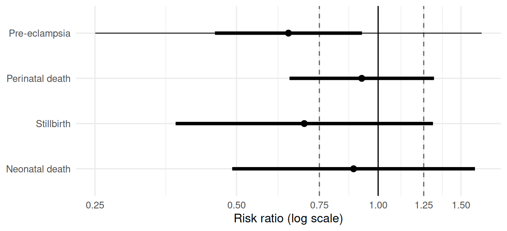

# (PART) Reporting {#sec-part-reporting .unnumbered}

# Certainty of Evidence (GRADE) and Reporting {#sec-reporting}

A pooled estimate with a confidence interval is not yet a conclusion. Readers of a meta-analysis,
whether clinicians, policy makers, managers, or other researchers, need to know how much to trust
the estimate, and they need the information presented so that they can check it, reuse it, and
apply it to their own setting. This chapter covers both tasks. The first half introduces the
GRADE approach to rating the certainty of a body of evidence and builds a Summary of Findings
table in R from metafor model fits, including absolute effects and certainty ratings. The second
half turns to reporting: the PRISMA 2020 items that concern the synthesis, the main extensions
and discipline-specific standards, how to write a results paragraph directly from model output,
what to report about heterogeneity, and the practices that make a meta-analysis reproducible and
updatable.

## From a pooled estimate to a judgment about certainty {#sec-reporting-why}

The preceding chapters produced many numbers: a pooled effect, its confidence interval, $\tau$,
a prediction interval, subgroup estimates, small-study tests, sensitivity analyses, and
risk-of-bias assessments. None of these alone says how confident one should be that the true
effect is close to the estimate. A precise estimate built on trials at high risk of bias, or on
studies of a different population than the one of interest, can be misleading. An imprecise
estimate from excellent trials can still support a firm conclusion if every value in its
confidence interval implies the same decision.

The **GRADE** approach (Grading of Recommendations Assessment, Development and Evaluation)
provides a structured and transparent way to combine these considerations into a single rating
of certainty for each outcome [@guyatt2008grade; @guyatt2011grade1]. It is used by Cochrane, the
World Health Organization, and many guideline organizations, and its logic applies well beyond
medicine: any synthesis that informs a decision benefits from an explicit statement of how much
the evidence can bear.

## The GRADE approach {#sec-reporting-grade}

### Certainty and what it means {#sec-reporting-grade-certainty}

GRADE rates the certainty (earlier called quality) of evidence for each outcome on four levels
[@balshem2011grade]:

- **High**: we are very confident that the true effect lies close to the estimate.
- **Moderate**: we are moderately confident; the true effect is likely to be close to the
  estimate, but there is a possibility that it is substantially different.
- **Low**: our confidence is limited; the true effect may be substantially different from the
  estimate.
- **Very low**: we have very little confidence; the true effect is likely to be substantially
  different from the estimate.

The GRADE Working Group has since clarified that certainty is always certainty *about something*:
that the true effect lies on one side of a threshold, or within a specified range
[@hultcrantz2017grade]. In a systematic review without a specific decision context, the usual
target is whether the effect is above or below the null (or a minimal important difference); in
a guideline, the thresholds are set by what would change a recommendation. Choosing the target
explicitly is what makes ratings of imprecision and inconsistency reproducible
[@zeng2022grade; @schunemann2022grade].

### Starting certainty by study design {#sec-reporting-grade-start}

Evidence from randomized trials starts at **high** certainty and evidence from observational
studies at **low** certainty, reflecting the greater risk of confounding in the latter
[@balshem2011grade]. When non-randomized studies are assessed with ROBINS-I, which judges them
against a target trial (Chapter \@ref(sec-systematic-review)), the body of evidence can start at
high certainty and is then usually rated down for risk of bias, so that the ROBINS-I judgment
carries the concern about confounding [@schunemann2019grade]. From the starting level, certainty
is rated down for five kinds of concern and, for observational evidence, can be rated up for
three.

### Five reasons to rate down {#sec-reporting-grade-down}

Each domain can lower certainty by one level (serious concern) or two (very serious concern).

**Risk of bias.** Rate down when the pooled result depends on studies whose limitations are
likely to bias it, judged from the domain-level assessments of Chapter
\@ref(sec-systematic-review) [@guyatt2011grade4]. The question is not whether some studies are at
high risk but whether their influence on the pooled estimate is enough to lower confidence;
a sensitivity analysis restricted to studies at low risk answers it directly.

**Inconsistency.** Rate down when effects vary across studies more than can be explained, in a way
that matters for the decision [@guyatt2011grade7]. The signals are point estimates that differ
widely, confidence intervals that overlap little, a small $p$-value for the $Q$ test, and a large
$I^2$. Because $I^2$ is a relative measure that depends on study precision
[@rucker2008undue; @borenstein2017basics], the more useful question is whether the prediction
interval spans values that would lead to different decisions. If the inconsistency is explained
by a credible moderator (Chapter \@ref(sec-heterogeneity)), separate estimates should be
presented instead of rating down.

**Indirectness.** Rate down when the evidence differs from the question in population,
intervention, comparator, or outcome, for example when trials used a surrogate outcome or an
older version of the intervention, or when two interventions were compared only indirectly
[@guyatt2011grade8]. The last case is central to network meta-analysis
(Chapter \@ref(sec-network)), for which GRADE has a dedicated approach [@puhan2014grade].

**Imprecision.** Rate down when the confidence interval is wide relative to the decision
threshold [@guyatt2011grade6]. Under the minimally contextualized approach, the reviewer rates
down when the confidence interval crosses the threshold of interest, often the null or a minimal
important difference, and by two or three levels when it is very wide [@zeng2022grade]. A
classical default for binary outcomes is to treat a relative risk reduction or increase of 25% as
appreciable [@guyatt2011grade6]. Even when the interval does not cross the threshold, certainty can
be rated down if the total sample size is smaller than the **optimal information size** (OIS),
the sample size a single adequately powered trial would need. With few events, a pooled estimate
can be both "significant" and fragile [@schunemann2016interpreting].

**Publication bias.** Rate down when there is reason to suspect that studies are missing
selectively, for example a literature dominated by small industry-funded trials, an asymmetric
funnel plot, or registered trials that were never reported [@guyatt2011grade5]. Funnel-plot
methods need at least about ten studies (Chapter \@ref(sec-publication-bias)); with fewer, the
judgment rests on the search and the registry evidence. Because publication bias can rarely be
proven, GRADE describes it as "strongly suspected" or "undetected" rather than present or absent.

The domains should not double-count. A single problem, such as an outcome measured in a way that
favors the intervention, should lower certainty once, in the domain where it fits best, with the
reasoning stated in a footnote.

### Three reasons to rate up {#sec-reporting-grade-up}

For bodies of observational evidence without serious limitations, certainty can be rated up
[@guyatt2011grade9]: for a **large effect** (by one level for a risk ratio above 2 or below 0.5
from consistent evidence with no plausible confounders, by two levels for a risk ratio above 5 or
below 0.2); for a **dose-response gradient**; and when **all plausible residual confounding**
would reduce a demonstrated effect, or would create a spurious effect where none was observed.
Rating up is uncommon and should be argued explicitly.

### Overall certainty {#sec-reporting-grade-overall}

Certainty is rated separately for each outcome. When a single overall rating is needed, for
example to support a recommendation, it is the lowest certainty among the outcomes judged
critical for the decision [@guyatt2013grade11]. GRADE does not require a meta-analysis: when
studies cannot be pooled and the synthesis is narrative, certainty can still be rated using the
same domains [@murad2017rating]. A useful discipline is to rate certainty before
looking at whether the conclusions are welcome; GRADE judgments involve subjectivity, and the
footnotes that justify each judgment are what allow others to disagree productively.

## A Summary of Findings table in R {#sec-reporting-sof}

A **Summary of Findings** (SoF) table presents, for each important outcome, the number of studies
and participants, the relative effect, the absolute effects, and the certainty of the evidence,
with footnotes explaining every judgment [@guyatt2011grade1; @guyatt2013grade12]. This section
builds one for the trials of diuretics in pregnancy compiled by @collins1985overview, available as
`dat.collins1985b` in metadat. Nine trials compared diuretics with placebo or no treatment and
reported pre-eclampsia, perinatal death, stillbirth, and neonatal death.

::: {.rmdnote}
The certainty ratings in this section are illustrative. They are based on what the dataset
records and on general features of these trials, not on a formal risk-of-bias assessment of the
original reports, and they should not be read as a clinical appraisal of diuretics in pregnancy.
:::

### Fitting the models {#sec-reporting-sof-models}

The four outcomes are binary, so each is analyzed as a log risk ratio with a random-effects model.
The mortality outcomes share the same follow-up denominators; stillbirth and neonatal death are
missing for one trial.


``` r
dat <- dat.collins1985b
spec <- data.frame(
  outcome = c("Pre-eclampsia", "Perinatal death", "Stillbirth", "Neonatal death"),
  ai  = c("pre.xti", "ped.xti", "stb.xti", "ned.xti"),
  n1i = c("pre.nti", "fup.nti", "fup.nti", "fup.nti"),
  ci  = c("pre.xci", "ped.xci", "stb.xci", "ned.xci"),
  n2i = c("pre.nci", "fup.nci", "fup.nci", "fup.nci")
)

fit_outcome <- function(row) {
  d <- data.frame(ai = dat[[row$ai]], n1i = dat[[row$n1i]],
                  ci = dat[[row$ci]], n2i = dat[[row$n2i]])
  d <- d[complete.cases(d), ]
  list(data = d,
       fit = rma(measure = "RR", ai = ai, n1i = n1i, ci = ci, n2i = n2i, data = d))
}
fits <- lapply(split(spec, spec$outcome)[spec$outcome], fit_outcome)

summ <- do.call(rbind, lapply(names(fits), function(o) {
  m <- fits[[o]]$fit; d <- fits[[o]]$data; p <- predict(m, transf = exp)
  data.frame(outcome = o, k = m$k, N = sum(d$n1i + d$n2i), events = sum(d$ai + d$ci),
             RR = p$pred, ci.lb = p$ci.lb, ci.ub = p$ci.ub,
             pi.lb = p$pi.lb, pi.ub = p$pi.ub, tau = sqrt(m$tau2), I2 = m$I2)
}))
print(summ, digits = 3, row.names = FALSE)
#>          outcome k    N events    RR ci.lb ci.ub pi.lb pi.ub   tau   I2
#>    Pre-eclampsia 9 6942    636 0.645 0.450 0.924 0.250  1.66 0.446 76.7
#>  Perinatal death 9 6864    123 0.923 0.648 1.315 0.648  1.31 0.000  0.0
#>       Stillbirth 8 4158     37 0.697 0.371 1.308 0.371  1.31 0.000  0.0
#>   Neonatal death 8 4158     43 0.887 0.489 1.606 0.489  1.61 0.000  0.0
```


Pre-eclampsia is the only outcome with clear heterogeneity: $\hat\tau$ = 0.45,
$I^2$ = 77%, and a 95% prediction interval of 0.25 to
1.66 around a pooled risk ratio of 0.64. For the mortality outcomes
$\hat\tau^2$ is zero, so the prediction intervals coincide with the confidence intervals, and all
three intervals are wide because deaths are rare: there were only 123 perinatal deaths
in 6,864 pregnancies. Chapter \@ref(sec-models) discusses alternatives
to these defaults, such as the Hartung-Knapp confidence interval and methods that suit rare
events better than inverse-variance pooling of log risk ratios; the defaults are kept here to
focus on the presentation.

### Thresholds, imprecision, and inconsistency {#sec-reporting-sof-thresholds}

Imprecision and inconsistency are judged against thresholds. Following the classical GRADE
default, we treat a relative risk reduction or increase of 25% (risk ratios of 0.75 and 1.25) as
appreciable, with the null (a risk ratio of 1) as the primary threshold. Figure
\@ref(fig:rep-thresholds) places each outcome's confidence and prediction intervals against these
lines.


``` r
summ$label <- factor(summ$outcome, rev(summ$outcome))
ggplot(summ, aes(y = label)) +
  geom_vline(xintercept = 1) +
  geom_vline(xintercept = c(0.75, 1.25), linetype = "dashed", colour = "grey40") +
  geom_segment(aes(x = pi.lb, xend = pi.ub, yend = label), linewidth = 0.4) +
  geom_segment(aes(x = ci.lb, xend = ci.ub, yend = label), linewidth = 1.6) +
  geom_point(aes(x = RR), size = 2.5) +
  scale_x_log10(breaks = c(0.25, 0.5, 0.75, 1, 1.25, 1.5)) +
  labs(x = "Risk ratio (log scale)", y = NULL)
```

<div class="figure" style="text-align: center">

<p class="caption">(\#fig:rep-thresholds)Pooled risk ratios with 95\% confidence intervals (thick) and 95\% prediction intervals (thin) for four outcomes, on a log scale. The solid line marks the null; dashed lines mark the thresholds for an appreciable benefit or harm (risk ratios of 0.75 and 1.25).</p>
</div>

Imprecision can be rated mechanically once the thresholds are fixed. The function below applies
a rule in the spirit of GRADE: rate down one level if the confidence interval crosses the null,
two levels if it includes both an appreciable benefit and an appreciable harm, and one level if
the interval excludes the null but the total sample size falls short of the optimal information
size. The OIS is computed as the total sample size of a two-arm trial with 80% power to detect a
25% relative risk reduction at the assumed control risk.


``` r
ois <- function(control_risk, rrr = 0.25, power = 0.8) {
  2 * ceiling(power.prop.test(p1 = control_risk, p2 = control_risk * (1 - rrr),
                              power = power)$n)
}
rate_imprecision <- function(lb, ub, N, ois_n, benefit = 0.75, harm = 1.25) {
  if (lb < benefit && ub > harm) return(-2)
  if (lb < 1 && ub > 1) return(-1)
  if (N < ois_n) return(-1)
  0
}

# assumed control risk: median control-group risk across the trials
summ$acr <- sapply(fits, function(f) median(f$data$ci / f$data$n2i))
summ$ois <- sapply(summ$acr, ois)
summ$imprecision <- mapply(rate_imprecision, summ$ci.lb, summ$ci.ub, summ$N, summ$ois)
summ[, c("outcome", "N", "acr", "ois", "ci.lb", "ci.ub", "imprecision")]
#>           outcome    N     acr   ois  ci.lb ci.ub imprecision
#> 1   Pre-eclampsia 6942 0.12687  3078 0.4498 0.924           0
#> 2 Perinatal death 6864 0.02727 15730 0.6480 1.315          -2
#> 3      Stillbirth 4158 0.01594 27188 0.3711 1.308          -2
#> 4  Neonatal death 4158 0.01194 36418 0.4895 1.606          -2
```

For pre-eclampsia, the confidence interval excludes the null and the trials include more
participants than the OIS of 3,078, so imprecision is not a
serious concern. For each mortality outcome the interval includes both a 25% reduction and a 25%
increase in risk, and the total sample size is between
2 and
9 times smaller than the OIS, which is large
because the outcomes are rare. These outcomes are rated down two levels for imprecision.

The remaining judgments require reading the trials, and they are recorded with their reasons.
Several of the trials used oedema as one of the diagnostic criteria for pre-eclampsia
(the `oedema` variable), and diuretics reduce oedema directly, so the measured outcome is biased
in favor of diuretics: a serious risk-of-bias concern in the measurement of the outcome. The
sensitivity analysis below supports the concern.


``` r
res_pre_no_oedema <- rma(measure = "RR", ai = pre.xti, n1i = pre.nti, ci = pre.xci,
                         n2i = pre.nci, data = dat, subset = oedema == 0)
predict(res_pre_no_oedema, transf = exp, digits = 2)
#> 
#>  pred ci.lb ci.ub pi.lb pi.ub 
#>  0.77  0.56  1.06  0.39  1.54
```


Restricted to the 7 trials that did not use oedema as a criterion, the risk
ratio is 0.77 (95% CI 0.56 to 1.06), closer to the null
and no longer excluding it. The pre-eclampsia evidence is also rated down for inconsistency, since
the prediction interval extends from a large benefit to an appreciable harm. Mortality outcomes are
objectively measured and show no heterogeneity. With nine or fewer trials per outcome, funnel-plot
methods are uninformative, and publication bias is recorded as undetected.

### Absolute effects and the table {#sec-reporting-sof-table}

Relative effects tend to be more stable across populations than absolute effects, but decisions
depend on absolute effects. GRADE therefore presents the risk in the control group, the
corresponding risk with the intervention, and their difference, usually per 1,000 people
[@guyatt2013grade12]. With an assumed control risk $p_C$ and a pooled risk ratio
$\widehat{RR}$ with confidence limits $(L, U)$,

$$
\hat p_I = p_C \cdot \widehat{RR}, \qquad
\widehat{\Delta} = p_C(\widehat{RR} - 1), \qquad
\text{95\% CI for } \Delta = \big(p_C(L - 1),\; p_C(U - 1)\big).
$$

The assumed control risk should reflect the population to which the results will be applied.
Here it is the median control-group risk across the trials; a guideline would often use risks
from a representative cohort and might present several baseline risks.


``` r
judgments <- data.frame(
  outcome       = spec$outcome,
  risk_of_bias  = c(-1, 0, 0, 0),
  inconsistency = c(-1, 0, 0, 0),
  indirectness  = c(0, 0, 0, 0),
  publication   = c(0, 0, 0, 0)
)
sof <- merge(summ, judgments, by = "outcome", sort = FALSE)
sof$score <- 4 + sof$risk_of_bias + sof$inconsistency + sof$indirectness +
  sof$imprecision + sof$publication
grade_label <- function(s) {
  s <- max(1, min(4, s))
  c("⊕◯◯◯ Very low", "⊕⊕◯◯ Low",
    "⊕⊕⊕◯ Moderate", "⊕⊕⊕⊕ High")[s]
}
per1000 <- function(x) round(1000 * x)
diff_text <- function(acr, rr, lb, ub) {
  d <- per1000(acr * (c(rr, lb, ub) - 1))
  dir <- function(v) if (v < 0) paste(abs(v), "fewer") else paste(v, "more")
  sprintf("%s (%s to %s)", dir(d[1]), dir(d[2]), dir(d[3]))
}

sof_tab <- data.frame(
  Outcome = sof$outcome,
  `Participants (trials)` = sprintf("%s (%d)", format(sof$N, big.mark = ","), sof$k),
  `Relative effect RR (95% CI)` = sprintf("%.2f (%.2f to %.2f)", sof$RR, sof$ci.lb, sof$ci.ub),
  `Risk with control` = sprintf("%d per 1,000", per1000(sof$acr)),
  `Risk with diuretics` = sprintf("%d per 1,000", per1000(sof$acr * sof$RR)),
  `Difference per 1,000 (95% CI)` = mapply(diff_text, sof$acr, sof$RR, sof$ci.lb, sof$ci.ub),
  Certainty = sapply(sof$score, grade_label),
  check.names = FALSE
)
sof_tab$Certainty <- paste0(sof_tab$Certainty, c("^a,b^", "^c^", "^c^", "^c^"))
knitr::kable(sof_tab, align = "lcccccl",
  caption = "Summary of findings: diuretics compared with placebo or no treatment in pregnancy.")
```


Table: (\#tab:rep-sof-table)Summary of findings: diuretics compared with placebo or no treatment in pregnancy.

|Outcome         | Participants (trials) | Relative effect RR (95% CI) | Risk with control | Risk with diuretics |  Difference per 1,000 (95% CI)  |Certainty     |
|:---------------|:---------------------:|:---------------------------:|:-----------------:|:-------------------:|:-------------------------------:|:-------------|
|Pre-eclampsia   |       6,942 (9)       |     0.64 (0.45 to 0.92)     |   127 per 1,000   |    82 per 1,000     | 45 fewer (70 fewer to 10 fewer) |⊕⊕◯◯ Low^a,b^ |
|Perinatal death |       6,864 (9)       |     0.92 (0.65 to 1.31)     |   27 per 1,000    |    25 per 1,000     |  2 fewer (10 fewer to 9 more)   |⊕⊕◯◯ Low^c^   |
|Stillbirth      |       4,158 (8)       |     0.70 (0.37 to 1.31)     |   16 per 1,000    |    11 per 1,000     |  5 fewer (10 fewer to 5 more)   |⊕⊕◯◯ Low^c^   |
|Neonatal death  |       4,158 (8)       |     0.89 (0.49 to 1.61)     |   12 per 1,000    |    11 per 1,000     |   1 fewer (6 fewer to 7 more)   |⊕⊕◯◯ Low^c^   |


Footnotes to Table \@ref(tab:rep-sof-table):
^a^ Rated down one level for risk of bias: several trials included oedema, which diuretics reduce
directly, in the definition of pre-eclampsia; excluding them moves the estimate toward the null.
^b^ Rated down one level for inconsistency: $I^2$ = 77%, and the 95% prediction
interval (0.25 to 1.66) includes both a large benefit and an appreciable
harm.
^c^ Rated down two levels for imprecision: the confidence interval includes both a 25% relative
reduction and a 25% relative increase in risk, few events, and a total sample size well below the
optimal information size.

All four outcomes end at low certainty, for different reasons, and the footnotes are what tell a
reader which. The pre-eclampsia estimate is precise but probably biased and heterogeneous; the
mortality estimates are unbiased as far as we can tell but too imprecise to exclude either a
meaningful benefit or a meaningful harm. This distinction matters for what further research would
help: a new trial would need a clean definition of pre-eclampsia to resolve the first question,
and a very large size to resolve the second.

::: {.rmdtip}
For publication-quality SoF tables, the `gt` and `kableExtra` packages offer footnote and styling
functions, and the GRADEpro tool produces tables in the official format. Generating the table
from the model objects, as here, guarantees that the numbers in the table match the analysis.
:::

### The evidence profile {#sec-reporting-sof-profile}

A Summary of Findings table is written for decision makers and hides the domain-level judgments
in footnotes. The **evidence profile** is its companion for reviewers and methodologists: one row
per outcome and one column per GRADE domain, so that every judgment is visible
[@guyatt2011grade1]. Because the judgments are already stored in `sof`, the profile is a
different view of the same object.


``` r
level_text <- function(x) c("-2" = "Very serious", "-1" = "Serious", "0" = "Not serious")[as.character(x)]
profile <- data.frame(
  Outcome            = sof$outcome,
  `Studies (design)` = paste(sof$k, "RCTs"),
  `Risk of bias`     = level_text(sof$risk_of_bias),
  Inconsistency      = level_text(sof$inconsistency),
  Indirectness       = level_text(sof$indirectness),
  Imprecision        = level_text(sof$imprecision),
  `Publication bias` = ifelse(sof$publication == 0, "Undetected", "Strongly suspected"),
  Certainty          = sub("^\\S+ ", "", sapply(sof$score, grade_label)),
  check.names = FALSE, row.names = NULL
)
knitr::kable(profile, caption = "GRADE evidence profile for the diuretics example.")
```


Table: (\#tab:rep-evidence-profile)GRADE evidence profile for the diuretics example.

|Outcome         |Studies (design) |Risk of bias |Inconsistency |Indirectness |Imprecision  |Publication bias |Certainty |
|:---------------|:----------------|:------------|:-------------|:------------|:------------|:----------------|:---------|
|Pre-eclampsia   |9 RCTs           |Serious      |Serious       |Not serious  |Not serious  |Undetected       |Low       |
|Perinatal death |9 RCTs           |Not serious  |Not serious   |Not serious  |Very serious |Undetected       |Low       |
|Stillbirth      |8 RCTs           |Not serious  |Not serious   |Not serious  |Very serious |Undetected       |Low       |
|Neonatal death  |8 RCTs           |Not serious  |Not serious   |Not serious  |Very serious |Undetected       |Low       |


Read across a row, the profile shows how each certainty rating was reached; read down a column, it
shows which concern dominates the body of evidence. Here imprecision is the binding constraint for
every mortality outcome, which tells a reader immediately that the problem is too little data, not
bad data.

### How sensitive are the ratings to the thresholds? {#sec-reporting-sof-sensitivity}

The imprecision ratings above depend on the choice of a 25% relative change as the threshold for
an appreciable effect. That choice is a value judgment, and with rare but serious outcomes such as
perinatal death, many decision makers would regard a much smaller relative change as important.
Recomputing the ratings for a range of thresholds shows how much the conclusions depend on it.


``` r
thresholds <- c(0.10, 0.25, 0.40)
sens <- sapply(thresholds, function(t) {
  mapply(function(lb, ub, N, acr) {
    rate_imprecision(lb, ub, N, ois(acr, rrr = t), benefit = 1 - t, harm = 1 + t)
  }, summ$ci.lb, summ$ci.ub, summ$N, summ$acr)
})
dimnames(sens) <- list(summ$outcome, paste0("RRR/RRI ", 100 * thresholds, "%"))
sens
#>                 RRR/RRI 10% RRR/RRI 25% RRR/RRI 40%
#> Pre-eclampsia            -1           0           0
#> Perinatal death          -2          -2          -1
#> Stillbirth               -2          -2          -1
#> Neonatal death           -2          -2          -2
```

With a 10% threshold, the pre-eclampsia evidence is rated down for imprecision as well, because
the trials no longer reach the much larger optimal information size needed to detect a 10%
relative reduction. With a 40% threshold, perinatal death and stillbirth are still rated down by
one level, because their confidence intervals cross the null, and neonatal death by two, because
its interval spans a 40% reduction and a 40% increase. The conclusion that the mortality evidence
is imprecise is robust to the threshold; the conclusion that the pre-eclampsia evidence is
precise enough is not. Stating the threshold, and showing how the
ratings change with it, is what the GRADE guidance on contextualization asks for
[@zeng2022grade; @schunemann2022grade].

## Reporting standards {#sec-reporting-standards}

### PRISMA 2020 {#sec-reporting-prisma}

The **PRISMA 2020** statement is the main reporting guideline for systematic reviews and
meta-analyses [@page2021prisma], replacing the 2009 statement [@moher2009preferred]. It consists of
a 27-item checklist, an abstract checklist, and the flow diagram described in Chapter
\@ref(sec-systematic-review); the explanation and elaboration paper gives the rationale and
examples for each item [@page2021prismaelaboration]. The items most directly concerned with the
statistical synthesis are:

- **Item 12, effect measures**: the effect measure used for each outcome (for example risk ratio,
  standardized mean difference).
- **Item 13, synthesis methods** (13a to 13f): how studies were grouped for each synthesis, how data
  were prepared (handling of missing statistics, conversions), how results were tabulated and
  displayed, the meta-analysis model and its rationale, the method for estimating and
  identifying heterogeneity and the software used, methods to explore heterogeneity, and
  sensitivity analyses.
- **Items 14 and 15**: methods for assessing the risk of bias due to missing results (reporting
  biases) and for assessing certainty.
- **Item 20, results of syntheses** (20a to 20d): for each synthesis, the characteristics and risk
  of bias of the contributing studies, the summary estimate with its confidence interval and
  measures of heterogeneity, the results of investigations of heterogeneity, and the results of
  sensitivity analyses.
- **Items 21 and 22**: assessments of reporting biases and of certainty for each outcome.
- **Items 24 and 27**: registration and protocol, and the availability of data, analytic code,
  and other materials.

### Extensions and other standards {#sec-reporting-extensions}

Extensions adapt PRISMA to particular review types. **PRISMA-NMA** covers network meta-analyses,
adding items on the geometry of the network, the assessment of inconsistency, and the
presentation of treatment rankings [@hutton2015prisma] (Chapter \@ref(sec-network)).
**PRISMA-IPD** covers meta-analyses of individual participant data, including how data were
obtained, checked, and analyzed [@stewart2015preferred] (Chapter \@ref(sec-multivariate-ipd)).
**PRISMA-DTA** covers diagnostic test accuracy reviews [@mcinnes2018preferred]
(Chapter \@ref(sec-dta)). PRISMA-P and PRISMA-S, for protocols and search reporting, were
discussed in Chapter \@ref(sec-systematic-review).

Two further standards are common in the social sciences and in epidemiology. In psychology, the
APA Journal Article Reporting Standards for quantitative research (**JARS-Quant**) include the
Meta-Analysis Reporting Standards (**MARS**), which many psychology and management journals
require [@appelbaum2018journal]. MARS overlaps substantially with PRISMA and asks for more
detail on matters that are common in behavioral research, such as how moderators were coded and
how statistical dependencies among effect sizes were handled. For meta-analyses of
observational studies, **MOOSE** gives a checklist covering background, search strategy, methods,
results, discussion, and conclusions [@stroup2000metaanalysis]. When a journal names one standard,
follow it, and consider including a completed PRISMA checklist as well; the overlap makes this
cheap.

## Writing the results {#sec-reporting-results}

### What to report about heterogeneity {#sec-reporting-heterogeneity}

Heterogeneity is often reported only as $I^2$ with the $p$-value of the $Q$ test. Both are
incomplete. $I^2$ is the proportion of observed variance that is not sampling error; it depends on
the precision of the studies as well as on how much the true effects vary, so the same $\tau$ can
produce a small $I^2$ in a meta-analysis of small studies and a large one in a meta-analysis of
large studies [@rucker2008undue; @borenstein2017basics]. The $Q$ test has low power with few
studies and rejects trivial heterogeneity with many.

A complete report gives:

1. $\hat\tau$ (or $\hat\tau^2$) with its confidence interval, on the scale of the effect size, and
   the estimator used;
2. the **prediction interval**, which translates $\tau$ into the range of true effects to expect in
   a new setting [@riley2011interpretation; @inthout2016plea];
3. $Q$ with its degrees of freedom and $p$-value, and $I^2$ with its confidence interval, as
   secondary descriptors.

For effects on a log scale, report the prediction interval back-transformed (as a range of risk
ratios or odds ratios), since few readers can interpret $\tau$ = 0.45 on the log scale
directly.

### Figures and tables {#sec-reporting-figures}

A small set of displays covers most meta-analyses. A **table of study characteristics** lists, for
each included study, the design, sample size, population, intervention and comparator details,
outcome measures, and risk-of-bias judgments; it is usually the longest table in the review and
often belongs in the supplement. A **forest plot** for each main synthesis shows the study
estimates with their confidence intervals and weights, the pooled estimate, and the prediction
interval (Chapter \@ref(sec-introduction)); when subgroups are analyzed, a forest plot grouped by
subgroup with subgroup summaries is clearer than a table. A **funnel plot**, with contour
enhancement, accompanies any assessment of small-study effects (Chapter
\@ref(sec-publication-bias)), and risk-of-bias **summary and traffic-light plots** show the
domain-level assessments (Chapter \@ref(sec-systematic-review)). Finally, the **Summary of
Findings table** brings the main outcomes together with their certainty. Each display should
state the effect measure, the model, and the direction of benefit, so that it can be read without
the text.

For subgroup analyses and meta-regression, report the number of studies in each subgroup or the
range of the moderator, the test of the moderator with its degrees of freedom, the residual
heterogeneity, and whether the analysis was pre-specified. Post hoc moderator analyses are
legitimate but exploratory, and their findings should be described as hypotheses
(Chapter \@ref(sec-heterogeneity)).

### The methods paragraph {#sec-reporting-methods}

PRISMA item 13d asks for the model, the method for estimating heterogeneity, and the software. A
methods description should let a reader refit the model exactly: the effect measure and its scale,
the model (common-effect or random-effects), the estimator of $\tau^2$, the method used for
confidence intervals and tests, how the prediction interval was computed, how zero cells or
missing statistics were handled, and the software with version numbers. Version numbers can be
taken from the running session, so that they are always correct:

> Risk ratios were analyzed on the log scale. We fitted random-effects models with the restricted
> maximum likelihood estimator of the between-trial variance $\tau^2$, Wald-type confidence
> intervals, and 95% prediction intervals for the risk ratio in a new trial. Confidence intervals
> for $\tau^2$ were obtained with the Q-profile method. Absolute effects were computed at the
> median control-group risk across trials. Analyses used R 4.6.2
> and the metafor package, version 5.2.1
> [@viechtbauer2010conducting].

Two details deserve attention. Defaults change between software versions, so naming the estimator
and interval method explicitly is safer than writing "default settings". And if the analysis
deviated from the protocol, for example by switching from a common-effect to a random-effects
model, the methods section is where to say so and why.

### A results paragraph generated from model output {#sec-reporting-paragraph}

Results paragraphs are a common source of errors: numbers copied from output into a manuscript
drift out of date when the analysis changes. Writing the paragraph with inline R code, so that
every number is computed when the document is rendered, removes this source of error. The
following paragraph is generated this way from the pre-eclampsia model; the R Markdown source
shows the inline code.


``` r
res_pre <- fits[["Pre-eclampsia"]]$fit
ci_tau  <- confint(res_pre)$random
p_pre   <- predict(res_pre, transf = exp)
```


> In total, 9 randomized trials (6,942 participants,
> 636 events) compared diuretics with placebo or no treatment for the prevention
> of pre-eclampsia. In a random-effects model with the REML estimator of between-trial variance,
> the average risk ratio was 0.64 (95% CI 0.45 to
> 0.92; $z$ = -2.39, $p$ = 0.017). Effects varied
> substantially across trials ($\hat\tau$ = 0.45, 95% CI
> 0.22 to 1.26;
> $Q$(8) = 28.6, $p$ < .001;
> $I^2$ = 77%), and the 95% prediction interval for the risk ratio in a new
> trial ranged from 0.25 to 1.66. Restricting the analysis to the
> 7 trials that did not include oedema in the diagnosis of pre-eclampsia gave
> a risk ratio of 0.77 (95% CI 0.56 to 1.06). Diuretics
> may reduce the risk of pre-eclampsia, but the evidence is of low certainty because of bias in
> the outcome definition and unexplained inconsistency.

The last sentence follows the GRADE guidance on informative statements, which links the wording
to the certainty rating: an unqualified verb ("reduces") for high certainty, "probably reduces"
for moderate, "may reduce" for low, and "the evidence is very uncertain" for very low
[@santesso2020grade]. Using these phrases consistently lets readers infer the certainty from
the sentence alone.

### Automated reports with reporter() {#sec-reporting-reporter}

metafor's `reporter()` function writes a complete methods-and-results report for a fitted model,
with citations, a forest plot, and a funnel plot, as an HTML, PDF, or Word document. It is useful
as a checklist of what to report and as a starting draft. The call below writes the report for
the pre-eclampsia model into a temporary directory without opening it, and prints the text of its
results section.


``` r
report_dir <- normalizePath(file.path(tempdir(), "metafor-report"), winslash = "/",
                            mustWork = FALSE)
dir.create(report_dir, showWarnings = FALSE)
reporter(res_pre, dir = report_dir, filename = "report_pre", open = FALSE,
         format = "html_document", verbose = FALSE)

html <- xml2::read_html(file.path(report_dir, "report_pre.html"))
txt  <- xml2::xml_text(xml2::xml_find_all(html, "//div[@id='results']/p"))
# turn the LaTeX math of the HTML report into plain text
txt  <- gsub("\\\\hat\\{\\\\(\\w+)\\}", "\\1", txt)
txt  <- gsub("\\\\pm", "+/-", txt)
txt  <- gsub("\\\\\\(|\\\\\\)|\\\\", "", txt)
txt  <- gsub("\\s+", " ", txt)
txt  <- txt[nchar(txt) > 0]
cat(vapply(txt, function(p) paste(strwrap(p, width = 90), collapse = "\n"), ""),
    sep = "\n\n")
#> A total of k=9 studies were included in the analysis. The observed log risk ratios ranged
#> from -1.3558 to 1.0512, with the majority of estimates being negative (67%). The
#> estimated average log risk ratio based on the random-effects model was mu = -0.4390 (95%
#> CI: -0.7990 to -0.0790). Therefore, the average outcome differed significantly from zero
#> (z = -2.3903, p = 0.0168). A forest plot showing the observed outcomes and the estimate
#> based on the random-effects model is shown in Figure 1.
#> 
#> According to the Q-test, the true outcomes appear to be heterogeneous (Q(8) = 28.6221, p
#> = 0.0004, tau^2 = 0.1992, I^2 = 76.7422%). A 95% prediction interval for the true
#> outcomes is given by -1.3849 to 0.5069. Hence, although the average outcome is estimated
#> to be negative, in some studies the true outcome may in fact be positive.
#> 
#> An examination of the studentized residuals revealed that none of the studies had a value
#> larger than +/- 2.7729 and hence there was no indication of outliers in the context of
#> this model. According to the Cook’s distances, none of the studies could be considered to
#> be overly influential.
#> 
#> A funnel plot of the estimates is shown in Figure 2. Neither the rank correlation nor the
#> regression test indicated any funnel plot asymmetry (p = 0.9195 and p = 0.6765,
#> respectively).
```

The generated text is accurate and complete, but generic: it reports the $Q$ test and $I^2$ in the
same sentence as $\hat\tau^2$, does not interpret the effect on the risk-ratio scale, and knows
nothing about the oedema problem or the certainty of the evidence. Treat it as scaffolding, not as
the final text.

## Reproducibility and open data {#sec-reporting-reproducibility}

A meta-analysis is, in principle, among the most reproducible kinds of research: its data are
published studies, and anyone can redo the search and the analysis. In practice, reproducing a
published meta-analysis is often hard. Data extraction errors are common [@gotzsche2007data], and
surveys of published reviews have found that sharing of extracted data and analysis code is the
exception rather than the rule [@page2018reproducible; @polanin2020transparency].
@lakens2016reproducibility give six practical recommendations, among them disclosing all extracted
data, specifying how each effect size was computed, preregistering, and following reporting
guidelines.

A reproducible meta-analysis shares, at minimum:

- the full search strategies for every source, with dates;
- the screening decisions, or at least the list of full-text exclusions with reasons;
- the extracted dataset with the **raw** statistics from each study, the computed effect sizes and
  variances, the codebook, and a note of every conversion or imputation;
- the risk-of-bias assessments at domain level;
- the analysis code, with package versions (`sessionInfo()`, or a lockfile from `renv`).

Sharing these in a public repository with a persistent identifier (OSF, Zenodo, or a journal's
supplementary materials) satisfies PRISMA item 27, allows errors to be found and corrected, and
makes the next update or reanalysis far cheaper. Literate formats such as R Markdown and Quarto,
in which the report is generated from the code, extend this to the manuscript itself.

## Living, dynamic, and community-augmented meta-analyses {#sec-reporting-living}

A published meta-analysis is a snapshot. Several models aim to keep syntheses current.
**Living systematic reviews** (Chapter \@ref(sec-systematic-review)) are updated as new studies
appear, with versioned results and certainty ratings that can change between versions.
**Community-augmented meta-analyses** (CAMAs) go further, combining an open repository of
extracted effect sizes with an online interface that lets anyone rerun, extend, and update the
analysis, and lets researchers add their own studies [@tsuji2014community]. In psychology,
PsychOpen CAMA provides a platform for publishing such meta-analyses [@burgard2021psychopen].

These formats raise their own reporting questions. The data and code must be versioned so that
any published result can be tied to the data that produced it; the certainty rating must be
revisited when the evidence changes; and repeated updating raises the same multiplicity issues as
interim analyses in trials. The reproducible workflow described in the previous section is a
prerequisite for all of them.

## Common pitfalls {#sec-reporting-pitfalls}

Several reporting failures recur. Reporting $I^2$ as if it measured the size of the variation in
effects, and omitting $\tau$ and the prediction interval, leaves readers unable to judge how much
effects vary. Presenting only relative effects for binary outcomes hides the absolute benefit,
which may be tiny when baseline risk is low. Rating certainty without footnotes makes the ratings
uncheckable, and rating down twice for one problem (for example for both risk of bias and
indirectness when the issue is a biased outcome definition) understates certainty. Describing
low-certainty evidence with the language of high certainty ("diuretics prevent pre-eclampsia")
misleads, as does using GRADE language without having done a GRADE assessment. Finally, results
copied by hand from output into a manuscript, and data or code that are not shared, make errors
both more likely and harder to detect.

## Key takeaways {#sec-reporting-takeaways}

- GRADE rates certainty for each outcome on four levels. Randomized evidence starts high and
  observational evidence low (or high when assessed with ROBINS-I); certainty is rated down for
  risk of bias, inconsistency, indirectness, imprecision, and publication bias, and observational
  evidence can be rated up for large effects, dose-response gradients, and plausible residual
  confounding that would have worked against the observed effect.
- Certainty is about a target: the true effect being on one side of a threshold. Judge
  imprecision from the confidence interval against that threshold and the optimal information
  size, and inconsistency from the prediction interval against it, not from $I^2$ alone.
- A Summary of Findings table reports, per outcome, participants and studies, the relative effect,
  absolute risks and differences at a stated control risk, and the certainty with footnotes.
  Build it from the model objects.
- Follow PRISMA 2020 and the relevant extension (NMA, IPD, DTA), or MARS and MOOSE where journals
  require them.
- Report $\hat\tau$ with its confidence interval and the prediction interval, not only $I^2$, and
  phrase conclusions with wording that matches the certainty.
- Generate results text from the analysis, and share the data, codebook, and code so that the
  meta-analysis can be reproduced, corrected, and updated.

## Further reading {#sec-reporting-reading}

The GRADE series in the *Journal of Clinical Epidemiology*, beginning with @guyatt2011grade1, is
the primary source; @balshem2011grade on rating certainty, the domain papers
[@guyatt2011grade4; @guyatt2011grade5; @guyatt2011grade6; @guyatt2011grade7; @guyatt2011grade8;
@guyatt2011grade9], and @guyatt2013grade12 on Summary of Findings tables are the most useful for
analysts. The updated guidance on imprecision [@zeng2022grade; @schunemann2022grade] and on the
construct of certainty [@hultcrantz2017grade] reflects current practice. For reporting, read the
PRISMA 2020 statement and its explanation and elaboration [@page2021prisma;
@page2021prismaelaboration] and, in psychology, @appelbaum2018journal. @riley2011interpretation
and @inthout2016plea make the case for prediction intervals, and @lakens2016reproducibility and
@polanin2020transparency discuss reproducibility. The Cochrane Handbook [@higgins2019cochrane]
has chapters on Summary of Findings tables and on interpreting results that complement this
chapter.
