# Methods

We describe our methods in this chapter.

## Moderation Interpretation

A little reminder of the moderation effect

$$
Y = b_1 X+ b_2 W + b_3 XW
$$

Johnson-Neyman finds the values of the moderators $W$ such that the p-value of the conditional effect of the predictor is equal to the level of significance $\alpha$

$$
t_{crit} = \frac{b_1 + b_3 W}{\sqrt{s^2_{b1} + 2 Ws_{b_1b_3} + W^2 s^2_{b_3}}}
$$

The solution for $W$ is

$$
W = \frac{-2(t_{crit}^2 s_{b_1b_3} - b_1b_3)\pm \sqrt{(2t^2_{crit}s_{b_1b_3}- 2b_1 b_3)^2-4(t_{crit}^2s^2_{b_3} - b_3^2)(t_{crit}^2 s^2_{b_1}-b_1^2)}}{2(t^2_{crit}s^2_{b_3}-b^2_3)}
$$

To implement the custom function, I model the code after [Marko Bachl](https://rpubs.com/bachl/jn-plot)

To get the Johnson-Neyman signficance area


```r
jnt = function(.rma.mv, predictor, moderator, alpha = .05) {
    require(stringi)
    library(tidyverse)
    
    # get coefficient for the predictor
    b1 = .rma.mv$b[predictor, 1]
    # get coefficient for the interaction term
    b3 = .rma.mv$b[paste0(predictor, ":", moderator), 1]
    
    # standard error for the predictor term
    se_b1 = .rma.mv$se[which(rownames(summary(.rma.mv)$b) == predictor)]
    
    # standard error for the interaction term
    se_b3 = .rma.mv$se[which(rownames(summary(.rma.mv)$b) == paste0(predictor, ":", moderator))]
    
    # covariance for the predictor and the interaction term
    COV_b1b3 = .rma.mv$vb[which(rownames(summary(.rma.mv)$b) == predictor), which(rownames(summary(.rma.mv)$b) == paste0(predictor, ":", moderator))]
    
    # the t-critical value
    t_crit = qt(1 - alpha / 2, df.residual(.rma.mv))
    
    
    # see Bauer & Curran, 2005
    a = t_crit ^ 2 * se_b3 ^ 2 - b3 ^ 2
    
    b = 2 * (t_crit ^ 2 * COV_b1b3 - b1 * b3)
    
    c = t_crit ^ 2 * se_b1 ^ 2 - b1 ^ 2
    
    jn = c((-b - sqrt(b ^ 2 - 4 * a * c)) / (2 * a),
           (-b + sqrt(b ^ 2 - 4 * a * c)) / (2 * a))
    
    JN = sort(unname(jn))
    
    # see whether it's inside the two numbers or outside
    
    if (length(JN) != 0){
        # randomly pick a number between the two cutoffs
        test_num <- runif(1, JN[1], JN[2])
        test_theta = b1 + test_num * b3
        test_se_theta = sqrt(se_b1 ^ 2 + 2 * test_num * COV_b1b3 + test_num ^ 2 * se_b3 ^ 2)
        
        test.ci.lo_theta = test_theta - qt(1 - alpha / 2, df.residual(.rma.mv)) * test_se_theta
        test.ci.hi_theta = test_theta + qt(1 - alpha / 2, df.residual(.rma.mv)) * test_se_theta
        if (0 %in% c(test.ci.lo_theta:test.ci.hi_theta)){
            print("inside the range")
        } else {
            print("outside the range")
        }
    }
    
    
    return(JN)
    rm(.rma.mv)
}
```

If the results are 0, 1, 2, then the whole range of the predictors are significant.


```r
theta_plot = function(.rma.mv,
                      predictor,
                      moderator,
                      alpha = .05,
                      jn = F) {
    require(dplyr)
    require(ggplot2)
    theme_set(theme_minimal())
    require(stringi)
    
    .data = tibble(
        # get coefficient for the predictor
        b1 = .rma.mv$b[predictor, 1],
        # get coefficient for the interaction term
        b3 = .rma.mv$b[paste0(predictor, ":", moderator), 1],
        
        Z = quantile(.rma.mv$X[, moderator], seq(0, 1, .01)),
        
        theta = b1 + Z * b3,
        
        # standard error for the predictor term
        se_b1 = .rma.mv$se[which(rownames(summary(.rma.mv)$b) == predictor)],
        
        # standard error for the interaction term
        se_b3 = .rma.mv$se[which(rownames(summary(.rma.mv)$b) == paste0(predictor, ":", moderator))],
        
        # covariance for the predictor and the interaction term
        COV_b1b3 = .rma.mv$vb[which(rownames(summary(.rma.mv)$b) == predictor), which(rownames(summary(.rma.mv)$b) == paste0(predictor, ":", moderator))], 
        
        se_theta = sqrt(se_b1 ^ 2 + 2 * Z * COV_b1b3 + Z ^ 2 * se_b3 ^ 2),
        
        ci.lo_theta = theta - qt(1 - alpha / 2, df.residual(.rma.mv)) * se_theta,
        ci.hi_theta = theta + qt(1 - alpha / 2, df.residual(.rma.mv)) * se_theta
    )
    
    
    if (jn) {
        JN = jnt(
            .rma.mv = .rma.mv,
            predictor = predictor,
            moderator = moderator,
            alpha = alpha
        )
        JN_lines = geom_vline(xintercept = JN, linetype = 2)
        JN_regions = ifelse(length(JN) == 0,
                            "no significance regions",
                            paste(round(JN, 2), collapse = "; "))
        Xlab = paste0(moderator, " (JN Significance Regions: ", JN_regions, ")")
    } else {
        Xlab = moderator
        JN_lines = NULL
    }
    .data %>%
        ggplot(aes(x = Z, y = theta)) +
        geom_ribbon(aes(ymin = ci.lo_theta, ymax = ci.hi_theta), fill = "grey70") +
        geom_line() +
        ggtitle(paste(
            "Conditional Effect of",
            predictor,
            "as function of",
            moderator
        )) +
        geom_hline(yintercept = 0, linetype = 2) +
        labs(x = Xlab, y = expression(theta)) +
        JN_lines +
        xlim(min(.rma.mv$X[, moderator]), max(.rma.mv$X[, moderator]))
}
```

Let's try it on a model

Note: both the moderator and the predictor must be **continuous**


```r
library(metafor)
mod <- rma.mv(yi, vi, mods = ~ year * pubstatus, random = ~ 1 | study/esid, data= dat.assink2016)
summary(mod)
#> 
#> Multivariate Meta-Analysis Model (k = 100; method: REML)
#> 
#>   logLik  Deviance       AIC       BIC      AICc   
#> -66.6051  133.2102  145.2102  160.5963  146.1540   
#> 
#> Variance Components:
#> 
#>             estim    sqrt  nlvls  fixed      factor 
#> sigma^2.1  0.1143  0.3381     17     no       study 
#> sigma^2.2  0.1138  0.3373    100     no  study/esid 
#> 
#> Test for Residual Heterogeneity:
#> QE(df = 96) = 447.7313, p-val < .0001
#> 
#> Test of Moderators (coefficients 2:4):
#> QM(df = 3) = 9.8164, p-val = 0.0202
#> 
#> Model Results:
#> 
#>                 estimate      se     zval    pval    ci.lb    ci.ub     
#> intrcpt           0.6985  0.2621   2.6655  0.0077   0.1849   1.2121  ** 
#> year             -0.0928  0.0464  -1.9990  0.0456  -0.1837  -0.0018   * 
#> pubstatus        -0.3308  0.2826  -1.1704  0.2418  -0.8847   0.2231     
#> year:pubstatus    0.0608  0.0499   1.2170  0.2236  -0.0371   0.1586     
#> 
#> ---
#> Signif. codes:  0 '***' 0.001 '**' 0.01 '*' 0.05 '.' 0.1 ' ' 1

jnt(mod, predictor = "year", moderator = "pubstatus")
#> [1] "outside the range"
#> [1] -0.02071889  0.94999771

theta_plot(mod, predictor = "year", moderator = "pubstatus", jn = T)
#> [1] "outside the range"
```

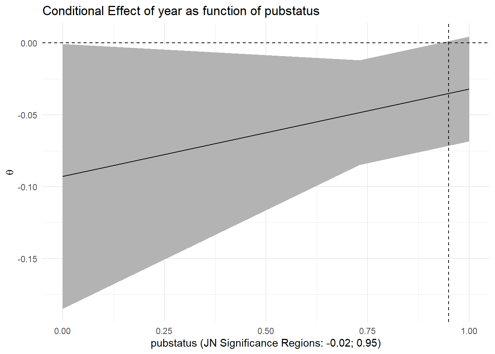

Then we interpret that the impact of year on the outcome variable is only significant when the publication status is greater than 0.95 or less than -0.02 (but this is not possible because the lower limit is 0).

## metafor

[Code by the author of the package](https://www.youtube.com/watch?v=IkduL5iRdqo&ab_channel=UseROslo)


```r
library(metafor)

dat.bcg
#>    trial               author year tpos  tneg cpos  cneg ablat      alloc
#> 1      1              Aronson 1948    4   119   11   128    44     random
#> 2      2     Ferguson & Simes 1949    6   300   29   274    55     random
#> 3      3      Rosenthal et al 1960    3   228   11   209    42     random
#> 4      4    Hart & Sutherland 1977   62 13536  248 12619    52     random
#> 5      5 Frimodt-Moller et al 1973   33  5036   47  5761    13  alternate
#> 6      6      Stein & Aronson 1953  180  1361  372  1079    44  alternate
#> 7      7     Vandiviere et al 1973    8  2537   10   619    19     random
#> 8      8           TPT Madras 1980  505 87886  499 87892    13     random
#> 9      9     Coetzee & Berjak 1968   29  7470   45  7232    27     random
#> 10    10      Rosenthal et al 1961   17  1699   65  1600    42 systematic
#> 11    11       Comstock et al 1974  186 50448  141 27197    18 systematic
#> 12    12   Comstock & Webster 1969    5  2493    3  2338    33 systematic
#> 13    13       Comstock et al 1976   27 16886   29 17825    33 systematic
```
### Log Risk


```r
# calculate log risk ratios and corresponding sampling variances
# note: slab for adding 'study labels' to the dataset
dat <- escalc(measure="RR", ai=tpos, bi=tneg,
                            ci=cpos, di=cneg,
              slab=paste(author, ", ", year, sep=""), data=dat.bcg)
dat
#> 
#>    trial               author year tpos  tneg cpos  cneg ablat      alloc 
#> 1      1              Aronson 1948    4   119   11   128    44     random 
#> 2      2     Ferguson & Simes 1949    6   300   29   274    55     random 
#> 3      3      Rosenthal et al 1960    3   228   11   209    42     random 
#> 4      4    Hart & Sutherland 1977   62 13536  248 12619    52     random 
#> 5      5 Frimodt-Moller et al 1973   33  5036   47  5761    13  alternate 
#> 6      6      Stein & Aronson 1953  180  1361  372  1079    44  alternate 
#> 7      7     Vandiviere et al 1973    8  2537   10   619    19     random 
#> 8      8           TPT Madras 1980  505 87886  499 87892    13     random 
#> 9      9     Coetzee & Berjak 1968   29  7470   45  7232    27     random 
#> 10    10      Rosenthal et al 1961   17  1699   65  1600    42 systematic 
#> 11    11       Comstock et al 1974  186 50448  141 27197    18 systematic 
#> 12    12   Comstock & Webster 1969    5  2493    3  2338    33 systematic 
#> 13    13       Comstock et al 1976   27 16886   29 17825    33 systematic 
#>         yi     vi 
#> 1  -0.8893 0.3256 
#> 2  -1.5854 0.1946 
#> 3  -1.3481 0.4154 
#> 4  -1.4416 0.0200 
#> 5  -0.2175 0.0512 
#> 6  -0.7861 0.0069 
#> 7  -1.6209 0.2230 
#> 8   0.0120 0.0040 
#> 9  -0.4694 0.0564 
#> 10 -1.3713 0.0730 
#> 11 -0.3394 0.0124 
#> 12  0.4459 0.5325 
#> 13 -0.0173 0.0714

# random-effects model (using log risk ratios and variances as input)
res <- rma(yi, vi, data=dat)
res
#> 
#> Random-Effects Model (k = 13; tau^2 estimator: REML)
#> 
#> tau^2 (estimated amount of total heterogeneity): 0.3132 (SE = 0.1664)
#> tau (square root of estimated tau^2 value):      0.5597
#> I^2 (total heterogeneity / total variability):   92.22%
#> H^2 (total variability / sampling variability):  12.86
#> 
#> Test for Heterogeneity:
#> Q(df = 12) = 152.2330, p-val < .0001
#> 
#> Model Results:
#> 
#> estimate      se     zval    pval    ci.lb    ci.ub      
#>  -0.7145  0.1798  -3.9744  <.0001  -1.0669  -0.3622  *** 
#> 
#> ---
#> Signif. codes:  0 '***' 0.001 '**' 0.01 '*' 0.05 '.' 0.1 ' ' 1

# predicted pooled risk ratio and corresponding CI/PI
predict(res, transf=exp, digits=2)
#> 
#>  pred ci.lb ci.ub pi.lb pi.ub 
#>  0.49  0.34  0.70  0.15  1.55

# forest plot
forest(res)
```

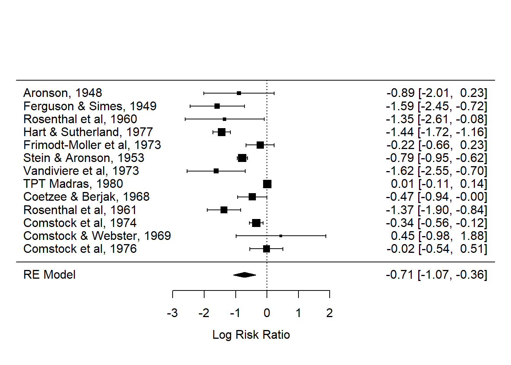

```r
forest(res, addpred=TRUE, header=TRUE)
```

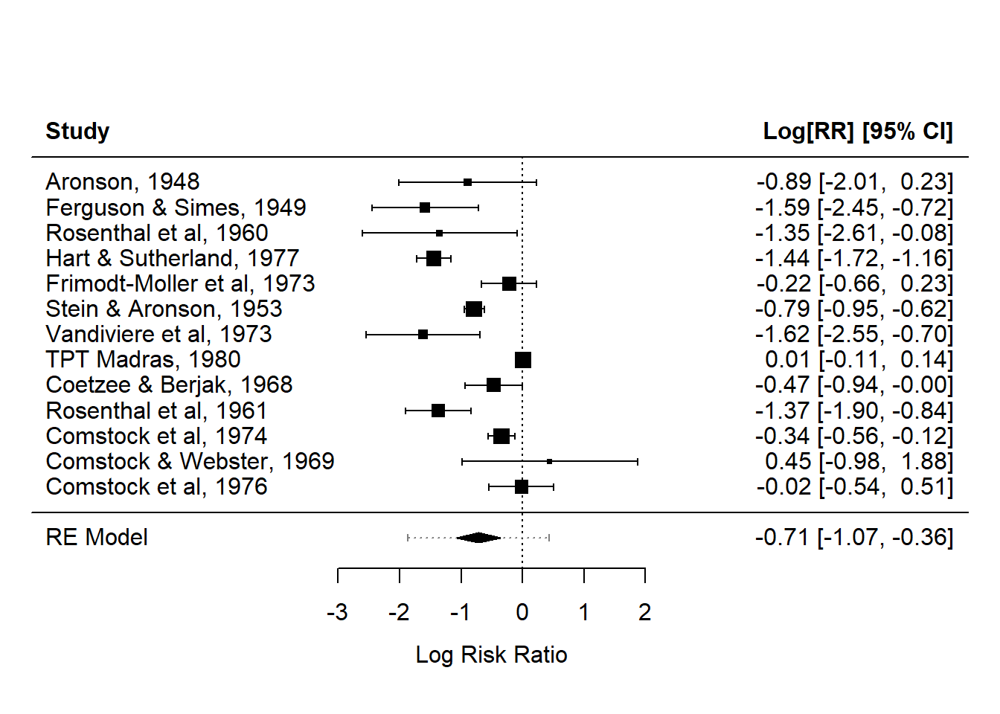

```r
print(forest(res, addpred=TRUE, header=TRUE))
#> $xlim
#> [1] -8.00  7.26
#> 
#> $alim
#> [1] -3  2
#> 
#> $at
#> [1] -3 -2 -1  0  1  2
#> 
#> $ylim
#> [1] -1.5 16.0
#> 
#> $rows
#>  [1]  1  2  3  4  5  6  7  8  9 10 11 12 13
#> 
#> $cex
#> [1] 1
#> 
#> $cex.lab
#> [1] 1
#> 
#> $cex.axis
#> [1] 1
#> 
#> $ilab.xpos
#> NULL
#> 
#> $ilab.pos
#> NULL
#> 
#> $textpos
#> [1] -8.00  7.26
forest(res, addpred=TRUE, header=TRUE, xlim=c(-8,6))
```

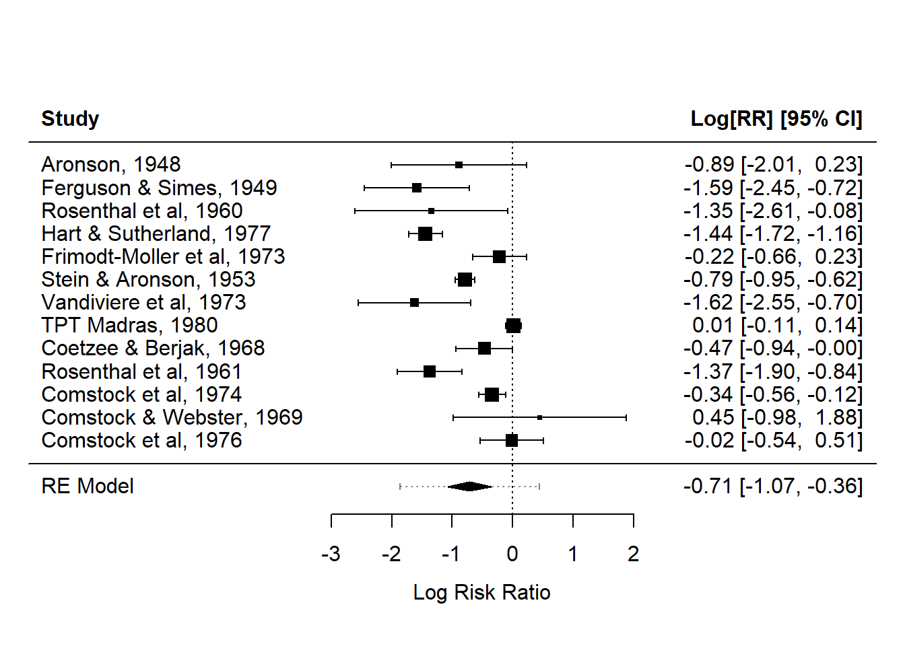

```r
forest(res, addpred=TRUE, header=TRUE, xlim=c(-8,6), atransf=exp)
```

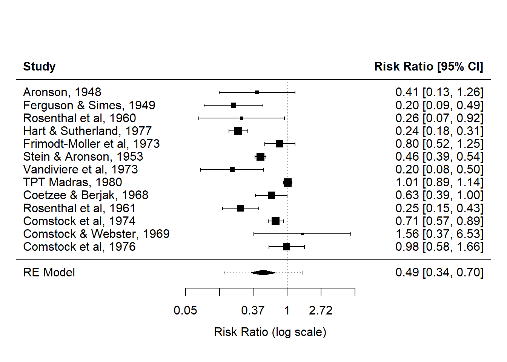

```r
forest(res, addpred=TRUE, header=TRUE, xlim=c(-8,5), atransf=exp, at=log(c(.05, .25, 1, 4)))
```

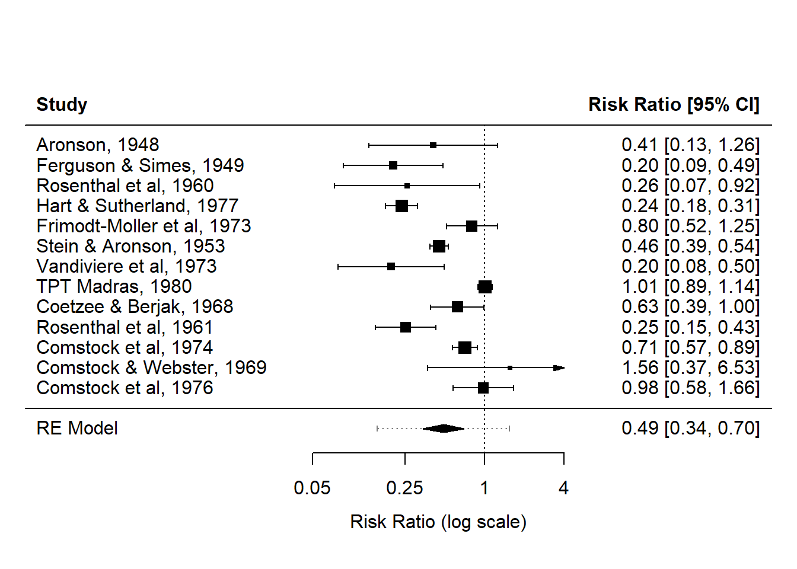

```r

# funnel plot
funnel(res)
```

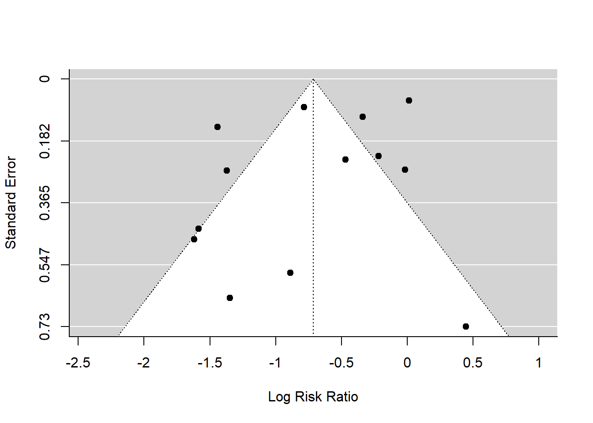

```r
funnel(res, ylim=c(0,.8), las=1)
```


```r
funnel(res, ylim=c(0,.8), las=1, digits=list(1L,1))
```

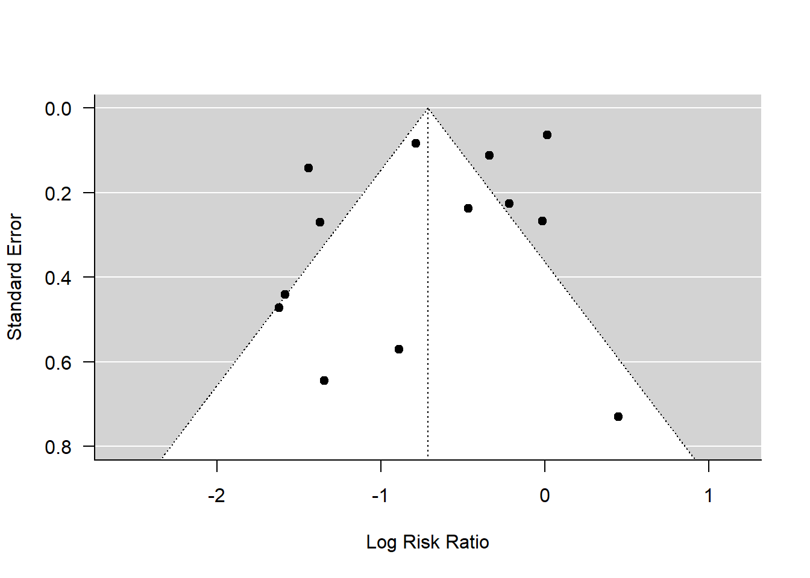

```r

# calculate log odds ratios and corresponding sampling variances for
# the meta-analysis on the effectiveness of vaccines against cholera
dat <- escalc(measure="OR", ai=ai, n1i=n1i,
                            ci=ci, n2i=n2i, data=dat.graves2010)
dat
#> 
#>              study  ai    n1i ci    n2i      yi     vi 
#> 1    Oseasohn 1965   8   6956 33   7103 -1.3997 0.1556 
#> 2   McCormack 1969  44  29939 35   9923 -0.8775 0.0514 
#> 3    Mosley 1970-i  32  11491 13   3810 -0.2038 0.1085 
#> 4   Mosley 1970-ii   2  11435 12   3810 -2.8938 0.5837 
#> 5      Taneja 1965  73  40326 27  10789 -0.3245 0.0509 
#> 6        PCC 1973b  72  82220 93  40620 -0.9625 0.0247 
#> 7      PCC 1973a-i  38  44500 23  11050 -0.8922 0.0699 
#> 8     PCC 1973a-ii  33  45750 22  11050 -1.0166 0.0759 
#> 9    PCC 1973a-iii  36  44450 23  11050 -0.9452 0.0714 
#> 10    PCC 1973a-iv  26  44700 22  11050 -1.2319 0.0840 
#> 11   Azurin 1965-i 110 145500 52  48934 -0.3408 0.0283 
#> 12  Azurin 1965-ii  92 148100 52  48933 -0.5373 0.0301 
#> 13 Azurin 1965-iii  71 143600 52  48933 -0.7657 0.0333 
#> 14        Pal 1980  13 101096 33 101030 -0.9324 0.1072 
#> 15        PCC 1968  54 268700 41  90900 -0.8087 0.0429 
#> 16   Saroso 1978-i  18 156300 19  79250 -0.7334 0.1082 
#> 17  Saroso 1978-ii  10 155600 18  79250 -1.2626 0.1556

# random-effects model
res <- rma(yi, vi, data=dat)
predict(res, transf=exp, digits=2)
#> 
#>  pred ci.lb ci.ub pi.lb pi.ub 
#>  0.45  0.38  0.53  0.29  0.70

# contour-enhanced funnel plot
funnel(dat$yi, dat$vi, yaxis="seinv",
       xlim=c(-3,2), ylim=c(.00001,8), xaxs="i", yaxs="i", las=1,
       level=c(.10, .05, .01), shade=c("white", "gray55", "gray75"),
       legend=TRUE, back="gray90", hlines=NULL, ylab="Precision (1/se)")
```

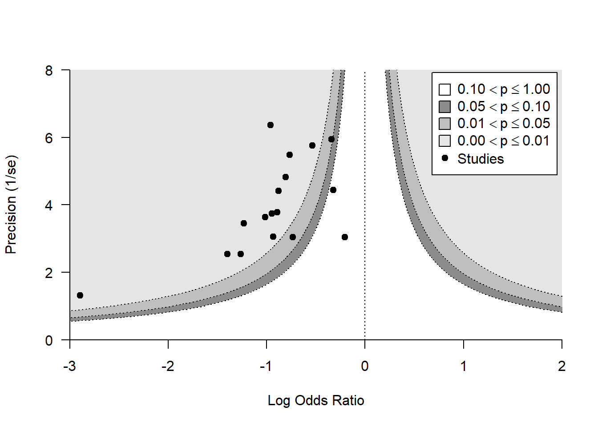

```r

# meta-analysis on the risk of lung cancer in women exposed to environmental
# tobacco smoke (ETS) from their smoking spouse (yi are log odds ratios)
res <- rma(yi, vi, data=dat.hackshaw1998)
res
#> 
#> Random-Effects Model (k = 37; tau^2 estimator: REML)
#> 
#> tau^2 (estimated amount of total heterogeneity): 0.0224 (SE = 0.0178)
#> tau (square root of estimated tau^2 value):      0.1497
#> I^2 (total heterogeneity / total variability):   29.57%
#> H^2 (total variability / sampling variability):  1.42
#> 
#> Test for Heterogeneity:
#> Q(df = 36) = 47.4979, p-val = 0.0952
#> 
#> Model Results:
#> 
#> estimate      se    zval    pval   ci.lb   ci.ub      
#>   0.2189  0.0494  4.4313  <.0001  0.1221  0.3157  *** 
#> 
#> ---
#> Signif. codes:  0 '***' 0.001 '**' 0.01 '*' 0.05 '.' 0.1 ' ' 1
predict(res, transf=exp, digits=2)
#> 
#>  pred ci.lb ci.ub pi.lb pi.ub 
#>  1.24  1.13  1.37  0.91  1.70
funnel(res, ylim=c(0,.8), las=1, digits=list(1L,1))
```

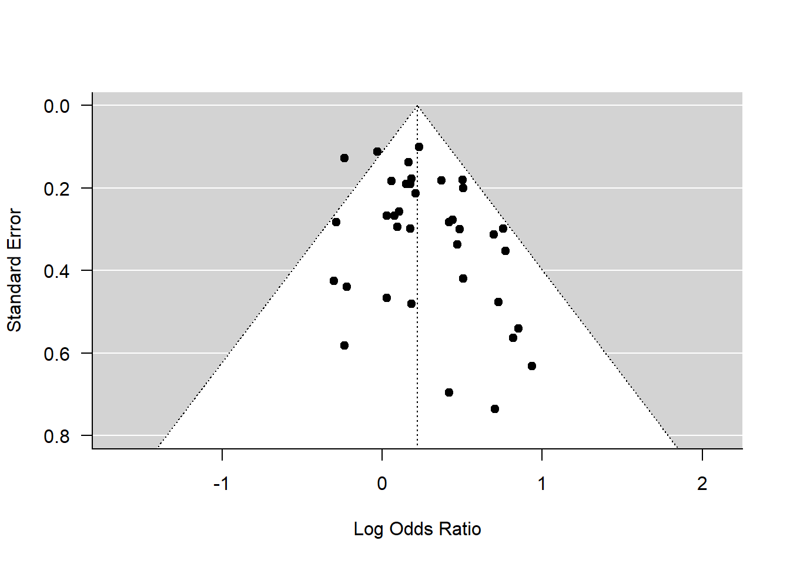

```r

# trim and fill method
funnel(trimfill(res), las=1, ylim=c(0,.8), digits=list(1L,1), legend=TRUE)
```

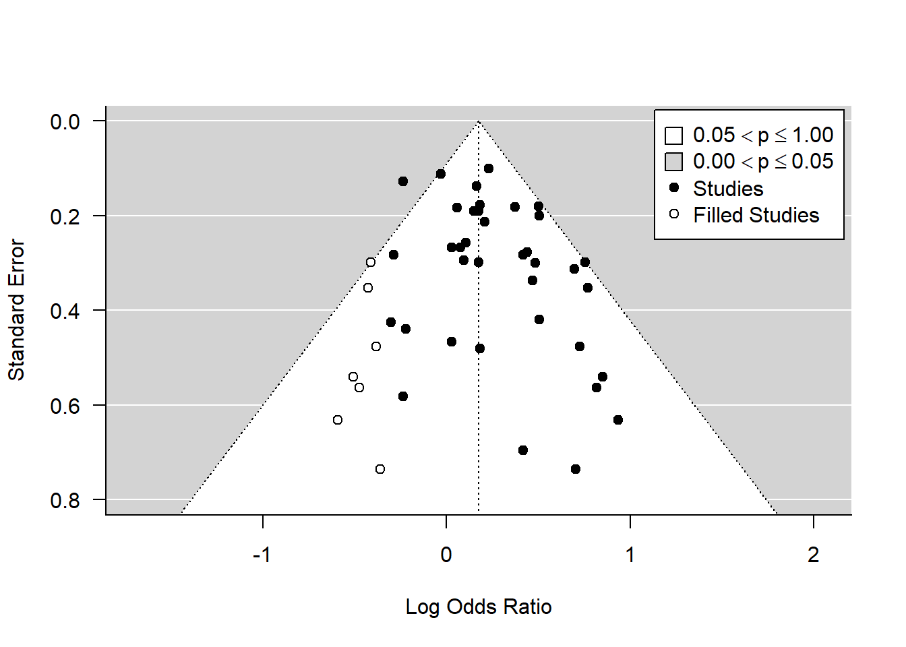

### Correlation


```r
# and job performance (using r-to-z transformed correlation for the analysis)
dat <- escalc(measure="ZCOR", ri=ri, ni=ni, data=dat.mcdaniel1994)
res <- rma(yi, vi, data=dat)
res
predict(res, transf=transf.ztor)

# outlier/influence diagnostics
par(mar=c(5,6,4,2))
plot(influence(res), cex=0.8, las=1)

# Baujat plot (back to the BCG meta-analysis)
dat <- escalc(measure="RR", ai=tpos, bi=tneg, ci=cpos, di=cneg,
              slab=paste(author, ", ", year, sep=""), data=dat.bcg)
res <- rma(yi, vi, data=dat)
baujat(res, bty="l", xlim=c(0,2), ylim=c(0,.25))

# cumulative meta-analyis
sav <- cumul(res, order=dat$year)
sav
forest(sav, xlim=c(-5,2.5), header=TRUE)

# back to the meta-analysis on the risk of lung cancer due to ETS
res <- rma(yi, vi, data=dat.hackshaw1998)

# radial plot
radial(res)

# meta-analysis on the effectiveness of wrist acupuncture point P6 stimulation
# for preventing postoperative nausea
res <- rma(measure="RR", ai=ai, n1i=n1i, ci=ci, n2i=n2i, data=dat.lee2004)
res
predict(res, transf=exp, digits=2)

# L'Abbé plot
labbe(res, transf=exp, bty="l")

# meta-analysis based on 20 hypothetical trials to examine the effectiveness
# of a particular treatment/medication
dat <- escalc(measure="OR", ai=xTi, n1i=nTi, ci=xCi, n2i=nCi,
              add=1/2, to="all", data=dat.viechtbauer2021)
dat
res <- rma(yi, vi, data=dat, method="FE")
res

# GOSH plot
sav <- gosh(res, subset=20000)
plot(sav, out=6, xlim=c(-0.25,1.25), breaks=100, hh=0.2)

# GOSH plot based on all possible subsets (takes a long time to create)
#sav <- gosh(res, subsets=10^7)
#plot(sav, cex=0.1, out=6, xlim=c(-0.25,1.25), breaks=c(200,100), hh=0.2, lwd=1)

# mixed-effects meta-regression model with absolute latitude and type of
# allocation as moderators/predictors (back to BCG dataset)
dat <- escalc(measure="RR", ai=tpos, bi=tneg, ci=cpos, di=cneg,
              slab=paste(author, ", ", year, sep=""), data=dat.bcg)
res <- rma(yi, vi, mods = ~ ablat + alloc, data=dat)
res

############################################################################

# forest plots with subgroups

# fit random-effects model
res <- rma(yi, vi, data=dat)

# a little helper function to add Q-test, I^2, and tau^2 estimate info
mlabfun <- function(text, res) {
   list(bquote(paste(.(text),
      " (Q = ", .(formatC(res$QE, digits=2, format="f")),
      ", df = ", .(res$k - res$p),
      ", p ", .(metafor:::.pval(res$QEp, digits=2, showeq=TRUE, sep=" ")), "; ",
      I^2, " = ", .(formatC(res$I2, digits=1, format="f")), "%, ",
      tau^2, " = ", .(formatC(res$tau2, digits=2, format="f")), ")")))}

# set up forest plot (with 2x2 table counts added; the 'rows' argument is
# used to specify in which rows the outcomes will be plotted)
forest(res, xlim=c(-16, 4.6), at=log(c(0.05, 0.25, 1, 4)), atransf=exp,
       ilab=cbind(dat$tpos, dat$tneg, dat$cpos, dat$cneg),
       ilab.xpos=c(-9.5,-8,-6,-4.5), cex=0.90, ylim=c(-1, 27),
       order=dat$alloc, rows=c(3:4,9:15,20:23),
       mlab=mlabfun("RE Model for All Studies", res),
       psize=1, header="Author(s) and Year")

# set font expansion factor (as in forest() above) and use a bold font
op <- par(cex=0.90, font=2)

# add additional column headings to the plot
text(c(-9.5,-8,-6,-4.5), 26, c("TB+", "TB-", "TB+", "TB-"))
text(c(-8.75,-5.25),     27, c("Vaccinated", "Control"))

# switch to bold italic font
par(font=4)

# add text for the subgroups
text(-16, c(24,16,5), pos=4, c("Systematic Allocation",
                               "Random Allocation",
                               "Alternate Allocation"))

# set par back to the original settings
par(op)

# fit random-effects model in the three subgroups
res.s <- rma(yi, vi, subset=(alloc=="systematic"), data=dat)
res.r <- rma(yi, vi, subset=(alloc=="random"),     data=dat)
res.a <- rma(yi, vi, subset=(alloc=="alternate"),  data=dat)

# add summary polygons for the three subgroups
addpoly(res.s, row=18.5, cex=0.90, atransf=exp, mlab=mlabfun("RE Model for Subgroup", res.s))
addpoly(res.r, row= 7.5, cex=0.90, atransf=exp, mlab=mlabfun("RE Model for Subgroup", res.r))
addpoly(res.a, row= 1.5, cex=0.90, atransf=exp, mlab=mlabfun("RE Model for Subgroup", res.a))

# fit meta-regression model to test for subgroup differences
res <- rma(yi, vi, mods = ~ alloc, data=dat)

# add text for the test of subgroup differences
text(-16, -1.8, pos=4, cex=0.90, bquote(paste("Test for Subgroup Differences: ",
     Q[M], " = ", .(formatC(res$QM, digits=2, format="f")), ", df = ", .(res$p - 1),
     ", p = ", .(formatC(res$QMp, digits=2, format="f")))))

############################################################################

# mixed-effects meta-regression model with absolute latitude and type of
# allocation as moderators/predictors (back to BCG dataset)
dat <- escalc(measure="RR", ai=tpos, bi=tneg, ci=cpos, di=cneg, data=dat.bcg)
res <- rma(yi, vi, mods = ~ ablat, data=dat)

# draw plot
regplot(res, xlim=c(10,60), predlim=c(0,60), xlab="Absolute Latitude", refline=0,
        atransf=exp, at=log(seq(0.2,2,by=0.2)), digits=1, las=1, bty="l",
        label=c(4,7,12,13), offset=c(1.6,1), labsize=0.9)

############################################################################

# selection models

cols <- palette.colors(8, palette = "R4")

res <- rma(yi, vi, data=dat.hackshaw1998)

types <- c("beta", "halfnorm", "negexp", "logistic", "power", "negexppow", "stepfun")
sel <- list()

for (j in 1:length(types)) {
   sel[[j]] <- selmodel(res, type=types[j], steps = if (types[j] == "stepfun") c(.025, .1, .2, .5, 1) else NA,
                        control=list(pval.min = if (types[j] %in% c("beta","negexppow")) 1e-4 else 0))
   plot(sel[[j]], ylim=c(0,1), scale=j==1, lwd=3, col=cols[j], add=j>1, las=1, bty="l")
}

types <- c("beta function", "half normal function", "negative exponential function", "logistic function", "power function", "negative exponential power function", "step function")
ord <- c(2,5,4,3,6,7,1)
legend("topright", inset=0, legend=types[ord], lwd=3, col=cols[ord], bg="white", seg.len=3, box.col="white")

############################################################################

# reporter() function

dat <- escalc(measure="RR", ai=tpos, bi=tneg, ci=cpos, di=cneg,
              slab=paste(author, ", ", year, sep=""), data=dat.bcg)
res <- rma(yi, vi, data=dat)
res

reporter(res)
reporter(res, format="pdf")
reporter(res, format="word")

# add an outlier
dat$yi[6] <- 2.5
res <- rma(yi, vi, data=dat)
reporter(res)

############################################################################

```

