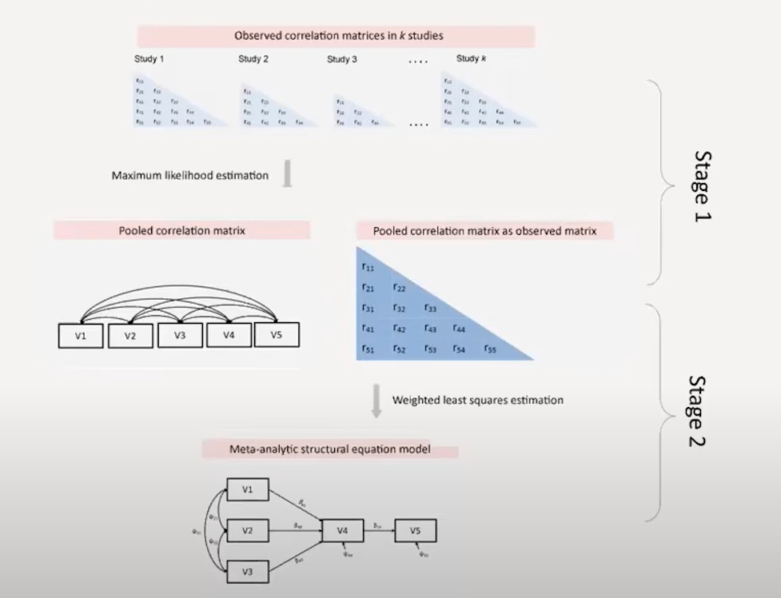
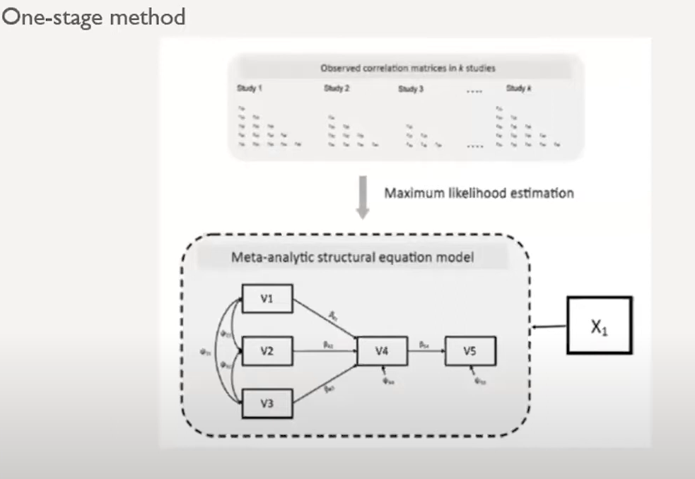
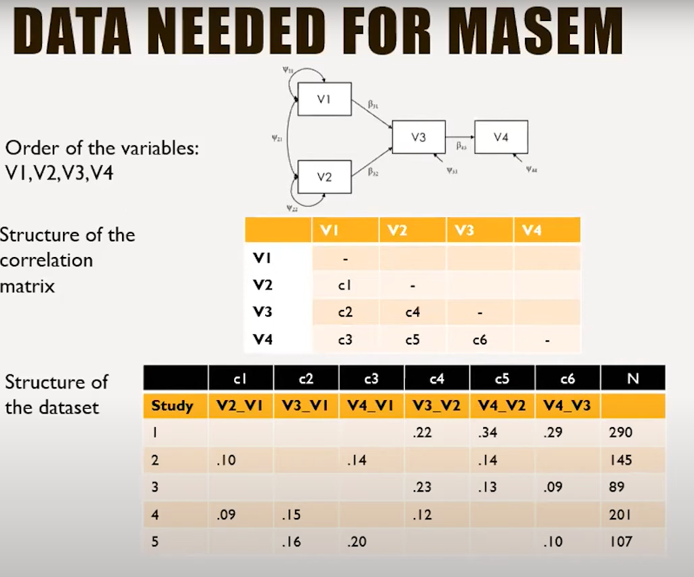
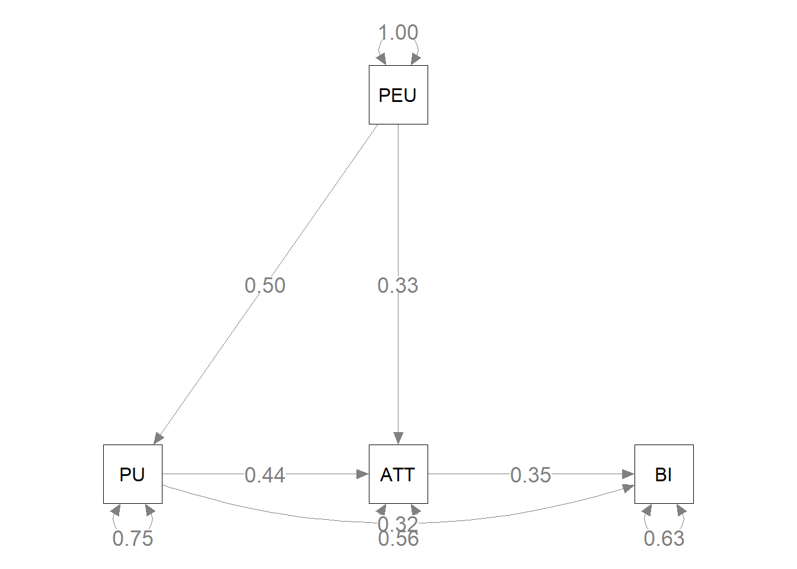
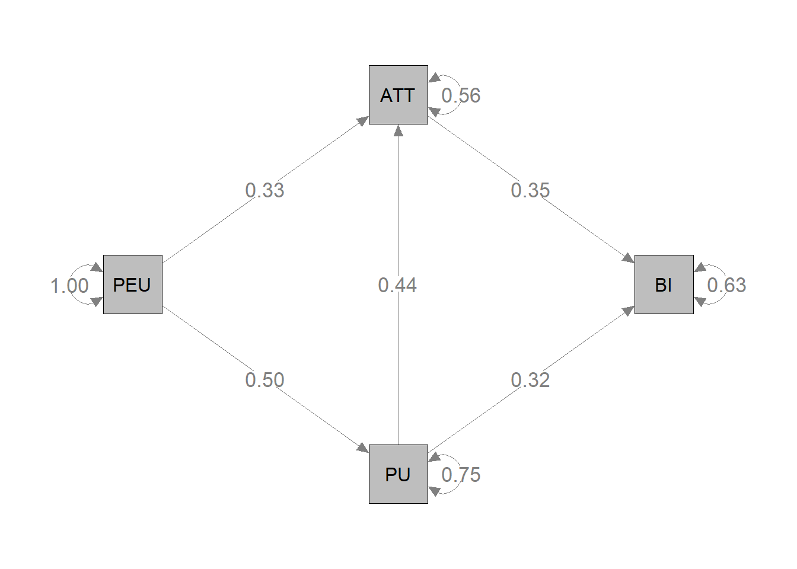
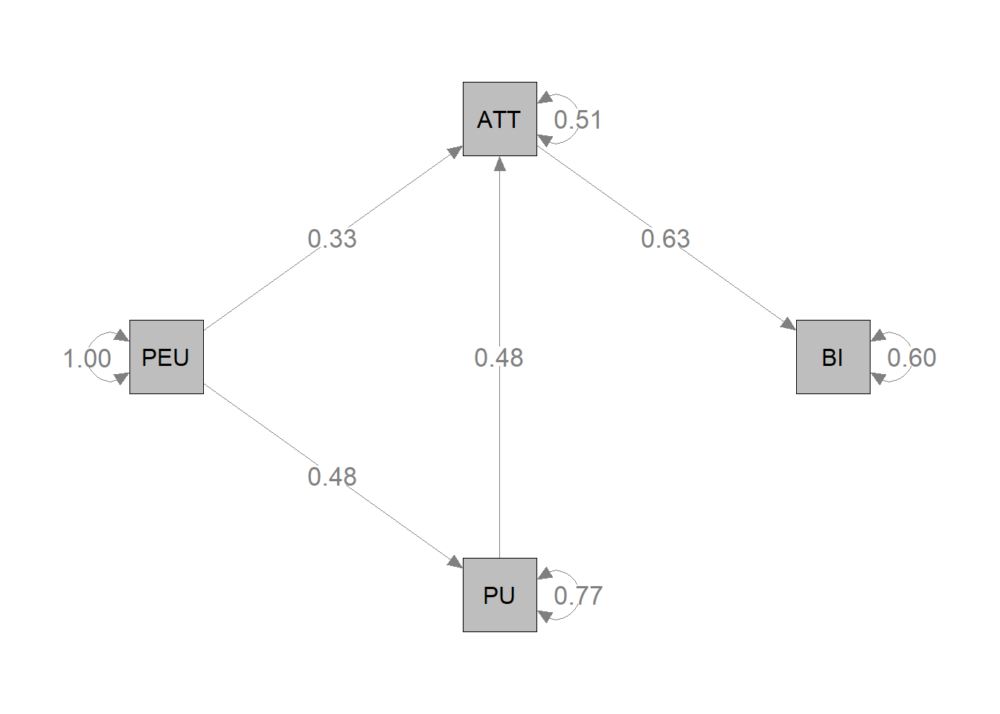

# Meta-Analysis Structural Equation Modeling

Readings

-   Fixed-effects MASEM [@cheung2009]

-   Fixed and random-effects MASEM [@cheung2013]

-   Random-effect MASEM [@cheung2016]

-   Health psychology application [@cheung2017]

-   Review [@cheung2018]

[Forum](https://openmx.ssri.psu.edu//forums/third-party-software/metasem) to get help

Notes:

-   SEM is also known as covariance structural analysis, covariance structure model, analysis of covariance structures, analysis of correlation structure

-   MASEM is also known as meta-analytic path analysis, meta-analysis of factor analysis, meta-analytically structural euqaiton analysis, path analysis of meta-analytically derived correlation matrices, SEM of a meta-analytic correlation matrix, path analysis based on meta-analytic findings, model-based meta-analysis

Advantages of MASEM [@bergh2016using]

-   Can test intermediate mechanisms and opposing hypotheses.

-   Increase external validity.

Disadvantages of MASEM

-   Not useful in cases where no competing hypotheses or

-   Cannot be performed with limited primary studies (40 studies minimum)

-   Number of variables should not be too large

-   Is not immune to construct validity threats.

-   Can be misleading when imputation is in great proportion

-   Limited use of moderation analysis within SEM

-   cannot make causal inferences (except when all primary data are from experimental designs)

    -   One can only do her best to address endogeneity concerns

        -   use lagged term for autocorrelation

        -   adjust for measurement error

        -   Include as many relevant controls as possible

        -   test alternative specification.

Two-stage method



(image by [Dr. Suzanne Jak](https://www.youtube.com/watch?v=0v-CdNLa_eo&ab_channel=ZPID-LeibnizInstituteforPsychology))



(image by [Dr. Suzanne Jak](https://www.youtube.com/watch?v=0v-CdNLa_eo&ab_channel=ZPID-LeibnizInstituteforPsychology))

Steps to do MASEM [@bergh2016using, p. 480]:

Step 1: Specify conceptual models:

1.  Specify competing models o be tested
2.  Specify whether the models are a priori or post hoc

Step 2: Meta-analytic procedures:

1.  Solutions to missing data (recommend the first three)
    1.  Search again (based on the same or different search criteria.

    2.  Contact authors to request correlation values [@shadish1996]

    3.  Replicate the primary study

    4.  Use surrogate or proxy variables that are conceptually similar [@eby1999motivational]

    5.  Use composite correlations by combining specific constructs into broader ones [@viswesvaran1995theory]

    6.  Use a two-stage SEM [@cheung2005meta; @fan2010factor]

    7.  Data imputation (e.g., full information maximum likelihood) [@cheung2008model]

    8.  Use the average effect size across nonmissing effect sizes [@viswesvaran1995theory]
2.  Different pairs of variables can have different sample size values to calculate the meta-analytic correlations. Solutions:
    1.  Harmonic mean [@burke2003methodological]: $k/(1/N_1 + 1/N_2 + \dots + 1/N_k)$ where $k$ is the number of correlations, and $N_k$ refers to the sample used to calculate the $k$-th correlation. This is **recommended** because it limits the influence of very big numbers and increases the influence of smaller values and is usually smaller than the arithmetic mean [@landis2013successfully; @johnson2001synthetic]

    2.  The smallest total sample size [@roesch2001meta]

    3.  Median [@tokunaga2010evaluation]

    4.  Arithmetic mean [@graham2011measuring; @judge2002personality]
3.  Derive meta-analytic matrix

Step 3: Structural equation modeling

1.  Approaches
    1.  Two-stage methods [@cheung2005meta]

        1.  can't do moderation analysis really. (can only do subgroup analysis)
        2.  Stage 1: Combine the correlation matrices into a pooled correlation matrix
        3.  Stage 2: Fit SEM on the pooled correlation matrix
        4.  Can use (1) Uni variate approach [@hunter1990], (2) GLM [@becker1992], (3) TSSEM [@cheung2005meta]

    2.  One-stage methods [@jak2020meta]

        1.  Can do moderation analysis (for continuous moderator)

        2.  handles missing data similar to 2-stage

        3.  provides fit indices similar to two-stage

        4.  can use webMASEM to apply

    3.  Parameter-based MASEM [@becker2007synthesis; @gnambs2016parameter]

        1.  Steps: Fit SEM, then pool the SEM parameters

        2.  need complete data, and model needs to fit equally well in all samples, but can be solved by Bayesian [@ke2019bayesian]
2.  nonpositive definite matrix (i.e., 0 or negative eigenvalues) fix (either because of a small total number of studies in some cells, two variables are highly correlated, or overuse of imputation)
    1.  Choose alternative global starting values. [@eby1999motivational]

    2.  Select precise starting values for parameter estimates [@eby1999motivational]

    3.  Reduce the set of variables
3.  Reliability missing: can either use
    1.  Mean reliability [@kirca2005market; @rosengren2020meta]

    2.  Use 0.8 as a conservative number for all constructs [@bergh2016using; @aguinis2011debunking]
4.  Sample dependencies fix:
    1.  [@geyskens2006make] recommendations in steps:

        1.  Include all meaningful correlations from each sample for consideration

        2.  calculate composite correlation from conceptually similar component correlations from each sample

        3.  If different studies used totally or partially overlapping datasets, choose correlation(s) based on the bigger sample size(s).

    2.  use generalized least squares [@furlow2005meta; @shadish1996]

    3.  use random effect meta-analyses in conjunction with MASEM [@erez1996using]

    4.  use multilevel meta-analytic in conjunction with MASEM [@van2003combining]
5.  Use multiple fit measures (no general cutoff, all context-specific [@nye2011effect)
    1.  Chi-square (careful because of its dependent on sample size): since MASEM can have a large number of observations, chi-square usually has poor fit even in cases where the empirical correlation matrix is quite close to the hypothesized model's correlation matrix. [@aguinis2009cautionary]. Hence, use other fit indices as well.

        1.  Tests the null hypothesis of exact fit

        2.  If $p < 0.05$, exact fit is rejected

    2.  Comparative fit index (CFI)

    3.  Goodness-of-fit index (GFI)

    4.  Root mean square residual (RMSR): measure of approximate fit

        1.  \< .05 close approximate fit

        2.  .5 to .8 reasonable fit

        3.  \>.1 poor fit [@browne1992alternative]

    5.  Standardized Root Mean Squared Residual (SRMSR)
6.  Inclusion and exclusion criteria [@bergh2016using, p. 482]:
    1.  Select the meta-analytic correlation for variables whose operationalizations are congruent with the a priori definitions of interest

    2.  Select meta-analytic correlation reported by meta-analyses that used prespecified meta-analytic methodologies (e.g., how unreliability was adjusted/corrected)

    3.  Utilize meta-analytic correlations derived from meta-analyses with the greatest sample sizes.

Step 4: Reporting procedures

1.  Follow the meta-analysis reporting standards (MARS)
    1.  If the model only has observed variables, the procedure should be called path analysis rather than MASEM
2.  Include a table that has all estimated bivariate meta-analytic correlations and 95% CIs for each correlation, the number of studies for each correlation (k), and the total sample size (n)
3.  Include a table of results of each tested model with figures
4.  Include a table of coefficients (always standardized) and statistical significance level, SEs, 95% CIs.

Data



(image by [Dr. Suzanne Jak](https://www.youtube.com/watch?v=0v-CdNLa_eo&ab_channel=ZPID-LeibnizInstituteforPsychology))

## 

metaSEM

[webMASEM](https://sjak.shinyapps.io/webMASEM/)

[Document](https://osf.io/wh6d3/)


```r
library(metaSEM)
data("Roorda11")


my.df <- Cor2DataFrame(Roorda11$data, Roorda11$n)

## Add centered SES as a moderator (standardizing SES helps to improve the stability of the results)
my.df$data <- data.frame(my.df$data, SES=scale(Roorda11$SES), check.names=FALSE)
head(my.df$data)
#>   neg_pos enga_pos achiev_pos enga_neg achiev_neg achiev_enga
#> 1   -0.54       NA       0.18       NA      -0.29          NA
#> 2      NA     0.64       0.29       NA         NA        0.23
#> 3      NA     0.29         NA       NA         NA          NA
#> 4      NA     0.29         NA       NA         NA          NA
#> 5      NA       NA         NA       NA      -0.24          NA
#> 6      NA     0.06      -0.09       NA         NA        0.20
#>   C(neg_pos neg_pos) C(enga_pos neg_pos) C(achiev_pos neg_pos)
#> 1       0.0005989503       -0.0001515535         -9.072888e-05
#> 2       0.0018375288       -0.0004649535         -2.783491e-04
#> 3       0.0063790635       -0.0016141079         -9.663017e-04
#> 4       0.0118882493       -0.0030081057         -1.800829e-03
#> 5       0.0043833791       -0.0011091346         -6.639929e-04
#> 6       0.0084368192       -0.0021347816         -1.278004e-03
#>   C(enga_neg neg_pos) C(achiev_neg neg_pos) C(achiev_enga neg_pos)
#> 1        0.0001507643          3.883504e-05          -2.214649e-05
#> 2        0.0004625324          1.191428e-04          -6.794417e-05
#> 3        0.0016057006          4.136083e-04          -2.358707e-04
#> 4        0.0029924455          7.708180e-04          -4.395732e-04
#> 5        0.0011033574          2.842108e-04          -1.620776e-04
#> 6        0.0021236669          5.470286e-04          -3.119521e-04
#>   C(enga_pos enga_pos) C(achiev_pos enga_pos) C(enga_neg enga_pos)
#> 1         0.0006397566           0.0001647861        -0.0001910368
#> 2         0.0019627193           0.0005055497        -0.0005860852
#> 3         0.0068136693           0.0017550402        -0.0020346212
#> 4         0.0126982048           0.0032707507        -0.0037918008
#> 5         0.0046820181           0.0012059759        -0.0013980892
#> 6         0.0090116233           0.0023211770        -0.0026909450
#>   C(achiev_neg enga_pos) C(achiev_enga enga_pos) C(achiev_pos achiev_pos)
#> 1          -5.134692e-05            3.127062e-05             0.0007526507
#> 2          -1.575275e-04            9.593552e-05             0.0023090684
#> 3          -5.468647e-04            3.330468e-04             0.0080160366
#> 4          -1.019160e-03            6.206678e-04             0.0149389709
#> 5          -3.757769e-04            2.288519e-04             0.0055082223
#> 6          -7.232702e-04            4.404767e-04             0.0106018447
#>   C(enga_neg achiev_pos) C(achiev_neg achiev_pos) C(achiev_enga achiev_pos)
#> 1          -0.0000639557            -0.0002463388              0.0001998713
#> 2          -0.0001962109            -0.0007557451              0.0006131873
#> 3          -0.0006811551            -0.0026236049              0.0021287076
#> 4          -0.0012694257            -0.0048894474              0.0039671336
#> 5          -0.0004680519            -0.0018028091              0.0014627431
#> 6          -0.0009008759            -0.0034699233              0.0028153854
#>   C(enga_neg enga_neg) C(achiev_neg enga_neg) C(achiev_enga enga_neg)
#> 1         0.0006389859           0.0001558887           -7.403048e-05
#> 2         0.0019603553           0.0004782534           -2.271198e-04
#> 3         0.0068054597           0.0016602745           -7.884545e-04
#> 4         0.0126829099           0.0030941522           -1.469390e-03
#> 5         0.0046763734           0.0011408577           -5.417836e-04
#> 6         0.0090007606           0.0021958460           -1.042788e-03
#>   C(achiev_neg achiev_neg) C(achiev_enga achiev_neg) C(achiev_enga achiev_enga)
#> 1             0.0007298084             -0.0001921435               0.0006716402
#> 2             0.0022389887             -0.0005894789               0.0020605349
#> 3             0.0077727476             -0.0020463990               0.0071532349
#> 4             0.0144855833             -0.0038137502               0.0133310333
#> 5             0.0053410484             -0.0014061844               0.0049153512
#> 6             0.0102800837             -0.0027065274               0.0094607287
#>          SES
#> 1  0.4464188
#> 2  0.7145383
#> 3  0.8821129
#> 4 -0.8941783
#> 5 -0.9947231
#> 6 -0.5925439
```


```r
data(Scalco17)
my.df <- Cor2DataFrame(Scalco17$data, Scalco17$n, acov = "weighted")

## Add the centered Age as a moderator
my.df$data <- data.frame(my.df$data, Age=scale(Scalco17$Age,  scale=FALSE), check.names=FALSE)
head(my.df$data)
#>                                       SN_ATT PBC_ATT BI_ATT BEH_ATT PBC_SN
#> Al-Swidi et al., 2014                  0.562    0.18  0.798      NA  0.314
#> Arvola et al., 2008 (Study A from IT)  0.690    0.44  0.730      NA  0.460
#> Arvola et al., 2008 (Study A from UK)  0.520    0.22  0.600      NA  0.280
#> Arvola et al., 2008 (Study A from FI)  0.570    0.40  0.670      NA  0.340
#> Arvola et al., 2008 (Study B from IT)  0.760    0.35  0.710      NA  0.360
#> Arvola et al., 2008 (Study B from UK)  0.460    0.03  0.550      NA  0.150
#>                                       BI_SN BEH_SN BI_PBC BEH_PBC BEH_BI
#> Al-Swidi et al., 2014                 0.696     NA  0.216      NA     NA
#> Arvola et al., 2008 (Study A from IT) 0.620     NA  0.410      NA     NA
#> Arvola et al., 2008 (Study A from UK) 0.560     NA  0.310      NA     NA
#> Arvola et al., 2008 (Study A from FI) 0.550     NA  0.360      NA     NA
#> Arvola et al., 2008 (Study B from IT) 0.640     NA  0.240      NA     NA
#> Arvola et al., 2008 (Study B from UK) 0.580     NA  0.100      NA     NA
#>                                       C(SN_ATT SN_ATT) C(PBC_ATT SN_ATT)
#> Al-Swidi et al., 2014                      0.003943229      0.0007678353
#> Arvola et al., 2008 (Study A from IT)      0.003591861      0.0006994172
#> Arvola et al., 2008 (Study A from UK)      0.002687245      0.0005232762
#> Arvola et al., 2008 (Study A from FI)      0.003627776      0.0007064166
#> Arvola et al., 2008 (Study B from IT)      0.003591855      0.0006994208
#> Arvola et al., 2008 (Study B from UK)      0.002687245      0.0005232761
#>                                       C(BI_ATT SN_ATT) C(BEH_ATT SN_ATT)
#> Al-Swidi et al., 2014                     0.0011950618      0.0012021391
#> Arvola et al., 2008 (Study A from IT)     0.0010885722      0.0010950198
#> Arvola et al., 2008 (Study A from UK)     0.0008144188      0.0008192439
#> Arvola et al., 2008 (Study A from FI)     0.0010994610      0.0011059724
#> Arvola et al., 2008 (Study B from IT)     0.0010885737      0.0010950199
#> Arvola et al., 2008 (Study B from UK)     0.0008144187      0.0008192440
#>                                       C(PBC_SN SN_ATT) C(BI_SN SN_ATT)
#> Al-Swidi et al., 2014                     0.0010869769     0.001853521
#> Arvola et al., 2008 (Study A from IT)     0.0009901025     0.001688358
#> Arvola et al., 2008 (Study A from UK)     0.0007407646     0.001263146
#> Arvola et al., 2008 (Study A from FI)     0.0010000307     0.001705244
#> Arvola et al., 2008 (Study B from IT)     0.0009901226     0.001688357
#> Arvola et al., 2008 (Study B from UK)     0.0007407654     0.001263145
#>                                       C(BEH_SN SN_ATT) C(BI_PBC SN_ATT)
#> Al-Swidi et al., 2014                      0.001499233     0.0005441095
#> Arvola et al., 2008 (Study A from IT)      0.001365640     0.0004956130
#> Arvola et al., 2008 (Study A from UK)      0.001021706     0.0003708108
#> Arvola et al., 2008 (Study A from FI)      0.001379300     0.0005005915
#> Arvola et al., 2008 (Study B from IT)      0.001365641     0.0004956285
#> Arvola et al., 2008 (Study B from UK)      0.001021706     0.0003708104
#>                                       C(BEH_PBC SN_ATT) C(BEH_BI SN_ATT)
#> Al-Swidi et al., 2014                      0.0004086058     0.0006118278
#> Arvola et al., 2008 (Study A from IT)      0.0003721897     0.0005573051
#> Arvola et al., 2008 (Study A from UK)      0.0002784662     0.0004169550
#> Arvola et al., 2008 (Study A from FI)      0.0003759267     0.0005628855
#> Arvola et al., 2008 (Study B from IT)      0.0003721980     0.0005573105
#> Arvola et al., 2008 (Study B from UK)      0.0002784645     0.0004169550
#>                                       C(PBC_ATT PBC_ATT) C(BI_ATT PBC_ATT)
#> Al-Swidi et al., 2014                        0.004547982      0.0007764255
#> Arvola et al., 2008 (Study A from IT)        0.004142722      0.0007072478
#> Arvola et al., 2008 (Study A from UK)        0.003099380      0.0005291289
#> Arvola et al., 2008 (Study A from FI)        0.004184156      0.0007143181
#> Arvola et al., 2008 (Study B from IT)        0.004142726      0.0007072449
#> Arvola et al., 2008 (Study B from UK)        0.003099378      0.0005291285
#>                                       C(BEH_ATT PBC_ATT) C(PBC_SN PBC_ATT)
#> Al-Swidi et al., 2014                       0.0013663048       0.001663771
#> Arvola et al., 2008 (Study A from IT)       0.0012445548       0.001515506
#> Arvola et al., 2008 (Study A from UK)       0.0009311243       0.001133843
#> Arvola et al., 2008 (Study A from FI)       0.0012570092       0.001530685
#> Arvola et al., 2008 (Study B from IT)       0.0012445619       0.001515525
#> Arvola et al., 2008 (Study B from UK)       0.0009311233       0.001133842
#>                                       C(BI_SN PBC_ATT) C(BEH_SN PBC_ATT)
#> Al-Swidi et al., 2014                     0.0004362904      0.0005789535
#> Arvola et al., 2008 (Study A from IT)     0.0003974116      0.0005273586
#> Arvola et al., 2008 (Study A from UK)     0.0002973332      0.0003945553
#> Arvola et al., 2008 (Study A from FI)     0.0004013953      0.0005326467
#> Arvola et al., 2008 (Study B from IT)     0.0003974189      0.0005273715
#> Arvola et al., 2008 (Study B from UK)     0.0002973319      0.0003945558
#>                                       C(BI_PBC PBC_ATT) C(BEH_PBC PBC_ATT)
#> Al-Swidi et al., 2014                       0.002592421        0.001688971
#> Arvola et al., 2008 (Study A from IT)       0.002361403        0.001538468
#> Arvola et al., 2008 (Study A from UK)       0.001766701        0.001151015
#> Arvola et al., 2008 (Study A from FI)       0.002385041        0.001553864
#> Arvola et al., 2008 (Study B from IT)       0.002361423        0.001538477
#> Arvola et al., 2008 (Study B from UK)       0.001766699        0.001151012
#>                                       C(BEH_BI PBC_ATT) C(BI_ATT BI_ATT)
#> Al-Swidi et al., 2014                      0.0006653419      0.002028710
#> Arvola et al., 2008 (Study A from IT)      0.0006060481      0.001847937
#> Arvola et al., 2008 (Study A from UK)      0.0004534267      0.001382534
#> Arvola et al., 2008 (Study A from FI)      0.0006121213      0.001866417
#> Arvola et al., 2008 (Study B from IT)      0.0006060600      0.001847936
#> Arvola et al., 2008 (Study B from UK)      0.0004534261      0.001382533
#>                                       C(BEH_ATT BI_ATT) C(PBC_SN BI_ATT)
#> Al-Swidi et al., 2014                      0.0012950276     0.0004215196
#> Arvola et al., 2008 (Study A from IT)      0.0011796378     0.0003839543
#> Arvola et al., 2008 (Study A from UK)      0.0008825445     0.0002872670
#> Arvola et al., 2008 (Study A from FI)      0.0011914296     0.0003878078
#> Arvola et al., 2008 (Study B from IT)      0.0011796320     0.0003839639
#> Arvola et al., 2008 (Study B from UK)      0.0008825443     0.0002872672
#>                                       C(BI_SN BI_ATT) C(BEH_SN BI_ATT)
#> Al-Swidi et al., 2014                    0.0005366974     0.0005252412
#> Arvola et al., 2008 (Study A from IT)    0.0004888724     0.0004784379
#> Arvola et al., 2008 (Study A from UK)    0.0003657550     0.0003579479
#> Arvola et al., 2008 (Study A from FI)    0.0004937657     0.0004832269
#> Arvola et al., 2008 (Study B from IT)    0.0004888751     0.0004784409
#> Arvola et al., 2008 (Study B from UK)    0.0003657543     0.0003579484
#>                                       C(BI_PBC BI_ATT) C(BEH_PBC BI_ATT)
#> Al-Swidi et al., 2014                     0.0005461570      0.0003593276
#> Arvola et al., 2008 (Study A from IT)     0.0004974762      0.0003273048
#> Arvola et al., 2008 (Study A from UK)     0.0003722050      0.0002448829
#> Arvola et al., 2008 (Study A from FI)     0.0005024729      0.0003305885
#> Arvola et al., 2008 (Study B from IT)     0.0004974942      0.0003273117
#> Arvola et al., 2008 (Study B from UK)     0.0003722044      0.0002448816
#>                                       C(BEH_BI BI_ATT) C(BEH_ATT BEH_ATT)
#> Al-Swidi et al., 2014                     0.0005717457        0.003394128
#> Arvola et al., 2008 (Study A from IT)     0.0005207960        0.003091691
#> Arvola et al., 2008 (Study A from UK)     0.0003896390        0.002313045
#> Arvola et al., 2008 (Study A from FI)     0.0005260095        0.003122603
#> Arvola et al., 2008 (Study B from IT)     0.0005208004        0.003091684
#> Arvola et al., 2008 (Study B from UK)     0.0003896390        0.002313044
#>                                       C(PBC_SN BEH_ATT) C(BI_SN BEH_ATT)
#> Al-Swidi et al., 2014                      0.0006189012     0.0006147086
#> Arvola et al., 2008 (Study A from IT)      0.0005637450     0.0005599316
#> Arvola et al., 2008 (Study A from UK)      0.0004217819     0.0004189201
#> Arvola et al., 2008 (Study A from FI)      0.0005694011     0.0005655367
#> Arvola et al., 2008 (Study B from IT)      0.0005637574     0.0005599346
#> Arvola et al., 2008 (Study B from UK)      0.0004217821     0.0004189193
#>                                       C(BEH_SN BEH_ATT) C(BI_PBC BEH_ATT)
#> Al-Swidi et al., 2014                      0.0010606176      0.0007797375
#> Arvola et al., 2008 (Study A from IT)      0.0009661052      0.0007102441
#> Arvola et al., 2008 (Study A from UK)      0.0007227989      0.0005313897
#> Arvola et al., 2008 (Study A from FI)      0.0009757742      0.0007173696
#> Arvola et al., 2008 (Study B from IT)      0.0009661109      0.0007102615
#> Arvola et al., 2008 (Study B from UK)      0.0007227999      0.0005313885
#>                                       C(BEH_PBC BEH_ATT) C(BEH_BI BEH_ATT)
#> Al-Swidi et al., 2014                       0.0007167360      0.0014083899
#> Arvola et al., 2008 (Study A from IT)       0.0006528574      0.0012828864
#> Arvola et al., 2008 (Study A from UK)       0.0004884532      0.0009597985
#> Arvola et al., 2008 (Study A from FI)       0.0006594061      0.0012957229
#> Arvola et al., 2008 (Study B from IT)       0.0006528724      0.0012828925
#> Arvola et al., 2008 (Study B from UK)       0.0004884512      0.0009597983
#>                                       C(PBC_SN PBC_SN) C(BI_SN PBC_SN)
#> Al-Swidi et al., 2014                      0.004844337    0.0010602659
#> Arvola et al., 2008 (Study A from IT)      0.004412645    0.0009657902
#> Arvola et al., 2008 (Study A from UK)      0.003301337    0.0007225602
#> Arvola et al., 2008 (Study A from FI)      0.004456806    0.0009754554
#> Arvola et al., 2008 (Study B from IT)      0.004412673    0.0009657909
#> Arvola et al., 2008 (Study B from UK)      0.003301337    0.0007225593
#>                                       C(BEH_SN PBC_SN) C(BI_PBC PBC_SN)
#> Al-Swidi et al., 2014                      0.001559444      0.002233177
#> Arvola et al., 2008 (Study A from IT)      0.001420476      0.002034161
#> Arvola et al., 2008 (Study A from UK)      0.001062741      0.001521882
#> Arvola et al., 2008 (Study A from FI)      0.001434701      0.002054540
#> Arvola et al., 2008 (Study B from IT)      0.001420490      0.002034191
#> Arvola et al., 2008 (Study B from UK)      0.001062742      0.001521881
#>                                       C(BEH_PBC PBC_SN) C(BEH_BI PBC_SN)
#> Al-Swidi et al., 2014                       0.001572054     0.0006097968
#> Arvola et al., 2008 (Study A from IT)       0.001431963     0.0005554512
#> Arvola et al., 2008 (Study A from UK)       0.001071337     0.0004155733
#> Arvola et al., 2008 (Study A from FI)       0.001446305     0.0005610229
#> Arvola et al., 2008 (Study B from IT)       0.001431979     0.0005554636
#> Arvola et al., 2008 (Study B from UK)       0.001071335     0.0004155736
#>                                       C(BI_SN BI_SN) C(BEH_SN BI_SN)
#> Al-Swidi et al., 2014                    0.002860050     0.001725480
#> Arvola et al., 2008 (Study A from IT)    0.002605197     0.001571732
#> Arvola et al., 2008 (Study A from UK)    0.001949076     0.001175888
#> Arvola et al., 2008 (Study A from FI)    0.002631251     0.001587447
#> Arvola et al., 2008 (Study B from IT)    0.002605196     0.001571727
#> Arvola et al., 2008 (Study B from UK)    0.001949075     0.001175888
#>                                       C(BI_PBC BI_SN) C(BEH_PBC BI_SN)
#> Al-Swidi et al., 2014                    0.0005120301     0.0003559385
#> Arvola et al., 2008 (Study A from IT)    0.0004663971     0.0003242191
#> Arvola et al., 2008 (Study A from UK)    0.0003489479     0.0002425730
#> Arvola et al., 2008 (Study A from FI)    0.0004710778     0.0003274721
#> Arvola et al., 2008 (Study B from IT)    0.0004664073     0.0003242235
#> Arvola et al., 2008 (Study B from UK)    0.0003489462     0.0002425706
#>                                       C(BEH_BI BI_SN) C(BEH_SN BEH_SN)
#> Al-Swidi et al., 2014                    0.0006331430      0.003763996
#> Arvola et al., 2008 (Study A from IT)    0.0005767206      0.003428598
#> Arvola et al., 2008 (Study A from UK)    0.0004314804      0.002565100
#> Arvola et al., 2008 (Study A from FI)    0.0005824958      0.003462883
#> Arvola et al., 2008 (Study B from IT)    0.0005767263      0.003428595
#> Arvola et al., 2008 (Study B from UK)    0.0004314796      0.002565101
#>                                       C(BI_PBC BEH_SN) C(BEH_PBC BEH_SN)
#> Al-Swidi et al., 2014                     0.0006727146      0.0005788221
#> Arvola et al., 2008 (Study A from IT)     0.0006127584      0.0005272421
#> Arvola et al., 2008 (Study A from UK)     0.0004584512      0.0003944639
#> Arvola et al., 2008 (Study A from FI)     0.0006189093      0.0005325263
#> Arvola et al., 2008 (Study B from IT)     0.0006127757      0.0005272482
#> Arvola et al., 2008 (Study B from UK)     0.0004584515      0.0003944633
#>                                       C(BEH_BI BEH_SN) C(BI_PBC BI_PBC)
#> Al-Swidi et al., 2014                     0.0011957567      0.004234769
#> Arvola et al., 2008 (Study A from IT)     0.0010891977      0.003857382
#> Arvola et al., 2008 (Study A from UK)     0.0008148913      0.002885930
#> Arvola et al., 2008 (Study A from FI)     0.0011001015      0.003896002
#> Arvola et al., 2008 (Study B from IT)     0.0010892077      0.003857422
#> Arvola et al., 2008 (Study B from UK)     0.0008148917      0.002885928
#>                                       C(BEH_PBC BI_PBC) C(BEH_BI BI_PBC)
#> Al-Swidi et al., 2014                       0.002227327     0.0009451278
#> Arvola et al., 2008 (Study A from IT)       0.002028848     0.0008608926
#> Arvola et al., 2008 (Study A from UK)       0.001517894     0.0006440956
#> Arvola et al., 2008 (Study A from FI)       0.002049154     0.0008695262
#> Arvola et al., 2008 (Study B from IT)       0.002028861     0.0008609134
#> Arvola et al., 2008 (Study B from UK)       0.001517891     0.0006440947
#>                                       C(BEH_PBC BEH_PBC) C(BEH_BI BEH_PBC)
#> Al-Swidi et al., 2014                        0.003778508      0.0006339296
#> Arvola et al., 2008 (Study A from IT)        0.003441808      0.0005774402
#> Arvola et al., 2008 (Study A from UK)        0.002574993      0.0004320183
#> Arvola et al., 2008 (Study A from FI)        0.003476237      0.0005832222
#> Arvola et al., 2008 (Study B from IT)        0.003441815      0.0005774444
#> Arvola et al., 2008 (Study B from UK)        0.002574990      0.0004320170
#>                                       C(BEH_BI BEH_BI)       Age
#> Al-Swidi et al., 2014                      0.002176141 -2.398421
#> Arvola et al., 2008 (Study A from IT)      0.001982216  2.871579
#> Arvola et al., 2008 (Study A from UK)      0.001483005  2.871579
#> Arvola et al., 2008 (Study A from FI)      0.002002054  2.871579
#> Arvola et al., 2008 (Study B from IT)      0.001982230  2.871579
#> Arvola et al., 2008 (Study B from UK)      0.001483004  2.871579
```

## Univariate approach

[@viswesvaran1995]

Stage 1:

-   Synthesize the correlation coefficients in a correlation matrix as if the correlation coefficients were independent

-   Incomplete correlation coefficients are handled by either list-wise deletion or pairwise deletion

-   But when using pairwise decision, missing correlations are assumed to be missing completely at random

Stage 2:

-   The pooled correlation matrix is used as if it was a covariance matrix

    -   But the SEs may be incorrect

    -   Treating correlation matrices as covariance matrices in SEM is very dangerous [@cudeck1989]

-   Use harmonic mean of the sample sizes as the sample size

    -   very hard to argue to have a single sample size to be used to represent the precision fo the average correlation matrix

    -   (some SEs can be overestimated and some can be underestimated) [@cudeck1989]

    -   Chi-square test and GOF will be affected

## GLS Approach

Stage 1

-   GLS is utilized to create correlation matrices by considering the impact of sampling error.

Stage 2

-   parameter estimates are obtained through matrix calculations and SEs are determined using the multivariate delta method.
-   However, this method is not easily adaptable to models that are over-identified or latent variables.

## TSSEM Approach

Fixed-effects models assume that and . Random-effects models, on the other hand, treat

### Fixed-effects

-   researchers are only concerned with the specific studies included in the meta-analysis

-   a single correlation matrix is assumed

-   need to impose nonlinear constraints to ensure the diagonals are 1 `diag.constraints = T`

### Random-effects

-   the studies as samples from a larger population

-   researchers may want to generalize their findings to beyond the studies included in the meta-analysis

-   studies may have different correlation matrices

# Application

Code by [Diego G Campos](https://osf.io/jnryt/?view_only=7eaaaedf59a8407cac5e52317b20bc3a)


```r
# Load packages
library(metaSEM)
library(semPlot)
library(lavaan)
library(OpenMx)
```

## Data input and preparation


```r
## Uncorrected correlations
## Constructs: PU, PEU, ATT, and BI

# Read in the correlations
# We have 4 variables: Therefore we need 6 correlations and 4 variances
TAMu <- matrix(
	c(1,0.61,1,0.6776,0.5138,1,0.599184,0.449892,0.860328,1,
		1,0.661,1,0.59,0.584,1,0.75,0.746,0.684,1,
		1,0.5,1,0.64,0.55,1,0.55,0.48,0.59,1,
		1,0.512,1,0.461,0.754,1,0.364,0.669,0.595,1,
		1,0.279,1,0.63,0.873,1,0.319,0.441,0.505,1,
		1,0.68,1,0.68,0.73,1,0.34,0.3,0.3,1,
		1,0.4,1,0.56,0.43,1,0.23,0.32,0.36,1,
		1,0.329,1,0.565,0.349,1,0.523,0.327,0.462,1,
		1,0.136,1,0.625,0.1,1,0.436,0.1,0.514,1,
		1,0.467,1,0.634,0.61,1,0.562,0.494,0.681,1,
		1,0.62,1,0.72,0.73,1,0.76,0.6,0.71,1,
		1,0.69,1,0.76,0.71,1,0.03,0.18,0.27,1,
		1,0.067,1,0.207,0.426,1,0.199,0.076,0.006,1,
		1,0.649,1,0.525,0.408,1,0.521,0.406,0.418,1,
		1,0.3,1,0.66,0.52,1,0.57,0.26,0.5,1,
		1,0.44,1,0.62,0.51,1,0.43,0.29,0.36,1,
		1,0.449,1,0.791,0.509,1,0.362,0.217,0.412,1,
		1,0.392,1,0.682,0.446,1,0.327,0.188,0.442,1,
		1,0.11,1,0.75,0.11,1,0.62,0.2,0.67,1,
		1,0.41,1,0.54,0.51,1,0.4,0.43,0.54,1,
		1,0.656,1,0.8358,0.564,1,0.643,0.5431,0.5299,1,
		1,0.33,1,0.63,0.5,1,0.738,0.311,0.527,1,
		1,0.23,1,0.46,0.35,1,0.43,0.19,0.44,1,
		1,0.44,1,0.61,0.48,1,0.68,0.33,0.55,1,
		1,0.72,1,0.71,0.7,1,0.73,0.65,0.68,1,
		1,0.52,1,0.535,0.51,1,0.707,0.553,0.437,1,
		1,0.54,1,0.64,0.56,1,0.54,0.38,0.61,1,
		1,0.53,1,0.63,0.65,1,0.57,0.51,0.69,1,
		1,0.54,1,0.46,0.44,1,0.35,0.22,0.21,1,
		1,0.36,1,0.57,0.48,1,0.16,0.17,0.13,1,
		1,0.44,1,0.63,0.47,1,0.63,0.41,0.62,1,
		1,0.44,1,0.61,0.49,1,0.41,0.3,0.4,1,
		1,0.66,1,0.28,0.2,1,0.58,0.5,0.07,1,
		1,0.53,1,0.81,0.67,1,0.7,0.63,0.69,1,
		1,0.61,1,0.6,0.64,1,0.62,0.59,0.71,1,
		1,0.62,1,0.71,0.55,1,0.66,0.56,0.84,1,
		1,0.575,1,0.486,0.453,1,0.351,0.297,0.447,1,
		1,0.749,1,0.508,0.258,1,0.872,0.743,0.461,1,
		1,0.61,1,0.63,0.67,1,0.64,0.59,0.75,1,
		1,0.31,1,0.23,0.61,1,0.28,0.53,0.53,1,
		1,0.65,1,0.51,0.35,1,0.5,0.41,0.42,1,
		1,0.526,1,0.681,0.585,1,0.654,0.445,0.684,1,
		1,0.307,1,0.632,0.462,1,0.586,0.283,0.446,1,
		1,0.517,1,0.6,0.527,1,0.548,0.405,0.687,1,
		1,0.64,1,0.65,0.65,1,0.61,0.65,0.75,1,
		1,0.26,1,0.549,0.497,1,0.192,0.265,0.249,1,
		1,0.26,1,0.551,0.507,1,0.176,0.101,0.257,1,
		1,0.5376,1,0.6336,0.8396,1,0.8905,0.6887,0.8154,1,
		1,0.709,1,0.885,0.768,1,0.758,0.589,0.783,1,
		1,0.49,1,0.63,0.53,1,0.63,0.46,0.62,1),
	ncol=10, byrow=TRUE)	# fill in correlations row by row with the variances

# Split the above-created matrix into matrices for single studies
# 50 studies in total
# 4x4 correlation matrices
TAMu <- lapply(split(TAMu, 1:50), # split rows into separate studies
                                  # 50 studies 
                   function(x) {mat <- matrix(1, ncol=4, nrow=4);	# create matrix with 1's
                   mat[upper.tri(mat, diag=TRUE)] <- x;		# fill upper matrix and diagonals
                   mat[lower.tri(mat)] <- t(mat)[lower.tri(mat)];	# fill lower matrix
                   mat})

# Name variables
TAMu <- lapply(TAMu, function(x, var.names) {dimnames(x) <- list(var.names, var.names); x},
                   var.names=c("PU", "PEU", "ATT", "BI"))	# create variable names				   

# Study names
names(TAMu) <- c("Okazaki & Renda dos Santos (2012)",
					"Parkman (2015)",
					"Wong (2015)",
					"Cote & Miliner (2015)",
					"Teo & Milutinovic (2015)",
					"Teo & Fan et al. (2015)-1",
					"Teo & Fan et al. (2015)-2",
					"Koutromanos et al. (2015)-1",
					"Koutromanos et al. (2015)-2",
					"Wu et al. (2015)",
					"Kabakci-Yurdakul et al. (2014)",
					"Kirmizi (2014)",
					"Mac Callum et al. (2014)",
					"Wong et al. (2013)",
					"Teo & Ursavas et al. (2011a)",
					"Teo & Luan et al. (2008)",
					"Sumak & Sorgo (2016)-1",
					"Sumak & Sorgo (2016)-2",
					"Wu et al. (2016)",
					"Wong et al. (2016)",
					"Atif et al. (2015)",
					"Tokel & Isler (2015)",
					"Sadeghi et al. (2014)",
					"Pynoo et al. (2012)",
					"Aypay et al. (2012)",
					"Chen & Tseng (2012)",
					"Teo (2012a)",
					"Teo & van Schaik (2012)",
					"Teo & Noyes (2011)",
					"Teo & Lee et al. (2009a)-1",
					"Teo & Lee et al. (2009a)-2",
					"Teo (2009a)",
					"Park et al. (2007)",
					"Cheung & Sachs (2006)",
					"Teo (2011)",
					"Shiue (2007)",
					"Chiu (2017)",
					"Lai et al. (2013)",
					"Teo & Zhou et al. (2016)",
					"Teo (2008)",
					"Wong & Teo et al. (2012)",
					"Luan & Teo (2009)",
					"Teo & Ursavas et al. (2012)",
					"Teo & Zhou (2014)",
					"Teo (2013)",
					"Teo & Milutinovic et al. (2016a)-1",
					"Teo & Milutinovic et al. (2016a)-2",
					"Pittalis & Christou (2010)",
					"Fathema et al. (2015)",
					"Luan & Teo (2011)")

# Sample sizes
TAM.n <- c(446,88,234,29,313,169,170,151,106,340,579,
			213,196,302,197,495,438,460,144,185,184,46,275,
			919,754,402,157,429,153,250,245,475,191,57,592,
			242,306,160,592,139,302,245,487,314,385,226,
			226,105,560,245)

#################	
# Combine everything in an object
TAMu <- list(data=TAMu, n=TAM.n)
head(TAMu$data)
#> $`Okazaki & Renda dos Santos (2012)`
#>           PU      PEU      ATT       BI
#> PU  1.000000 0.610000 0.677600 0.599184
#> PEU 0.610000 1.000000 0.513800 0.449892
#> ATT 0.677600 0.513800 1.000000 0.860328
#> BI  0.599184 0.449892 0.860328 1.000000
#> 
#> $`Parkman (2015)`
#>        PU   PEU   ATT    BI
#> PU  1.000 0.661 0.590 0.750
#> PEU 0.661 1.000 0.584 0.746
#> ATT 0.590 0.584 1.000 0.684
#> BI  0.750 0.746 0.684 1.000
#> 
#> $`Wong (2015)`
#>       PU  PEU  ATT   BI
#> PU  1.00 0.50 0.64 0.55
#> PEU 0.50 1.00 0.55 0.48
#> ATT 0.64 0.55 1.00 0.59
#> BI  0.55 0.48 0.59 1.00
#> 
#> $`Cote & Miliner (2015)`
#>        PU   PEU   ATT    BI
#> PU  1.000 0.512 0.461 0.364
#> PEU 0.512 1.000 0.754 0.669
#> ATT 0.461 0.754 1.000 0.595
#> BI  0.364 0.669 0.595 1.000
#> 
#> $`Teo & Milutinovic (2015)`
#>        PU   PEU   ATT    BI
#> PU  1.000 0.279 0.630 0.319
#> PEU 0.279 1.000 0.873 0.441
#> ATT 0.630 0.873 1.000 0.505
#> BI  0.319 0.441 0.505 1.000
#> 
#> $`Teo & Fan et al. (2015)-1`
#>       PU  PEU  ATT   BI
#> PU  1.00 0.68 0.68 0.34
#> PEU 0.68 1.00 0.73 0.30
#> ATT 0.68 0.73 1.00 0.30
#> BI  0.34 0.30 0.30 1.00
head(TAMu$n)
#> [1] 446  88 234  29 313 169
```

\newpage

# Correlation-Based MASEM

## Check the correlation matrices for positive definiteness


```r
# PD check
pd_check <- is.pd(TAMu$data)
sum(!is.na(pd_check))
#> [1] 50
pd_check
#>  Okazaki & Renda dos Santos (2012)                     Parkman (2015) 
#>                               TRUE                               TRUE 
#>                        Wong (2015)              Cote & Miliner (2015) 
#>                               TRUE                               TRUE 
#>           Teo & Milutinovic (2015)          Teo & Fan et al. (2015)-1 
#>                               TRUE                               TRUE 
#>          Teo & Fan et al. (2015)-2        Koutromanos et al. (2015)-1 
#>                               TRUE                               TRUE 
#>        Koutromanos et al. (2015)-2                   Wu et al. (2015) 
#>                               TRUE                               TRUE 
#>     Kabakci-Yurdakul et al. (2014)                     Kirmizi (2014) 
#>                               TRUE                               TRUE 
#>           Mac Callum et al. (2014)                 Wong et al. (2013) 
#>                               TRUE                               TRUE 
#>       Teo & Ursavas et al. (2011a)           Teo & Luan et al. (2008) 
#>                               TRUE                               TRUE 
#>             Sumak & Sorgo (2016)-1             Sumak & Sorgo (2016)-2 
#>                               TRUE                               TRUE 
#>                   Wu et al. (2016)                 Wong et al. (2016) 
#>                               TRUE                               TRUE 
#>                 Atif et al. (2015)               Tokel & Isler (2015) 
#>                               TRUE                               TRUE 
#>              Sadeghi et al. (2014)                Pynoo et al. (2012) 
#>                               TRUE                               TRUE 
#>                Aypay et al. (2012)                Chen & Tseng (2012) 
#>                               TRUE                               TRUE 
#>                        Teo (2012a)            Teo & van Schaik (2012) 
#>                               TRUE                               TRUE 
#>                 Teo & Noyes (2011)         Teo & Lee et al. (2009a)-1 
#>                               TRUE                               TRUE 
#>         Teo & Lee et al. (2009a)-2                        Teo (2009a) 
#>                               TRUE                               TRUE 
#>                 Park et al. (2007)              Cheung & Sachs (2006) 
#>                               TRUE                               TRUE 
#>                         Teo (2011)                       Shiue (2007) 
#>                               TRUE                               TRUE 
#>                        Chiu (2017)                  Lai et al. (2013) 
#>                               TRUE                               TRUE 
#>           Teo & Zhou et al. (2016)                         Teo (2008) 
#>                               TRUE                               TRUE 
#>           Wong & Teo et al. (2012)                  Luan & Teo (2009) 
#>                               TRUE                               TRUE 
#>        Teo & Ursavas et al. (2012)                  Teo & Zhou (2014) 
#>                               TRUE                               TRUE 
#>                         Teo (2013) Teo & Milutinovic et al. (2016a)-1 
#>                               TRUE                               TRUE 
#> Teo & Milutinovic et al. (2016a)-2         Pittalis & Christou (2010) 
#>                               TRUE                               TRUE 
#>              Fathema et al. (2015)                  Luan & Teo (2011) 
#>                               TRUE                               TRUE

# if some Fail, need to exclude because its matrix is not positive definite

# Some description of the studies
# Available studies per correlation
pattern.na(TAMu$data, show.na=FALSE)
#>     PU PEU ATT BI
#> PU  50  50  50 50
#> PEU 50  50  50 50
#> ATT 50  50  50 50
#> BI  50  50  50 50


# Available sample sizes per correlation
pattern.n(TAMu$data, TAMu$n)
#>        PU   PEU   ATT    BI
#> PU  14918 14918 14918 14918
#> PEU 14918 14918 14918 14918
#> ATT 14918 14918 14918 14918
#> BI  14918 14918 14918 14918
```

All 50 correlation matrices are positive definite and can be submitted to stage 1 of the correlation-based MASEM approach (i.e., two-stage SEM). If some correlation matrices were not positive definite, we would either have to exclude them or find the nearest positive definite matrix (using the `nearPD()` function in the `Matrix` package).

Notice that none of the correlations were missing.

## Stage 1: Pooling of correlation matrices

### Pooling under a random-effects model


```r
# Combine correlation matrices using a REM
# 
rem <- tssem1(TAMu$data, TAMu$n, 
                method = "REM", # random effect model
                RE.type = "Diag")

# Summarize the results
summary(rem)
#> 
#> Call:
#> meta(y = ES, v = acovR, RE.constraints = Diag(paste0(RE.startvalues, 
#>     "*Tau2_", 1:no.es, "_", 1:no.es)), RE.lbound = RE.lbound, 
#>     I2 = I2, model.name = model.name, suppressWarnings = TRUE, 
#>     silent = silent, run = run)
#> 
#> 95% confidence intervals: z statistic approximation (robust=FALSE)
#> Coefficients:
#>             Estimate Std.Error    lbound    ubound z value  Pr(>|z|)    
#> Intercept1 0.4828802 0.0217706 0.4402105 0.5255499 22.1803 < 2.2e-16 ***
#> Intercept2 0.6068160 0.0174683 0.5725787 0.6410533 34.7381 < 2.2e-16 ***
#> Intercept3 0.5153033 0.0254332 0.4654551 0.5651514 20.2610 < 2.2e-16 ***
#> Intercept4 0.5276429 0.0209277 0.4866253 0.5686604 25.2127 < 2.2e-16 ***
#> Intercept5 0.4089908 0.0220210 0.3658303 0.4521513 18.5727 < 2.2e-16 ***
#> Intercept6 0.5187087 0.0259696 0.4678093 0.5696081 19.9737 < 2.2e-16 ***
#> Tau2_1_1   0.0210148 0.0047131 0.0117772 0.0302524  4.4588 8.243e-06 ***
#> Tau2_2_2   0.0134545 0.0030663 0.0074446 0.0194644  4.3878 1.145e-05 ***
#> Tau2_3_3   0.0298527 0.0064754 0.0171612 0.0425443  4.6102 4.023e-06 ***
#> Tau2_4_4   0.0195271 0.0044114 0.0108809 0.0281733  4.4265 9.578e-06 ***
#> Tau2_5_5   0.0210140 0.0048452 0.0115176 0.0305103  4.3371 1.444e-05 ***
#> Tau2_6_6   0.0312785 0.0066695 0.0182064 0.0443506  4.6898 2.735e-06 ***
#> ---
#> Signif. codes:  0 '***' 0.001 '**' 0.01 '*' 0.05 '.' 0.1 ' ' 1
#> 
#> Q statistic on the homogeneity of effect sizes: 3622.956
#> Degrees of freedom of the Q statistic: 294
#> P value of the Q statistic: 0
#> 
#> Heterogeneity indices (based on the estimated Tau2):
#>                              Estimate
#> Intercept1: I2 (Q statistic)   0.9178
#> Intercept2: I2 (Q statistic)   0.9146
#> Intercept3: I2 (Q statistic)   0.9460
#> Intercept4: I2 (Q statistic)   0.9217
#> Intercept5: I2 (Q statistic)   0.9015
#> Intercept6: I2 (Q statistic)   0.9493
#> 
#> Number of studies (or clusters): 50
#> Number of observed statistics: 27
#> Number of estimated parameters: 12
#> Degrees of freedom: 15
#> -2 log likelihood: -241.0066 
#> OpenMx status1: 0 ("0" or "1": The optimization is considered fine.
#> Other values may indicate problems.)
```


```r
# Extract the pooled correlation matrix
corr.rem <- vec2symMat(coef(rem, select="fixed"), diag=FALSE)
colnames(corr.rem) <- c("PU", "PEU", "ATT", "BI")
rownames(corr.rem) <- c("PU", "PEU", "ATT", "BI")
corr.rem
#>            PU       PEU       ATT        BI
#> PU  1.0000000 0.4828802 0.6068160 0.5153033
#> PEU 0.4828802 1.0000000 0.5276429 0.4089908
#> ATT 0.6068160 0.5276429 1.0000000 0.5187087
#> BI  0.5153033 0.4089908 0.5187087 1.0000000
```

Beacuse the Q statistic is different from 0. We can consider some moderation analysis

### Pooling under a fixed-effects model


```r
# Combine correlation matrices using a FEM
fem <- tssem1(TAMu$data, TAMu$n, 
                method = "FEM")

# Summarize the results
summary(fem)
#> 
#> Call:
#> tssem1FEM(Cov = Cov, n = n, cor.analysis = cor.analysis, model.name = model.name, 
#>     cluster = cluster, suppressWarnings = suppressWarnings, silent = silent, 
#>     run = run)
#> 
#> Coefficients:
#>         Estimate Std.Error z value  Pr(>|z|)    
#> S[1,2] 0.5212537 0.0060659  85.932 < 2.2e-16 ***
#> S[1,3] 0.6402167 0.0049081 130.441 < 2.2e-16 ***
#> S[1,4] 0.5639943 0.0057290  98.445 < 2.2e-16 ***
#> S[2,3] 0.5652784 0.0056752  99.605 < 2.2e-16 ***
#> S[2,4] 0.4406021 0.0067117  65.647 < 2.2e-16 ***
#> S[3,4] 0.5744811 0.0056531 101.622 < 2.2e-16 ***
#> ---
#> Signif. codes:  0 '***' 0.001 '**' 0.01 '*' 0.05 '.' 0.1 ' ' 1
#> 
#> Goodness-of-fit indices:
#>                                       Value
#> Sample size                      14918.0000
#> Chi-square of target model        3908.0585
#> DF of target model                 294.0000
#> p value of target model              0.0000
#> Chi-square of independence model 25262.4835
#> DF of independence model           300.0000
#> RMSEA                                0.2030
#> RMSEA lower 95% CI                   0.1977
#> RMSEA upper 95% CI                   0.2090
#> SRMR                                 0.1432
#> TLI                                  0.8523
#> CFI                                  0.8552
#> AIC                               3320.0585
#> BIC                               1082.6233
#> OpenMx status1: 0 ("0" or "1": The optimization is considered fine.
#> Other values may indicate problems.)

# Extract the pooled correlation matrix
coef(fem)
#>            PU       PEU       ATT        BI
#> PU  1.0000000 0.5212537 0.6402167 0.5639943
#> PEU 0.5212537 1.0000000 0.5652784 0.4406021
#> ATT 0.6402167 0.5652784 1.0000000 0.5744811
#> BI  0.5639943 0.4406021 0.5744811 1.0000000
```

The fit of the fixed-effects model is marginal and suggests that the data are not represented well. Moreover, the REM indicates some significant heterogeneity of the correlations across studies. This gives reason to prefer the REM over the FEM.

## Stage 2: Structural equation modeling

The pooled correlation matrix is now submitted to SEM.

### Model 1: Path model with the direct effect

In the first step, we specify the model using the `lavaan` language.


```r
# Model specification
Model1 <- " # Structural parameters
            BI ~ ATT + PU
            ATT ~ PEU + PU
            PU ~ PEU
            
            # Variance of independent variables
            PEU ~~ 1*PEU
"

# Convert the model into the RAM language
RAM <- lavaan2RAM(Model1,
                  obs.variables = c("PU", "PEU", "ATT", "BI"))
```

This model is now estimated using the pooled correlation matrix obtained from the stage-1 REM.


```r
# Model estimation
# Confidence intervals are likelihood-ratio based (LBCIs)
TS.Model1 <- tssem2(rem, RAM = RAM,
                  intervals.type="LB",
                  diag.constraints = TRUE,
                  model.name = "Model 1 with the direct effect")

# Summarize the model parameters
summary(TS.Model1)
#> 
#> Call:
#> wls(Cov = pooledS, aCov = aCov, n = tssem1.obj$total.n, RAM = RAM, 
#>     Amatrix = Amatrix, Smatrix = Smatrix, Fmatrix = Fmatrix, 
#>     diag.constraints = diag.constraints, cor.analysis = cor.analysis, 
#>     intervals.type = intervals.type, mx.algebras = mx.algebras, 
#>     model.name = model.name, suppressWarnings = suppressWarnings, 
#>     silent = silent, run = run)
#> 
#> 95% confidence intervals: Likelihood-based statistic
#> Coefficients:
#>            Estimate Std.Error lbound  ubound z value Pr(>|z|)
#> ATTONPEU    0.31363        NA     NA      NA      NA       NA
#> ATTONPU     0.15952        NA     NA      NA      NA       NA
#> BIONATT     0.13118        NA     NA      NA      NA       NA
#> BIONPU      0.12996        NA     NA      NA      NA       NA
#> PUONPEU     0.30617        NA     NA 1.34144      NA       NA
#> ATTWITHATT  0.10009        NA     NA      NA      NA       NA
#> BIWITHBI    0.10009        NA     NA      NA      NA       NA
#> PUWITHPU    0.10009        NA     NA      NA      NA       NA
#> 
#> Goodness-of-fit indices:
#>                                                 Value
#> Sample size                                14918.0000
#> Chi-square of target model                  1564.2532
#> DF of target model                             1.0000
#> p value of target model                        0.0000
#> Number of constraints imposed on "Smatrix"     3.0000
#> DF manually adjusted                           0.0000
#> Chi-square of independence model            3002.8434
#> DF of independence model                       6.0000
#> RMSEA                                          0.3237
#> RMSEA lower 95% CI                             0.3104
#> RMSEA upper 95% CI                             0.3373
#> SRMR                                           0.3739
#> TLI                                           -2.1298
#> CFI                                            0.4784
#> AIC                                         1562.2532
#> BIC                                         1554.6428
#> OpenMx status1: 3 ("0" or "1": The optimization is considered fine.
#> Other values indicate problems.)

# Rerun the model to circumvent convergence issues and get all parameters
TS.Model1 <- rerun(TS.Model1)
```




```r

# Summarize the model parameters
summary(TS.Model1)
#> 
#> Call:
#> wls(Cov = pooledS, aCov = aCov, n = tssem1.obj$total.n, RAM = RAM, 
#>     Amatrix = Amatrix, Smatrix = Smatrix, Fmatrix = Fmatrix, 
#>     diag.constraints = diag.constraints, cor.analysis = cor.analysis, 
#>     intervals.type = intervals.type, mx.algebras = mx.algebras, 
#>     model.name = model.name, suppressWarnings = suppressWarnings, 
#>     silent = silent, run = run)
#> 
#> 95% confidence intervals: Likelihood-based statistic
#> Coefficients:
#>            Estimate Std.Error  lbound  ubound z value Pr(>|z|)
#> ATTONPEU    0.32668        NA 0.26622 0.38448      NA       NA
#> ATTONPU     0.43668        NA 0.38553 0.48763      NA       NA
#> BIONATT     0.35455        NA 0.26337 0.44480      NA       NA
#> BIONPU      0.32253        NA 0.23007 0.41357      NA       NA
#> PUONPEU     0.49973        NA 0.45790 0.54145      NA       NA
#> ATTWITHATT  0.56001        NA 0.51641 0.60109      NA       NA
#> BIWITHBI    0.63306        NA 0.58725 0.67591      NA       NA
#> PUWITHPU    0.75027        NA 0.70688 0.79028      NA       NA
#> 
#> Goodness-of-fit indices:
#>                                                 Value
#> Sample size                                14918.0000
#> Chi-square of target model                    10.0900
#> DF of target model                             1.0000
#> p value of target model                        0.0015
#> Number of constraints imposed on "Smatrix"     3.0000
#> DF manually adjusted                           0.0000
#> Chi-square of independence model            3002.8434
#> DF of independence model                       6.0000
#> RMSEA                                          0.0247
#> RMSEA lower 95% CI                             0.0125
#> RMSEA upper 95% CI                             0.0395
#> SRMR                                           0.0285
#> TLI                                            0.9818
#> CFI                                            0.9970
#> AIC                                            8.0900
#> BIC                                            0.4797
#> OpenMx status1: 0 ("0" or "1": The optimization is considered fine.
#> Other values indicate problems.)

# Plot results 
plot(TS.Model1)
```



```r

# Visualize the model and add its parameters
TS.Model1.plot <- meta2semPlot(TS.Model1)
semPaths(TS.Model1.plot, whatLabels="est", 
         rotation=2,
         edge.label.cex = 1.25,
         sizeMan = 8,
         color = "grey",
         layout = "tree2")
```



### Model 2: Path model without the direct effect

In the first step, we specify the model using the `lavaan` language.


```r
# Model specification
Model2 <- " # Structural parameters
            BI ~ ATT
            ATT ~ PEU + PU
            PU ~ PEU
            
            # Variance of independent variables
            PEU ~~ 1*PEU
"

# Convert the model into the RAM language
RAM2 <- lavaan2RAM(Model2,
                  obs.variables = c("PU", "PEU", "ATT", "BI"))
```

This model is now estimated using the pooled correlation matrix obtained from the stage-1 REM.


```r
# Model estimation
# Confidence intervals are likelihood-ratio based (LBCIs)
TS.Model2 <- tssem2(rem, RAM = RAM2,
                  intervals.type="LB",
                  diag.constraints = TRUE,
                  model.name = "Model 2 without the direct effect")

# Rerun the model to circumvent convergence issues and get all parameters
TS.Model2 <- rerun(TS.Model2)
```




```r

# Summarize the model parameters
summary(TS.Model2)
#> 
#> Call:
#> wls(Cov = pooledS, aCov = aCov, n = tssem1.obj$total.n, RAM = RAM, 
#>     Amatrix = Amatrix, Smatrix = Smatrix, Fmatrix = Fmatrix, 
#>     diag.constraints = diag.constraints, cor.analysis = cor.analysis, 
#>     intervals.type = intervals.type, mx.algebras = mx.algebras, 
#>     model.name = model.name, suppressWarnings = suppressWarnings, 
#>     silent = silent, run = run)
#> 
#> 95% confidence intervals: Likelihood-based statistic
#> Coefficients:
#>            Estimate Std.Error  lbound  ubound z value Pr(>|z|)
#> ATTONPEU    0.32656        NA 0.27283 0.37870      NA       NA
#> ATTONPU     0.48260        NA 0.43557 0.52893      NA       NA
#> BIONATT     0.63443        NA 0.59523 0.67385      NA       NA
#> PUONPEU     0.48312        NA 0.44040 0.52585      NA       NA
#> ATTWITHATT  0.50818        NA 0.46574 0.54856      NA       NA
#> BIWITHBI    0.59750        NA 0.54592 0.64562      NA       NA
#> PUWITHPU    0.76660        NA 0.72328 0.80609      NA       NA
#> 
#> Goodness-of-fit indices:
#>                                                 Value
#> Sample size                                14918.0000
#> Chi-square of target model                    52.1716
#> DF of target model                             2.0000
#> p value of target model                        0.0000
#> Number of constraints imposed on "Smatrix"     3.0000
#> DF manually adjusted                           0.0000
#> Chi-square of independence model            3002.8434
#> DF of independence model                       6.0000
#> RMSEA                                          0.0410
#> RMSEA lower 95% CI                             0.0318
#> RMSEA upper 95% CI                             0.0510
#> SRMR                                           0.0711
#> TLI                                            0.9498
#> CFI                                            0.9833
#> AIC                                           48.1716
#> BIC                                           32.9510
#> OpenMx status1: 0 ("0" or "1": The optimization is considered fine.
#> Other values indicate problems.)

# Visualize the model and add its parameters
TS.Model2.plot <- meta2semPlot(TS.Model2)
semPaths(TS.Model2.plot, whatLabels="est", 
         rotation=2,
         edge.label.cex = 1.25,
         sizeMan = 8,
         color = "grey",
         layout = "tree2")
```



### Model comparison: Model 1 vs. Model 2


```r
# Model comparison
anova(TS.Model1, TS.Model2)
#>                             base                        comparison ep minus2LL
#> 1 Model 1 with the direct effect                              <NA>  8 10.09000
#> 2 Model 1 with the direct effect Model 2 without the direct effect  7 52.17163
#>   df      AIC   diffLL diffdf            p
#> 1 -5 26.09000       NA     NA           NA
#> 2 -4 66.17163 42.08163      1 8.754174e-11
```

The chi-square different test suggest the preference of the model with the direct effect (`Model 1`) over the model without this effect (`Model 2`).

# R session info


```r
sessionInfo()
#> R version 4.0.4 (2021-02-15)
#> Platform: x86_64-w64-mingw32/x64 (64-bit)
#> Running under: Windows 10 x64 (build 19045)
#> 
#> Matrix products: default
#> 
#> locale:
#> [1] LC_COLLATE=English_United States.1252 
#> [2] LC_CTYPE=English_United States.1252   
#> [3] LC_MONETARY=English_United States.1252
#> [4] LC_NUMERIC=C                          
#> [5] LC_TIME=English_United States.1252    
#> 
#> attached base packages:
#> [1] stats     graphics  grDevices utils     datasets  methods   base     
#> 
#> other attached packages:
#>  [1] lavaan_0.6-12   semPlot_1.1.4   metaSEM_1.2.5.1 OpenMx_2.20.6  
#>  [5] scales_1.2.1    forcats_0.5.2   stringr_1.4.1   dplyr_1.0.10   
#>  [9] purrr_0.3.5     readr_2.1.3     tidyr_1.2.1     tibble_3.1.8   
#> [13] ggplot2_3.4.0   tidyverse_1.3.2
#> 
#> loaded via a namespace (and not attached):
#>   [1] googledrive_2.0.0   minqa_1.2.4         colorspace_2.0-3   
#>   [4] deldir_1.0-6        ellipsis_0.3.2      htmlTable_2.4.1    
#>   [7] corpcor_1.6.10      base64enc_0.1-3     fs_1.5.2           
#>  [10] rstudioapi_0.14     fansi_1.0.3         mvtnorm_1.1-3      
#>  [13] lubridate_1.8.0     xml2_1.3.3          codetools_0.2-18   
#>  [16] splines_4.0.4       mnormt_2.1.1        cachem_1.0.6       
#>  [19] knitr_1.40          glasso_1.11         Formula_1.2-4      
#>  [22] jsonlite_1.8.2      nloptr_2.0.3        broom_1.0.1        
#>  [25] cluster_2.1.2       dbplyr_2.2.1        png_0.1-7          
#>  [28] compiler_4.0.4      httr_1.4.4          backports_1.4.1    
#>  [31] assertthat_0.2.1    Matrix_1.5-1        fastmap_1.1.0      
#>  [34] gargle_1.2.1        cli_3.4.1           htmltools_0.5.3    
#>  [37] tools_4.0.4         igraph_1.3.5        coda_0.19-4        
#>  [40] gtable_0.3.1        glue_1.6.2          reshape2_1.4.4     
#>  [43] Rcpp_1.0.9          carData_3.0-5       cellranger_1.1.0   
#>  [46] jquerylib_0.1.4     vctrs_0.5.0         nlme_3.1-155       
#>  [49] lisrelToR_0.1.4     psych_2.2.9         xfun_0.33          
#>  [52] openxlsx_4.2.5      lme4_1.1-30         rvest_1.0.3        
#>  [55] lifecycle_1.0.3     gtools_3.9.3        XML_3.99-0.11      
#>  [58] googlesheets4_1.0.1 MASS_7.3-55         hms_1.1.2          
#>  [61] kutils_1.70         parallel_4.0.4      RColorBrewer_1.1-3 
#>  [64] yaml_2.3.5          pbapply_1.5-0       gridExtra_2.3      
#>  [67] sass_0.4.2          rpart_4.1.16        latticeExtra_0.6-30
#>  [70] stringi_1.7.8       highr_0.9           checkmate_2.1.0    
#>  [73] sem_3.1-15          boot_1.3-28         zip_2.2.1          
#>  [76] rlang_1.0.6         pkgconfig_2.0.3     arm_1.13-1         
#>  [79] evaluate_0.17       lattice_0.20-45     htmlwidgets_1.5.4  
#>  [82] tidyselect_1.2.0    plyr_1.8.7          magrittr_2.0.3     
#>  [85] bookdown_0.29       R6_2.5.1            generics_0.1.3     
#>  [88] Hmisc_4.7-1         DBI_1.1.3           pillar_1.8.1       
#>  [91] haven_2.5.1         foreign_0.8-83      withr_2.5.0        
#>  [94] rockchalk_1.8.151   nnet_7.3-18         survival_3.4-0     
#>  [97] abind_1.4-5         modelr_0.1.9        crayon_1.5.2       
#> [100] fdrtool_1.2.17      interp_1.1-3        utf8_1.2.2         
#> [103] ellipse_0.4.2       tzdb_0.3.0          rmarkdown_2.17     
#> [106] jpeg_0.1-9          grid_4.0.4          readxl_1.4.1       
#> [109] qgraph_1.9.2        data.table_1.14.2   pbivnorm_0.6.0     
#> [112] reprex_2.0.2        digest_0.6.29       xtable_1.8-4       
#> [115] mi_1.1              RcppParallel_5.1.5  stats4_4.0.4       
#> [118] munsell_0.5.0       bslib_0.4.0
```
