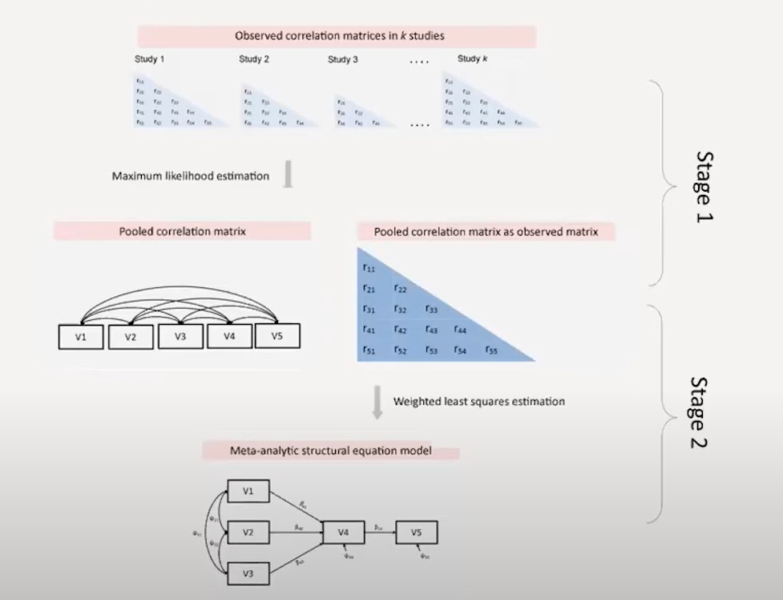
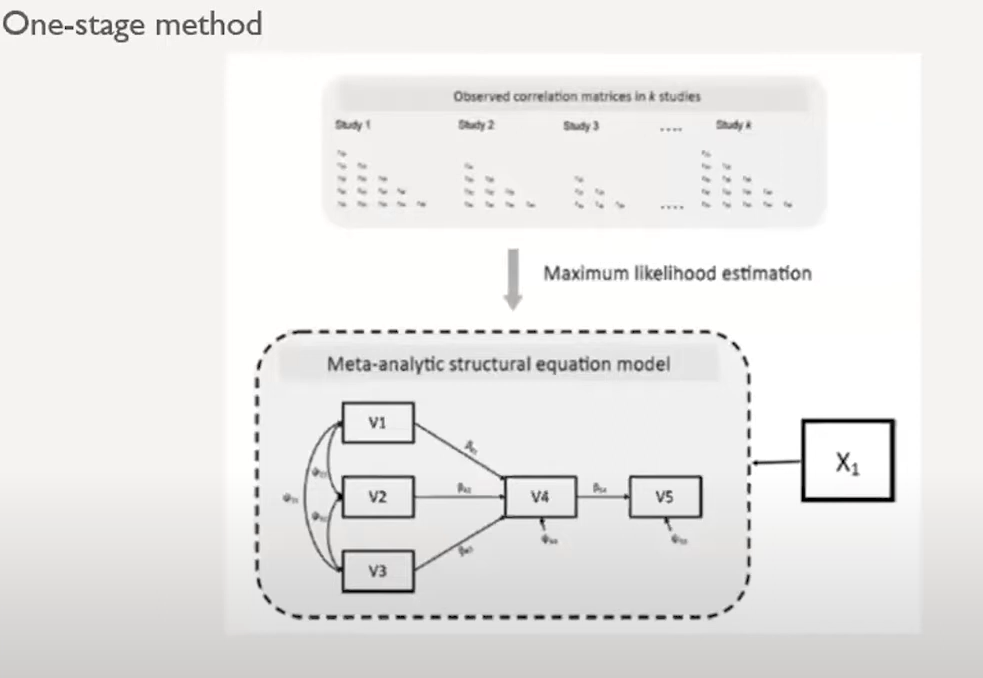
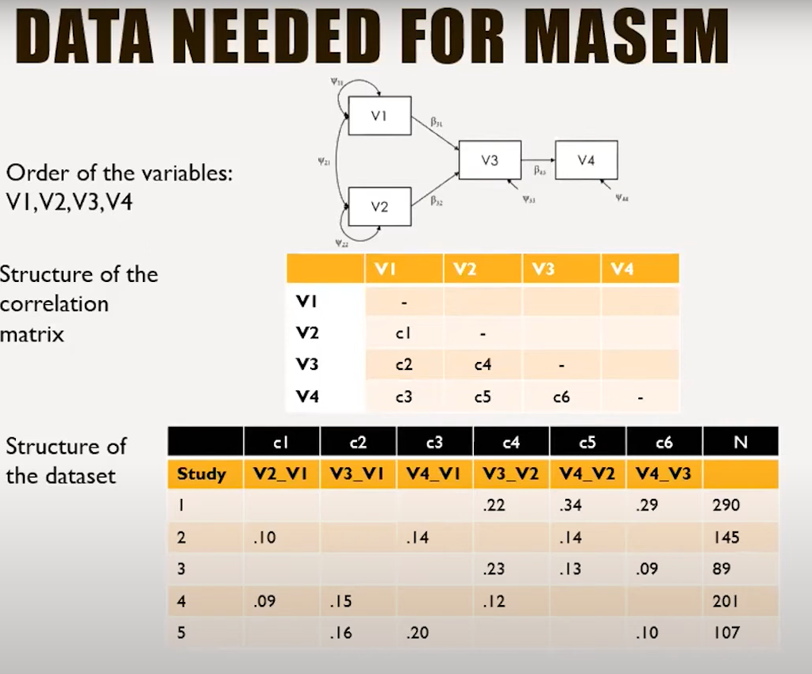

# Meta-Analysis Structural Equation Modeling

Readings

-   Fixed-effects MASEM [@cheung2009]

-   Fixed and random-effects MASEM [@cheung2013]

-   Random-effect MASEM [@cheung2016]

-   Health psychology application [@cheung2017]

-   Review [@cheung2018]

[Forum](https://openmx.ssri.psu.edu//forums/third-party-software/metasem) to get help

Notes:

-   SEM is also known as covariance structural analysis, covariance structure model, analysis of covariance structures, analysis of correlation structure

-   MASEM is also known as meta-analytic path analysis, meta-analysis of factor analysis, meta-analytically structural euqaiton analysis, path analysis of meta-analytically derived correlation matrices, SEM of a meta-analytic correlation matrix, path analysis based on meta-analytic findings, model-based meta-analysis

Advantages of MASEM [@bergh2016using]

-   Can test intermediate mechanisms and opposing hypotheses.

-   Increase external validity.

Disadvantages of MASEM

-   Not useful in cases where no competing hypotheses or

-   Cannot be performed with limited primary studies (40 studies minimum)

-   Number of variables should not be too large

-   Is not immune to construct validity threats.

-   Can be misleading when imputation is in great proportion

-   Limited use of moderation analysis within SEM

-   cannot make causal inferences (except when all primary data are from experimental designs)

    -   One can only do her best to address endogeneity concerns

        -   use lagged term for autocorrelation

        -   adjust for measurement error

        -   Include as many relevant controls as possible

        -   test alternative specification.

Two-stage method



(image by [Dr. Suzanne Jak](https://www.youtube.com/watch?v=0v-CdNLa_eo&ab_channel=ZPID-LeibnizInstituteforPsychology))



(image by [Dr. Suzanne Jak](https://www.youtube.com/watch?v=0v-CdNLa_eo&ab_channel=ZPID-LeibnizInstituteforPsychology))

Steps to do MASEM [@bergh2016using, p. 480]:

Step 1: Specify conceptual models:

1.  Specify competing models o be tested
2.  Specify whether the models are a priori or post hoc

Step 2: Meta-analytic procedures:

1.  Solutions to missing data (recommend the first three)
    1.  Search again (based on the same or different search criteria.

    2.  Contact authors to request correlation values [@shadish1996]

    3.  Replicate the primary study

    4.  Use surrogate or proxy variables that are conceptually similar [@eby1999motivational]

    5.  Use composite correlations by combining specific constructs into broader ones [@viswesvaran1995theory]

    6.  Use a two-stage SEM [@cheung2005meta; @fan2010factor]

    7.  Data imputation (e.g., full information maximum likelihood) [@cheung2008model]

    8.  Use the average effect size across nonmissing effect sizes [@viswesvaran1995theory]
2.  Different pairs of variables can have different sample size values to calculate the meta-analytic correlations. Solutions:
    1.  Harmonic mean [@burke2003methodological]: $k/(1/N_1 + 1/N_2 + \dots + 1/N_k)$ where $k$ is the number of correlations, and $N_k$ refers to the sample used to calculate the $k$-th correlation. This is **recommended** because it limits the influence of very big numbers and increases the influence of smaller values and is usually smaller than the arithmetic mean [@landis2013successfully; @johnson2001synthetic]

    2.  The smallest total sample size [@roesch2001meta]

    3.  Median [@tokunaga2010evaluation]

    4.  Arithmetic mean [@graham2011measuring; @judge2002personality]
3.  Derive meta-analytic matrix

Step 3: Structural equation modeling

1.  Approaches
    1.  Two-stage methods [@cheung2005meta]

        1.  can't do moderation analysis really. (can only do subgroup analysis)
        2.  Stage 1: Combine the correlation matrices into a pooled correlation matrix
        3.  Stage 2: Fit SEM on the pooled correlation matrix
        4.  Can use (1) Uni variate approach [@hunter1990], (2) GLM [@becker1992], (3) TSSEM [@cheung2005meta]

    2.  One-stage methods [@jak2020meta]

        1.  Can do moderation analysis (for continuous moderator)

        2.  handles missing data similar to 2-stage

        3.  provides fit indices similar to two-stage

        4.  can use webMASEM to apply

    3.  Parameter-based MASEM [@becker2007synthesis; @gnambs2016parameter]

        1.  Steps: Fit SEM, then pool the SEM parameters

        2.  need complete data, and model needs to fit equally well in all samples, but can be solved by Bayesian [@ke2019bayesian]
2.  nonpositive definite matrix (i.e., 0 or negative eigenvalues) fix (either because of a small total number of studies in some cells, two variables are highly correlated, or overuse of imputation)
    1.  Choose alternative global starting values. [@eby1999motivational]

    2.  Select precise starting values for parameter estimates [@eby1999motivational]

    3.  Reduce the set of variables
3.  Reliability missing: can either use
    1.  Mean reliability [@kirca2005market; @rosengren2020meta]

    2.  Use 0.8 as a conservative number for all constructs [@bergh2016using; @aguinis2011debunking]
4.  Sample dependencies fix:
    1.  [@geyskens2006make] recommendations in steps:

        1.  Include all meaningful correlations from each sample for consideration

        2.  calculate composite correlation from conceptually similar component correlations from each sample

        3.  If different studies used totally or partially overlapping datasets, choose correlation(s) based on the bigger sample size(s).

    2.  use generalized least squares [@furlow2005meta; @shadish1996]

    3.  use random effect meta-analyses in conjunction with MASEM [@erez1996using]

    4.  use multilevel meta-analytic in conjunction with MASEM [@van2003combining]
5.  Use multiple fit measures (no general cutoff, all context-specific [@nye2011effect)
    1.  Chi-square (careful because of its dependent on sample size): since MASEM can have a large number of observations, chi-square usually has poor fit even in cases where the empirical correlation matrix is quite close to the hypothesized model's correlation matrix. [@aguinis2009cautionary]. Hence, use other fit indices as well.

        1.  Tests the null hypothesis of exact fit

        2.  If $p < 0.05$, exact fit is rejected

    2.  Comparative fit index (CFI)

    3.  Goodness-of-fit index (GFI)

    4.  Root mean square residual (RMSR): measure of approximate fit

        1.  \< .05 close approximate fit

        2.  .5 to .8 reasonable fit

        3.  \>.1 poor fit [@browne1992alternative]

    5.  Standardized Root Mean Squared Residual (SRMSR)
6.  Inclusion and exclusion criteria [@bergh2016using, p. 482]:
    1.  Select the meta-analytic correlation for variables whose operationalizations are congruent with the a priori definitions of interest

    2.  Select meta-analytic correlation reported by meta-analyses that used prespecified meta-analytic methodologies (e.g., how unreliability was adjusted/corrected)

    3.  Utilize meta-analytic correlations derived from meta-analyses with the greatest sample sizes.

Step 4: Reporting procedures

1.  Follow the meta-analysis reporting standards (MARS)
    1.  If the model only has observed variables, the procedure should be called path analysis rather than MASEM
2.  Include a table that has all estimated bivariate meta-analytic correlations and 95% CIs for each correlation, the number of studies for each correlation (k), and the total sample size (n)
3.  Include a table of results of each tested model with figures
4.  Include a table of coefficients (always standardized) and statistical significance level, SEs, 95% CIs.

Data



(image by [Dr. Suzanne Jak](https://www.youtube.com/watch?v=0v-CdNLa_eo&ab_channel=ZPID-LeibnizInstituteforPsychology))

## 

metaSEM

[webMASEM](https://sjak.shinyapps.io/webMASEM/)

[Document](https://osf.io/wh6d3/)

```{r}
library(metaSEM)
data("Roorda11")


my.df <- Cor2DataFrame(Roorda11$data, Roorda11$n)

## Add centered SES as a moderator (standardizing SES helps to improve the stability of the results)
my.df$data <- data.frame(my.df$data, SES=scale(Roorda11$SES), check.names=FALSE)
head(my.df$data)
```

```{r}
data(Scalco17)
my.df <- Cor2DataFrame(Scalco17$data, Scalco17$n, acov = "weighted")

## Add the centered Age as a moderator
my.df$data <- data.frame(my.df$data, Age=scale(Scalco17$Age,  scale=FALSE), check.names=FALSE)
head(my.df$data)
```

## Univariate approach

[@viswesvaran1995]

Stage 1:

-   Synthesize the correlation coefficients in a correlation matrix as if the correlation coefficients were independent

-   Incomplete correlation coefficients are handled by either list-wise deletion or pairwise deletion

-   But when using pairwise decision, missing correlations are assumed to be missing completely at random

Stage 2:

-   The pooled correlation matrix is used as if it was a covariance matrix

    -   But the SEs may be incorrect

    -   Treating correlation matrices as covariance matrices in SEM is very dangerous [@cudeck1989]

-   Use harmonic mean of the sample sizes as the sample size

    -   very hard to argue to have a single sample size to be used to represent the precision fo the average correlation matrix

    -   (some SEs can be overestimated and some can be underestimated) [@cudeck1989]

    -   Chi-square test and GOF will be affected

## GLS Approach

Stage 1

-   GLS is utilized to create correlation matrices by considering the impact of sampling error.

Stage 2

-   parameter estimates are obtained through matrix calculations and SEs are determined using the multivariate delta method.
-   However, this method is not easily adaptable to models that are over-identified or latent variables.

## TSSEM Approach

Fixed-effects models assume that and . Random-effects models, on the other hand, treat

### Fixed-effects

-   researchers are only concerned with the specific studies included in the meta-analysis

-   a single correlation matrix is assumed

-   need to impose nonlinear constraints to ensure the diagonals are 1 `diag.constraints = T`

### Random-effects

-   the studies as samples from a larger population

-   researchers may want to generalize their findings to beyond the studies included in the meta-analysis

-   studies may have different correlation matrices

# Application

Code by [Diego G Campos](https://osf.io/jnryt/?view_only=7eaaaedf59a8407cac5e52317b20bc3a)

```{r}
# Load packages
library(metaSEM)
library(semPlot)
library(lavaan)
library(OpenMx)
```

## Data input and preparation

```{r, include = TRUE, cache=TRUE}
## Uncorrected correlations
## Constructs: PU, PEU, ATT, and BI

# Read in the correlations
# We have 4 variables: Therefore we need 6 correlations and 4 variances
TAMu <- matrix(
	c(1,0.61,1,0.6776,0.5138,1,0.599184,0.449892,0.860328,1,
		1,0.661,1,0.59,0.584,1,0.75,0.746,0.684,1,
		1,0.5,1,0.64,0.55,1,0.55,0.48,0.59,1,
		1,0.512,1,0.461,0.754,1,0.364,0.669,0.595,1,
		1,0.279,1,0.63,0.873,1,0.319,0.441,0.505,1,
		1,0.68,1,0.68,0.73,1,0.34,0.3,0.3,1,
		1,0.4,1,0.56,0.43,1,0.23,0.32,0.36,1,
		1,0.329,1,0.565,0.349,1,0.523,0.327,0.462,1,
		1,0.136,1,0.625,0.1,1,0.436,0.1,0.514,1,
		1,0.467,1,0.634,0.61,1,0.562,0.494,0.681,1,
		1,0.62,1,0.72,0.73,1,0.76,0.6,0.71,1,
		1,0.69,1,0.76,0.71,1,0.03,0.18,0.27,1,
		1,0.067,1,0.207,0.426,1,0.199,0.076,0.006,1,
		1,0.649,1,0.525,0.408,1,0.521,0.406,0.418,1,
		1,0.3,1,0.66,0.52,1,0.57,0.26,0.5,1,
		1,0.44,1,0.62,0.51,1,0.43,0.29,0.36,1,
		1,0.449,1,0.791,0.509,1,0.362,0.217,0.412,1,
		1,0.392,1,0.682,0.446,1,0.327,0.188,0.442,1,
		1,0.11,1,0.75,0.11,1,0.62,0.2,0.67,1,
		1,0.41,1,0.54,0.51,1,0.4,0.43,0.54,1,
		1,0.656,1,0.8358,0.564,1,0.643,0.5431,0.5299,1,
		1,0.33,1,0.63,0.5,1,0.738,0.311,0.527,1,
		1,0.23,1,0.46,0.35,1,0.43,0.19,0.44,1,
		1,0.44,1,0.61,0.48,1,0.68,0.33,0.55,1,
		1,0.72,1,0.71,0.7,1,0.73,0.65,0.68,1,
		1,0.52,1,0.535,0.51,1,0.707,0.553,0.437,1,
		1,0.54,1,0.64,0.56,1,0.54,0.38,0.61,1,
		1,0.53,1,0.63,0.65,1,0.57,0.51,0.69,1,
		1,0.54,1,0.46,0.44,1,0.35,0.22,0.21,1,
		1,0.36,1,0.57,0.48,1,0.16,0.17,0.13,1,
		1,0.44,1,0.63,0.47,1,0.63,0.41,0.62,1,
		1,0.44,1,0.61,0.49,1,0.41,0.3,0.4,1,
		1,0.66,1,0.28,0.2,1,0.58,0.5,0.07,1,
		1,0.53,1,0.81,0.67,1,0.7,0.63,0.69,1,
		1,0.61,1,0.6,0.64,1,0.62,0.59,0.71,1,
		1,0.62,1,0.71,0.55,1,0.66,0.56,0.84,1,
		1,0.575,1,0.486,0.453,1,0.351,0.297,0.447,1,
		1,0.749,1,0.508,0.258,1,0.872,0.743,0.461,1,
		1,0.61,1,0.63,0.67,1,0.64,0.59,0.75,1,
		1,0.31,1,0.23,0.61,1,0.28,0.53,0.53,1,
		1,0.65,1,0.51,0.35,1,0.5,0.41,0.42,1,
		1,0.526,1,0.681,0.585,1,0.654,0.445,0.684,1,
		1,0.307,1,0.632,0.462,1,0.586,0.283,0.446,1,
		1,0.517,1,0.6,0.527,1,0.548,0.405,0.687,1,
		1,0.64,1,0.65,0.65,1,0.61,0.65,0.75,1,
		1,0.26,1,0.549,0.497,1,0.192,0.265,0.249,1,
		1,0.26,1,0.551,0.507,1,0.176,0.101,0.257,1,
		1,0.5376,1,0.6336,0.8396,1,0.8905,0.6887,0.8154,1,
		1,0.709,1,0.885,0.768,1,0.758,0.589,0.783,1,
		1,0.49,1,0.63,0.53,1,0.63,0.46,0.62,1),
	ncol=10, byrow=TRUE)	# fill in correlations row by row with the variances

# Split the above-created matrix into matrices for single studies
# 50 studies in total
# 4x4 correlation matrices
TAMu <- lapply(split(TAMu, 1:50), # split rows into separate studies
                                  # 50 studies 
                   function(x) {mat <- matrix(1, ncol=4, nrow=4);	# create matrix with 1's
                   mat[upper.tri(mat, diag=TRUE)] <- x;		# fill upper matrix and diagonals
                   mat[lower.tri(mat)] <- t(mat)[lower.tri(mat)];	# fill lower matrix
                   mat})

# Name variables
TAMu <- lapply(TAMu, function(x, var.names) {dimnames(x) <- list(var.names, var.names); x},
                   var.names=c("PU", "PEU", "ATT", "BI"))	# create variable names				   

# Study names
names(TAMu) <- c("Okazaki & Renda dos Santos (2012)",
					"Parkman (2015)",
					"Wong (2015)",
					"Cote & Miliner (2015)",
					"Teo & Milutinovic (2015)",
					"Teo & Fan et al. (2015)-1",
					"Teo & Fan et al. (2015)-2",
					"Koutromanos et al. (2015)-1",
					"Koutromanos et al. (2015)-2",
					"Wu et al. (2015)",
					"Kabakci-Yurdakul et al. (2014)",
					"Kirmizi (2014)",
					"Mac Callum et al. (2014)",
					"Wong et al. (2013)",
					"Teo & Ursavas et al. (2011a)",
					"Teo & Luan et al. (2008)",
					"Sumak & Sorgo (2016)-1",
					"Sumak & Sorgo (2016)-2",
					"Wu et al. (2016)",
					"Wong et al. (2016)",
					"Atif et al. (2015)",
					"Tokel & Isler (2015)",
					"Sadeghi et al. (2014)",
					"Pynoo et al. (2012)",
					"Aypay et al. (2012)",
					"Chen & Tseng (2012)",
					"Teo (2012a)",
					"Teo & van Schaik (2012)",
					"Teo & Noyes (2011)",
					"Teo & Lee et al. (2009a)-1",
					"Teo & Lee et al. (2009a)-2",
					"Teo (2009a)",
					"Park et al. (2007)",
					"Cheung & Sachs (2006)",
					"Teo (2011)",
					"Shiue (2007)",
					"Chiu (2017)",
					"Lai et al. (2013)",
					"Teo & Zhou et al. (2016)",
					"Teo (2008)",
					"Wong & Teo et al. (2012)",
					"Luan & Teo (2009)",
					"Teo & Ursavas et al. (2012)",
					"Teo & Zhou (2014)",
					"Teo (2013)",
					"Teo & Milutinovic et al. (2016a)-1",
					"Teo & Milutinovic et al. (2016a)-2",
					"Pittalis & Christou (2010)",
					"Fathema et al. (2015)",
					"Luan & Teo (2011)")

# Sample sizes
TAM.n <- c(446,88,234,29,313,169,170,151,106,340,579,
			213,196,302,197,495,438,460,144,185,184,46,275,
			919,754,402,157,429,153,250,245,475,191,57,592,
			242,306,160,592,139,302,245,487,314,385,226,
			226,105,560,245)

#################	
# Combine everything in an object
TAMu <- list(data=TAMu, n=TAM.n)
head(TAMu$data)
head(TAMu$n)

```

\newpage

# Correlation-Based MASEM

## Check the correlation matrices for positive definiteness

```{r, include = TRUE, cache=TRUE}
# PD check
pd_check <- is.pd(TAMu$data)
sum(!is.na(pd_check))
pd_check

# if some Fail, need to exclude because its matrix is not positive definite

# Some description of the studies
# Available studies per correlation
pattern.na(TAMu$data, show.na=FALSE)


# Available sample sizes per correlation
pattern.n(TAMu$data, TAMu$n)
```

All 50 correlation matrices are positive definite and can be submitted to stage 1 of the correlation-based MASEM approach (i.e., two-stage SEM). If some correlation matrices were not positive definite, we would either have to exclude them or find the nearest positive definite matrix (using the `nearPD()` function in the `Matrix` package).

Notice that none of the correlations were missing.

## Stage 1: Pooling of correlation matrices

### Pooling under a random-effects model

```{r, include = TRUE, cache=TRUE}
# Combine correlation matrices using a REM
# 
rem <- tssem1(TAMu$data, TAMu$n, 
                method = "REM", # random effect model
                RE.type = "Diag")

# Summarize the results
summary(rem)

```

```{r}
# Extract the pooled correlation matrix
corr.rem <- vec2symMat(coef(rem, select="fixed"), diag=FALSE)
colnames(corr.rem) <- c("PU", "PEU", "ATT", "BI")
rownames(corr.rem) <- c("PU", "PEU", "ATT", "BI")
corr.rem
```

Beacuse the Q statistic is different from 0. We can consider some moderation analysis

### Pooling under a fixed-effects model

```{r, include = TRUE, cache=TRUE}
# Combine correlation matrices using a FEM
fem <- tssem1(TAMu$data, TAMu$n, 
                method = "FEM")

# Summarize the results
summary(fem)

# Extract the pooled correlation matrix
coef(fem)
```

The fit of the fixed-effects model is marginal and suggests that the data are not represented well. Moreover, the REM indicates some significant heterogeneity of the correlations across studies. This gives reason to prefer the REM over the FEM.

## Stage 2: Structural equation modeling

The pooled correlation matrix is now submitted to SEM.

### Model 1: Path model with the direct effect

In the first step, we specify the model using the `lavaan` language.

```{r, include=TRUE, cache=TRUE}
# Model specification
Model1 <- " # Structural parameters
            BI ~ ATT + PU
            ATT ~ PEU + PU
            PU ~ PEU
            
            # Variance of independent variables
            PEU ~~ 1*PEU
"

# Convert the model into the RAM language
RAM <- lavaan2RAM(Model1,
                  obs.variables = c("PU", "PEU", "ATT", "BI"))

```

This model is now estimated using the pooled correlation matrix obtained from the stage-1 REM.

```{r, include=TRUE, cache=TRUE}
# Model estimation
# Confidence intervals are likelihood-ratio based (LBCIs)
TS.Model1 <- tssem2(rem, RAM = RAM,
                  intervals.type="LB",
                  diag.constraints = TRUE,
                  model.name = "Model 1 with the direct effect")

# Summarize the model parameters
summary(TS.Model1)

# Rerun the model to circumvent convergence issues and get all parameters
TS.Model1 <- rerun(TS.Model1)

# Summarize the model parameters
summary(TS.Model1)

# Plot results 
plot(TS.Model1)

# Visualize the model and add its parameters
TS.Model1.plot <- meta2semPlot(TS.Model1)
semPaths(TS.Model1.plot, whatLabels="est", 
         rotation=2,
         edge.label.cex = 1.25,
         sizeMan = 8,
         color = "grey",
         layout = "tree2")

```

### Model 2: Path model without the direct effect

In the first step, we specify the model using the `lavaan` language.

```{r, include=TRUE, cache=TRUE}
# Model specification
Model2 <- " # Structural parameters
            BI ~ ATT
            ATT ~ PEU + PU
            PU ~ PEU
            
            # Variance of independent variables
            PEU ~~ 1*PEU
"

# Convert the model into the RAM language
RAM2 <- lavaan2RAM(Model2,
                  obs.variables = c("PU", "PEU", "ATT", "BI"))

```

This model is now estimated using the pooled correlation matrix obtained from the stage-1 REM.

```{r, include=TRUE, cache=TRUE}
# Model estimation
# Confidence intervals are likelihood-ratio based (LBCIs)
TS.Model2 <- tssem2(rem, RAM = RAM2,
                  intervals.type="LB",
                  diag.constraints = TRUE,
                  model.name = "Model 2 without the direct effect")

# Rerun the model to circumvent convergence issues and get all parameters
TS.Model2 <- rerun(TS.Model2)

# Summarize the model parameters
summary(TS.Model2)

# Visualize the model and add its parameters
TS.Model2.plot <- meta2semPlot(TS.Model2)
semPaths(TS.Model2.plot, whatLabels="est", 
         rotation=2,
         edge.label.cex = 1.25,
         sizeMan = 8,
         color = "grey",
         layout = "tree2")

```

### Model comparison: Model 1 vs. Model 2

```{r, include=TRUE, cache=TRUE}
# Model comparison
anova(TS.Model1, TS.Model2)

```

The chi-square different test suggest the preference of the model with the direct effect (`Model 1`) over the model without this effect (`Model 2`).

# R session info

```{r, include = TRUE, cache=TRUE}
sessionInfo()
```
